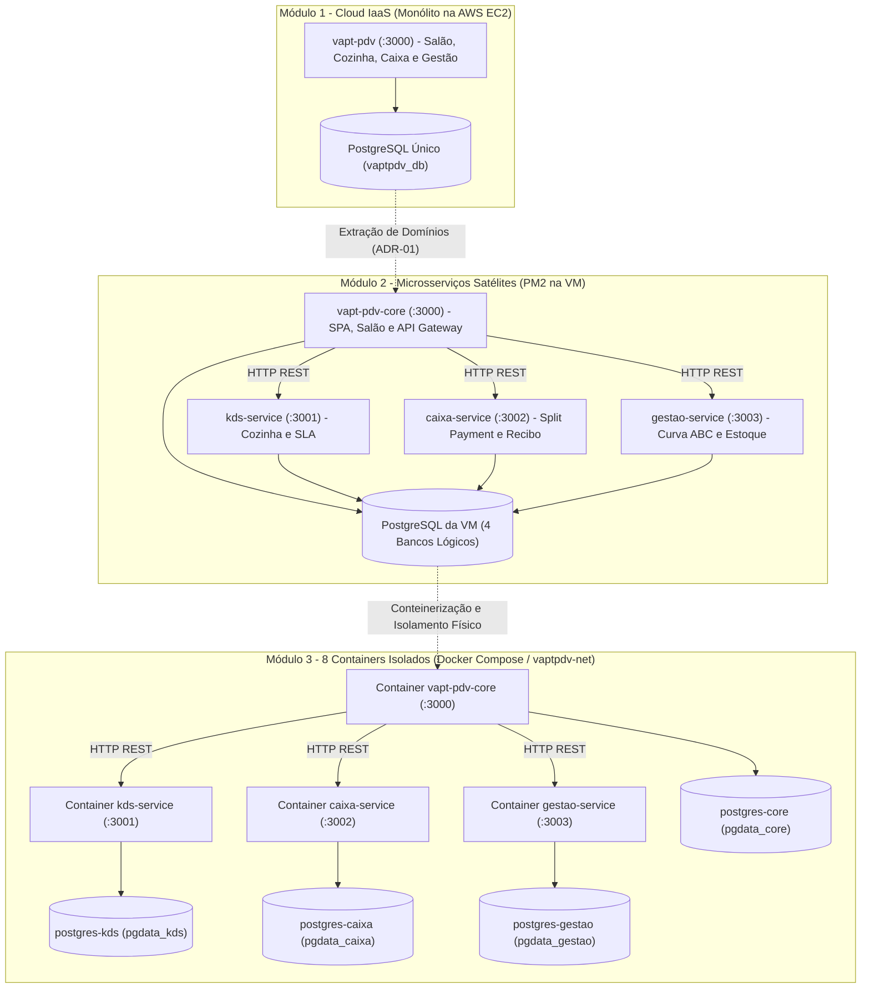
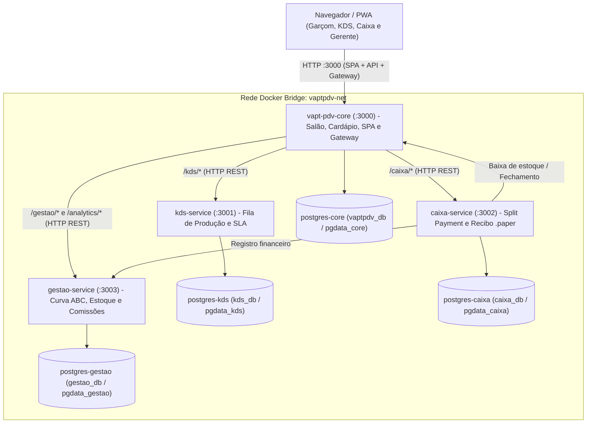

<div align="center">

# VaptPDV

**Ecossistema Distribuído de Ponto de Venda (PDV) e Gestão Operacional para Bares e Restaurantes**


[](https://nodejs.org/)
[](https://www.typescriptlang.org/)
[](https://fastify.dev/)
[](https://www.prisma.io/)
[](https://www.postgresql.org/)
[](https://react.dev/)
[](https://tailwindcss.com/)
[](https://vitejs.dev/)

</div>

---

## Sumário

- [Visão Geral](#visão-geral)
- [Contexto Acadêmico](#contexto-acadêmico)
- [Evolução da Arquitetura nos Módulos](#evolução-da-arquitetura-nos-módulos)
- [Arquitetura Atual do Sistema](#arquitetura-atual-do-sistema)
- [Camada de Interface](#camada-de-interface)
- [Microsserviços e Topologia de Containers](#microsserviços-e-topologia-de-containers)
- [Tecnologias Utilizadas](#tecnologias-utilizadas)
- [Estrutura do Repositório](#estrutura-do-repositório)
- [Aplicação na Nuvem e OpenAPI](#aplicação-na-nuvem-e-openapi)
- [Guia Passo a Passo de Execução](#guia-passo-a-passo-de-execução)
- [Variáveis de Ambiente](#variáveis-de-ambiente)

---

## Visão Geral

O **VaptPDV** é um sistema distribuído de Ponto de Venda (PDV) e operação em tempo real desenvolvido para bares, lanchonetes e restaurantes. A plataforma substitui o controle manual em comandas de papel por registros digitais atômicos, auditáveis e sincronizados entre **salão, cozinha/bar, frente de caixa e gerência**.

> [!NOTE]
> **Aplicação em Nuvem (AWS EC2):** [http://54.234.157.236:3000](http://54.234.157.236:3000)  
> **Vídeos Demonstrativos:** [Acervo no Google Drive](https://drive.google.com/drive/folders/1GzLecg9bSraN3ZjB7usL9Mg3I03I1uzm?usp=sharing)

### Perfis Operacionais Atendidos

- **Garçom (`/garcom`):** Abertura rápida de mesas livres, consulta de cardápio em tempo real, lançamento de pedidos com congelamento imediato do preço unitário, registro de observações/alergias, transferência de mesa e mesclagem de comandas.
- **Cozinha e Bar - KDS (`/kds`):** Fila de produção Kanban voltada para televisores e monitores, com cronômetro por ficha, alertas semafóricos de SLA (`< 10 min` verde, `10–15 min` amarelo, `> 15 min` vermelho/`ATRASADO`) e transição tátil (`recebido` ➔ `em_preparo` ➔ `pronto` ➔ `entregue`).
- **Frente de Caixa (`/caixa`):** Fechamento assistido com verificação preventiva de pendências na cozinha, taxa de serviço opcional (10%), _Split Payment_ exato por mesa (conservação integral dos centavos), cálculo de troco e geração de recibo térmico em formato `.paper`.
- **Gerente (`/gestao`):** Resumo executivo do turno (faturamento e ticket médio), Curva ABC de faturamento (Pareto 80/15/5), alertas de ruptura e reposição de estoque, CRUD de cardápio e colaboradores, além de ranking de comissões por garçom.

### Princípios Arquiteturais do Sistema

- **Database-per-Service Estrito:** Cada contexto de negócio mantém sua própria base PostgreSQL isolada, evitando acoplamento transacional e contenção de locks entre salão, cozinha, caixa e BI.
- **Core Coeso + Gateway Unificado (`ADR-01`):** O núcleo operacional (`vapt-pdv-core`) centraliza o atendimento no salão, serve a interface React compilada e atua como _API Gateway_ para os microsserviços satélites com timeouts explícitos e degradação graciosa (`503`).
- **Integridade Contábil e de Preço:** Preços são congelados no instante do lançamento do item; divisões de conta e troco operam sem perda de centavos.
- **Segurança no Fluxo Operacional:** Fechamento de caixa valida itens ainda não concluídos no KDS e atualiza o estoque e os indicadores gerenciais de forma rastreável.

---

## Contexto Acadêmico

Projeto prático e incremental desenvolvido na disciplina de **Sistemas Distribuídos** do **Departamento de Ciência da Computação (DCC)** da **Universidade do Estado do Rio Grande do Norte (UERN)**.

- **Docentes:** Profa. Dra. Glaucia Melissa e Profa. Ma. Luiziane Paulino dos Santos
- **Discentes:** Kaio França e Mateus Neri

O desenvolvimento acompanhou a progressão prática da disciplina:

1. **Módulo 1 - Computação em Nuvem (IaaS):** Implantação inicial do sistema monolítico em instância AWS EC2 com banco relacional único.
2. **Módulo 2 - Serviços e Microsserviços:** Decomposição em _Core_ + 3 microsserviços satélites com contratos HTTP REST e bases de dados lógicas independentes.
3. **Módulo 3 - Containers e Orquestração:** Conteinerização completa em **8 containers isolados** via Docker Compose com builds multi-stage, usuário não-root, rede interna dedicada e persistência em volumes nomeados.

---

## Evolução da Arquitetura nos Módulos



### Como funcionava o Módulo 1 - Cloud IaaS

No estágio inicial, toda a aplicação executava como um **monólito modularizado** em uma máquina virtual **AWS EC2 (Ubuntu LTS)**:

- **Processo Único (`:3000`):** Rotas de salão, cozinha, caixa, gestão e arquivos estáticos rodavam dentro do mesmo runtime Node.js.
- **Banco Único (`vaptpdv_db`):** Todas as tabelas compartilhavam o mesmo servidor PostgreSQL da VM.
- **Acoplamento Direto:** A comunicação entre domínios ocorria em memória; embora simples para validar o MVP na nuvem, qualquer reinicialização ou carga analítica afetava diretamente o atendimento no salão.

### Como funcionava o Módulo 2 - Microsserviços Satélites

Na segunda entrega, preservou-se a coesão do salão no **PDV Core** e extraíram-se três microsserviços independentes, executados na EC2 sob gerenciamento do **PM2**:

- **Separação por Domínio:** `vapt-pdv-core` (`:3000`), `kds-service` (`:3001`), `caixa-service` (`:3002`) e `gestao-service` (`:3003`).
- **Database-per-Service Lógico:** Foram criados quatro bancos distintos (`vaptpdv_db`, `kds_db`, `caixa_db`, `gestao_db`), ainda hospedados no mesmo processo PostgreSQL da VM.
- **Gateway e Gateways HTTP:** O Core passou a rotear chamadas `/kds/*`, `/caixa/*`, `/gestao/*` e `/analytics/*` para os satélites com timeouts definidos (`2s` na Gestão e `5s` no KDS/Caixa).

### Como funciona agora no Módulo 3 - Orquestração em Containers

Na entrega atual, toda a topologia distribuída opera de forma **imutável e isolada em 8 containers Docker** coordenados pelo `docker-compose.yml`:

- **Isolamento Físico de Bancos:** Em vez de compartilhar uma única instância PostgreSQL na VM, cada microsserviço ganhou seu próprio container `postgres:16-alpine` (`postgres-core`, `postgres-kds`, `postgres-caixa`, `postgres-gestao`) acoplado a um volume persistente (`pgdata_*`).
- **Imagens Enxutas e Não-Root (`USER node`):** Todos os serviços Node.js usam `Dockerfile` multi-stage sobre `node:20-alpine`, removendo `devDependencies`, código TypeScript bruto, testes e toolchains desnecessárias na imagem final de execução.
- **Rede Privada `vaptpdv-net`:** A comunicação entre APIs e bancos acontece via DNS interno do Docker (`http://kds-service:3001`, `http://caixa-service:3002`, `http://gestao-service:3003`, `http://vapt-pdv-core:3000`). Os bancos satélites não ficam expostos para fora da rede bridge.
- **Boot Determinístico e Resiliente:** As APIs só iniciam após o banco responder ao `pg_isready` (`depends_on: condition: service_healthy`), aplicam automaticamente `npx prisma migrate deploy` antes de abrir a porta HTTP e possuem `healthcheck` próprio em `/health`.
- **Orçamento de Recursos Controlado:** Limites explícitos de CPU e RAM somam **1.504 MB de memória máxima** nos 8 containers (`736 MB` para bancos + `768 MB` para APIs), permitindo rodar em instâncias EC2 compactas.

### Comparativo entre os Três Módulos

| Dimensão de Engenharia   | Módulo 1 (Cloud IaaS)                    | Módulo 2 (Microsserviços PM2)            | Módulo 3 (Docker Compose)                                       |
| :----------------------- | :--------------------------------------- | :--------------------------------------- | :-------------------------------------------------------------- |
| **Unidade de Deploy**    | Monólito único na VM (`:3000`).          | 4 processos Node.js no PM2.              | **8 containers independentes** (`4` APIs + `4` Postgres).       |
| **Isolamento de Dados**  | 1 banco único (`vaptpdv_db`).            | 4 databases lógicos no mesmo PostgreSQL. | **4 instâncias PostgreSQL isoladas** com volumes `pgdata_*`.    |
| **Portabilidade**        | Dependente de Node/Postgres do SO da VM. | Dependente do ambiente da VM e PM2.      | **100% reproduzível** entre máquina local e EC2.                |
| **Inicialização**        | Manual via CLI / serviço único.          | Ordem controlada manualmente no PM2.     | **Determinística** via `service_healthy` + migração automática. |
| **Segurança do Runtime** | Usuário de deploy na VM + código-fonte.  | Usuário de deploy na VM + código-fonte.  | **`USER node` (não-root)** + artefatos mínimos multi-stage.     |

---

## Arquitetura Atual do Sistema

O diagrama abaixo representa a topologia em execução no **Módulo 3**:



---

## Camada de Interface

A interface do **VaptPDV** é uma Single Page Application (SPA) / PWA construída em **React 19**, **TypeScript**, **Vite 8** e **Tailwind CSS**, empacotada dentro do container `vapt-pdv-core` (pasta `public/`) em produção ou servida via Vite Dev Server (`:5173`) em desenvolvimento.

- **Consumo Centralizado:** O frontend comunica-se via HTTP REST com o `vapt-pdv-core`, que responde diretamente pelos recursos de salão e encaminha as rotas dos demais domínios (`/kds/*`, `/caixa/*`, `/gestao/*`, `/analytics/*`).
- **5 Rotas Especializadas:**
  - `/login` - Autenticação unificada por perfil ativo.
  - `/garcom` - Mapa de mesas em tempo real, comandas, modificadores/alergias, transferência e mesclagem.
  - `/kds` - Painel Kanban widescreen com cronômetro e faixas visuais de SLA.
  - `/caixa` - Conferência de mesa, trava preventiva do KDS, _Split Payment_ e emissão de recibo `.paper`.
  - `/gestao` - Indicadores do dia, Curva ABC (Pareto), reposição de estoque, cardápio, equipe e comissões.

---

## Microsserviços e Topologia de Containers

### Microsserviços da Solução

<div align="center">

| Serviço                        | Papel no Domínio                                                                                                 | Comunicação / Exposição                                                                                         | Banco Dedicado                  |
| :----------------------------- | :--------------------------------------------------------------------------------------------------------------- | :-------------------------------------------------------------------------------------------------------------- | :------------------------------ |
| **`vapt-pdv-core`** (`:3000`)  | Salão, abertura/mesclagem/transferência de mesas, catálogo de produtos, usuários, servidor da SPA e API Gateway. | HTTP REST público + proxy para satélites (`/kds/*`, `/caixa/*`, `/gestao/*`, `/analytics/*`) + Swagger `/docs`. | `postgres-core` (`vaptpdv_db`)  |
| **`kds-service`** (`:3001`)    | Fila de preparo da cozinha e bar, ciclo de vida das fichas técnicas e monitoramento de SLA.                      | HTTP REST (`GET /health`, rotas `/kds/*`) via rede `vaptpdv-net` ou porta `:3001`.                              | `postgres-kds` (`kds_db`)       |
| **`caixa-service`** (`:3002`)  | Conferência de comandas, taxa de 10%, divisão de pagamento (_split payment_), troco e recibos `.paper`.          | HTTP REST + Swagger `/docs` + integração com Core e Gestão.                                                     | `postgres-caixa` (`caixa_db`)   |
| **`gestao-service`** (`:3003`) | BI/OLAP, Curva ABC de vendas, monitor de estoque crítico e apuração de produtividade/comissões.                  | HTTP REST + Swagger `/docs`.                                                                                    | `postgres-gestao` (`gestao_db`) |

</div>

### Mapa Completo dos 8 Containers (`docker-compose.yml`)

<div align="center">

| Container             | Imagem                         |       Porta Host        | Volume Persistente | Limites (CPU / RAM) |
| :-------------------- | :----------------------------- | :---------------------: | :----------------- | :-----------------: |
| **`vapt-pdv-core`**   | `node:20-alpine` (Multi-Stage) |       `3000:3000`       | -                  |  `0.50` / `256 MB`  |
| **`kds-service`**     | `node:20-alpine` (Multi-Stage) |       `3001:3001`       | -                  |  `0.25` / `160 MB`  |
| **`caixa-service`**   | `node:20-alpine` (Multi-Stage) |       `3002:3002`       | -                  |  `0.25` / `160 MB`  |
| **`gestao-service`**  | `node:20-alpine` (Multi-Stage) |       `3003:3003`       | -                  |  `0.30` / `192 MB`  |
| **`postgres-core`**   | `postgres:16-alpine`           |  `127.0.0.1:5432:5432`  | `pgdata_core`      |  `0.50` / `256 MB`  |
| **`postgres-kds`**    | `postgres:16-alpine`           | Interna (`vaptpdv-net`) | `pgdata_kds`       |  `0.25` / `128 MB`  |
| **`postgres-caixa`**  | `postgres:16-alpine`           | Interna (`vaptpdv-net`) | `pgdata_caixa`     |  `0.25` / `160 MB`  |
| **`postgres-gestao`** | `postgres:16-alpine`           | Interna (`vaptpdv-net`) | `pgdata_gestao`    |  `0.30` / `192 MB`  |

</div>

---

## Tecnologias Utilizadas

<div align="center">

| Categoria               | Tecnologia                                         | Justificativa Técnica                                                                                                      |
| :---------------------- | :------------------------------------------------- | :------------------------------------------------------------------------------------------------------------------------- |
| **Frontend Web/PWA**    | React 19, TypeScript 5.7, Vite 8, Tailwind CSS 3.4 | Interface modular e responsiva, com tipagem estática e suporte a empacotamento PWA (`vite-plugin-pwa`).                    |
| **Estado e Dados (UI)** | TanStack Query v5 & Zustand v5                     | Sincronização automática de estado remoto (polling de mesas/KDS) e estado global leve no cliente.                          |
| **Runtime & APIs**      | Node.js 20 LTS, Fastify 5, TypeBox                 | Alta vazão com baixo consumo de memória, validação estrita de schemas em runtime e tipagem ponta a ponta.                  |
| **Documentação de API** | `@fastify/swagger` & `@fastify/swagger-ui`         | Geração interativa de contratos OpenAPI diretamente a partir dos schemas TypeBox.                                          |
| **ORM e Persistência**  | Prisma ORM 6.4 & PostgreSQL 16                     | Migrações versionadas (`prisma migrate deploy`), integridade transacional e isolamento completo _Database-per-Service_.    |
| **Containers**          | Docker (Multi-Stage) & Docker Compose v2           | Imagens minimalistas sem privilégios de root (`USER node`), rede privada e volumes persistentes para paridade local/nuvem. |
| **Testes e Linting**    | Vitest & Oxlint                                    | Suíte de testes unitários/integração por serviço e verificação estática rápida no frontend.                                |

</div>

---

## Estrutura do Repositório

```text
vapt-pdv/
├── README.md                           # Documentação principal e guia de execução
├── docker-compose.yml                  # Orquestração dos 8 containers (rede vaptpdv-net e volumes)
├── .env.docker.example                 # Template seguro de variáveis para execução em containers
├── .dockerignore                       # Exclusões para builds Docker enxutos
│
├── backend/                            # PDV Core (Salão, Comandas, Catálogo, Gateway e SPA Host)
│   ├── Dockerfile                      # Build multi-stage (compila frontend + backend -> USER node)
│   ├── package.json
│   ├── tsconfig.json
│   ├── prisma/
│   │   ├── schema.prisma               # Schema e modelagem do banco vaptpdv_db
│   │   ├── migrations/                 # Histórico de migrações aplicadas no boot
│   │   └── seed-produtos.sql           # Carga SQL opcional de produtos demonstrativos
│   ├── public/                         # Build estático compilado do frontend
│   ├── src/
│   │   ├── app.ts                      # Fastify, Swagger (/docs), SPA routes e proxies Gateway
│   │   ├── server.ts
│   │   └── modules/                    # comandas, produtos, usuarios, saude
│   └── test/                           # Suíte Vitest (regras de negócio, gateways e checks Docker)
│
├── frontend/                           # Aplicação Web/PWA (React 19 + Vite 8 + Tailwind CSS)
│   ├── package.json
│   ├── vite.config.ts
│   └── src/
│       ├── features/                   # auth, garcom, kds, caixa, gestao
│       ├── components/                 # Componentes de interface reutilizáveis
│       ├── hooks/                      # Hooks customizados de consulta e atualização
│       ├── services/                   # Clientes HTTP
│       └── stores/                     # Stores Zustand
│
└── services/                           # Microsserviços Satélites Independentes
    ├── kds-service/                    # Cozinha & Bar (:3001) - fichas e SLA
    │   ├── Dockerfile
    │   ├── prisma/
    │   ├── src/modules/                # fichas, saude
    │   └── test/
    ├── caixa-service/                  # Frente de Caixa (:3002) - split payment e recibo .paper
    │   ├── Dockerfile
    │   ├── prisma/
    │   ├── src/modules/                # caixa, saude
    │   └── test/
    └── gestao-service/                 # Gestão & Analytics (:3003) - Curva ABC e comissões
        ├── Dockerfile
        ├── prisma/
        ├── src/modules/                # gestao, saude
        └── test/
```

---

## Aplicação na Nuvem e OpenAPI

- **Aplicação Web / PDV Core:** `http://54.234.157.236:3000`
  - **Swagger Core:** `http://54.234.157.236:3000/docs` | **Health:** `http://54.234.157.236:3000/health`
- **KDS Service (`:3001`):** `http://54.234.157.236:3001/health` _(endpoints `/kds/_`)\*
- **Caixa Service (`:3002`):** `http://54.234.157.236:3002/docs` | **Health:** `http://54.234.157.236:3002/health`
- **Gestão Service (`:3003`):** `http://54.234.157.236:3003/docs` | **Health:** `http://54.234.157.236:3003/health`
- **Vídeos Demonstrativos:** [Pasta no Google Drive](https://drive.google.com/drive/folders/1GzLecg9bSraN3ZjB7usL9Mg3I03I1uzm?usp=sharing)

---

## Guia Passo a Passo de Execução

### Modo A: Orquestração Completa em Containers (Módulo 3 - Recomendado)

Sobe todos os **8 containers** (`4` APIs + `4` instâncias PostgreSQL) com migrações Prisma automáticas, healthchecks e volumes persistentes.

#### Pré-requisitos

- **Docker Engine** e **Docker Compose v2** (`docker compose version`)
- **Git**

#### Passo 1 - Criar o arquivo `.env` na raiz

- **Linux / macOS / Git Bash:**
  ```bash
  cp .env.docker.example .env
  ```
- **Windows PowerShell:**
  ```powershell
  Copy-Item .env.docker.example .env
  ```

#### Passo 2 - Construir as imagens e iniciar os 8 containers

```bash
docker compose up -d --build
```

#### Passo 3 - Verificar saúde dos serviços

Confirme que todos os 8 containers atingiram o estado `healthy`:

```bash
docker compose ps
```

Valide os endpoints de saúde das quatro APIs:

```bash
curl http://localhost:3000/health
curl http://localhost:3001/health
curl http://localhost:3002/health
curl http://localhost:3003/health
```

#### Passo 4 - _(Opcional)_ Carregar cardápio inicial de demonstração

- **Linux / macOS / Git Bash:**
  ```bash
  docker compose exec -T postgres-core psql -U vaptpdv -d vaptpdv_db < backend/prisma/seed-produtos.sql
  ```
- **Windows PowerShell:**
  ```powershell
  Get-Content backend/prisma/seed-produtos.sql -Raw | docker compose exec -T postgres-core psql -U vaptpdv -d vaptpdv_db
  ```

#### Passo 5 - Acessar a aplicação e documentações locais

- **Frontend Web/PWA:** [http://localhost:3000](http://localhost:3000)
- **Swagger Core Salão:** [http://localhost:3000/docs](http://localhost:3000/docs)
- **Swagger Caixa Service:** [http://localhost:3002/docs](http://localhost:3002/docs)
- **Swagger Gestão Service:** [http://localhost:3003/docs](http://localhost:3003/docs)

#### Passo 6 - Testar persistência e comandos operacionais úteis

```bash
# Reiniciar a stack preservando os dados nos volumes (pgdata_*)
docker compose down
docker compose up -d
docker compose ps

# Visualizar logs em tempo real
docker compose logs -f
docker compose logs -f vapt-pdv-core

# Reconstruir apenas um serviço específico após alteração
docker compose up -d --build vapt-pdv-core

# Atenção: remove containers E apaga os volumes/dados locais
docker compose down -v
```

---

### Modo B: Execução Local para Desenvolvimento (Node.js + TSX Watch)

Indicado para desenvolvimento com _hot reload_ fora de containers.

#### Pré-requisitos

- **Node.js 20 LTS ou superior**
- **PostgreSQL 16** com os quatro bancos criados (`vaptpdv_db`, `kds_db`, `caixa_db`, `gestao_db`)
  > **Importante:** No `docker-compose.yml`, apenas `postgres-core` expõe `127.0.0.1:5432` para o host; `postgres-kds`, `postgres-caixa` e `postgres-gestao` ficam isolados dentro da rede `vaptpdv-net`. Para rodar os satélites fora de containers, utilize uma instância PostgreSQL local (ou exponha portas distintas no Compose em desenvolvimento).

#### Passo 1 - Configurar `.env` locais e instalar dependências

Configure os arquivos `.env` individuais de cada serviço (`backend/.env`, `services/kds-service/.env`, `services/caixa-service/.env`, `services/gestao-service/.env` tomando como base os `.env.example` dos satélites) e execute `npm install` em `backend/`, `frontend/` e nos três diretórios de `services/`.

#### Passo 2 - Gerar clientes Prisma e aplicar migrações

Execute em cada um dos quatro serviços backend:

```bash
npx prisma generate
npx prisma migrate deploy
```

#### Passo 3 - Subir os serviços em terminais separados

```bash
# Terminal 1 - PDV Core (:3000)
cd backend && npm run dev

# Terminal 2 - KDS Service (:3001)
cd services/kds-service && npm run dev

# Terminal 3 - Caixa Service (:3002)
cd services/caixa-service && npm run dev

# Terminal 4 - Gestão Service (:3003)
cd services/gestao-service && npm run dev

# Terminal 5 (Opcional) - Frontend Vite Dev Server (:5173)
cd frontend && npm run dev
```

---

## Variáveis de Ambiente

O arquivo `.env` na raiz (baseado em `.env.docker.example`) parametriza credenciais de banco, portas expostas e nível de log dos containers:

```dotenv
POSTGRES_USER=vaptpdv
POSTGRES_PASSWORD=vaptpdv_secret
POSTGRES_DB_CORE=vaptpdv_db
POSTGRES_DB_KDS=kds_db
POSTGRES_DB_CAIXA=caixa_db
POSTGRES_DB_GESTAO=gestao_db

CORE_PORT=3000
KDS_PORT=3001
CAIXA_PORT=3002
GESTAO_PORT=3003

NODE_ENV=production
LOG_LEVEL=info
```
