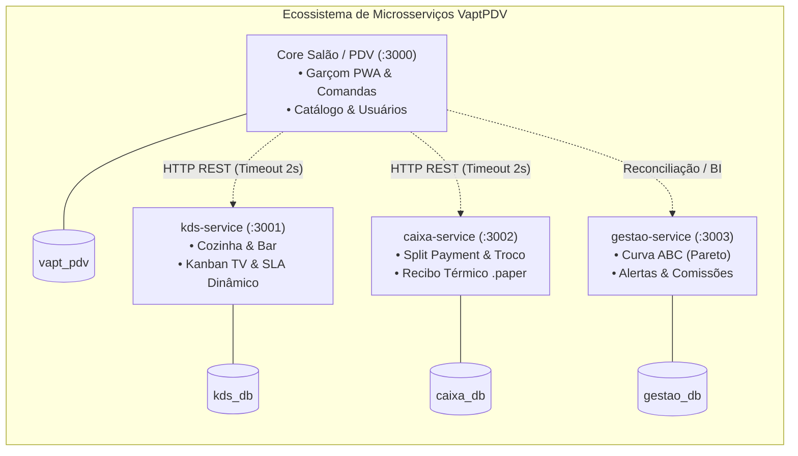

# VaptPDV

> **Trabalho prático e incremental desenvolvido para a disciplina de Sistemas Distribuídos**  
> **Departamento de Ciência da Computação (DCC) - Universidade do Estado do Rio Grande do Norte (UERN)**  
> **Docentes:** Profa. Dra. Glaucia Melissa e Profa. Ma. Luiziane Paulino dos Santos  
> **Discentes:** Kaio França e Mateus Neri  

---

## 1. Visão Geral

O **VaptPDV** é um ecossistema distribuído de Ponto de Venda (PDV) e gestão operacional voltado para bares, lanchonetes e restaurantes. O sistema substitui o controle arcaico de comandas em papel por registros digitais unificados, atômicos e auditáveis, eliminando perdas financeiras, pedidos extraviados e atritos entre salão, cozinha e frente de caixa.

O produto atende quatro perfis operacionais especializados:
- **Garçom:** Abertura rápida de mesas livres, consulta ao cardápio com validação em tempo real e lançamento ágil de pedidos com congelamento imediato de preços e registro de observações/alergias.
- **Cozinha e Bar (KDS):** Fila de produção em tempo real com controle visual de tempos decorridos e alertas dinâmicos de SLA.
- **Frente de Caixa:** Fechamento de contas com aplicação opcional de taxa de serviço (10%), conferência de pendências da cozinha, suporte a *Split Payment* (divisão de conta sem perda de centavos) e emissão de recibo térmico.
- **Gerente:** Monitoramento de faturamento diário, Curva ABC de produtos (Pareto 80/15/5), alertas preditivos de ruptura de estoque e ranking de produtividade da equipe.

---

## 2. Arquitetura de Microsserviços Distribuídos

O sistema opera sob o padrão **Database-per-Service**, com microsserviços autônomos comunicando-se via HTTP REST com resiliência e degradação graciosa:



### Serviços e Bancos Isolados

| Serviço | Porta | Banco de Dados | Responsabilidade Principal |
| :--- | :--- | :--- | :--- |
| **Core Salão / PDV** | `:3000` | `vapt_pdv` | Gestão de comandas, catálogo de produtos, usuários e gateway operacional. Serve o frontend em produção. |
| **KDS Cozinha e Bar** | `:3001` | `kds_db` | Kanban TV de preparo, transições de status com 1 toque e cálculo de SLA. |
| **Caixa Service** | `:3002` | `caixa_db` | Fechamento fiscal/financeiro, divisão de conta (*split payment*), cálculo de troco e recibo térmico formatado. |
| **Gestão Executiva e BI** | `:3003` | `gestao_db` | Agregações analíticas, Curva ABC de vendas, alertas de estoque e produtividade de garçons. |
| **Frontend PWA** | `:3000` / `:5173` | — | Interface React 19 moderna e responsiva (PWA para garçom no celular, desktop para caixa/gestão, TV para KDS). |

---

## 3. Modos Operacionais do Sistema

### Modo Garçom Mobile / PWA (`/garcom`)
- **Gestão de Mesas e Comandas:** Abertura e seleção de mesas com cálculo dinâmico de tempo de permanência.
- **Lançamento Ágil:** Busca textual instantânea por produtos, filtros de categoria e stepper numérico tátil.
- **Observações e Alergias:** Inclusão de observações customizadas enviadas diretamente para a ficha do KDS.
- **Operações de Salão:** Transferência de mesa e mesclagem/junção de comandas.

### Modo Painel KDS TV (`/kds`)
- **Visualização Kanban:** Separação visual por canal (`COZINHA` ou `BAR`).
- **SLA Dinâmico:** Badges cromáticos com base no tempo decorrido (verde para normal, âmbar para atenção, vermelho para urgência).
- **Avanço em 1 Toque:** Transição direta entre `pendente` ➔ `preparando` ➔ `pronto`.

### Modo Frente de Caixa Desktop (`/caixa`)
- **Visão do Salão:** Visualização rápida das comandas prontas para fechamento.
- **Taxa de Serviço Opcional:** Aplicação ou dispensa parametrizada dos 10% do garçom.
- **Trava de Segurança KDS:** Alerta caso existam itens da mesa ainda pendentes na cozinha.
- **Split Payment Flexível:** Divisão de conta em até *N* cotas por mesa sem perda de centavos.
- **Troco e Recibo Térmico:** Cálculo de troco exato em `DECIMAL(10,2)` e comprovante em formato `.paper` para impressoras térmicas (80mm/58mm).

### Portal Gerencial e Analytics (`/gestao`)
- **Resumo Executivo Diário:** Faturamento bruto, ticket médio e volume de comandas do dia.
- **Curva ABC de Vendas (Pareto):** Classificação automática dos produtos em Classe A (80%), B (15%) e C (5%).
- **Controle de Ruptura de Estoque:** Painel de alertas para produtos esgotados ou abaixo do estoque mínimo, com reposição transacional.
- **Produtividade da Equipe:** Total vendido e comissões dos 10% acumuladas por operador.

---

## 4. Stack Tecnológica

* **Linguagem e Runtime:** TypeScript 5 sobre Node.js 20 LTS.
* **Framework Web:** Fastify 5 (APIs REST de alta performance com OpenAPI/Swagger integrado).
* **ORM e Persistência:** Prisma ORM 6 com PostgreSQL 16 (Multi-database em container Docker).
* **Frontend:** React 19, Vite, Tailwind CSS, TanStack Query v5, Zustand, Lucide React.
* **Qualidade e Testes:** Vitest em todos os módulos (testes unitários, de integração e de gateways).

---

## 5. Guia de Execução Local

Siga os passos abaixo para inicializar o ecossistema completo em ambiente de desenvolvimento local.

### Pré-requisitos
* **Node.js:** versão 20 LTS ou superior.
* **Docker e Docker Compose:** para inicialização dos 4 bancos de dados PostgreSQL.
* **Git**

---

### Passo 1: Subir os Bancos de Dados com Docker Compose
O projeto conta com provisionamento multi-banco automático através do script `docker/init-multi-db.sql`. Na raiz do repositório, execute:

```bash
docker compose up -d
```
*(O container `vapt-postgres` subirá na porta `:5432`, provisionando os bancos `vapt_pdv`, `kds_db`, `caixa_db` e `gestao_db`).*

---

### Passo 2: Aplicar Migrações e Seeds nos 4 Bancos

Execute as migrações Prisma em cada microsserviço e carregue os produtos iniciais:

```bash
# 1. Core Salão (banco vapt_pdv)
npm run prisma:generate --prefix backend
npm run prisma:deploy --prefix backend

# 2. KDS Cozinha (banco kds_db)
npm run prisma:generate --prefix services/kds-service
npm run prisma:deploy --prefix services/kds-service

# 3. Caixa Service (banco caixa_db)
npm run prisma:generate --prefix services/caixa-service
npm run prisma:deploy --prefix services/caixa-service

# 4. Gestão Service (banco gestao_db)
npm run prisma:generate --prefix services/gestao-service
npm run prisma:deploy --prefix services/gestao-service

# 5. Inserção do catálogo de produtos no Core
docker exec -i vapt-postgres psql -U postgres -d vapt_pdv < backend/prisma/seed-produtos.sql
```

---

### Passo 3: Iniciar os Serviços da Aplicação

Inicie os microsserviços em terminais separados:

```bash
# Terminal 1: PDV Core Salão (:3000) - também serve o frontend integrado em produção
cd backend && npm run dev

# Terminal 2: KDS Cozinha e Bar (:3001)
cd services/kds-service && npm run dev

# Terminal 3: Caixa Service (:3002)
cd services/caixa-service && npm run dev

# Terminal 4: Gestão e Analytics (:3003)
cd services/gestao-service && npm run dev

# Terminal 5 (Opcional): Servidor de Desenvolvimento Vite (:5173 com HMR)
cd frontend && npm run dev
```

---

### Passo 4: URLs de Acesso

* **Aplicação Web Integrada:** [http://localhost:3000](http://localhost:3000) *(ou [http://localhost:5173](http://localhost:5173) no modo dev)*
* **Swagger Core Salão:** [http://localhost:3000/docs](http://localhost:3000/docs)
* **Swagger KDS Cozinha:** [http://localhost:3001/docs](http://localhost:3001/docs)
* **Swagger Caixa Service:** [http://localhost:3002/docs](http://localhost:3002/docs)
* **Swagger Gestão Service:** [http://localhost:3003/docs](http://localhost:3003/docs)

---

### Passo 5: Execução dos Testes Automatizados

Cada serviço conta com suíte de testes automatizados via Vitest:

```bash
npm run test --prefix backend
npm run test --prefix frontend
npm run test --prefix services/caixa-service
npm run test --prefix services/gestao-service
npm run test --prefix services/kds-service
```
