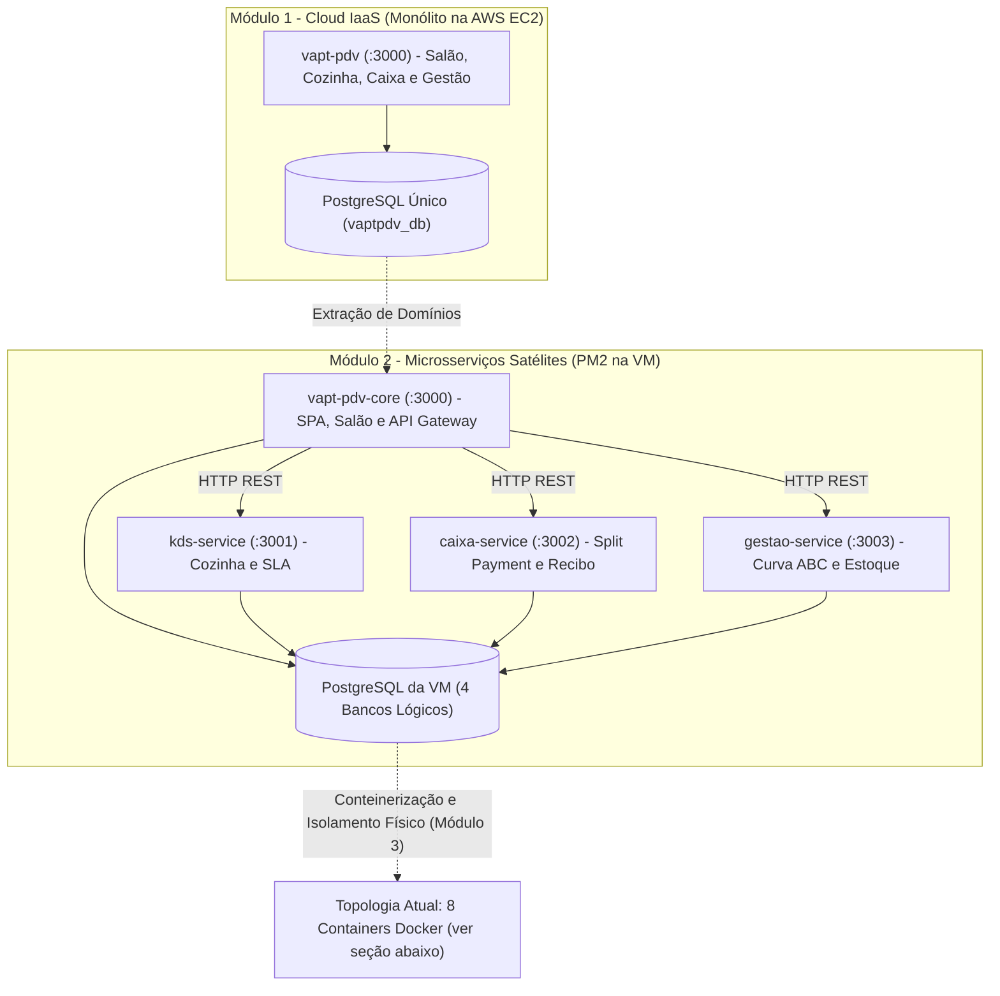
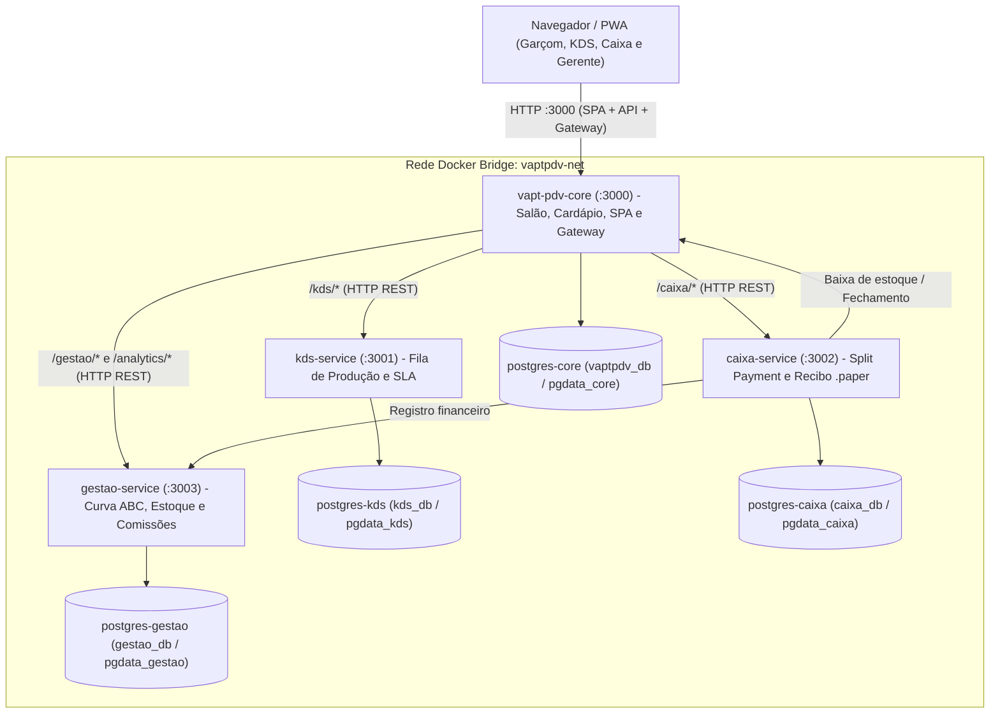

<div align="center">

# VaptPDV

**Ecossistema Distribuído de Ponto de Venda (PDV) e Gestão Operacional para Bares e Restaurantes**


[](https://nodejs.org/)
[](https://www.typescriptlang.org/)
[](https://fastify.dev/)
[](https://www.prisma.io/)
[](https://www.postgresql.org/)
[](https://react.dev/)
[](https://tailwindcss.com/)
[](https://vitejs.dev/)

</div>

---

## Sumário

- [Visão Geral](#visão-geral)
- [Contexto Acadêmico e Entregas Git](#contexto-acadêmico-e-entregas-git)
- [Evolução da Arquitetura nos Módulos](#evolução-da-arquitetura-nos-módulos)
- [Arquitetura Atual do Sistema](#arquitetura-atual-do-sistema)
- [Microsserviços e Topologia de Containers](#microsserviços-e-topologia-de-containers)
- [Tecnologias Utilizadas](#tecnologias-utilizadas)
- [Estrutura do Repositório](#estrutura-do-repositório)
- [Guia Passo a Passo de Execução](#guia-passo-a-passo-de-execução)
- [Testes Documentados e Verificação dos Módulos](#testes-documentados-e-verificação-dos-módulos)

---

## Visão Geral

O **VaptPDV** é um sistema distribuído de Ponto de Venda (PDV) e operação em tempo real desenvolvido para bares, lanchonetes e restaurantes. A plataforma substitui comandas manuais por registros digitais atômicos, auditáveis e sincronizados entre **salão, cozinha/bar, frente de caixa e gerência**.

### Acesso na Nuvem (AWS EC2), OpenAPI e Vídeos

- **Aplicação Web / PDV Core (`:3000`):** [http://54.234.157.236:3000](http://54.234.157.236:3000) | **Swagger:** `http://54.234.157.236:3000/docs` | **Health:** `http://54.234.157.236:3000/health`
- **KDS Service (`:3001`):** `http://54.234.157.236:3001/docs` | **Health:** `http://54.234.157.236:3001/health` *(endpoints `/kds/*`)*
- **Caixa Service (`:3002`):** `http://54.234.157.236:3002/docs` | **Health:** `http://54.234.157.236:3002/health`
- **Gestão Service (`:3003`):** `http://54.234.157.236:3003/docs` | **Health:** `http://54.234.157.236:3003/health`
- **Vídeos Demonstrativos (Cloud e Containers):** [Acervo no Google Drive](https://drive.google.com/drive/folders/1GzLecg9bSraN3ZjB7usL9Mg3I03I1uzm?usp=sharing)

### Perfis Operacionais e Interface (SPA/PWA)

A interface web é uma SPA/PWA construída em **React 19**, **TypeScript**, **Vite 8** e **Tailwind CSS**, empacotada dentro do `vapt-pdv-core` (`backend/public/`) e centralizada via _API Gateway_ na porta `:3000`:

- **Login Operacional (`/login`):** Seleção rápida de operador ativo por perfil.
- **Garçom (`/garcom`):** Abertura de mesas livres, consulta de cardápio, lançamento de itens com congelamento de preço unitário, registro de observações/alergias, transferência de mesa e mesclagem de comandas.
- **Cozinha e Bar - KDS (`/kds`):** Fila de produção Kanban para televisores e monitores, com separação por setor (`cozinha` e `bar`), cronômetro por ficha, alertas semafóricos de SLA (`< 10 min` verde, `10–15 min` amarelo, `> 15 min` vermelho/`ATRASADO`) e transição tátil (`recebido` ➔ `em_preparo` ➔ `pronto` ➔ `entregue`).
- **Frente de Caixa (`/caixa`):** Fechamento assistido com verificação preventiva de pendências na cozinha, taxa de serviço opcional (10%), _Split Payment_ exato por mesa (conservação integral dos centavos), cálculo de troco, estorno de parcelas parciais e emissão de recibo térmico em formato `.paper`.
- **Gerente (`/gestao`):** Resumo executivo do turno (faturamento e ticket médio), Curva ABC de faturamento (Pareto 80/15/5), alertas de ruptura e reposição de estoque, CRUD de cardápio e colaboradores, além de ranking de comissões por garçom.

### Princípios Arquiteturais do Sistema

- **Database-per-Service Estrito:** Cada contexto de negócio mantém sua própria base PostgreSQL isolada, evitando acoplamento transacional e contenção de locks entre salão, cozinha, caixa e BI.
- **Core Coeso + Gateway Unificado:** O núcleo operacional (`vapt-pdv-core`) centraliza o atendimento no salão, serve a interface React compilada e atua como _API Gateway_ para os microsserviços satélites com timeouts explícitos (`2s` na Gestão e `5s` nos proxies KDS/Caixa) e degradação graciosa (`503`).
- **Integridade Contábil e de Preço:** Preços são congelados no instante do lançamento do item; divisões de conta e troco operam em decimal exato sem perda de centavos.

---

## Contexto Acadêmico e Entregas Git

Projeto prático e incremental desenvolvido na disciplina de **Sistemas Distribuídos** do **Departamento de Ciência da Computação (DCC)** da **Universidade do Estado do Rio Grande do Norte (UERN)**.

- **Docentes:** Profa. Dra. Glaucia Melissa e Profa. Ma. Luiziane Paulino dos Santos
- **Discentes:** Kaio França e Mateus Neri
- **Branches de Entrega por Módulo:**
  - `entrega-1-cloud` — Módulo 1 (Computação em Nuvem: monólito inicial na AWS EC2)
  - `entrega-2-microsservicos` — Módulo 2 (Serviços e Microsserviços: decomposição em Core + 3 satélites sob PM2)
  - `entrega-3-containers` — Módulo 3 (Containers: conteinerização multi-stage e orquestração de 8 containers via Docker Compose)

---

## Evolução da Arquitetura nos Módulos



- **Módulo 1 — Cloud IaaS:** Toda a aplicação rodava como um único processo Node.js (`:3000`) conectado a um único banco PostgreSQL (`vaptpdv_db`) na EC2. Simples para validar o MVP na nuvem, porém com acoplamento em memória entre domínios.
- **Módulo 2 — Microsserviços Satélites:** Preservou-se o salão no **PDV Core** (`:3000`) e extraíram-se `kds-service` (`:3001`), `caixa-service` (`:3002`) e `gestao-service` (`:3003`) gerenciados via **PM2**, com 4 bancos lógicos (`vaptpdv_db`, `kds_db`, `caixa_db`, `gestao_db`) na VM e **API Gateway e Clientes HTTP** com timeouts e fallback `503`.
- **Módulo 3 — Orquestração em Containers (Atual):** Toda a topologia foi empacotada em **8 containers Docker** (`4` APIs + `4` instâncias `postgres:16-alpine`) no `docker-compose.yml`, com **isolamento físico dos bancos** em volumes `pgdata_*`, builds **multi-stage não-root (`USER node`)**, rede privada **`vaptpdv-net`** (APIs em `http://<serviço>:<porta>` e bancos em `postgres-*:5432`) e boot determinístico (`service_healthy` + `prisma migrate deploy`). Em relação ao deploy direto dos Módulos 1 e 2, a conteinerização eliminou diferenças de ambiente entre máquina local e EC2, automatizou migrações e isolou os dados de cada serviço, ao custo inicial de maior uso de RAM/CPU coordenado por limites explícitos no Compose (`1.504 MB` totais).

### Comparativo entre os Três Módulos

| Dimensão de Engenharia   | Módulo 1 (Cloud IaaS)                    | Módulo 2 (Microsserviços PM2)            | Módulo 3 (Docker Compose)                                       |
| :----------------------- | :--------------------------------------- | :--------------------------------------- | :-------------------------------------------------------------- |
| **Unidade de Deploy**    | Monólito único na VM (`:3000`).          | 4 processos Node.js no PM2.              | **8 containers independentes** (4 APIs + 4 Postgres).           |
| **Isolamento de Dados**  | 1 banco único (`vaptpdv_db`).            | 4 databases lógicos no mesmo PostgreSQL. | **4 instâncias PostgreSQL isoladas** com volumes `pgdata_*`.    |
| **Portabilidade**        | Dependente de Node/Postgres do SO da VM. | Dependente do ambiente da VM e PM2.      | **100% reproduzível** entre máquina local e EC2.                |
| **Inicialização**        | Manual via CLI / serviço único.          | Ordem controlada manualmente no PM2.     | **Determinística** via `service_healthy` + migração automática. |
| **Segurança do Runtime** | Usuário de deploy na VM + código-fonte.  | Usuário de deploy na VM + código-fonte.  | **`USER node` (não-root)** + artefatos mínimos multi-stage.     |

---

## Arquitetura Atual do Sistema

O diagrama abaixo representa a topologia em execução no **Módulo 3**:



---

## Microsserviços e Topologia de Containers

| Container / Serviço | Papel e Rotas Principais | Imagem Base | Porta Host / Rede | Volume / Banco | Limites (CPU / RAM) |
| :--- | :--- | :--- | :---: | :--- | :---: |
| **`vapt-pdv-core`** | Salão, mesas, cardápio, usuários, host da SPA, Swagger `/docs` e Gateway (`/kds/*`, `/caixa/*`, `/gestao/*`, `/analytics/*`) | `node:20-alpine` (Multi-Stage) | `3000:3000` | — | `0.50` / `256 MB` |
| **`kds-service`** | Fila de preparo cozinha/bar, ciclo das fichas, cálculo de SLA e Swagger `/docs` | `node:20-alpine` (Multi-Stage) | `3001:3001` | — | `0.25` / `160 MB` |
| **`caixa-service`** | Conferência, taxa 10%, _Split Payment_, estorno de parcelas, troco, recibo `.paper` e Swagger `/docs` | `node:20-alpine` (Multi-Stage) | `3002:3002` | — | `0.25` / `160 MB` |
| **`gestao-service`** | BI/OLAP, Curva ABC, estoque crítico, produtividade/comissões e Swagger `/docs` | `node:20-alpine` (Multi-Stage) | `3003:3003` | — | `0.30` / `192 MB` |
| **`postgres-core`** | Persistência do núcleo PDV (`vaptpdv_db`) | `postgres:16-alpine` | `127.0.0.1:5432:5432` | `pgdata_core` | `0.50` / `256 MB` |
| **`postgres-kds`** | Persistência das fichas de preparo (`kds_db`) | `postgres:16-alpine` | Interna (`vaptpdv-net`) | `pgdata_kds` | `0.25` / `128 MB` |
| **`postgres-caixa`** | Persistência de cobranças, parcelas e recibos (`caixa_db`) | `postgres:16-alpine` | Interna (`vaptpdv-net`) | `pgdata_caixa` | `0.25` / `160 MB` |
| **`postgres-gestao`** | Persistência analítica e eventos (`gestao_db`) | `postgres:16-alpine` | Interna (`vaptpdv-net`) | `pgdata_gestao` | `0.30` / `192 MB` |

---

## Tecnologias Utilizadas

| Categoria               | Tecnologia                                         | Justificativa Técnica                                                                                                      |
| :---------------------- | :------------------------------------------------- | :------------------------------------------------------------------------------------------------------------------------- |
| **Frontend Web/PWA**    | React 19, TypeScript 5.7, Vite 8, Tailwind CSS 3.4 | Interface modular e responsiva, com tipagem estática e empacotamento PWA (`vite-plugin-pwa`).                              |
| **Estado e Dados (UI)** | TanStack Query v5 & Zustand v5                     | Sincronização automática de estado remoto (polling de mesas/KDS) e estado global leve no cliente.                          |
| **Runtime & APIs**      | Node.js 20 LTS, Fastify 5, TypeBox                 | Alta vazão com baixo consumo de memória, validação estrita de schemas em runtime e tipagem ponta a ponta.                  |
| **Documentação de API** | `@fastify/swagger` & `@fastify/swagger-ui`         | Geração interativa de contratos OpenAPI diretamente a partir dos schemas TypeBox nos 4 serviços.                           |
| **ORM e Persistência**  | Prisma ORM 6.4 & PostgreSQL 16                     | Migrações versionadas (`prisma migrate deploy`), integridade transacional e isolamento completo _Database-per-Service_.    |
| **Containers**          | Docker (Multi-Stage) & Docker Compose v2           | Imagens minimalistas sem privilégios de root (`USER node`), rede privada e volumes persistentes para paridade local/nuvem. |
| **Testes e Linting**    | Vitest & Oxlint                                    | Suíte de testes unitários/integração por serviço e verificação estática rápida no frontend.                                |

---

## Estrutura do Repositório

```text
vapt-pdv/
├── README.md                           # Documentação principal e guia de execução
├── docker-compose.yml                  # Orquestração dos 8 containers (rede vaptpdv-net e volumes)
├── .env.docker.example                 # Template seguro de variáveis para execução em containers
├── .dockerignore                       # Exclusões para builds Docker enxutos
│
├── backend/                            # PDV Core (Salão, Comandas, Catálogo, Gateway e SPA Host)
│   ├── Dockerfile                      # Build multi-stage (compila frontend + backend -> USER node)
│   ├── .env.example                    # Template de variáveis para execução local
│   ├── prisma/                         # Schema (vaptpdv_db), migrações e seed-produtos.sql
│   ├── public/                         # Build estático compilado do frontend
│   ├── src/                            # app.ts, server.ts, gateways e módulos (comandas, produtos, usuarios, saude)
│   └── test/                           # Suíte Vitest
│
├── frontend/                           # Aplicação Web/PWA (React 19 + Vite 8 + Tailwind CSS)
│   ├── vite.config.ts                  # Proxy de dev para /comandas, /produtos, /usuarios, /kds, /caixa, /gestao
│   └── src/                            # features (auth, garcom, kds, caixa, gestao), hooks, services, stores
│
└── services/                           # Microsserviços Satélites Independentes
    ├── kds-service/                    # Cozinha & Bar (:3001) - fichas, SLA e /docs
    ├── caixa-service/                  # Frente de Caixa (:3002) - split payment, estorno, recibo .paper e /docs
    └── gestao-service/                 # Gestão & Analytics (:3003) - Curva ABC, comissões e /docs
```

---

## Guia Passo a Passo de Execução

### Modo A: Orquestração Completa em Containers (Módulo 3 - Recomendado)

Sobe todos os **8 containers** (4 APIs + 4 instâncias PostgreSQL) com migrações Prisma automáticas, healthchecks e volumes persistentes.

#### Pré-requisitos

- **Docker Engine** e **Docker Compose v2** (`docker compose version`)
- **Git**

#### Passo 1 — Criar o arquivo `.env` na raiz a partir de [`.env.docker.example`](./.env.docker.example)

- **Linux / macOS / Git Bash:**
  ```bash
  cp .env.docker.example .env
  ```
- **Windows PowerShell:**
  ```powershell
  Copy-Item .env.docker.example .env
  ```

#### Passo 2 — Construir as imagens e iniciar os 8 containers

```bash
docker compose up -d --build
```

#### Passo 3 — Verificar saúde dos serviços

Confirme que todos os 8 containers atingiram o estado `healthy`:

```bash
docker compose ps
```

Valide os endpoints de saúde das quatro APIs:

```bash
curl http://localhost:3000/health
curl http://localhost:3001/health
curl http://localhost:3002/health
curl http://localhost:3003/health
```

#### Passo 4 — *(Opcional)* Carregar cardápio inicial de demonstração

- **Linux / macOS / Git Bash:**
  ```bash
  docker compose exec -T postgres-core psql -U vaptpdv -d vaptpdv_db < backend/prisma/seed-produtos.sql
  ```
- **Windows PowerShell:**
  ```powershell
  Get-Content backend/prisma/seed-produtos.sql -Raw | docker compose exec -T postgres-core psql -U vaptpdv -d vaptpdv_db
  ```

#### Passo 5 — Acessar a aplicação e documentações locais

- **Frontend Web/PWA:** [http://localhost:3000](http://localhost:3000)
- **Swagger PDV Core:** [http://localhost:3000/docs](http://localhost:3000/docs)
- **Swagger KDS Service:** [http://localhost:3001/docs](http://localhost:3001/docs)
- **Swagger Caixa Service:** [http://localhost:3002/docs](http://localhost:3002/docs)
- **Swagger Gestão Service:** [http://localhost:3003/docs](http://localhost:3003/docs)

---

### Modo B: Execução Local para Desenvolvimento (Node.js + TSX Watch)

Indicado para desenvolvimento com _hot reload_ fora de containers.

#### Pré-requisitos

- **Node.js 20 LTS ou superior**
- **PostgreSQL 16** com os quatro bancos criados (`vaptpdv_db`, `kds_db`, `caixa_db`, `gestao_db`)
  > **Importante:** No `docker-compose.yml`, apenas `postgres-core` expõe `127.0.0.1:5432` para o host; `postgres-kds`, `postgres-caixa` e `postgres-gestao` ficam isolados dentro da rede `vaptpdv-net`. Para rodar os satélites fora de containers, utilize uma instância PostgreSQL local.

#### Passo 1 — Configurar `.env` locais e instalar dependências

Configure os arquivos `.env` individuais de cada serviço (`backend/.env`, `services/kds-service/.env`, `services/caixa-service/.env` e `services/gestao-service/.env`, tomando como base os respectivos `.env.example`) e execute `npm install` em `backend/`, `frontend/` e nos três diretórios de `services/`.

#### Passo 2 — Gerar clientes Prisma e aplicar migrações

Execute em cada um dos quatro serviços backend:

```bash
npx prisma generate
npx prisma migrate deploy
```

#### Passo 3 — Subir os serviços em terminais separados

```bash
# Terminal 1 - PDV Core (:3000)
cd backend && npm run dev

# Terminal 2 - KDS Service (:3001)
cd services/kds-service && npm run dev

# Terminal 3 - Caixa Service (:3002)
cd services/caixa-service && npm run dev

# Terminal 4 - Gestão Service (:3003)
cd services/gestao-service && npm run dev

# Terminal 5 (Opcional) - Frontend Vite Dev Server (:5173)
cd frontend && npm run dev
```

---

## Testes Documentados e Verificação dos Módulos

### 1. Módulo 1 — API REST Pública (CRUD em Nuvem)

Substitua `http://localhost:3000` por `http://54.234.157.236:3000` para validar diretamente contra a instância publicada na AWS EC2:

```bash
# 1. Healthcheck do núcleo e banco PostgreSQL
curl -s http://54.234.157.236:3000/health
# Resposta esperada (200 OK):
# {"status":"ok","servico":"vapt-pdv-core","banco":"conectado","timestamp":"..."}

# 2. Criar produto (Create)
curl -s -X POST http://54.234.157.236:3000/produtos \
  -H "Content-Type: application/json" \
  -d '{"nome":"Porção de Fritas","categoria":"Porções","preco":"25.00","estoque":30,"estoque_minimo":5}'

# 3. Listar produtos (Read)
curl -s http://54.234.157.236:3000/produtos

# 4. Atualizar produto (Update)
curl -s -X PATCH http://54.234.157.236:3000/produtos/1 \
  -H "Content-Type: application/json" \
  -d '{"preco":"27.50"}'

# 5. Inativar produto (Delete lógico)
curl -s -X POST http://54.234.157.236:3000/produtos/1/inativar
```

### 2. Módulo 2 — Comunicação HTTP entre Microsserviços e Degradação Graciosa

```bash
# 1. Consultar fila de preparo do KDS através do API Gateway do Core (:3000 -> :3001)
curl -s http://localhost:3000/kds/fichas

# 2. Consultar resumo financeiro do Gestão através do API Gateway (:3000 -> :3003)
curl -s http://localhost:3000/gestao/resumo-diario

# 3. Simular indisponibilidade de um satélite (ex.: parar kds-service) e validar resposta amigável 503:
docker compose stop kds-service
curl -i http://localhost:3000/kds/fichas
# Resposta esperada (503 Service Unavailable):
# {"erro":{"codigo":"SERVICO_INDISPONIVEL","mensagem":"O microsserviço satélite solicitado está temporariamente indisponível.","detalhes":{"destino":"http://kds-service:3001/kds/fichas"}}}

# Restaurar o serviço após o teste:
docker compose start kds-service
```

### 3. Módulo 3 — Persistência em Volumes e Suítes Automatizadas

A persistência dos dados entre ciclos `docker compose down` e `docker compose up -d` (preservando os volumes `pgdata_*`) é demonstrada no vídeo da entrega do Módulo 3 ([Acervo no Google Drive](https://drive.google.com/drive/folders/1GzLecg9bSraN3ZjB7usL9Mg3I03I1uzm?usp=sharing)).

Para executar a suíte de testes automatizados e verificação de tipos em todos os módulos localmente:

```bash
npm --prefix backend test
npm --prefix services/kds-service test
npm --prefix services/caixa-service test
npm --prefix services/gestao-service test
npm --prefix frontend test
```
