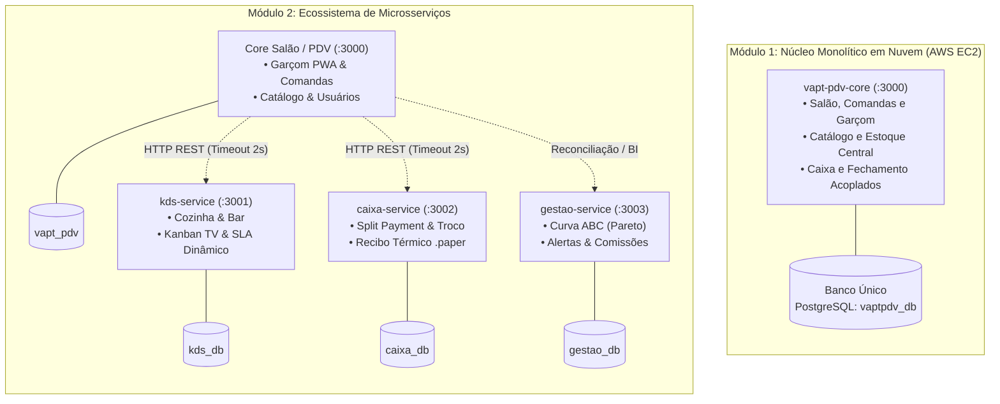

# VaptPDV

> **Trabalho prático e incremental desenvolvido para a disciplina de Sistemas Distribuídos**  
> **Departamento de Ciência da Computação (DCC) - Universidade do Estado do Rio Grande do Norte (UERN)**  
> **Docentes:** Profa. Dra. Glaucia Melissa e Profa. Ma. Luiziane Paulino dos Santos  
> **Discentes:** Kaio França e Mateus Neri  

[-success)](docs/engenharia/01-visao-e-escopo.md)
[](docs/engenharia/03-arquitetura-c4-model.md)
[](docs/engenharia/04-modelo-dados-e-dominio.md)
---

## 1. Visão Geral

O **VaptPDV** é um ecossistema distribuído de Ponto de Venda (PDV) e gestão operacional voltado para bares, lanchonetes e restaurantes. O sistema substitui o controle arcaico de comandas em papel por registros digitais unificados, atômicos e auditáveis, eliminando perdas financeiras, pedidos extraviados e atritos entre salão, cozinha e frente de caixa.

O produto foi concebido para atender quatro perfis operacionais especializados:
- **Garçom:** Abertura rápida de mesas livres, consulta ao cardápio com validação em tempo real e lançamento ágil de pedidos com congelamento imediato de preços e registro de observações/alergias.
- **Cozinha e Bar (KDS):** Fila de produção em tempo real com controle visual de tempos decorridos e alertas dinâmicos de SLA.
- **Frente de Caixa:** Fechamento de contas com aplicação opcional de taxa de serviço (10%), conferência de pendências da cozinha, suporte a *Split Payment* (divisão de conta sem perda de centavos) e emissão de recibo térmico.
- **Gerente:** Monitoramento de faturamento diário, Curva ABC de produtos (Pareto 80/15/5), alertas preditivos de ruptura de estoque e ranking de produtividade da equipe.

Para aprofundamento nos requisitos formais, modelos de domínio e decisões arquiteturais, consulte a pasta [`docs/engenharia/`](docs/engenharia/).

---

## 2. Evolução Arquitetural: Módulo 1 (Cloud IaaS) vs. Módulo 2 (Microsserviços)

O projeto segue uma progressão didática e prática, partindo de uma arquitetura em nuvem monolítica e evoluindo para um ecossistema de microsserviços distribuídos orientados a domínios de negócio.

### Diagrama Comparativo de Evolução



### Tabela Comparativa de Dimensões de Engenharia

| Dimensão de Engenharia | Módulo 1 - Computação em Nuvem (IaaS) | Módulo 2 - Microsserviços | Ganho Arquitetural e Operacional |
| :--- | :--- | :--- | :--- |
| **Topologia da Aplicação** | Monólito modularizado em processo único (`:3000`). | PDV (`:3000`) + 3 microsserviços (`:3001`, `:3002`, `:3003`). | Desacoplamento de responsabilidades por estação física de trabalho (Salão, Cozinha, Caixa, Gestão). |
| **Padrão de Dados** | Banco relacional único (`vaptpdv_db`) compartilhado por todas as entidades. | Padrão estrito **Database-per-Service** com 4 bancos isolados (`vapt_pdv`, `kds_db`, `caixa_db`, `gestao_db`). | Independência transacional; manutenção ou lentidão em um serviço não afeta as demais bases. |
| **Comunicação e Fronteiras** | Chamadas diretas em memória entre módulos internos. | Comunicação via **Gateways HTTP REST** com isolamento de contexto e contratos JSON estritos. | Fronteiras claras de domínio; preparação direta para mensageria assíncrona. |
| **Cozinha e Bar (KDS)** | Consultas manuais diretamente nas tabelas de itens do salão. | **`kds-service` dedicado** com Painel TV, SLA dinâmico por faixas de cor e observações de preparo/alergias. | Fila de produção fluida e visibilidade em tempo real sem concorrência no banco do salão. |
| **Frente de Caixa** | Fechamento básico em cota única de pagamento. | **`caixa-service` dedicado** com *Split Payment* exato (conservação total de centavos), cálculo de troco e recibo `.paper`. | Segurança contábil, integridade nos fechamentos e flexibilidade de cobrança fracionada. |
| **Gestão e BI** | Relatórios básicos concorrendo com transações de venda. | **`gestao-service` analítico (OLAP)** com Curva ABC de vendas (Pareto 80/15/5), monitor de estoque crítico e comissões. | Processamento de consultas agregadas complexas isolado do tráfego operacional do PDV. |
| **Frontend Web/PWA** | Interface simplificada para Garçom e Caixa básico. | **5 modos especializados** (`/login`, `/garcom`, `/caixa`, `/kds`, `/gestao`) cobrindo 4 perfis operacionais. | Ergonomia focada na função de cada colaborador, desde smartphones a televisores widescreen. |
---

## 3. Topologia Distribuída e Portas dos Microsserviços (ADR-01)

Adotou-se a decisão arquitetural canônica: ao invés de fragmentar o núcleo operacional em microsserviços CRUD artificiais, preservou-se a alta coesão do **PDV Core** para operações de salão e extraíram-se três satélites de domínio vertical:

| Serviço / Módulo | Diretório | Porta | Banco de Dados | Responsabilidade Principal |
| :--- | :--- | :---: | :--- | :--- |
| **PDV Core (`vapt-pdv-core`)** | `backend/` | `:3000` | `vapt_pdv` | Salão, abertura de mesas, comandas, catálogo de produtos, perfis e coordenação geral. |
| **KDS Service (`kds-service`)** | `services/kds-service/` | `:3001` | `kds_db` | Gestão da fila de produção da cozinha/bar, fichas técnicas e monitoramento de SLA. |
| **Caixa Service (`caixa-service`)** | `services/caixa-service/` | `:3002` | `caixa_db` | Processamento de pagamentos, divisão de conta (*split payment*), troco e emissão de comprovantes. |
| **Gestão Service (`gestao-service`)** | `services/gestao-service/` | `:3003` | `gestao_db` | Inteligência analítica (OLAP), Curva ABC de Pareto, gestão de reposição e comissões de garçons. |
| **Frontend Web/PWA** | `frontend/` | `:5173` / `:3000` | - | Interface unificada em React 19 servida via Vite Dev Gateway (`:5173`) ou estáticos compilados (`:3000`). |

---

## 4. Aplicação na Nuvem (AWS EC2), Swagger/OpenAPI e Vídeos

A infraestrutura oficial do projeto está provisionada em máquina virtual **AWS EC2 (Ubuntu LTS)** gerenciada via **PM2**:

### Endpoints da Aplicação e Documentação Swagger/OpenAPI
* **Aplicação Web / PDV Core:** [http://54.234.157.236:3000](http://54.234.157.236:3000)
  * Swagger / OpenAPI do Core: [http://54.234.157.236:3000/docs](http://54.234.157.236:3000/docs)
  * Health Check do Core: [http://54.234.157.236:3000/health](http://54.234.157.236:3000/health)
* **KDS Service (Cozinha/Bar):** [http://54.234.157.236:3001](http://54.234.157.236:3001)
  * Swagger / OpenAPI do KDS: [http://54.234.157.236:3001/docs](http://54.234.157.236:3001/docs)
  * Health Check do KDS: [http://54.234.157.236:3001/health](http://54.234.157.236:3001/health)
* **Caixa Service (Split Payment):** [http://54.234.157.236:3002](http://54.234.157.236:3002)
  * Swagger / OpenAPI do Caixa: [http://54.234.157.236:3002/docs](http://54.234.157.236:3002/docs)
  * Health Check do Caixa: [http://54.234.157.236:3002/health](http://54.234.157.236:3002/health)
* **Gestão Service (Analytics & BI):** [http://54.234.157.236:3003](http://54.234.157.236:3003)
  * Swagger / OpenAPI da Gestão: [http://54.234.157.236:3003/docs](http://54.234.157.236:3003/docs)
  * Health Check da Gestão: [http://54.234.157.236:3003/health](http://54.234.157.236:3003/health)

### Vídeos: [Pasta dos vídeos](https://drive.google.com/drive/folders/1GzLecg9bSraN3ZjB7usL9Mg3I03I1uzm?usp=sharing) 

---

## 5. Catálogo das Interfaces do Frontend Web/PWA (5 Modos)

A interface do VaptPDV foi projetada como uma Single Page Application (SPA/PWA) adaptativa, implementada em React 19 e Tailwind CSS, seguindo rigorosamente a identidade visual de `docs/DESIGN.md` (Mostarda `#F2A81D`, café `#2B2019` e creme `#FBF7F1`, sem neon, sem emojis na interface e com conformidade de acessibilidade WCAG 2.2 AA).

### 1. Autenticação Unificada (`/login`)
- Seleção direta entre os 4 perfis do sistema (`garcom`, `caixa`, `cozinha`, `gerente`) com operadores ativos cadastrados no banco.
- Login otimizado sem fricção de senhas para agilidade em turnos movimentados, mantendo a rastreabilidade por ID de operador em todas as ações.

### 2. Modo Garçom Mobile-First (`/garcom`)
- **Mapa Visual de Mesas:** Exibição da ocupação do salão em tempo real (mesas livres, ocupadas, reservadas ou em fechamento).
- **Lançamento Ágil de Pedidos:** Abertura de comandas com validação de mesa livre (`RN07`) e adição de itens com congelamento imediato de preço (`RN04`).
- **Observações e Alergias (`G04`):** Bottom sheet mobile com seleção rápida de modificadores (ex.: *"Sem cebola"*, *"Ponto da carne: bem passada"*, *"Alérgico a glúten"*).

### 3. Painel TV da Cozinha / KDS (`/kds`)
- **Layout Kanban Widescreen:** Desenvolvido especificamente para monitores industriais ou smart TVs fixadas na cozinha/bar.
- **SLA de Preparo Dinâmico:** Fichas de produção com cronômetro em tempo real e sinalização semafórica de urgência:
  - **Verde:** Tempo decorrido de 0 a 10 minutos (dentro do prazo regular).
  - **Amarelo:** Tempo decorrido de 11 a 20 minutos (alerta de atenção).
  - **Vermelho:** Tempo decorrido superior a 20 minutos (urgência crítica).
- **Ciclo de Preparo em 1 Toque:** Botões táteis largos (>= 44x44px) para avançar pedidos de `pendente` ➔ `preparando` ➔ `pronto`.

### 4. Modo Frente de Caixa Desktop (`/caixa`)
- **Visão Geral do Salão:** Painel desktop (1440x900) para visualização rápida das comandas prontas para fechamento.
- **Taxa de Serviço Opcional:** Aplicação ou dispensa parametrizada dos 10% do garçom no ato da conferência.
- **Trava de Segurança KDS (`C04`):** Bloqueio/aviso preventivo caso existam itens da mesa que ainda não foram marcados como prontos pela cozinha.
- **Split Payment Flexível:** Divisão de conta em até *N* cotas por mesa, garantindo 100% de conservação dos centavos (soma das cotas estritamente igual ao total da comanda).
- **Troco e Recibo Térmico:** Cálculo de troco exato em `DECIMAL(10,2)` e emissão de comprovante em formato `.paper` padronizado para impressoras de 80mm/58mm.

### 5. Portal Gerencial e Analytics (`/gestao`)
- **Resumo Executivo Diário:** Faturamento bruto, ticket médio e volume de comandas atendidas no dia.
- **Curva ABC de Vendas (Pareto):** Classificação automática dos produtos mais rentáveis em Classe A (80% da receita), Classe B (15%) e Classe C (5%).
- **Controle de Ruptura de Estoque (`M05`):** Painel de alertas para produtos esgotados (venda bloqueada) ou abaixo da margem de segurança, com modal de entrada de mercadorias (`M06`).
- **Produtividade da Equipe:** Relatório consolidado com total vendido e rateio da taxa de serviço de 10% acumulada por garçom.

---

## 6. Stack Tecnológica Consolidada

* **Linguagem e Runtime:** [TypeScript 5](https://www.typescriptlang.org/) sobre [Node.js 20 LTS](https://nodejs.org/).
* **Framework Web:** [Fastify 5](https://fastify.dev/) 
* **ORM e Persistência:** [Prisma ORM 6](https://www.prisma.io/) com [PostgreSQL 16](https://www.postgresql.org/) 
* **Frontend Web/PWA:** [React 19](https://react.dev/), [Vite](https://vitejs.dev/), [Tailwind CSS](https://tailwindcss.com/), [TanStack Query v5](https://tanstack.com/query), [Zustand](https://zustand-demo.pmnd.rs/) e [Lucide React](https://lucide.dev/).
* **Infraestrutura:** AWS EC2 e PM2.

---

## 7. Guia passo a passo de execução local

Siga os passos abaixo para inicializar o ecossistema completo em ambiente de desenvolvimento local.

### Pré-requisitos
* **Node.js:** versão 20 LTS ou superior.
* **Docker e Docker Compose:** para inicialização dos bancos de dados relacionais.
* **Git:** para clonagem do repositório.

---

### Passo 1: Subir os Bancos de Dados com Docker Compose
O projeto conta com provisionamento multi-banco automático através do script [`docker/init-multi-db.sql`](docker/init-multi-db.sql). Execute na raiz do repositório:

```bash
docker compose up -d
```
*(O container `vapt-postgres` subirá na porta `:5432`, criando automaticamente os bancos `vapt_pdv`, `kds_db`, `caixa_db` e `gestao_db`).*

---

### Passo 2: Aplicar Migrações e Seeds nos 4 Bancos
Para estruturar as tabelas e carregar o catálogo de 24 produtos reais, utilize o script automatizado:

**Via terminal (Linux / macOS / Bash):**
  ```bash
  # Core Salão (vapt_pdv)
  npm run prisma:generate --prefix backend
  npm run prisma:deploy --prefix backend

  # KDS Cozinha (kds_db)
  npm run prisma:generate --prefix services/kds-service
  npm run prisma:deploy --prefix services/kds-service

  # Caixa Service (caixa_db)
  npm run prisma:generate --prefix services/caixa-service
  npm run prisma:deploy --prefix services/caixa-service

  # Gestão Service (gestao_db)
  npm run prisma:generate --prefix services/gestao-service
  npm run prisma:deploy --prefix services/gestao-service

  # Inserção do catálogo de produtos reais no Core
  docker exec -i vapt-postgres psql -U postgres -d vapt_pdv < backend/prisma/seed-produtos.sql
  ```

---

### Passo 3: Iniciar os serviços da aplicação

#### Inicialização Manual em Terminais Separados

```bash
# Terminal 1: PDV Core Salão (:3000) e Frontend Integrado
cd backend && npm run dev

# Terminal 2: KDS Cozinha e Bar (:3001)
cd services/kds-service && npm run dev

# Terminal 3: Caixa Service (:3002)
cd services/caixa-service && npm run dev

# Terminal 4: Gestão e Analytics (:3003)
cd services/gestao-service && npm run dev

# Terminal 5 (Opcional): Frontend Vite Dev Server (:5173 com proxies)
cd frontend && npm run dev
```

---

### Passo 4: Acessar as Interfaces e Documentações

* **Frontend Web/PWA Integrado:** [http://localhost:3000](http://localhost:3000) *(ou [http://localhost:5173](http://localhost:5173) no modo Vite dev)*
* **Swagger Core Salão:** [http://localhost:3000/docs](http://localhost:3000/docs)
* **Swagger KDS Cozinha:** [http://localhost:3001/docs](http://localhost:3001/docs)
* **Swagger Caixa Service:** [http://localhost:3002/docs](http://localhost:3002/docs)
* **Swagger Gestão Service:** [http://localhost:3003/docs](http://localhost:3003/docs)
