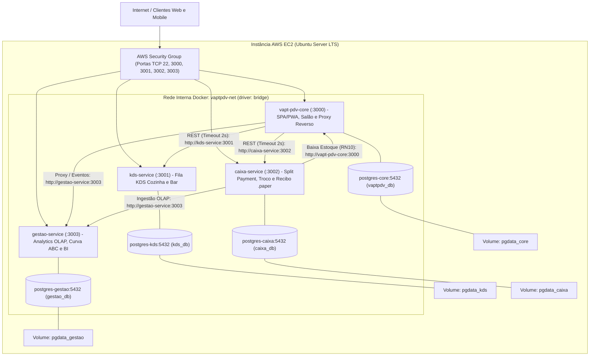
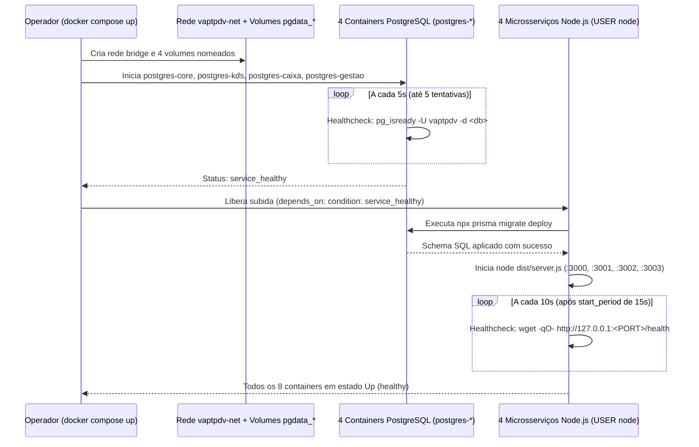

# Guia de Configuração e Orquestração de Containers na AWS EC2 (Módulo 3)

> **Trabalho Prático e Incremental — Sistemas Distribuídos**  
> **Departamento de Ciência da Computação (DCC) — Universidade do Estado do Rio Grande do Norte (UERN)**  
> **Docentes:** Profa. Dra. Glaucia Melissa e Profa. Ma. Luiziane Paulino dos Santos  
> **Discentes:** Kaio França e Mateus Neri  
> **Módulo 3:** Containerização Multi-Stage, Orquestração Docker Compose (8 Containers), Isolamento *Database-per-Service* e Persistência em Volumes Nomeados

---

## Sumário Executivo

Este documento é o manual de engenharia e operação para implantar, configurar, validar e manter em produção na máquina virtual **AWS EC2 (Ubuntu Server LTS)** a arquitetura containerizada do **VaptPDV** (`docker-compose.yml`). O ecossistema é composto por **8 containers isolados** conectados pela rede bridge dedicada `vaptpdv-net`:

- **4 Microsserviços de Aplicação (`node:20-alpine`):** `vapt-pdv-core` (`:3000`), `kds-service` (`:3001`), `caixa-service` (`:3002`) e `gestao-service` (`:3003`).
- **4 Instâncias Independentes de Banco de Dados (`postgres:16-alpine`):** `postgres-core`, `postgres-kds`, `postgres-caixa` e `postgres-gestao`, cada uma associada ao seu próprio volume persistente (`pgdata_core`, `pgdata_kds`, `pgdata_caixa` e `pgdata_gestao`).

---

## 1. Arquitetura, Topologia de Rede e Orçamento de Recursos

### 1.1. Topologia de Rede e Volumes na Instância AWS EC2



### 1.2. Orçamento de Recursos (`deploy.resources.limits`)

Os 8 containers possuem tetos explícitos de memória e CPU em `docker-compose.yml`, totalizando **1504 MB de RAM (~1,47 GiB)** e **2,60 vCPUs**. Essa distribuição evita que picos analíticos no `gestao-service` ou consultas pesadas degradem as operações críticas de salão e caixa (*bulkhead pattern*).

| Container | Função no Ecossistema | Imagem Base / Dockerfile | Porta no Host EC2 | Banco / Volume | Limite RAM | Limite CPU |
| :--- | :--- | :--- | :--- | :--- | :---: | :---: |
| **`postgres-core`** | SGBD Operacional do Salão | `postgres:16-alpine` | `127.0.0.1:5432:5432` | `vaptpdv_db` / `pgdata_core` | `256M` | `0.50` |
| **`postgres-kds`** | SGBD da Cozinha e Bar | `postgres:16-alpine` | Interna (`vaptpdv-net`) | `kds_db` / `pgdata_kds` | `128M` | `0.25` |
| **`postgres-caixa`** | SGBD de Cobranças e Cotas | `postgres:16-alpine` | Interna (`vaptpdv-net`) | `caixa_db` / `pgdata_caixa` | `160M` | `0.25` |
| **`postgres-gestao`** | SGBD Analítico (OLAP/BI) | `postgres:16-alpine` | Interna (`vaptpdv-net`) | `gestao_db` / `pgdata_gestao` | `192M` | `0.30` |
| **`vapt-pdv-core`** | Core Salão + PWA + Proxy | `backend/Dockerfile` | `${CORE_PORT:-3000}:3000` | `postgres-core:5432` | `256M` | `0.50` |
| **`kds-service`** | Microsserviço KDS e SLA | `services/kds-service/Dockerfile` | `${KDS_PORT:-3001}:3001` | `postgres-kds:5432` | `160M` | `0.25` |
| **`caixa-service`** | Microsserviço Caixa/Split | `services/caixa-service/Dockerfile` | `${CAIXA_PORT:-3002}:3002` | `postgres-caixa:5432` | `160M` | `0.25` |
| **`gestao-service`** | Microsserviço Gestão/BI | `services/gestao-service/Dockerfile` | `${GESTAO_PORT:-3003}:3003` | `postgres-gestao:5432` | `192M` | `0.30` |
| **Total Combinado** | **8 Containers Ativos** | **Alpine Linux** | **4 Portas Públicas** | **4 Volumes Isolados** | **`1504M`** | **`2.60`** |

### 1.3. Matriz de Comunicação Interna e Descoberta de Serviços

Dentro da rede `vaptpdv-net`, o Docker DNS resolve os nomes dos serviços automaticamente:

| Origem | Destino | Variável de Ambiente no Compose | Valor Interno (`vaptpdv-net`) | Finalidade Operacional |
| :--- | :--- | :--- | :--- | :--- |
| `vapt-pdv-core` | `kds-service` | `KDS_SERVICE_URL` | `http://kds-service:3001` | Despacho síncrono de fichas de preparo, consulta de pendências (`C04`) e proxy `/kds/*` |
| `vapt-pdv-core` | `caixa-service` | `CAIXA_SERVICE_URL` | `http://caixa-service:3002` | Sincronização de fechamento de conta e proxy `/caixa/*` |
| `vapt-pdv-core` | `gestao-service` | `GESTAO_SERVICE_URL` / `GESTAO_API_URL` | `http://gestao-service:3003` | Encaminhamento transparente de `/gestao/*` (incluindo exportação CSV) e `/analytics/*` |
| `caixa-service` | `vapt-pdv-core` | `CORE_API_URL` | `http://vapt-pdv-core:3000` | Baixa transacional e idempotente de estoque (`RN10`) ao quitar comanda |
| `caixa-service` | `gestao-service` | `GESTAO_API_URL` | `http://gestao-service:3003` | Emissão de evento `comanda.paga` para ingestão OLAP (`POST /analytics/eventos`) |

---

## 2. Engenharia dos Dockerfiles Multi-Stage e Segurança

Os 4 Dockerfiles foram projetados para máxima segurança e densidade de armazenamento em nuvem:

1. **Compilação Multi-Stage Isolada:**
   - No `backend/Dockerfile`, o **Estágio 1 (`frontend-builder`)** instala as dependências do `frontend/` e compila o bundle de produção do React 19 + Vite (`frontend/dist`); o **Estágio 2 (`backend-builder`)** gera o Prisma Client e compila o TypeScript; e o **Estágio 3 (`runner`)** recebe apenas os artefatos finais compilados (`./dist`, `./public`, `./prisma` e `node_modules` podado).
   - Nenhum arquivo `.ts`, `.tsx`, teste (`*.test.ts`), documentação (`docs/`) ou ferramenta de desenvolvimento (`_bmad/`) entra na imagem final, garantido por `.dockerignore` e `backend/.dockerignore`.
2. **Poda Cirúrgica do Prisma e Wrapper Leve `npx`:**
   - Após `npm prune --omit=dev`, os estágios de build removem motores de bancos não utilizados (MySQL, SQLite, SQL Server, CockroachDB, `introspection-engine`, `prisma-fmt` e sourcemaps `.d.ts`/`.map`).
   - No estágio `runner`, o gerenciador `npm` global é removido e substituído por um script POSIX enxuto em `/usr/local/bin/npx` que redireciona `npx prisma ...` diretamente para `node /app/node_modules/prisma/build/index.js`. Isso reduz as imagens finais para **`~117 MB` no Core** e **`~76–77,6 MB` nos satélites**, mantendo `npx prisma migrate deploy` funcional na subida.
3. **Execução Estrita Sem Privilégios de Root (`USER node`):**
   - Todos os artefatos são copiados com `--chown=node:node` e o processo executa sob `USER node` (UID `1000`), mitigando riscos de escalonamento de privilégios no host EC2.

---

## 3. Configuração de Rede e Firewall (AWS Security Group)

No console da AWS (**EC2** ➔ **Security Groups** ➔ **Inbound rules**), configure as seguintes regras de entrada para a instância:

| Tipo | Protocolo | Porta | Origem Recomendada | Serviço / Finalidade |
| :--- | :---: | :---: | :--- | :--- |
| **SSH** | TCP | `22` | Seu IP fixo (ou `0.0.0.0/0`) | Administração remota via terminal SSH |
| **Custom TCP** | TCP | `3000` | `0.0.0.0/0` | **PDV Core (`vapt-pdv-core`)** + Frontend Web/PWA + Proxy Reverso + Swagger `/docs` |
| **Custom TCP** | TCP | `3001` | `0.0.0.0/0` | **KDS Service (`kds-service`)** — API REST e Swagger `/docs` |
| **Custom TCP** | TCP | `3002` | `0.0.0.0/0` | **Caixa Service (`caixa-service`)** — API REST e Swagger `/docs` |
| **Custom TCP** | TCP | `3003` | `0.0.0.0/0` | **Gestão Service (`gestao-service`)** — API REST e Swagger `/docs` |

> [!WARNING]
> **Isolamento de Bancos de Dados (Porta `5432`):**
> A porta `5432` **jamais** deve ser aberta no Security Group da AWS. O `postgres-core` faz bind exclusivamente no endereço de loopback da própria VM (`127.0.0.1:5432:5432`), e os outros 3 bancos (`postgres-kds`, `postgres-caixa`, `postgres-gestao`) não possuem mapeamento de porta no host.

---

## 4. Preparação da Máquina Virtual AWS EC2 (Ubuntu LTS)

Conecte-se à instância via SSH (`ssh -i sua-chave.pem ubuntu@<IP_PUBLICO_EC2>`) e execute as etapas abaixo.

### 4.1. Criar e Ativar Memória Swap de 2 GB

Essencial em instâncias `t2.micro`, `t3.micro` (1 GB RAM) ou `t3.small` (2 GB RAM) para suportar o pico de memória da compilação do Vite/React 19 e TypeScript durante o `docker compose build`:

```bash
# 1. Alocar e formatar arquivo de Swap de 2 GB
sudo fallocate -l 2G /swapfile
sudo chmod 600 /swapfile
sudo mkswap /swapfile
sudo swapon /swapfile

# 2. Persistir o Swap no /etc/fstab para sobreviver a reboots da EC2
if ! grep -q '/swapfile' /etc/fstab; then
  echo '/swapfile none swap sw 0 0' | sudo tee -a /etc/fstab
fi

# 3. Verificar memória RAM e Swap disponíveis
free -h
```

### 4.2. Instalar Docker Engine e Docker Compose v2

```bash
sudo apt-get update
sudo apt-get install -y ca-certificates curl git

sudo install -m 0755 -d /etc/apt/keyrings
sudo curl -fsSL https://download.docker.com/linux/ubuntu/gpg -o /etc/apt/keyrings/docker.asc
sudo chmod a+r /etc/apt/keyrings/docker.asc

echo \
  "deb [arch=$(dpkg --print-architecture) signed-by=/etc/apt/keyrings/docker.asc] https://download.docker.com/linux/ubuntu \
  $(. /etc/os-release && echo "$VERSION_CODENAME") stable" | \
  sudo tee /etc/apt/sources.list.d/docker.list > /dev/null

sudo apt-get update
sudo apt-get install -y docker-ce docker-ce-cli containerd.io docker-buildx-plugin docker-compose-plugin

# Adicionar usuário atual ao grupo docker (evita uso de sudo)
sudo usermod -aG docker "$USER"
newgrp docker

# Confirmar instalação
docker --version
docker compose version
```

### 4.3. Transição do Módulo 2 (PM2 + PostgreSQL Nativo) para o Módulo 3 (Containers)

> [!IMPORTANT]
> Caso a instância EC2 já estivesse rodando os serviços dos Módulos 1–2 via **PM2** e **PostgreSQL nativo**, execute o backup opcional abaixo (se desejar preservar os dados antigos) e **pare ambos os serviços** para liberar as portas `3000–3003` e `5432`.

```bash
# (Opcional) Exportar dados existentes do PostgreSQL nativo antes de desligá-lo
mkdir -p ~/migracao-m2-para-m3
sudo -u postgres pg_dump --data-only --column-inserts vapt_pdv  > ~/migracao-m2-para-m3/core_data.sql   || true
sudo -u postgres pg_dump --data-only --column-inserts kds_db    > ~/migracao-m2-para-m3/kds_data.sql    || true
sudo -u postgres pg_dump --data-only --column-inserts caixa_db  > ~/migracao-m2-para-m3/caixa_data.sql  || true
sudo -u postgres pg_dump --data-only --column-inserts gestao_db > ~/migracao-m2-para-m3/gestao_data.sql || true

# 1. Encerrar e remover processos do PM2
if command -v pm2 >/dev/null 2>&1; then
  pm2 stop all
  pm2 delete all
  pm2 save --force
fi

# 2. Parar e desabilitar o serviço PostgreSQL nativo do Ubuntu
if systemctl list-unit-files | grep -q '^postgresql\.service'; then
  sudo systemctl stop postgresql
  sudo systemctl disable postgresql
fi
```

---

## 5. Configuração de Ambiente (`.env`) e Subida da Orquestração

### 5.1. Configurar o Arquivo `.env`

Atualize o repositório na EC2 e gere o arquivo `.env` a partir do template `.env.docker.example`:

```bash
cd ~/vapt-pdv
git fetch origin
git checkout develop
git pull origin develop

cp .env.docker.example .env
```

Revise as variáveis em `.env` (`nano .env`):

| Variável | Valor Padrão | Papel na Orquestração |
| :--- | :--- | :--- |
| `POSTGRES_USER` | `vaptpdv` | Superusuário criado nos 4 containers PostgreSQL |
| `POSTGRES_PASSWORD` | `vaptpdv_secret` | Senha dos 4 bancos (recomenda-se alterar para senha forte em produção) |
| `POSTGRES_DB_CORE` | `vaptpdv_db` | Database do `postgres-core` |
| `POSTGRES_DB_KDS` | `kds_db` | Database do `postgres-kds` |
| `POSTGRES_DB_CAIXA` | `caixa_db` | Database do `postgres-caixa` |
| `POSTGRES_DB_GESTAO` | `gestao_db` | Database do `postgres-gestao` |
| `CORE_PORT` | `3000` | Porta pública mapeada no host para `vapt-pdv-core` |
| `KDS_PORT` | `3001` | Porta pública mapeada no host para `kds-service` |
| `CAIXA_PORT` | `3002` | Porta pública mapeada no host para `caixa-service` |
| `GESTAO_PORT` | `3003` | Porta pública mapeada no host para `gestao-service` |
| `NODE_ENV` | `production` | Ambiente de execução do Node.js |
| `LOG_LEVEL` | `info` | Nível de severidade dos logs Fastify/Pino |

### 5.2. Sequência Determinística de Inicialização (`docker compose up -d --build`)

Execute o build e a subida dos 8 containers:

```bash
docker compose up -d --build
docker compose ps
```

O diagrama abaixo ilustra a cadeia de sincronização automática que evita condições de corrida (*race conditions*) no boot:



### 5.3. Carga Inicial do Cardápio (`seed-produtos.sql`)

Após os containers atingirem `(healthy)`, popule o catálogo inicial do `vapt-pdv-core` executando:

```bash
docker compose exec -T postgres-core psql -U vaptpdv -d vaptpdv_db < backend/prisma/seed-produtos.sql
```

---

## 6. Validação em Produção e Prova de Persistência (`down` ➔ `up`)

### 6.1. Verificação de Saúde Local e Externa

Na VM EC2, valide o estado dos containers e as respostas HTTP `200 OK`:

```bash
docker compose ps

curl -fsS http://127.0.0.1:3000/health && echo ""
curl -fsS http://127.0.0.1:3001/health && echo ""
curl -fsS http://127.0.0.1:3002/health && echo ""
curl -fsS http://127.0.0.1:3003/health && echo ""
```

Pelo navegador externo (ex.: IP público oficial `54.234.157.236`):

- **Aplicação Web / PWA (5 Modos):** `http://54.234.157.236:3000` (`/login`, `/garcom`, `/caixa`, `/kds`, `/gestao`)
- **Documentação OpenAPI / Swagger:**
  - Core Salão: `http://54.234.157.236:3000/docs`
  - KDS Cozinha: `http://54.234.157.236:3001/docs`
  - Caixa Service: `http://54.234.157.236:3002/docs`
  - Gestão Service: `http://54.234.157.236:3003/docs`

### 6.2. Prova Automatizada de Persistência Pós-Ciclo `down` ➔ `up`

O script `scripts/testar-persistencia-docker.sh` executa uma bateria ponta a ponta sobre os 8 containers:
1. Cria garçom e produto no Core (`:3000`) e abre comanda em mesa livre.
2. Lança item na comanda, gerando ficha no KDS (`:3001`), e avança o status por `em_preparo` ➔ `pronto` ➔ `entregue`.
3. Fecha a comanda no Core e realiza o pagamento via PIX no Caixa (`:3002`), gerando recibo térmico `VAPT-*`, abatendo estoque no Core (`RN10`) e registrando o faturamento no Gestão (`:3003`).
4. Destrói os containers com `docker compose down`, recria-os com `docker compose up -d` e valida que **100% dos estados** permanecem intactos nos 4 volumes (`pgdata_core`, `pgdata_kds`, `pgdata_caixa`, `pgdata_gestao`):

```bash
bash scripts/testar-persistencia-docker.sh
```

---

## 7. Operação Contínua, Atualização, Backup e Troubleshooting

### 7.1. Rotina de Atualização (Deploy Contínuo sem Downtime de Dados)

```bash
cd ~/vapt-pdv
git pull origin develop
docker compose up -d --build --remove-orphans
docker image prune -f
docker compose ps
```

### 7.2. Monitoramento, Logs e Inspeção de Volumes

```bash
# Logs consolidados em tempo real
docker compose logs -f --tail=100

# Logs de um microsserviço específico
docker compose logs -f vapt-pdv-core

# Consumo de CPU/RAM em tempo real comparado aos limites do Compose
docker stats --no-stream

# Listar e inspecionar os 4 volumes persistentes
docker volume ls | grep pgdata_
```

### 7.3. Backup e Restauração dos 4 Bancos Isolados

```bash
mkdir -p ~/backups-vaptpdv
DATA=$(date +%Y%m%d_%H%M%S)

docker compose exec -T postgres-core   pg_dump -U vaptpdv vaptpdv_db > ~/backups-vaptpdv/core_${DATA}.sql
docker compose exec -T postgres-kds    pg_dump -U vaptpdv kds_db     > ~/backups-vaptpdv/kds_${DATA}.sql
docker compose exec -T postgres-caixa  pg_dump -U vaptpdv caixa_db   > ~/backups-vaptpdv/caixa_${DATA}.sql
docker compose exec -T postgres-gestao pg_dump -U vaptpdv gestao_db  > ~/backups-vaptpdv/gestao_${DATA}.sql
```

### 7.4. Diagnóstico Rápido de Problemas (Troubleshooting)

| Sintoma Observado | Causa Raiz Provável | Ação Corretiva |
| :--- | :--- | :--- |
| **`Bind for 0.0.0.0:3000 failed: port is already allocated`** | Processos antigos do PM2 ou PostgreSQL nativo ainda ativos na VM | Execute a Seção **4.3** (`pm2 delete all` e `sudo systemctl stop postgresql`). |
| **Build falha com `Killed` ou `JavaScript heap out of memory`** | Exaustão de RAM física na instância EC2 durante compilação do Vite/TS | Ative o arquivo de Swap de 2 GB conforme a Seção **4.1** (`free -h`). |
| **Container de aplicação em `Restarting` após `up`** | Credenciais do `.env` divergentes de um volume `pgdata_*` já existente | Verifique `docker compose logs <servico>` e alinhe `POSTGRES_PASSWORD` no `.env`. |
| **Erro `503 SERVICO_INDISPONIVEL` no proxy do Core** | Container satélite ainda aplicando migrações ou reiniciando | Aguarde o `start_period` de 15s e confirme `docker compose ps` = `(healthy)`. |

> [!CAUTION]
> **Proteção dos Volumes em Produção:** Jamais execute `docker compose down -v` no ambiente de produção. O parâmetro `-v` remove os volumes `pgdata_core`, `pgdata_kds`, `pgdata_caixa` e `pgdata_gestao`. Utilize apenas `docker compose down` ou `docker compose restart`.

---

## 8. Checklist de Implantação na AWS EC2

- [ ] **Security Group:** Portas TCP `22`, `3000`, `3001`, `3002` e `3003` liberadas nas *Inbound Rules* (porta `5432` fechada).
- [ ] **Memória Swap:** Arquivo `/swapfile` de 2 GB ativo (`free -h`) e registrado em `/etc/fstab`.
- [ ] **Desativação Legada:** `pm2 delete all` e `sudo systemctl disable --now postgresql` executados.
- [ ] **Arquivo `.env`:** Criado a partir de `.env.docker.example` com senha segura em `POSTGRES_PASSWORD`.
- [ ] **Containers Saudáveis:** `docker compose up -d --build` concluído e todos os 8 containers exibindo `(healthy)` em `docker compose ps`.
- [ ] **Health Checks & Swagger:** Endpoints `/health` e `/docs` respondendo `200 OK` nas portas `3000` a `3003`.
- [ ] **Teste de Persistência:** `bash scripts/testar-persistencia-docker.sh` executado com mensagem final `SUCESSO: 100% dos dados persistiram nos 4 bancos PostgreSQL após down -> up!`.
