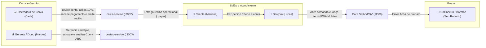
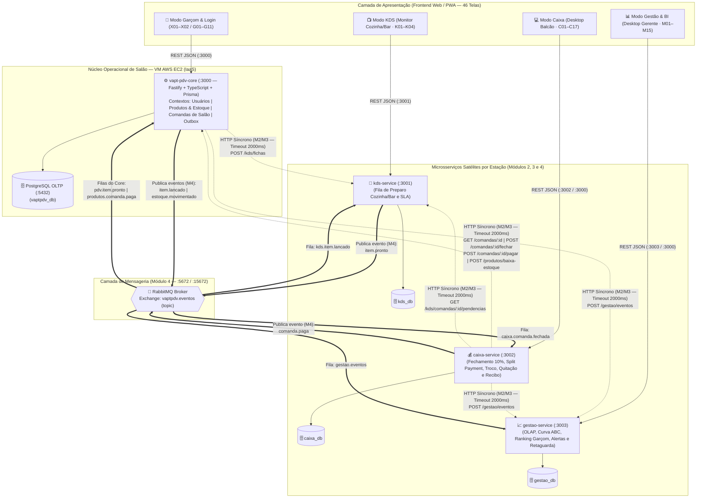
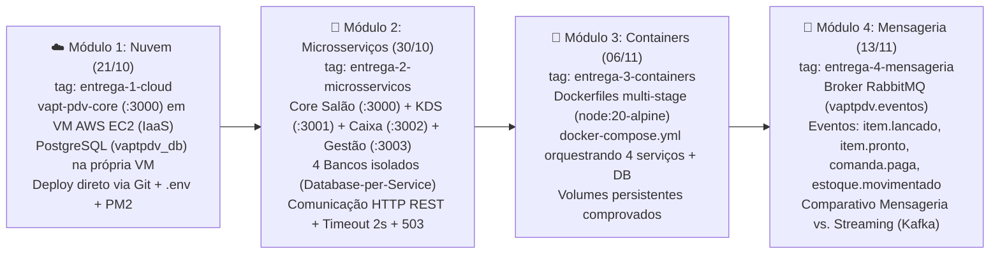

# 01 - Documento de Visão e Escopo do Sistema (PRD Parte 1)

| Metadado | Valor |
| :--- | :--- |
| **Projeto** | **VaptPDV** |
| **Data** | 04 de Novembro de 2026 |
| **Autores (Equipe)** | Kaio França e Mateus Neri |

---

## 1. Contexto de Negócio e Declaração do Problema

### 1.1 Cenário Atual de Pequenos Bares e Lanchonetes
Estabelecimentos gastronômicos de pequeno e médio porte — bares, botecos, espetinhos, hamburguerias e lanchonetes com equipes de **1 a 15 colaboradores** e operação de **até 30 mesas** — operam sob alta pressão em horários de pico (happy hour, finais de semana e dias de jogos). Na grande maioria desses negócios, o controle de consumo ainda é realizado por meio de **comandas de papel**, anotações informais em cadernos ou "conta de cabeça".

Esse modelo analógico e descentralizado gera gargalos operacionais severos e perdas financeiras recorrentes:

1. **Evasão de Receita por Esquecimento de Itens:** Na correria do salão, garçons esquecem de anotar cervejas, porções ou doses adicionais entregues rapidamente na mesa. Estima-se que estabelecimentos sem controle digital percam entre **5% e 12% do faturamento bruto** em itens consumidos e não cobrados.
2. **Erros de Soma, Divisão de Conta e Divergência de Preços:** No fechamento da conta, o operador de caixa soma os valores manualmente ou em calculadora comum, frequentemente aplicando preços desatualizados do cardápio, errando o cálculo da taxa de serviço opcional de 10% ou se perdendo ao dividir a conta entre vários amigos pagando em meios diferentes (dinheiro com troco, Pix e cartão).
3. **Conflitos na Cozinha e no Bar:** Pedidos gritados no balcão ou entregues em papéis rasgados/ilegíveis geram atrasos no preparo, pratos trocados entre mesas e ausência de visibilidade sobre o que está pendente (`em_preparo` vs. `pronto`).
4. **Ruptura Cega de Estoque:** O garçom vende um item no salão sem saber que a última unidade acabou de sair no bar, causando constrangimento perante o cliente e retrabalho no estorno do pedido.
5. **Lentidão e Filas no Caixa:** No momento de ir embora, o cliente enfrenta fila enquanto o caixa decifra a caligrafia do garçom, confere itens consumidos, calcula o troco e emite o comprovante.
6. **Cegueira Gerencial e Descontrole Operacional:** O proprietário ou gerente encerra o expediente sem saber quais produtos trazem maior margem (Curva ABC), qual garçom teve melhor desempenho e comissão de 10%, ou quais itens atingiram o estoque mínimo.

### 1.2 Matriz de Problema

| Elemento | Descrição |
| :--- | :--- |
| **O problema de** | Controle manual de consumo em comandas de papel, descoordenação entre salão, cozinha e caixa, erros de cálculo monetário/divisão de conta e falta de visibilidade de estoque e vendas |
| **Afeta** | Proprietários/gerentes, garçons, operadores de caixa, cozinheiros/barmen e clientes de bares, botecos e lanchonetes de pequeno e médio porte |
| **Cujo impacto é** | Perda direta de faturamento (itens não anotados ou somados incorretamente), filas no fechamento e divisão de conta, venda de produtos sem estoque, atraso na entrega de pratos/bebidas e impossibilidade de tomada de decisão baseada em dados |
| **Uma solução de sucesso seria** | O **VaptPDV**, uma plataforma distribuída composta por um **Núcleo de Salão/PDV (`vapt-pdv-core` `:3000`)** com interface Web/PWA responsiva e **3 Microsserviços Satélites** por estação operacional (**KDS `:3001`**, **Caixa `:3002`** e **Gestão/BI `:3003`**), garantindo precisão decimal exata, imutabilidade histórica de vendas e alta disponibilidade no salão mesmo sob falhas parciais |

---

## 2. Proposta de Valor, Métricas e Contra-Métricas de Sucesso

### 2.1 Proposta de Valor Única (UVP)
> *"Do pedido na mesa ao painel da cozinha, à divisão da conta no caixa e ao painel do gerente em segundos: o **VaptPDV** elimina a comanda de papel com uma arquitetura distribuída por estação de trabalho, garantindo que o atendimento no salão nunca pare, o preço nunca erre e o estoque nunca minta."*

### 2.2 Objetivos Estratégicos e Indicadores de Sucesso

| ID Objetivo | ID Métrica | Objetivo Estratégico | Métrica / Indicador de Sucesso (KPI) | Meta Alvo |
| :--- | :--- | :--- | :--- | :--- |
| **OBJ-01** | **SM-1** | **Agilidade no Salão** | Tempo de resposta (latência P95) para abertura de comanda e lançamento de item no Core Salão e número máximo de toques no smartphone | `< 1 segundo` (P95) e `≤ 3 toques` para lançar item em mesa aberta |
| **OBJ-02** | **SM-2** | **Integridade Financeira Absoluta** | Divergência de arredondamento em fechamentos, divisão de parcelas (split), troco ou alteração retroativa de valores em comandas lançadas/fechadas | `0 ocorrências` (uso de `Decimal(10,2)` exato, `round_half_up` e congelamento de `nome_copiado`/`preco_copiado` no lançamento) |
| **OBJ-03** | **SM-3** | **Controle Fiel de Estoque** | Precisão na baixa de estoque após o pagamento da comanda (sem duplicidade e sem baixa em cancelamentos) | `100% de idempotência` por `comanda_id` em `movimentos_estoque` |
| **OBJ-04** | **SM-4** | **Continuidade Operacional (Resiliência)** | Disponibilidade do fluxo crítico do garçom e do caixa caso um microsserviço satélite (`kds`, `caixa` ou `gestao`) sofra falha parcial | `100% de degradação graciosa` (timeout controlado `2000ms`, retorno HTTP `503` informativo em dependências obrigatórias ou fila assíncrona via RabbitMQ sem abortar vendas) |
| **OBJ-05** | **SM-5** | **Sincronia Salão–Cozinha–Caixa** | Tempo entre o lançamento do item pelo garçom e a exibição da ficha no `kds-service`, ou entre o pedido de conta (`G06`) e a chegada na fila do `caixa-service` (`C04`) | `< 2 segundos` via HTTP REST (M2/M3) ou eventos RabbitMQ (M4) |
| **OBJ-06** | **SM-6** | **Isolamento Analítico (OLTP vs. OLAP)** | Impacto de geração de relatórios gerenciais e Curva ABC sobre a latência do banco transacional do Core (`vaptpdv_db`) | `0% de sobrecarga` no banco OLTP (consultas analíticas isoladas no `gestao-service` sobre `gestao_db`) |

### 2.3 Contra-Métricas Inegociáveis

Para evitar que a otimização agressiva de uma métrica de velocidade ou conveniência degrade as garantias fundamentais de negócio e de engenharia distribuída, o **VaptPDV** estabelece quatro contra-métricas (guardrails arquiteturais) que nunca podem ser violadas:

| ID | Contra-Métrica (Guardrail de Produto e Arquitetura) | Regra de Proteção e Verificação |
| :--- | :--- | :--- |
| **SM-C1** | **Inviolabilidade Financeira e de Estoque sob Baixa Latência** | **Nunca** sacrificar a consistência financeira (`Decimal(10,2)`) ou pular a validação de disponibilidade de estoque (`produto.estoque >= quantidade`) em nome de reduzir latência de lançamento (`SM-1`). Toda mutação financeira e de reserva/baixa opera sob validação estrita no backend. |
| **SM-C2** | **Blindagem do Fluxo Crítico contra Falhas de Satélites** | **Nunca** bloquear, reverter (`ROLLBACK`) ou impedir o lançamento de pedido no Salão (`:3000`) nem o fechamento/pagamento da conta (`:3000` / `:3002`) por indisponibilidade ou lentidão dos microsserviços colaterais (`kds-service`, `gestao-service`). O atendimento da mesa e o recebimento financeiro no caixa têm prioridade operacional absoluta. |
| **SM-C3** | **Zero Atrito de Autenticação na Troca de Turno no Salão** | **Nunca** exigir autenticação complexa (digitação de senha alfanumérica longa, MFA/2FA ou fluxos OAuth externos) na seleção ou troca rápida de operador no salão (`X01`/`X02`) que aumente o tempo de atendimento ou ultrapasse o limite ergonômico de **3 toques** para lançar um item. |
| **SM-C4** | **Proibição de Queries Analíticas Pesadas no Banco OLTP** | **Nunca** executar queries analíticas pesadas (`GROUP BY` históricos, cálculo de Curva ABC, rankings multi-período ou relatórios gerenciais de fim de mês) diretamente sobre o banco transacional OLTP (`vaptpdv_db`). Toda carga analítica deve ser servida exclusivamente pelo `gestao-service` (`gestao_db`). |

---

## 3. Perfis de Usuário, Personas e Jobs To Be Done (JTBD)

O ecossistema **VaptPDV** foi desenhado em torno de cinco atores reais do cotidiano de um bar ou lanchonete:

### 3.1 Tabela Consolidada de Personas

| Persona | Perfil no Sistema | Dispositivo Principal | Dores Principais | O que espera do VaptPDV |
| :--- | :--- | :--- | :--- | :--- |
| **Lucas (24 anos)** — *Garçom de Salão* | `garcom` | Smartphone Android/iOS (uso com uma mão no salão, `390×844`) | Esquecer de anotar cerveja pedida no corredor; ir até a cozinha descobrir que o tira-gosto acabou; perder tempo procurando papel e caneta. | Interface rápida (Modo Garçom `G01`–`G11` no `:3000`), poucos toques para abrir mesa e lançar itens, bloqueio imediato se o produto estiver sem estoque e aviso instantâneo (`G10`) quando o prato fica `pronto`. |
| **Carla (29 anos)** — *Operadora de Caixa* | `caixa` | Tablet ou Desktop no balcão de saída (`1440×900`) | Fila de clientes querendo pagar e dividir a conta ao mesmo tempo; rasuras na comanda de papel; calcular 10% e troco manualmente; sistema travar na hora de cobrar. | Estação dedicada (Modo Caixa `C01`–`C17` no `caixa-service` `:3002`), fila clara de mesas com `Conta pedida` (`C04`), cálculo instantâneo de `subtotal`, `taxa_servico` (10%) e `total`, divisão de conta por pessoa/item (`C11`), cálculo de troco (`C07`) e emissão de recibo (`.paper` em `C12`). |
| **Seu Roberto (45 anos)** — *Cozinheiro / Barman* | `cozinha` (Operador do `kds-service`) | TV/Monitor ou Tablet fixado na parede da cozinha/bar (`1920×1080`, tema escuro) | Papel molhado ou letra ilegível; garçom cobrando pedido fora de ordem; não saber qual pedido chegou primeiro ou se há alergia grave. | Painel visual limpo (`K01`–`K04` em `/kds` no `kds-service` `:3001`) com fila cronológica de fichas (`recebido` $\rightarrow$ `em_preparo` $\rightarrow$ `pronto` $\rightarrow$ `entregue`), alerta de alergia em destaque, SLA visual e toque amplo (`72px`) para avançar status. |
| **Marcos (38 anos)** — *Gerente / Proprietário* | `gerente` | Notebook ou Desktop (`1440×900`) | Prejuízo invisível no fim do mês; produtos acabando sem aviso; reajuste de preço no cardápio alterando comandas abertas; relatórios lentos. | Estação executiva (`M01`–`M15` em `/gestao` no `gestao-service` `:3003`) com cadastro seguro de cardápio e equipe (sem exclusão física — `M02`, `M12`), congelamento do preço na venda, alertas de estoque mínimo (`M05`) e dashboard analítico (`M01`, `M09`–`M11`) em tempo real. |
| **Mariana (31 anos)** — *Cliente do Bar* | Consumidora | Atendimento presencial na mesa e balcão | Cobrança de item que não pediu; demora para fechar e dividir a conta entre amigos; erro no cálculo do troco ou dos 10%. | Conta transparente e detalhada com preços congelados no ato do pedido, opção ágil de dividir a conta em parcelas (`dinheiro`, `pix` ou `cartao`) e recibo operacional claro ao final do pagamento (`C12`). |

### 3.2 Jobs To Be Done (JTBD) por Ator e Dimensão

A análise **Jobs To Be Done (JTBD)** explicita as tarefas funcionais, operacionais, emocionais e gerenciais que cada usuário "contrata" o **VaptPDV** para resolver durante um turno real:

| Ator / Persona | Dimensão do Job | Declaração estruturada (*"Quando... Eu quero... Para que..."*) | Telas e Recursos Associados |
| :--- | :--- | :--- | :--- |
| **Lucas (`garcom`)** | **Funcional** | *Quando* um cliente me pede duas cervejas e uma porção com observação sem cebola enquanto estou de pé no corredor, *eu quero* selecionar a mesa e enviar o pedido para o bar e cozinha em até 3 toques com uma só mão, *para que* eu não esqueça de cobrar nenhum item e não precise ir até o balcão gritar o pedido. | `G01`, `G02`, `G03`, `G04`, `RF03`, `RF04` |
| **Lucas (`garcom`)** | **Operacional** | *Quando* a cozinha finaliza uma porção ou o cliente levanta a mão pedindo a conta, *eu quero* receber um alerta imediato no topo do celular e travar a comanda com um toque em "Pedir a conta", *para que* o prato chegue quente à mesa e o caixa já receba a pré-conta conferida na fila `C04 Receber`. | `G05`, `G06`, `G10`, `G11`, `RF06`, `RF20` |
| **Lucas (`garcom`)** | **Emocional** | *Quando* o bar está lotado na sexta-feira à noite, *eu quero* que o próprio aplicativo me impeça de lançar um produto esgotado (`Esgotado`), *para que* eu não passe constrangimento voltando à mesa para pedir desculpas ao cliente. | `G03`, `RF11`, `RF13`, `RN13` |
| **Carla (`caixa`)** | **Funcional** | *Quando* um grupo de amigos chega ao balcão para acertar a mesa, *eu quero* visualizar no `caixa-service` todas as comandas com status `Conta pedida`, alternar os 10% de serviço, dividir o total por pessoa ou por item e registrar pagamentos parciais em Pix, cartão e dinheiro com cálculo automático de troco, *para que* a fila ande rápido e sem erro de conta. | `C02`, `C04`, `C06`, `C07`, `C10`, `C11`, `C12`, `RF24`–`RF28` |
| **Carla (`caixa`)** | **Emocional / Operacional** | *Quando* o serviço da cozinha ou do painel analítico oscila no pico do movimento, *eu quero* que o fechamento e o recebimento da conta funcionem sem travar a tela do caixa, *para que* eu mantenha a calma sob pressão e nunca retenha clientes querendo ir embora. | `C06`, `C12`, `X03/X04`, `RF07`, `RF27`, `RN17`, `SM-C2` |
| **Seu Roberto (`cozinha`)** | **Funcional / Operacional** | *Quando* dezenas de pedidos chegam simultaneamente do salão e do balcão, *eu quero* enxergar a 3 metros de distância uma fila cronológica clara em fundo escuro, separada entre Cozinha e Bar, com destaque vermelho para alergias e cronômetro de SLA (`Dentro do prazo`, `Atenção`, `Atrasado`), *para que* eu produza na ordem certa e sem risco de contaminação alimentar. | `K01`, `K02`, `K03`, `K04`, `RF19`, `RF20`, `RF21`, `RN22` |
| **Marcos (`gerente`)** | **Gerencial / Estratégico** | *Quando* encerro a noite ou planejo as compras da semana, *eu quero* consultar no `gestao-service` o faturamento real por forma de pagamento, a Curva ABC (80/15/5) de produtos, as comissões de 10% de cada garçom e os alertas de estoque abaixo do mínimo sem deixar o sistema do salão/caixa lento, *para que* eu tome decisões baseadas em dados concretos e proteja a margem de lucro do bar. | `M01`, `M02`, `M05`, `M06`, `M09`, `M10`, `M11`, `RF29`–`RF33`, `SM-C4` |
| **Mariana (`cliente`)** | **Funcional / Emocional** | *Quando* pago minha conta após o happy hour com amigos, *eu quero* conferir cada item pelo preço exato que vi no cardápio, dividir nossa conta sem confusão e receber meu recibo detalhado na hora, *para que* eu confie na transparência do bar. | `C11`, `C12`, `RF04`, `RF26`–`RF28`, `RN04`, `RN19` |

---

## 4. Visão Geral do Ecossistema Tecnológico

A arquitetura do **VaptPDV** alinha diretamente as **quatro estações operacionais do estabelecimento** (Salão/Garçom, Cozinha/KDS, Balcão/Caixa e Retaguarda/Gestão) em **4 serviços distribuídos com bancos de dados isolados (`Database-per-Service`)**: um **Núcleo de Salão/PDV (`vapt-pdv-core` em `:3000`, `vaptpdv_db`)** que preserva 100% da entrega do Módulo 1 e **3 Microsserviços Satélites (`kds-service` `:3001`/`kds_db`, `caixa-service` `:3002`/`caixa_db`, `gestao-service` `:3003`/`gestao_db`)**.

### 4.1 Diagrama de Contexto e Topologia Distribuída

### 4.2 Papéis dos Componentes do Ecossistema

1. **Núcleo Operacional de Salão (`vapt-pdv-core` — Porta `:3000`, Banco `vaptpdv_db`):**
   - **Responsabilidade:** Coração transacional (OLTP) que preserva 100% da entrega do Módulo 1 (`entrega-1-cloud`) e sustenta toda a operação de Salão/Garçom (`/login` `X01–X02` e `/garcom` `G01–G11`), além do catálogo mestre de `Usuários`, `Produtos/Estoque` (`movimentos_estoque`) e `Comandas`.
   - **Domínios Internos Coesos com Fronteiras de Gateway:** Abertura de comanda em mesa livre (`POST /comandas`), lançamento/ajuste/remoção de itens com snapshot imutável (`nome_copiado`, `preco_copiado`), pedido de pré-conta pelo garçom (`POST /comandas/:id/fechar` em `G06`), rotas internas de fronteira (`GET /usuarios/:id/validar-garcom`, `GET /produtos/:id/disponibilidade`, `POST /produtos/baixa-estoque`) e tabela `outbox_eventos`. No Módulo 4, o consumidor interno da fila `produtos.comanda.paga` realiza a baixa assíncrona e idempotente de estoque dentro do próprio núcleo e publica `estoque.movimentado`.
2. **Microsserviço Satélite 1 — `kds-service` (Kitchen Display System — Porta `:3001`, Banco `kds_db`):**
   - **Responsabilidade:** Orquestra a produção da cozinha e do bar em tempo real (`K01–K04`). Recebe os itens lançados nas comandas e gerencia o ciclo de vida de preparo de cada ficha (`recebido` $\rightarrow$ `em_preparo` $\rightarrow$ `pronto` $\rightarrow$ `entregue` ou `cancelado`).
   - **Integração:** Expõe `POST /kds/fichas`, `GET /kds/fichas?setor=cozinha|bar&status=`, `PATCH /kds/fichas/:id/status` e `GET /kds/comandas/:comandaId/pendencias` (consultado antes do fechamento com timeout de `2000ms`). No Módulo 4, consome assincronamente `item.lancado` na fila `kds.item.lancado` e publica `item.pronto`.
3. **Microsserviço Satélite 2 — `caixa-service` (Fechamento, Divisão de Conta, Quitação e Recibos — Porta `:3002`, Banco `caixa_db`):**
   - **Responsabilidade:** Dedicado à estação de trabalho do Operador de Caixa (`C01–C17`). A comanda é aberta e recebe itens no Salão (`:3000`); quando a conta é pedida (`G06`/`C06`), o `caixa-service` (`:3002`) assume a fila de recebimento (`GET /caixa/comandas`, `GET /caixa/comandas/:comandaId`), o fechamento com conferência de pendências do KDS e taxa de serviço opcional de 10% (`POST /caixa/comandas/:comandaId/fechar`), a **divisão de conta / split payment por pessoa ou por item** (`POST /caixa/comandas/:comandaId/dividir` — `C11`), o registro de pagamentos parciais ou totais em `dinheiro` (com cálculo exato de `troco` — `C07`), `pix` (`C10`) e `cartao` (`POST /caixa/comandas/:comandaId/pagar`), e a emissão do **Recibo Operacional** (`.paper` de `C12` em `GET /caixa/recibos/:comandaId`).
   - **Integração:** Nos Módulos 2 e 3, coordena sincronicamente com o Core (`:3000`) a transição final e a baixa idempotente de estoque (`POST /produtos/baixa-estoque` com timeout de `2000ms`); no Módulo 4, publica o evento `comanda.paga` no RabbitMQ para disparo assíncrono da baixa de estoque (`produtos.comanda.paga`) e consolidação gerencial (`gestao.eventos`).
4. **Microsserviço Satélite 3 — `gestao-service` (Gestão Executiva, BI/OLAP e Retaguarda — Porta `:3003`, Banco `gestao_db`):**
   - **Responsabilidade:** Dedicado à estação de Gestão e BI do proprietário/gerente (`M01–M15`). Isola o processamento analítico pesado (OLAP / CQRS) do banco transacional do PDV (`vaptpdv_db`). Consolida resumo diário de faturamento (`GET /gestao/resumo-diario`, com alias compatível `/analytics/resumo-diario`), ranking de produtos mais vendidos e Curva ABC (`GET /gestao/ranking-produtos`), desempenho e comissões de 10% por garçom (`GET /gestao/desempenho-garcons`), alertas de estoque crítico (`GET /gestao/alertas-estoque`), exportação de dados (`GET /gestao/exportar` — `M15`), além de orquestrar as operações administrativas de Cardápio (`M02–M03`), Reposição de Estoque (`M05–M06`), Auditoria de Vendas (`M07`) e Equipe (`M12–M13`).
   - **Integração:** Recebe notificações de eventos via `POST /gestao/eventos` (Módulos 2–3) ou consome todos os eventos de domínio (`item.lancado`, `item.pronto`, `comanda.paga`, `estoque.movimentado`) na fila `gestao.eventos` do RabbitMQ (Módulo 4).

---

## 5. Alinhamento com os 4 Módulos de Sistemas Distribuídos

### 5.1 Evolução Arquitetural nos 4 Módulos Avaliativos

### 5.2 Matriz de Correlação Acadêmica e Entregáveis

| Módulo da Disciplina | Data da Prática | Tag Git Oficial | Como o Ecossistema VaptPDV Atende ao Módulo | Entregáveis Obrigatórios da Equipe |
| :--- | :--- | :--- | :--- | :--- |
| **Módulo 1: Computação em Nuvem (IaaS)** | **21/10/2026** | `entrega-1-cloud` | Implantação do **PDV Core (`vapt-pdv-core`)** (API REST completa + Frontend Web/PWA) em máquina virtual **AWS EC2 (Linux)**, com banco **PostgreSQL (`vaptpdv_db`) instalado diretamente na VM** (sem Docker neste módulo). Configuração 100% via variáveis de ambiente (`.env`) e processo gerenciado por `pm2`/`systemd`. | • Repositório Git com código e `README.md` contendo a URL pública na AWS EC2. • Roteiro de testes documentado (`curl`/Postman/prints) cobrindo o ciclo completo da comanda. • Vídeo curto (YouTube não listado) demonstrando a aplicação em nuvem. |
| **Módulo 2: Serviços / Microsserviços** | **30/10/2026** | `entrega-2-microsservicos` | Decomposição distribuída mantendo o **Core Salão/PDV** (`:3000`, `vaptpdv_db`) integrado a **3 microsserviços satélites independentes** (`kds-service` `:3001`/`kds_db`, `caixa-service` `:3002`/`caixa_db`, `gestao-service` `:3003`/`gestao_db`) via chamadas HTTP REST síncronas com **timeout de 2000ms**, degradação graciosa e tratamento padronizado de indisponibilidade (`503 SERVICO_INDISPONIVEL`). | • Repositório Git atualizado em estrutura de serviços. • Diagrama de arquitetura detalhando serviços, bancos isolados e direção das chamadas HTTP. • Demonstração de resiliência: queda de serviço satélite sem derrubar o PDV Core. |
| **Módulo 3: Containers e Orquestração** | **06/11/2026** | `entrega-3-containers` | Empacotamento de cada serviço (`vapt-pdv-core`, `kds-service`, `caixa-service`, `gestao-service`) em `Dockerfile` próprio otimizado (`node:20-alpine`), orquestrados com PostgreSQL via `docker-compose.yml`, redes internas, `healthcheck` e volumes nomeados. | • `Dockerfile` por serviço e `docker-compose.yml` funcional. • Comprovação prática de persistência de dados após `docker compose down` e `docker compose up`. • Análise comparativa no `README.md` (Deploy direto na VM vs. Containers) + vídeo demonstrativo. |
| **Módulo 4: Mensageria e Streaming** | **13/11/2026** | `entrega-4-mensageria` | Inclusão do broker **RabbitMQ** (`rabbitmq:3-management-alpine`) no Docker Compose. Ao registrar pagamento ou lançar item, os serviços publicam eventos (`comanda.paga`, `item.lancado`, `item.pronto`, `estoque.movimentado`), com processamento assíncrono e idempotente para baixa de estoque (`produtos.comanda.paga`), fila do KDS (`kds.item.lancado`) e consolidação de Gestão/BI (`gestao.eventos`). | • Código do produtor e consumidores com fila durável, `ack` manual, DLQ e idempotência por `comanda_id`/`item_comanda_id`. • Logs/prints da fila RabbitMQ processando mensagens. • Documento técnico comparando **Mensageria (RabbitMQ)** vs. **Streaming de Eventos (Apache Kafka / Redpanda)** aplicado ao VaptPDV. |

### 5.3 Análise de Trade-offs de Escopo e Arquitetura por Módulo (M1 a M4)

A evolução em quatro estágios impõe decisões conscientes de engenharia (*trade-offs*) para equilibrar complexidade operacional, consistência de dados e aderência aos requisitos acadêmicos:

| Módulo | Decisão Arquitetural Adotada | Benefício Conquistado (Ganho) | Custo / Trade-off Aceito | Como o Trade-off é Mitigado no Módulo Seguinte |
| :--- | :--- | :--- | :--- | :--- |
| **Módulo 1 (IaaS Monolito Modular)** | Manter `usuarios`, `produtos` e `comandas` no **`vapt-pdv-core` (`:3000`)** rodando diretamente na VM AWS EC2 sobre `vaptpdv_db`, isolados no código por interfaces (`GarcomGateway`, `EstoqueGateway`). | Simplicidade de deploy IaaS na EC2, transações ACID locais ultrarrápidas (`< 50ms`) e entrega completa do Módulo 1 com 143 testes automatizados. | Ausência de isolamento de processos por estação para KDS, Caixa e Gestão/BI. | As interfaces de Gateway e portas de serviço permitem extrair os 3 satélites no Módulo 2 sem quebrar nenhuma rota do Módulo 1. |
| **Módulo 2 (Core Salão + 3 Satélites HTTP: KDS, Caixa e Gestão)** | Desmembrar as estações em **`kds-service` (`:3001`/`kds_db`)**, **`caixa-service` (`:3002`/`caixa_db`)** e **`gestao-service` (`:3003`/`gestao_db`)**, mantendo o atendimento de salão e catálogo base no `vapt-pdv-core` (`:3000`/`vaptpdv_db`). | Alinhamento 1:1 com as 4 superfícies reais do produto (`/garcom`, `/kds`, `/caixa`, `/gestao`), isolamento *Database-per-Service* para os cálculos de split/troco/recibo do Caixa e OLAP da Gestão, e eliminação da complexidade periférica de fidelidade/cashback. | Acoplamento temporal nas chamadas HTTP síncronas entre Caixa (`:3002`) e Core (`:3000`) ou entre Core (`:3000`) e KDS (`:3001`). | Adoção de `AbortSignal.timeout(2000)` + degradação graciosa imediata no Módulo 2, e desacoplamento via filas duráveis do RabbitMQ no Módulo 4. |
| **Módulo 3 (Containers e Volumes)** | Empacotar os 4 serviços Node.js em imagens multi-stage `node:20-alpine` e orquestrá-los com PostgreSQL em um único `docker-compose.yml` com rede bridge e volumes nomeados. | Paridade absoluta entre o ambiente de desenvolvimento local e a VM AWS EC2; inicialização determinística com `depends_on: condition: service_healthy`. | Leve consumo adicional de memória RAM na instância EC2 devido a 4 processos Node.js isolados em containers. | Imagens enxutas Alpine sem `devDependencies` e ajuste de pool de conexões Prisma por container. |
| **Módulo 4 (Mensageria Assíncrona RabbitMQ)** | Migrar a baixa de estoque (`produtos.comanda.paga`), o envio ao KDS (`kds.item.lancado`), a notificação de prato pronto (`pdv.item.pronto`) e a ingestão OLAP (`gestao.eventos`) para o exchange tópico `vaptpdv.eventos` no RabbitMQ. | Desacoplamento temporal completo, absorção de picos de tráfego (*backpressure*), resposta imediata ao caixa e tolerância a quedas temporárias dos satélites sem perder nenhum evento. | Introdução de **consistência eventual** (atraso de milissegundos a poucos segundos entre o `200 OK` do pagamento e a atualização do estoque/BI) e possibilidade de reentrega (*at-least-once*). | Validação prévia de disponibilidade no lançamento (`RN13`) e chaves estritas de idempotência (`UNIQUE` por `comanda_id`, `item_comanda_id` e `evento_id`) em todos os consumidores. |

---

## 6. Limites do Escopo (In-Scope vs. Out-of-Scope)

Para garantir entregas pontuais dentro do cronograma da 3ª Unidade e manter a coesão arquitetural, o escopo do projeto é rigorosamente delimitado abaixo.

### 6.1 Dentro do Escopo (In-Scope por Camada e Serviço)

| Camada / Componente | Funcionalidades Incluídas no Escopo (`In-Scope`) |
| :--- | :--- |
| **Core Salão / PDV (`vapt-pdv-core` `:3000`, `vaptpdv_db`)** | • Autenticação Operacional (`/login` — `X01`/`X02`) com seleção rápida de colaborador e despacho imediato para a estação de trabalho correspondente (`/garcom`, `/caixa`, `/kds`, `/gestao`). • Operação completa do **Modo Garçom (`G01–G11`)**: mapa do salão, abertura de comanda em mesa livre vinculada a garçom ativo (`POST /comandas`), lançamento/ajuste/remoção de itens com **congelamento de nome e preço** (`nome_copiado`, `preco_copiado`), validação imediata de estoque e pedido de pré-conta (`POST /comandas/:id/fechar` em `G06` $\rightarrow$ `G11`). • Repositório mestre e rotas de fronteira de **Usuários** (`garcom`, `caixa`, `gerente`, `cozinha`) e **Produtos/Estoque** (`movimentos_estoque`, `GET /produtos/:id/disponibilidade`, `POST /produtos/baixa-estoque`), além de compatibilidade integral com as rotas do Módulo 1. |
| **Satélite 1: `kds-service` (`:3001`, `kds_db`)** | • Operação completa do **Modo KDS (`K01–K04`)** para Cozinha e Bar. • Recebimento de fichas de preparo por item lançado (`POST /kds/fichas` em M2/M3 ou fila `kds.item.lancado` em M4). • Máquina de estados de preparo: `recebido` $\rightarrow$ `em_preparo` $\rightarrow$ `pronto` $\rightarrow$ `entregue` (ou `cancelado`) via `PATCH /kds/fichas/:id/status`. • Listagem da fila por setor (`GET /kds/fichas?setor=cozinha\|bar&status=`) com SLA visual e endpoint de consulta de pendências por comanda (`GET /kds/comandas/:comandaId/pendencias`). • Publicação do evento `item.pronto` no Módulo 4 para aviso em tempo real ao garçom (`G10`). |
| **Satélite 2: `caixa-service` (`:3002`, `caixa_db`)** | • Operação completa do **Modo Caixa (`C01–C13`, `C15–C17`)** no balcão. • Fila de recebimento de comandas abertas e com `"Conta pedida"` (`GET /caixa/comandas`, `GET /caixa/comandas/:comandaId`). • Conferência e fechamento de conta com taxa de serviço opcional de 10% (`POST /caixa/comandas/:comandaId/fechar` — `C06`). • **Divisão de conta / Split Payment** por número de pessoas ou por itens selecionados (`POST /caixa/comandas/:comandaId/dividir` — `C11`). • Registro de pagamentos parciais e liquidação total (`POST /caixa/comandas/:comandaId/pagar`) em `dinheiro` (com cálculo automático e persistência de `valor_recebido` e `troco` — `C07`), `pix` (`C10`) e `cartao`, acionando a baixa idempotente de estoque e o evento `comanda.paga`. • Emissão e consulta do **Recibo Operacional** detalhado (`.paper` de `C12` em `GET /caixa/recibos/:comandaId`). |
| **Satélite 3: `gestao-service` (`:3003`, `gestao_db`)** | • Operação completa do **Modo Gestão e BI (`M01–M15`)**. • Ingestão idempotente de eventos operacionais (`POST /gestao/eventos` em M2/M3 e fila `gestao.eventos` em M4). • Relatório de resumo diário e faturamento por forma de pagamento (`GET /gestao/resumo-diario` / `/analytics/resumo-diario` — `M01`, `M09`). • Ranking de produtos mais vendidos e **Curva ABC** por volume e receita (`GET /gestao/ranking-produtos` — `M10`). • Métricas de desempenho e comissões de 10% por garçom (`GET /gestao/desempenho-garcons` — `M11`). • Painel de alertas de produtos abaixo do `estoque_minimo` (`GET /gestao/alertas-estoque` — `M05`) e exportação tabular (`GET /gestao/exportar` — `M15`). • Retaguarda administrativa de Cardápio (`M02–M03`), Reposição de Estoque (`M06`), Auditoria de Comandas (`M07`) e Equipe (`M12–M13`). |
| **Infraestrutura e Qualidade** | • Deploy IaaS na AWS EC2 + PostgreSQL local na VM (Módulo 1), comunicação REST resiliente entre os 4 serviços (Módulo 2), Docker Compose com volumes (Módulo 3) e RabbitMQ (Módulo 4). • Health check (`GET /health`), documentação OpenAPI/Swagger (`GET /docs`) e logs estruturados em todos os 4 serviços. |

### 6.2 Fora do Escopo (Out-of-Scope / Non-Goals)

Os itens abaixo estão **explicitamente excluídos** do escopo de backend da v1 para manter o foco arquitetural nas 4 estações principais do restaurante e em Sistemas Distribuídos (quando exibidos na UI, aparecem desabilitados com motivo claro conforme `DESIGN.md` §15):

1. **Programa de Fidelidade, Clube de Pontos e Cashback (`C14 Cliente e fidelidade`):** O cadastro de clientes por CPF, acúmulo/resgate de pontos e cálculo de cashback estão **fora do escopo da v1**. Não há microsserviço de fidelidade; a prancha `C14` permanece apenas no catálogo visual como referência de *future goal* fora da v1 (assim como `M14 Fiscal`).
2. **Integração Bancária Real e Gateways de Pagamento:** O `caixa-service` registra a modalidade de pagamento (`dinheiro`, `pix`, `cartao`) e calcula parcelas e troco, mas **não** se conecta a adquirentes de maquininhas (TEF/Stone/Cielo) nem liquida QR Codes Pix em instituições financeiras reais (o QR Code exibido em `C10` é demonstrativo para o fluxo operacional).
3. **Emissão Fiscal Eletrônica (NFC-e / SAT / CF-e — `M14 Fiscal`):** Não haverá integração com a SEFAZ, assinatura digital via certificado A1/A3 ou cálculo de tributos (ICMS, PIS, COFINS). O recibo gerado pelo `caixa-service` (`GET /caixa/recibos/:comandaId` em `C12`) tem caráter exclusivamente operacional/comprovante simples de consumo.
4. **Mesa Reservada, Desconto Manual e Transferência entre Mesas:** As mesas operam estritamente nos estados derivados das comandas (`Livre`, `Aberta`, `Conta pedida`). Botões como "Transferir mesa" ou "Desconto" aparecem desabilitados com a explicação *"disponível em breve"*.
5. **Fila Offline de Vendas no Navegador:** Conforme `DESIGN.md` §9 e §15, quando não há conexão com a API (`Sem conexão`), as ações de escrita ficam desabilitadas com aviso explícito; não há enfileiramento local offline de comandas para sincronização posterior.
6. **Marketplaces de Delivery e Logística de Entregadores:** Integrações com iFood, Rappi, roteirização de motoboys e controle de taxa de entrega estão fora do escopo (o foco é o atendimento presencial em mesas e balcão).
7. **Ficha Técnica de Insumos Compostos (Receituário Industrial):** A baixa de estoque ocorre por unidade inteira do produto vendido no cardápio (ex.: `-1 Porção de Batata`, `-2 Chopp Pilsen 500ml`), não havendo decomposição fracionada em gramas de matéria-prima.
8. **Orquestração em Kubernetes (K8s) ou Operação Multi-tenant SaaS:** A orquestração de containers exigida pela disciplina utiliza **Docker Compose**, atendendo a um único estabelecimento comercial por deploy.

---

## 7. Matriz de Riscos de Produto e Mitigações

| ID | Risco Identificado | Categoria | Probabilidade | Impacto | Estratégia de Prevenção e Mitigação Arquitetural |
| :--- | :--- | :---: | :---: | :---: | :--- |
| **RSK-01** | **Condição de corrida (*Race Condition*) na abertura simultânea da mesma mesa por dois garçons** | Concorrência / Dados | Média | Alto | Além da verificação na regra de negócio (`RN07`), o PostgreSQL possui o índice único parcial `CREATE UNIQUE INDEX comandas_mesa_aberta_idx ON comandas (mesa) WHERE status = 'aberta'`, garantindo atomicidade no nível do SGBD e retorno imediato de `409 MESA_OCUPADA`. |
| **RSK-02** | **Indisponibilidade de microsserviço satélite (`kds-service` ou `gestao-service`) travar o lançamento no Salão ou o recebimento no Caixa** | Resiliência Distribuída | Média | Crítico | Aplicação estrita de `AbortSignal.timeout(2000)` em chamadas HTTP síncronas (M2/M3) com bloco `try/catch` não-bloqueante para efeitos colaterais (`RN17` / `SM-C2`, gravando `integracao_pendente = true` e `avisos`) e desacoplamento via filas duráveis do RabbitMQ no Módulo 4. |
| **RSK-03** | **Duplicidade de baixa de estoque ou de consolidação gerencial em caso de reentrega de mensagem (*redelivery*) pelo RabbitMQ** | Consistência Assíncrona | Alta (em falhas de rede) | Crítico | Consumidores idempotentes (`RN18`): a tabela `movimentos_estoque` valida unicidade por `(comanda_id, produto_id, motivo='venda_comanda')`, o `caixa-service` garante unicidade de quitação/recibo por `comanda_id` e o `gestao-service` desduplica por `evento_id`/`comanda_id` antes de enviar `basic.ack`. |
| **RSK-04** | **Divergência de centavos na divisão de conta (split payment), cálculo de troco, soma de itens ou taxa de 10%** | Integridade Financeira | Baixa | Alto | Proibição total de `Float` no banco e de aritmética binária livre (`RN15` / `SM-C1`). Uso obrigatório de `DECIMAL(10,2)` no PostgreSQL, `Prisma.Decimal` no backend e função determinística `round_half_up`, garantindo que a soma das parcelas no `caixa-service` feche exatamente com o `total` da comanda (`RN19`). |
| **RSK-05** | **Alteração de preço de produto no cardápio durante o expediente afetar mesas que já consumiram o item** | Regra de Domínio | Média | Alto | Snapshot imutável no lançamento (`RN04`): `POST /comandas/:id/itens` copia `nome_copiado` e `preco_copiado` na tabela `itens_comanda`. O fechamento no Core e no `caixa-service` calcula o subtotal exclusivamente sobre `preco_copiado`. |
| **RSK-06** | **Perda de dados dos 4 bancos de dados ao recriar ou reiniciar containers no Módulo 3** | Infraestrutura / Containers | Média | Crítico | Mapeamento obrigatório de volumes nomeados persistentes (`pgdata:/var/lib/postgresql/data` e `rabbitmq_data:/var/lib/rabbitmq`) no `docker-compose.yml`, validado por roteiro de teste `docker compose down && docker compose up -d`. |
| **RSK-07** | **Consultas pesadas de relatórios do gerente degradarem a velocidade do garçom ou do caixa no horário de pico** | Performance (OLTP vs. OLAP) | Média | Alto | Segregação CQRS (`RN21` / `SM-C4`): o painel de Gestão (`M01`, `M09`–`M11`) consulta exclusivamente o `gestao-service` (`:3003` / `gestao_db`), mantendo os bancos `vaptpdv_db` e `caixa_db` 100% dedicados à operação transacional. |
