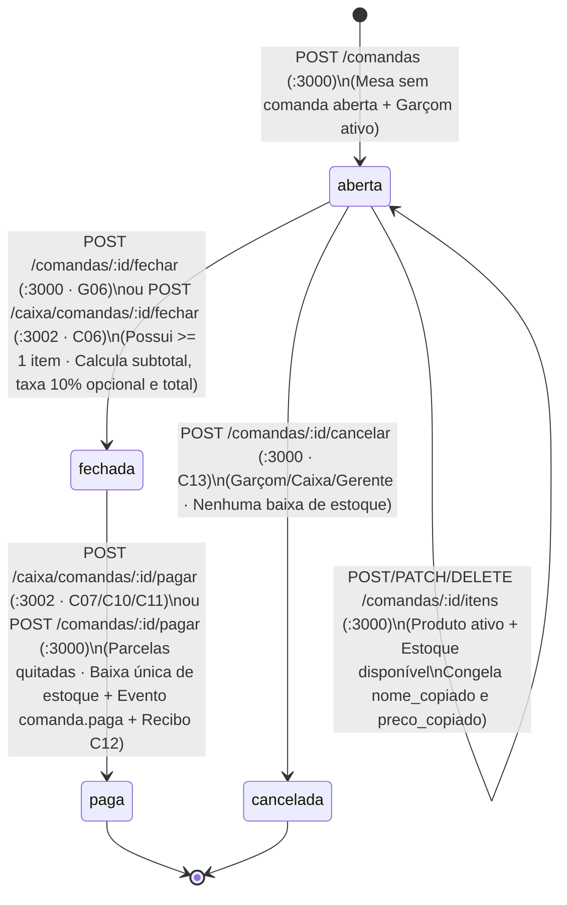
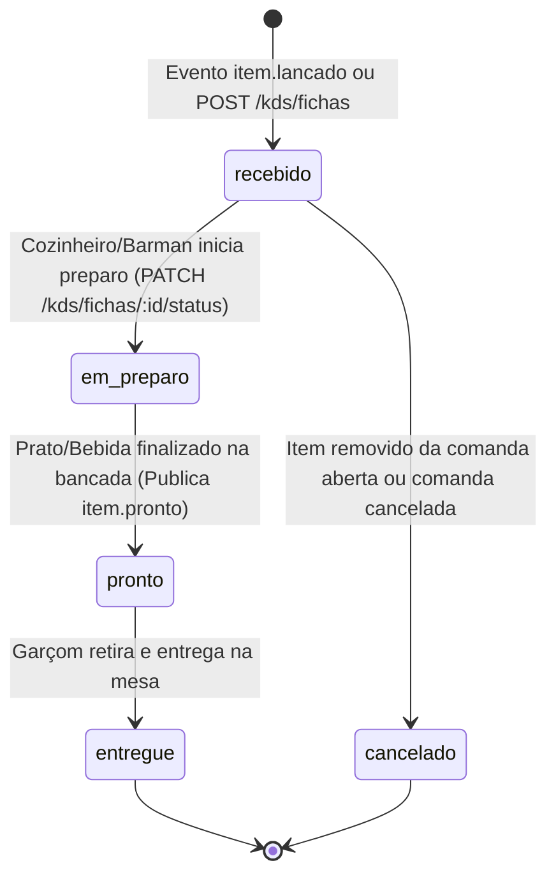
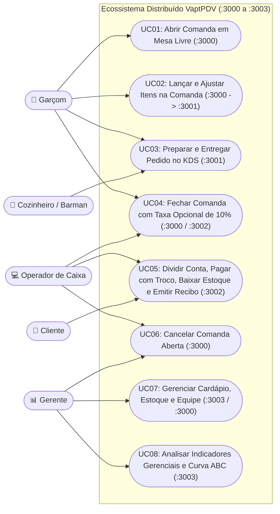

# 02 - Especificação de Requisitos de Software

| Metadado | Valor |
| :--- | :--- |
| **Projeto** | **VaptPDV** |
| **Data** | 04 de Novembro de 2026 |
| **Equipe de Desenvolvimento** | Kaio França e Mateus Neri |

---

## 1. Introdução

### 1.1 Propósito deste Documento
Esta Especificação de Requisitos de Software (**SRS**) define, de maneira completa, verificável e rastreável, o Catálogo de Jornadas do Usuário (**UJ-01 a UJ-10**), os Requisitos Funcionais (**RF01 a RF34**), o Catálogo de Regras de Negócio (**RN01 a RN24**), os Requisitos Não Funcionais (**RNF01 a RNF12**) e os Casos de Uso Detalhados (**UC01 a UC08**) do sistema **VaptPDV**. Este documento serve como contrato técnico definitivo para implementação, testes automatizados, validação acadêmica nos 4 módulos de Sistemas Distribuídos e operação em nuvem AWS EC2.

### 1.2 Convenções, Acrônimos e Definições
- **Core Salão / PDV (`vapt-pdv-core`):** Núcleo transacional coeso do sistema (Frontend Web/PWA + Backend Fastify/TypeScript + Prisma + PostgreSQL em `:3000`, banco `vaptpdv_db`) que preserva 100% da entrega do Módulo 1 e, a partir do Módulo 2, sustenta o atendimento de Salão/Garçom (`/login` `X01–X02`, `/garcom` `G01–G11`), abertura e lançamento de comandas, catálogo base (`Usuários`, `Produtos/Estoque`, `movimentos_estoque`) e `outbox_eventos`, desacoplados internamente por interfaces de Gateway (`GarcomGateway` e `EstoqueGateway`).
- **KDS (`kds-service`):** *Kitchen Display System* (`:3001`, banco `kds_db`) — Microsserviço satélite responsável pela fila de preparo da cozinha e do bar (`K01–K04`).
- **Caixa (`caixa-service`):** Microsserviço satélite (`:3002`, banco `caixa_db`) responsável pela estação do Operador de Caixa (`C01–C17`, exceto `C14` fora da v1): fila de recebimento de contas pedidas, fechamento com taxa opcional de 10%, divisão de conta (*split payment* por pessoa ou por item), registro de pagamentos parciais/totais em `dinheiro` (com cálculo de `troco`), `pix` e `cartao`, emissão de recibo operacional (`.paper`) e disparo da baixa de estoque e do evento `comanda.paga`.
- **Gestão e BI (`gestao-service`):** Microsserviço satélite (`:3003`, banco `gestao_db`) responsável pela estação executiva do Gerente (`M01–M15`): consolidação analítica (OLAP / CQRS), resumo diário de faturamento, Curva ABC de produtos (80/15/5), desempenho e comissões de 10% por garçom, alertas de estoque mínimo, exportação de relatórios e orquestração da retaguarda administrativa (Cardápio, Estoque, Vendas e Equipe).
- **RabbitMQ (`vaptpdv.eventos`):** Message Broker AMQP 0-9-1 (`:5672` AMQP / `:15672` Management) responsável pelo barramento assíncrono dos eventos `item.lancado`, `item.pronto`, `comanda.paga` e `estoque.movimentado`.
- **OLTP (*Online Transaction Processing*):** Processamento transacional de baixa latência executado nos bancos `vaptpdv_db` e `caixa_db`.
- **OLAP (*Online Analytical Processing*):** Processamento analítico desacoplado executado no banco `gestao_db` do `gestao-service`.
- **Prioridades (MoSCoW):**
  - **Essencial (Must Have):** Indispensável para o funcionamento operacional do módulo correspondente.
  - **Importante (Should Have):** Agrega alto valor operacional e arquitetural nos módulos distribuídos.
  - **Desejável (Could Have):** Refinamento de experiência e visualização complementar.

---

## 2. Descrição Geral do Sistema, Máquinas de Estados e Jornadas do Usuário

### 2.1 Máquina de Estados da Comanda (`vapt-pdv-core` `:3000` $\leftrightarrow$ `caixa-service` `:3002`)
A entidade central do sistema é a **Comanda**. Ela nasce aberta no Core Salão (`:3000`) e é encerrada/liquidada em coordenação com o `caixa-service` (`:3002`):

### 2.2 Máquina de Estados da Ficha de Preparo (`kds-service` `:3001`)
Cada item lançado em uma comanda gera uma ficha de preparo no **KDS** com o seguinte ciclo de vida:

---

### 2.3 Catálogo de Jornadas do Usuário (`UJ-01` a `UJ-10` — Padrão BMad v7)

As 10 jornadas abaixo mapeiam a experiência ponta a ponta dos operadores e clientes nas 46 telas do sistema (`X01..M15`), vinculando cada passo às rotas de API dos 4 serviços (`:3000` a `:3003`) e regras de negócio.

#### `UJ-01` — Login Operacional e Troca Rápida de Turno sem Senha
- **Persona e Contexto:** Lucas (`garcom`), Carla (`caixa`), Seu Roberto (`cozinha`) ou Marcos (`gerente`) iniciando ou alternando o turno em terminal compartilhado ou smartphone.
- **Estado de Entrada:** Operador não autenticado na sessão ou outro colega logado no mesmo aparelho.
- **Fluxo Passo a Passo:**
  1. O usuário acessa `/login` (`X01 Login` no desktop ou `X01 Login (celular)` no smartphone), que carrega `GET /usuarios?ativo=true` no `:3000`.
  2. O sistema destaca o card com badge `"Último acesso"` e agrupa os operadores ativos por perfil (`garcom`, `caixa`, `cozinha`, `gerente`).
  3. O usuário toca no seu card; o frontend grava a sessão em `useAppStore` / `localStorage` e redireciona instantaneamente para a estação correspondente: `/garcom` (`G01` no `:3000`), `/caixa` (`C01` integrado ao `caixa-service` `:3002`), `/kds` (`K01` no `kds-service` `:3001`, forçando tema escuro) ou `/gestao` (`M01` no `gestao-service` `:3003`).
  4. Durante o expediente, para revezar o aparelho sem perder contexto, o operador aciona `"Trocar operador"` (`X02`), seleciona o colega via radio button e confirma.
- **Clímax de Valor:** Entrada na estação de trabalho em **1 toque (< 1s)** sem digitação de senha.
- **Resolução:** Sessão ativa identificada pelo avatar nas barras de navegação; comandas já abertas permanecem vinculadas ao `garcom_id` que as abriu.
- **Casos de Borda:** Operador inativado (`ativo = false`) deixa de aparecer na lista; se não houver conexão com a API, exibe banner de erro (`X03/X04`) com botão `"Tentar de novo"`.
- **Rastreabilidade:** `RF02`, `RF34`, `RN08`, `RN23`, `SM-C3`.

#### `UJ-02` — Abertura de Mesa e Lançamento Ágil de Pedido pelo Garçom (Salão PWA `:3000`)
- **Persona e Contexto:** Lucas (`garcom`) em pé no salão com smartphone (`390×844`), atendendo clientes que acabaram de sentar na Mesa 12.
- **Estado de Entrada:** Tela `G01 Salão` aberta exibindo a Mesa 12 com `StatusPill` `"Livre"` e borda tracejada.
- **Fluxo Passo a Passo:**
  1. Lucas toca no card da Mesa 12 (ou no FAB `+ Abrir mesa`), abrindo o bottom sheet `G02 Abrir mesa`.
  2. Lucas informa o número de pessoas, opcionalmente o `nome_cliente` (`"Mariana Costa"`) e toca em `"Abrir mesa"`, disparando `POST /comandas` (`201 Created`) no `vapt-pdv-core` (`:3000`).
  3. O app abre `G03 Comanda`, carregando `GET /produtos?ativo=true` com `ProductTile` tintados por categoria.
  4. Lucas seleciona `2× Chopp Pilsen 500ml` e `1× Porção de Batata`, abre o sheet `G04 Observação e alergia` para anotar `"Sem cebola"` e toca no botão primário Mostarda `"Enviar ao preparo"`.
  5. O frontend envia `POST /comandas/:id/itens`, que congela `nome_copiado` e `preco_copiado` em `vaptpdv_db` e aciona o `kds-service` (`POST /kds/fichas` em M2/M3 ou evento `item.lancado` em M4).
- **Clímax de Valor:** Pedido validado contra o estoque e despachado para cozinha/bar em até 3 toques no celular.
- **Resolução:** Transição para `G05 Itens enviados` mostrando os itens com status `"Na fila"` (`recebido`) e o subtotal parcial.
- **Casos de Borda:** Se outro garçom abriu a Mesa 12 um segundo antes, a API retorna `409 MESA_OCUPADA` (`RN07`) e o app atualiza a grade do salão; se um produto esgotou, exibe `409 ESTOQUE_INSUFICIENTE` em toast no topo (`X04`).
- **Rastreabilidade:** `RF03`, `RF04`, `RF11`, `RF13`, `RF15`, `RN01`, `RN04`, `RN06`, `RN07`, `RN08`, `RN09`, `RN13`.

#### `UJ-03` — Produção na Cozinha/Bar (`kds-service` `:3001`) e Aviso de Item Pronto ao Garçom
- **Persona e Contexto:** Seu Roberto (`cozinha`) diante da TV `1920×1080` (`K01 Painel de cozinha e bar`) e Lucas (`garcom`) circulando no salão.
- **Estado de Entrada:** Ficha recém-criada na coluna `"Novos"` com status `recebido` e faixa lateral de SLA verde (`Dentro do prazo`, ref. `K02`).
- **Fluxo Passo a Passo:**
  1. O ticket entra em `K01` com um pulso único de borda. Seu Roberto lê a quantidade (`2×`), o item e o alerta de observação/alergia a 3 metros de distância.
  2. Seu Roberto toca no botão de `72px` `"Iniciar preparo"`: o frontend chama `PATCH /kds/fichas/:id/status` com `{"status": "em_preparo"}`, gravando `iniciado_em`.
  3. Ao concluir o prato, Seu Roberto toca em `"Marcar como pronto"`: a API grava `status = "pronto"` e `pronto_em`, e no Módulo 4 publica o evento `item.pronto` no RabbitMQ.
  4. No smartphone de Lucas (`G01 Salão`), surge no topo o toast persistente `G10 Aviso de item pronto` indicando a mesa e o prato.
  5. Lucas retira o prato no balcão, entrega na mesa e toca em `"Marcar como entregue"` em `G08 Cozinha` (ou `K01`), avançando a ficha para `"entregue"`.
- **Clímax de Valor:** Sincronia instantânea entre bancada de preparo e salão sem gritos nem comandas de papel.
- **Resolução:** Ficha arquivada como `entregue` e SLA de preparo contabilizado no `gestao-service`.
- **Casos de Borda:** Se o ticket ultrapassar o tempo limite configurável em `K03 Ajustes do KDS`, a faixa lateral muda para amarelo (`Atenção`) e vermelho (`Atrasado` — `K02`).
- **Rastreabilidade:** `RF19`, `RF20`, `RF21`, `RN18`, `RN20`, `RN22`.

#### `UJ-04` — Solicitação de Conta pelo Garçom no Salão ("Pedir a conta" $\rightarrow$ Fila do Caixa)
- **Persona e Contexto:** Lucas (`garcom`) atendendo o cliente que pediu a conta diretamente na mesa.
- **Estado de Entrada:** Comanda `aberta` com itens consumidos em `G05 Itens enviados`.
- **Fluxo Passo a Passo:**
  1. Em `G05 Itens enviados`, Lucas toca no botão secundário `"Pedir a conta"`, abrindo a tela `G06 Pedir a conta`.
  2. Lucas revisa os itens com o cliente, confirma se a `Gorjeta 10%` (`aplicar_taxa_servico`) será mantida e toca em `"Confirmar e avisar o caixa"`.
  3. O app executa `POST /comandas/:id/fechar`, que calcula no backend `subtotal`, `taxa_servico` e `total` e transita a comanda para `status = "fechada"`.
  4. O smartphone do garçom exibe `G11 Conta aguardando` (modo somente leitura, bloqueado para novos itens), o mapa do salão (`G01` e `C02`) passa a destacar o card da mesa com borda `2px solid danger` (`#C4391D`) e `StatusPill` `"Conta pedida"`, e a comanda entra automaticamente na fila prioritária do `caixa-service` (`GET /caixa/comandas` em `C04 Receber`).
- **Clímax de Valor:** O caixa recebe a conta pronta e conferida na fila `C04 Receber` no exato segundo em que o cliente pede na mesa.
- **Resolução:** Comanda aguardando exclusivamente a liquidação financeira no `caixa-service` (`:3002`).
- **Casos de Borda:** Se a comanda não tiver nenhum item lançado, o botão fica desabilitado com motivo e a API rejeita com `409 COMANDA_SEM_ITENS` (`RN11`).
- **Rastreabilidade:** `RF06`, `RF14`, `RF24`, `RN01`, `RN05`, `RN07`, `RN11`, `RN12`.

#### `UJ-05` — Conferência e Fechamento Direto de Conta no Balcão pelo Caixa (`caixa-service` `:3002`)
- **Persona e Contexto:** Carla (`caixa`) operando o terminal desktop `1440×900` (`C01`–`C06`).
- **Estado de Entrada:** Comanda listada em `C04 Receber` (já `fechada` pelo garçom como `"Conta pedida"`) ou selecionada ainda `aberta` em `C02 Mesas` / `C03 Pedidos` / `C05 Detalhe da comanda`.
- **Fluxo Passo a Passo:**
  1. Carla seleciona a comanda na fila do caixa (`GET /caixa/comandas` / `GET /caixa/comandas/:comandaId`), abrindo o drawer `C05 Detalhe da comanda` e em seguida `C06 Fechar conta`.
  2. Ao abrir `C06`, o `caixa-service` consulta `GET /kds/comandas/:comandaId/pendencias` (`:3001`, timeout `2000ms`) para alertar Carla caso ainda exista algum prato em preparo na cozinha.
  3. Carla confirma com o cliente a aplicação da `Gorjeta 10%` (`POST /caixa/comandas/:comandaId/fechar` com `{ aplicar_taxa_servico: true | false }`), fixando os valores definitivos de `subtotal`, `taxa_servico` e `total` em `caixa_db` e `vaptpdv_db`.
- **Clímax de Valor:** Visão consolidada da conta com checagem preventiva da cozinha e recálculo instantâneo da taxa de 10%.
- **Resolução:** Sessão de caixa aberta em `caixa_db` com `saldo_restante = total`, pronta para pagamento único ou dividido.
- **Casos de Borda:** Se o `kds-service` estiver temporariamente indisponível (`503`), o fechamento prossegue normalmente exibindo apenas aviso de que a checagem da cozinha foi ignorada (`RN17` / `SM-C2`).
- **Rastreabilidade:** `RF06`, `RF14`, `RF22`, `RF24`, `RF25`, `RN01`, `RN05`, `RN11`, `RN12`, `RN17`.

#### `UJ-06` — Divisão de Conta (Split Payment), Cálculo de Troco, Quitação e Recibo Operacional (`caixa-service` `:3002`)
- **Persona e Contexto:** Mariana (`cliente`) e dois amigos acertando a Mesa 12 no balcão com Carla (`caixa`) nas telas `C06`, `C07`, `C10`, `C11` e `C12`.
- **Estado de Entrada:** Comanda `fechada` em `C06 Fechar conta` com `total = "144.98"` e `saldo_restante = "144.98"`.
- **Fluxo Passo a Passo:**
  1. O grupo pede para dividir a conta. Carla clica em `"Dividir a conta"`, abrindo `C11 Dividir a conta`.
  2. Carla escolhe dividir por número de pessoas (`3 pessoas`) ou por itens selecionados, acionando `POST /caixa/comandas/:comandaId/dividir`, que calcula as cotas exatas em `Decimal(10,2)` ajustando eventual centavo residual na última parcela (`RN15`, `RN19`).
  3. **Parcela 1 (Dinheiro com Troco — `C07`):** O primeiro amigo entrega uma nota de `R$ 100,00` para pagar sua parte de `R$ 60,00`. Em `C07 Pagamento (dinheiro)`, Carla clica no chip `R$ 100`: o sistema calcula automaticamente `troco = "40.00"` e registra `POST /caixa/comandas/:comandaId/pagar` (`{ forma_pagamento: "dinheiro", valor: "60.00", valor_recebido: "100.00" }`), atualizando a barra de progresso para `"Já pago: R$ 60,00 · Falta pagar: R$ 84,98"`.
  4. **Parcela 2 (Pix / Cartão — `C10`):** Mariana paga o saldo restante (`R$ 84,98`) via Pix (`C10 Pagamento (Pix)`). Carla confirma `POST /caixa/comandas/:comandaId/pagar` (`{ forma_pagamento: "pix", valor: "84.98" }`).
  5. Como o `saldo_restante` chegou a `"0.00"`, o `caixa-service` liquida a comanda (`status = "paga"`), aciona a baixa única e idempotente de estoque (`POST /produtos/baixa-estoque` em M2/M3 ou evento `comanda.paga` em M4) e gera o **Recibo Operacional** (`GET /caixa/recibos/:comandaId`).
  6. A tela `C12 Venda concluída` exibe o recibo `.paper` em fundo branco fixo com todos os itens, parcelas pagas, troco devolvido e código de autenticação operacional pronto para impressão.
- **Clímax de Valor:** Divisão de conta multi-meios (dinheiro com troco + Pix + cartão) sem calculadora manual, com erro zero de centavos e liberação imediata da mesa.
- **Resolução:** Comanda liquidada (`paga`), estoque baixado uma única vez, recibo emitido em `caixa_db` e mesa liberada (`Livre`) no salão.
- **Casos de Borda:** Tentativa de registrar `valor_recebido < valor` em dinheiro é rejeitada com `400 VALIDACAO`; se `gestao-service` estiver fora do ar, a venda é concluída normalmente (`RN17` / `SM-C2`).
- **Rastreabilidade:** `RF07`, `RF12`, `RF26`, `RF27`, `RF28`, `RN02`, `RN03`, `RN10`, `RN15`, `RN17`, `RN18`, `RN19`, `RN24`.

#### `UJ-07` — Cancelamento Seguro de Comanda Aberta com Dupla Confirmação
- **Persona e Contexto:** Carla (`caixa`) ou Marcos (`gerente`) cancelando uma comanda aberta por desistência do cliente ou abertura acidental de mesa.
- **Estado de Entrada:** Comanda com `status = "aberta"` visualizada em `C05 Detalhe da comanda`.
- **Fluxo Passo a Passo:**
  1. O operador clica no botão destrutivo `"Cancelar comanda"`, abrindo o modal `C13 Cancelar comanda` (`ConfirmDialog`).
  2. O modal exibe aviso claro caso já existam itens enviados ao preparo na cozinha, solicita a seleção do motivo (radio) e exige a digitação da frase de confirmação `"cancelar comanda"` (`DESIGN.md` §16) para habilitar o botão destrutivo sólido.
  3. Ao confirmar, o frontend chama `POST /comandas/:id/cancelar` (`200 OK`).
  4. A comanda transita para `cancelada` sem deduzir nenhuma unidade do estoque (`RN10`), e eventuais fichas pendentes no KDS são marcadas como `cancelado`.
- **Clímax de Valor:** Prevenção contra cancelamentos acidentais combinada com liberação imediata da mesa e preservação total do estoque.
- **Resolução:** Comanda imutável em estado `cancelada`; mesa liberada.
- **Casos de Borda:** Tentativa de cancelar comanda já `fechada` ou `paga` é bloqueada na UI e rejeitada pela API com `409 COMANDA_NAO_ABERTA` / `409 COMANDA_IMUTAVEL` (`RN01`, `RN03`).
- **Rastreabilidade:** `RF08`, `RF23`, `RN01`, `RN03`, `RN07`, `RN10`.

#### `UJ-08` — Gestão de Cardápio, Reajuste de Preço com Snapshot e Inativação Lógica
- **Persona e Contexto:** Marcos (`gerente`) atualizando preços e disponibilidade do cardápio em `M02 Cardápio` e `M03 Produto`.
- **Estado de Entrada:** Marcos autenticado no módulo de Gestão (`/gestao`).
- **Fluxo Passo a Passo:**
  1. Em `M02 Cardápio`, Marcos visualiza todos os produtos com chips de categoria e switches de status ativo.
  2. Ele clica em `"Novo produto"` (ou edita um existente) abrindo `M03 Produto`, preenche `nome`, `categoria`, `preco` (`"16.50"`), `estoque` e `estoque_minimo`, e salva (`POST /produtos` ou `PATCH /produtos/:id`).
  3. Mesmo que Marcos reajuste o preço do Chopp de `"14.90"` para `"16.50"` com o bar aberto, todas as mesas que já haviam lançado o item continuam com `preco_copiado = "14.90"` (`RN04`).
  4. Para retirar um item fora de linha, Marcos desliga o switch em `M02` (confirmando no `ConfirmDialog` `X05`), acionando `POST /produtos/:id/inativar` (`ativo = false`, `RN14`).
- **Clímax de Valor:** Atualização imediata do cardápio no salão sem jamais corromper o valor de comandas em andamento ou o histórico de vendas.
- **Resolução:** Produto atualizado ou inativado logicamente em `vaptpdv_db`.
- **Casos de Borda:** Tentativa de lançar produto recém-inativado em um celular com cache antigo é barrada pelo backend com `422 PRODUTO_INATIVO` (`RN06`).
- **Rastreabilidade:** `RF01`, `RF11`, `RN04`, `RN06`, `RN14`, `RN15`.

#### `UJ-09` — Monitoramento de Alertas de Ruptura e Reposição Rápida de Estoque (`gestao-service` `:3003`)
- **Persona e Contexto:** Marcos (`gerente`) acompanhando níveis críticos de estoque durante o expediente.
- **Estado de Entrada:** Banner de alerta exibido em `M01 Visão geral` ou `M05 Estoque` a partir de `GET /gestao/alertas-estoque` (`:3003`) e `GET /produtos` (`:3000`).
- **Fluxo Passo a Passo:**
  1. Marcos acessa `M05 Estoque`, que destaca no topo os produtos com `estoque <= estoque_minimo` com `StatusPill` `"Baixo"` ou `"Esgotado"`.
  2. Marcos clica em `"Repor estoque"` no item crítico, abrindo o modal `M06 Repor estoque`.
  3. Ele ajusta a quantidade de entrada no `Stepper`, confere a prévia do novo saldo e confirma, disparando `PATCH /produtos/:id` (e gerando evento `estoque.movimentado` para o `gestao-service`).
- **Clímax de Valor:** Reativação imediata da venda de um produto que estava esgotado nos celulares dos garçons.
- **Resolução:** Saldo atualizado no `vapt-pdv-core` e alerta atualizado no painel do `gestao-service`.
- **Casos de Borda:** Valores negativos de estoque são rejeitados com `400 VALIDACAO`.
- **Rastreabilidade:** `RF01`, `RF13`, `RF33`, `RN13`, `RN18`.

#### `UJ-10` — Análise Executiva de Faturamento, Curva ABC, Desempenho de Garçons e Equipe (`gestao-service` `:3003`)
- **Persona e Contexto:** Marcos (`gerente`) encerrando o expediente e analisando os resultados financeiros e operacionais do bar.
- **Estado de Entrada:** Eventos de vendas consolidados no `gestao-service` (`gestao_db`).
- **Fluxo Passo a Passo:**
  1. Marcos abre `M01 Visão geral` e `M09 Faturamento`, que consomem `GET /gestao/resumo-diario?data=YYYY-MM-DD`, exibindo receita bruta, subtotal, total de gorjetas (10%), ticket médio e gráfico `HBarList` por forma de pagamento (`pix`, `cartao`, `dinheiro`).
  2. Marcos navega até `M10 Curva ABC` (`GET /gestao/ranking-produtos`), identificando os produtos Classe A (80% do faturamento), Classe B (15%) e Classe C (5%).
  3. Em seguida, abre `M11 Desempenho de garçons` (`GET /gestao/desempenho-garcons`), conferindo quantas comandas cada garçom atendeu e o valor exato de comissão de 10% a repassar.
  4. Caso precise auditar comandas (`M07 Vendas · Comandas`), gerenciar colaboradores (`M12 Equipe` / `M13 Usuário`) ou exportar o fechamento em CSV/JSON (`M15 Exportar dados` via `GET /gestao/exportar`), executa diretamente na estação `/gestao`.
- **Clímax de Valor:** Visão gerencial completa (OLAP) com zero impacto de performance sobre o banco transacional (OLTP) do salão e do caixa.
- **Resolução:** Fechamento gerencial e apuração de comissões concluídos com precisão decimal.
- **Casos de Borda:** Se o `gestao-service` estiver temporariamente indisponível, `M01` exibe `ErrorState` com botão `"Tentar de novo"` sem afetar o funcionamento do Salão ou do Caixa (`SM-C4`).
- **Rastreabilidade:** `RF02`, `RF29`, `RF30`, `RF31`, `RF32`, `RF33`, `RN14`, `RN15`, `RN21`, `SM-C4`.

---

## 3. Requisitos Funcionais (`RF01` a `RF34`)

Todos os requisitos abaixo possuem **Critérios de Aceitação Testáveis** e códigos HTTP alinhados 100% com `05-contrato-apis-e-eventos.md`.

### 3.1 Requisitos Funcionais do Núcleo Operacional de Salão — `vapt-pdv-core` (`:3000` / `vaptpdv_db`)

| ID | Requisito Funcional | Descrição Técnica e Critérios de Aceitação Testáveis (Dado / Quando / Então) | Prioridade | Módulo Alvo |
| :--- | :--- | :--- | :--- | :--- |
| **RF01** | **Gerenciar Produtos do Cardápio (CRUD + Inativação)** | **Rotas:** `POST /produtos`, `GET /produtos?categoria=&ativo=&limit=&offset=`, `GET /produtos/:id`, `PATCH /produtos/:id`, `POST /produtos/:id/inativar`. **Critérios de Aceitação:** • **CA1:** *Dado* um payload válido com `nome`, `categoria`, `preco` (`"14.90"`), `estoque >= 0` e `estoque_minimo >= 0`, *quando* `POST /produtos` for chamado, *então* retorna `201 Created` com `preco` formatado em 2 casas decimais e `ativo: true`. • **CA2:** *Quando* `POST /produtos/:id/inativar` for chamado (mesmo repetidas vezes), *então* retorna `200 OK` com `ativo: false` (idempotente, sem exclusão física — `RN14`). • **CA3:** *Quando* `preco <= 0` ou `estoque < 0`, *então* retorna `400 VALIDACAO`. Se `:id` não existir, retorna `404 NAO_ENCONTRADO`. | Essencial | Módulo 1+ |
| **RF02** | **Gerenciar Usuários Operadores (CRUD + Inativação)** | **Rotas:** `POST /usuarios`, `GET /usuarios?perfil=&ativo=&limit=&offset=`, `GET /usuarios/:id`, `PATCH /usuarios/:id`, `POST /usuarios/:id/inativar`. **Critérios de Aceitação:** • **CA1:** *Dado* um payload com `nome` e `perfil` válido (`garcom`, `caixa`, `gerente`, `cozinha`), *quando* `POST /usuarios` for chamado, *então* retorna `201 Created` com `ativo: true`. • **CA2:** *Quando* `POST /usuarios/:id/inativar` for chamado, *então* define `ativo = false` e retorna `200 OK` de forma idempotente (`RN14`). • **CA3:** *Quando* `perfil` for inválido, *então* retorna `400 VALIDACAO`; se `:id` inexistente, retorna `404 NAO_ENCONTRADO`. | Essencial | Módulo 1+ |
| **RF03** | **Abrir Comanda em Mesa Livre** | **Rota:** `POST /comandas` com `{ mesa, garcom_id, nome_cliente? }`. **Critérios de Aceitação:** • **CA1:** *Dado* que a `mesa` não possui comanda com `status = "aberta"` e o `garcom_id` pertence a um usuário ativo com perfil `garcom`, *quando* `POST /comandas` for chamado, *então* retorna `201 Created` com `status: "aberta"`, `aberta_em` preenchido e `subtotal/taxa_servico/total = null`. • **CA2:** *Dado* que já existe comanda `aberta` na mesma `mesa`, *quando* tentar abrir outra, *então* retorna `409 MESA_OCUPADA` (`RN07`). • **CA3:** *Dado* um `garcom_id` inexistente, inativo ou de outro perfil, *então* retorna `422 GARCOM_INVALIDO` (`RN08`). | Essencial | Módulo 1+ |
| **RF04** | **Lançar Item em Comanda Aberta com Congelamento de Preço** | **Rota:** `POST /comandas/:id/itens` com `{ produto_id, quantidade, observacao? }`. **Critérios de Aceitação:** • **CA1:** *Dado* comanda `aberta`, produto `ativo = true` e `estoque >= quantidade`, *quando* `POST /comandas/:id/itens` for chamado, *então* grava o item com `nome_copiado = produto.nome` e `preco_copiado = produto.preco` e retorna `201 Created`. • **CA2:** *Dado* que o preço do produto seja posteriormente alterado via `PATCH /produtos/:id`, *quando* a comanda for consultada ou fechada, *então* o `preco_copiado` do item lançado permanece inalterado (`RN04`). | Essencial | Módulo 1+ |
| **RF05** | **Ajustar Quantidade ou Remover Item de Comanda Aberta** | **Rotas:** `PATCH /comandas/:id/itens/:itemId` (`{ quantidade }`) e `DELETE /comandas/:id/itens/:itemId`. **Critérios de Aceitação:** • **CA1:** *Dado* comanda `aberta`, *quando* `PATCH` aumentar a quantidade para $Q_{\text{nova}}$, *então* valida se há estoque para a diferença e retorna `200 OK` preservando o `preco_copiado` original. • **CA2:** *Quando* `DELETE` for chamado em comanda `aberta`, *então* remove o item e retorna `204 No Content`. • **CA3:** *Quando* a comanda não estiver `aberta`, ambas as rotas retornam `409 COMANDA_NAO_ABERTA` (`RN01`). | Essencial | Módulo 1+ |
| **RF06** | **Pedir Pré-Conta / Fechar Comanda e Calcular Subtotal** | **Rota:** `POST /comandas/:id/fechar` com `{ aplicar_taxa_servico: boolean }`. **Critérios de Aceitação:** • **CA1:** *Dado* comanda `aberta` com pelo menos 1 item, *quando* `POST /comandas/:id/fechar` for chamado (pelo garçom em `G06` ou coordenado pelo `caixa-service` em `C06`), *então* calcula $\text{subtotal} = \sum(\text{preco\_copiado} \times \text{quantidade})$, transita `status` para `"fechada"`, grava `fechada_em` e retorna `200 OK`. • **CA2:** *Dado* comanda `aberta` com `itens.length === 0`, *quando* tentar fechar, *então* retorna `409 COMANDA_SEM_ITENS` (`RN11`). • **CA3:** *Dado* comanda já `fechada`, `paga` ou `cancelada`, *então* retorna `409 COMANDA_NAO_ABERTA` (`RN01`). | Essencial | Módulo 1+ |
| **RF07** | **Registrar Pagamento da Comanda no Core** | **Rota:** `POST /comandas/:id/pagar` com `{ forma_pagamento: "dinheiro" \| "pix" \| "cartao" }`. **Critérios de Aceitação:** • **CA1:** *Dado* comanda com `status = "fechada"`, *quando* `POST /comandas/:id/pagar` for chamado (diretamente no Módulo 1 ou pelo `caixa-service` ao concluir a quitação no Módulo 2+), *então* altera `status` para `"paga"`, grava `forma_pagamento` e `paga_em`, aciona a baixa de estoque e retorna `200 OK`. • **CA2:** *Dado* comanda com `status = "aberta"`, *quando* tentar pagar diretamente sem fechar, *então* retorna `409 COMANDA_NAO_FECHADA` (`RN02`). • **CA3:** *Dado* comanda já `paga` ou `cancelada`, *então* retorna `409 COMANDA_IMUTAVEL` (`RN03`). | Essencial | Módulo 1+ |
| **RF08** | **Cancelar Comanda Aberta** | **Rota:** `POST /comandas/:id/cancelar`. **Critérios de Aceitação:** • **CA1:** *Dado* comanda com `status = "aberta"`, *quando* `POST /comandas/:id/cancelar` for chamado, *então* transita para `"cancelada"` sem gerar nenhum registro de baixa em `movimentos_estoque` e retorna `200 OK`. • **CA2:** *Dado* comanda `fechada` ou `paga`, *quando* tentar cancelar, *então* retorna `409 COMANDA_NAO_ABERTA` / `409 COMANDA_IMUTAVEL` (`RN01`, `RN03`). | Essencial | Módulo 1+ |
| **RF09** | **Listar e Filtrar Comandas** | **Rota:** `GET /comandas?status=&mesa=&de=&ate=&limit=&offset=`. **Critérios de Aceitação:** • **CA1:** *Quando* chamado com filtros combinados (`status`, `mesa`, intervalo ISO `de`/`ate`), *então* retorna `200 OK` com a lista de comandas ordenada por `aberta_em DESC`. | Essencial | Módulo 1+ |
| **RF10** | **Consultar Detalhe Completo da Comanda** | **Rota:** `GET /comandas/:id`. **Critérios de Aceitação:** • **CA1:** *Dado* um `:id` existente, *quando* `GET /comandas/:id` for chamado, *então* retorna `200 OK` com todos os campos da comanda e o array `itens` contendo `id`, `produto_id`, `nome_copiado`, `preco_copiado` e `quantidade`. Se não existir, retorna `404 NAO_ENCONTRADO`. | Essencial | Módulo 1+ |
| **RF11** | **Bloquear Lançamento de Produto Inativo** | **Rota:** `POST /comandas/:id/itens`. **Critérios de Aceitação:** • **CA1:** *Dado* um produto com `ativo = false`, *quando* tentar lançá-lo em uma comanda aberta, *então* a operação é rejeitada com `422 PRODUTO_INATIVO` (`RN06`). | Essencial | Módulo 1+ |
| **RF12** | **Executar Baixa de Estoque Idempotente e Registrar Movimento no Pagamento** | **Mecanismo:** Via `EstoqueGateway` local / `POST /produtos/baixa-estoque` nos Módulos 1–3 e via consumidor interno da fila `produtos.comanda.paga` no `vapt-pdv-core` no Módulo 4. **Critérios de Aceitação:** • **CA1:** *Quando* a comanda transita para `paga`, *então* o módulo `produtos` deduz a `quantidade` de cada item do `estoque` do produto em `vaptpdv_db`, grava `movimentos_estoque` (`motivo = "venda_comanda"`, `comanda_id`) e no Módulo 4 publica `estoque.movimentado`. • **CA2:** *Dado* que os movimentos para aquele `comanda_id` já tenham sido processados, *quando* a rotina ou mensagem `comanda.paga` for executada novamente, *então* retorna sucesso idempotente sem deduzir o estoque uma segunda vez (`RN10`, `RN18`). | Essencial | Módulos 1 a 4 |
| **RF13** | **Bloquear Lançamento sem Estoque Disponível** | **Rotas:** `POST /comandas/:id/itens` e `PATCH /comandas/:id/itens/:itemId`. **Critérios de Aceitação:** • **CA1:** *Dado* um produto com `estoque = 2`, *quando* o garçom tentar lançar `quantidade = 3`, *então* a API rejeita imediatamente com `409 ESTOQUE_INSUFICIENTE` e `detalhes: { produto_id, solicitado: 3, disponivel: 2 }` (`RN13`). | Essencial | Módulo 1+ |
| **RF14** | **Aplicar Taxa de Serviço Opcional de 10% no Fechamento** | **Rotas:** `POST /comandas/:id/fechar` e `POST /caixa/comandas/:comandaId/fechar`. **Critérios de Aceitação:** • **CA1:** *Dado* `subtotal = "59.60"` e `aplicar_taxa_servico: true`, *quando* fechar a comanda, *então* calcula `taxa_servico = "5.96"` (`round_half_up`) e `total = "65.56"`. • **CA2:** *Dado* `aplicar_taxa_servico: false`, *então* grava `taxa_servico = "0.00"` e `total = subtotal` (`RN12`, `RN15`). | Essencial | Módulo 1+ |
| **RF15** | **Interface Frontend Web/PWA — Modo Garçom (Salão `G01–G11`)** | **Rota Frontend:** `/garcom`. **Critérios de Aceitação:** • **CA1:** Deve renderizar o mapa do salão (`G01`) exibindo mesas livres, abertas (`Aberta`) e fechadas aguardando pagamento (`Conta pedida` com borda `2px solid danger`), permitindo abrir mesa (`G02`), lançar itens em até 3 toques (`G03`), adicionar observações/alergia (`G04`), acompanhar preparo (`G05`, `G08`, `G10`) e pedir a conta (`G06` $\rightarrow$ `G11`). | Importante | Módulo 1+ |
| **RF16** | **Interface Frontend Web/PWA — Modo Caixa e Gestão (`C01–C17`, `M01–M15`)** | **Rotas Frontend:** `/caixa` e `/gestao`. **Critérios de Aceitação:** • **CA1:** Deve prover operação completa de balcão e mesas (`C01`–`C06`), pagamento com split/troco/Pix e emissão de recibo (`C07`, `C10`, `C11`, `C12`), cancelamento com dupla confirmação (`C13`) e painel gerencial de cardápio, estoque, equipe e BI (`M01`–`M15`). | Importante | Módulo 1+ |
| **RF17** | **Expor Endpoints Internos de Fronteira de Contexto** | **Rotas Internas:** `GET /usuarios/:id/validar-garcom`, `GET /produtos/:id/disponibilidade?quantidade=N` e `POST /produtos/baixa-estoque`. **Critérios de Aceitação:** • **CA1:** O módulo `comandas` e o `caixa-service` utilizam esses contratos formais de fronteira para validar garçom, consultar disponibilidade e executar baixa idempotente de estoque (`RN16`). | Essencial | Módulos 1 a 3 |
| **RF18** | **Monitoramento de Saúde (`Health Check`) e Documentação OpenAPI** | **Rotas:** `GET /health` e `GET /docs` em `:3000`, `:3001`, `:3002` e `:3003`. **Critérios de Aceitação:** • **CA1:** *Quando* o serviço e seu banco PostgreSQL estiverem saudáveis, `GET /health` retorna `200 OK` com `{"status": "ok"}`. • **CA2:** *Quando* o banco estiver inacessível, `GET /health` retorna `503 SERVICO_INDISPONIVEL`. | Essencial | Módulos 1 a 4 |
| **RF34** | **Login Operacional por Perfil e Roteamento de Estação (`X01–X02`)** | **Rota Frontend:** `/login`. **Critérios de Aceitação:** • **CA1:** *Quando* o operador seleciona seu card em `X01` (ou altera em `X02`), o sistema registra o operador ativo e redireciona para `/garcom`, `/caixa`, `/kds` ou `/gestao` sem exigir senha (`RN23`, `SM-C3`). | Essencial | Módulo 1+ |

---

### 3.2 Requisitos Funcionais do `kds-service` — Painel de Cozinha e Bar (`:3001` / `kds_db`)

| ID | Requisito Funcional | Descrição Técnica e Critérios de Aceitação Testáveis (Dado / Quando / Então) | Prioridade | Módulo Alvo |
| :--- | :--- | :--- | :--- | :--- |
| **RF19** | **Receber Fichas de Preparo de Itens Lançados** | **Rota / Fila:** `POST /kds/fichas` (Módulos 2–3) e fila `kds.item.lancado` (Módulo 4). **Critérios de Aceitação:** • **CA1:** *Dado* um item lançado na comanda, *quando* `POST /kds/fichas` for chamado ou o evento `item.lancado` for consumido, *então* cria a ficha em `kds_db` com `status = "recebido"`, classifica automaticamente `setor = "bar"` ou `"cozinha"` pela categoria (`RN22`) e retorna `201 Created` (ou envia `basic.ack`). • **CA2:** *Dado* um `item_comanda_id` já registrado, *quando* o evento for reentregue, *então* ignora a duplicata de forma idempotente (`RN18`). | Essencial | Módulos 2 a 4 |
| **RF20** | **Gerenciar Transição de Estados de Preparo** | **Rota:** `PATCH /kds/fichas/:id/status` com `{ status: "em_preparo" \| "pronto" \| "entregue" \| "cancelado" }`. **Critérios de Aceitação:** • **CA1:** *Dado* uma ficha existente, *quando* avançar linearmente na máquina de estados (`recebido` $\rightarrow$ `em_preparo` $\rightarrow$ `pronto` $\rightarrow$ `entregue`), *então* preenche o respectivo timestamp (`iniciado_em`, `pronto_em`, `entregue_em`) e retorna `200 OK`. • **CA2:** *Quando* a ficha atingir `status = "pronto"` no Módulo 4, *então* publica o evento `item.pronto` no RabbitMQ. • **CA3:** *Quando* tentar transitar fora de ordem ou alterar ficha já `entregue`, retorna `409 Conflict` (`RN20`). | Essencial | Módulos 2 a 4 |
| **RF21** | **Listar Fila de Preparo para o Painel Visual (Cozinha e Bar)** | **Rota:** `GET /kds/fichas?setor=cozinha\|bar&status=`. **Critérios de Aceitação:** • **CA1:** *Quando* consultado pelo painel `K01`, *então* retorna `200 OK` com as fichas filtradas por `setor` e `status`, ordenadas cronologicamente por `recebido_em ASC` (FIFO). | Importante | Módulos 2 a 4 |
| **RF22** | **Consultar Pendências de Preparo por Comanda (Integração Síncrona)** | **Rota:** `GET /kds/comandas/:comandaId/pendencias`. **Critérios de Aceitação:** • **CA1:** *Quando* o Core ou o `caixa-service` consultar `GET /kds/comandas/:comandaId/pendencias` antes do fechamento, *então* retorna `200 OK` com `{ comanda_id, possui_pendencias: boolean, itens_pendentes: number, fichas_em_aberto: [...] }`. | Importante | Módulo 2+ |
| **RF23** | **Cancelar Fichas de Preparo de Itens Estornados** | **Rota:** `PATCH /kds/fichas/:id/status` com `{ status: "cancelado" }`. **Critérios de Aceitação:** • **CA1:** *Dado* que um item foi removido da comanda aberta ou a comanda foi cancelada enquanto a ficha ainda não estava `entregue`, *quando* atualizado para `cancelado`, *então* retorna `200 OK` e retira a ficha da fila ativa de preparo. | Desejável | Módulos 2 a 4 |

---

### 3.3 Requisitos Funcionais do `caixa-service` — Fechamento, Divisão de Conta, Quitação e Recibos (`:3002` / `caixa_db`)

| ID | Requisito Funcional | Descrição Técnica e Critérios de Aceitação Testáveis (Dado / Quando / Então) | Prioridade | Módulo Alvo |
| :--- | :--- | :--- | :--- | :--- |
| **RF24** | **Listar e Consultar Fila de Recebimento de Comandas no Caixa** | **Rotas:** `GET /caixa/comandas?status=` e `GET /caixa/comandas/:comandaId`. **Critérios de Aceitação:** • **CA1:** *Quando* `GET /caixa/comandas` for consultado pelas telas `C02`, `C03` ou `C04 Receber`, *então* retorna `200 OK` destacando as comandas com `"Conta pedida"` (`status = "fechada"`) e listando o saldo (`total`, `valor_pago`, `saldo_restante`) e histórico de parcelas registradas em `caixa_db`. | Essencial | Módulos 2 a 4 |
| **RF25** | **Fechar Conta no Caixa com Conferência de KDS e Taxa Opcional de 10%** | **Rota:** `POST /caixa/comandas/:comandaId/fechar` com `{ aplicar_taxa_servico: boolean, operador_caixa_id? }`. **Critérios de Aceitação:** • **CA1:** *Dado* uma comanda com itens lançados no Core (`:3000`), *quando* `POST /caixa/comandas/:comandaId/fechar` for chamado em `C06`, *então* consulta `GET /kds/comandas/:comandaId/pendencias` (timeout `2000ms`, não-bloqueante), sincroniza o fechamento com `subtotal`, `taxa_servico` (10% `round_half_up` se `true`, `"0.00"` se `false`) e `total`, inicializa a sessão de cobrança em `caixa_db` com `saldo_restante = total` e retorna `200 OK`. | Essencial | Módulos 2 a 4 |
| **RF26** | **Dividir Conta (Split Payment por Número de Pessoas ou por Item)** | **Rota:** `POST /caixa/comandas/:comandaId/dividir` com `{ modo: "pessoas" \| "itens", quantidade_pessoas?, parcelas_itens? }`. **Critérios de Aceitação:** • **CA1:** *Dado* uma comanda em fechamento com `total = "100.00"` e `modo: "pessoas"` com `quantidade_pessoas = 3`, *quando* `POST /caixa/comandas/:comandaId/dividir` for chamado em `C11`, *então* gera 3 cotas em `caixa_db` (`"33.33"`, `"33.33"` e `"33.34"`) cuja soma é estritamente igual a `"100.00"` (`RN15`, `RN19`), retornando `200 OK`. • **CA2:** *Dado* `modo: "itens"`, *então* calcula o valor exato de cada subconta proporcional aos itens atribuídos (+ 10% se ativo). | Importante | Módulos 2 a 4 |
| **RF27** | **Registrar Pagamentos Parciais/Totais com Cálculo de Troco e Disparar Liquidação** | **Rota:** `POST /caixa/comandas/:comandaId/pagar` com `{ forma_pagamento: "dinheiro" \| "pix" \| "cartao", valor?, valor_recebido? }`. **Critérios de Aceitação:** • **CA1:** *Dado* pagamento em `dinheiro` (`C07`) com `valor = "60.00"` e `valor_recebido = "100.00"`, *quando* registrado, *então* calcula `troco = "40.00"`, grava a parcela em `caixa_db`, deduz `"60.00"` do `saldo_restante` e retorna `200 OK`. Se `valor_recebido < valor`, rejeita com `400 VALIDACAO` (`RN19`). • **CA2:** *Quando* a parcela registrada reduzir `saldo_restante` para `"0.00"`, *então* o `caixa-service` marca a comanda como `"paga"`, aciona a baixa idempotente de estoque (`POST /produtos/baixa-estoque` nos Módulos 2–3 ou publica o evento `comanda.paga` no RabbitMQ no Módulo 4) e gera automaticamente o recibo operacional (`RN10`, `RN18`, `RN24`). | Essencial | Módulos 2 a 4 |
| **RF28** | **Emitir e Consultar Recibo Operacional Detalhado da Venda Concluída** | **Rota:** `GET /caixa/recibos/:comandaId`. **Critérios de Aceitação:** • **CA1:** *Dado* uma comanda liquidada (`status = "paga"`), *quando* `GET /caixa/recibos/:comandaId` for chamado pela tela `C12 Venda concluída`, *então* retorna `200 OK` contendo `recibo_id`, `comanda_id`, `mesa`, `nome_cliente`, lista de `itens` (`nome_copiado`, `preco_copiado`, `quantidade`), `subtotal`, `taxa_servico`, `total`, lista de `pagamentos` (com `forma_pagamento`, `valor`, `valor_recebido`, `troco`), `codigo_autenticacao` e `emitido_em`. | Essencial | Módulos 2 a 4 |

---

### 3.4 Requisitos Funcionais do `gestao-service` — Gestão Executiva, BI/OLAP e Retaguarda (`:3003` / `gestao_db`)

| ID | Requisito Funcional | Descrição Técnica e Critérios de Aceitação Testáveis (Dado / Quando / Então) | Prioridade | Módulo Alvo |
| :--- | :--- | :--- | :--- | :--- |
| **RF29** | **Ingerir Eventos de Domínio e Consolidar Base OLAP** | **Rota / Fila:** `POST /gestao/eventos` (alias `POST /analytics/eventos` nos Módulos 2–3) e fila `gestao.eventos` no RabbitMQ (Módulo 4). **Critérios de Aceitação:** • **CA1:** *Quando* receber eventos `item.lancado`, `item.pronto`, `comanda.paga` ou `estoque.movimentado`, *então* atualiza de forma idempotente as projeções analíticas em `gestao_db` sem realizar nenhuma query pesada no banco `vaptpdv_db` (`RN18`, `RN21`, `SM-C4`). | Essencial | Módulos 2 a 4 |
| **RF30** | **Relatório de Resumo Diário e Faturamento por Forma de Pagamento** | **Rota:** `GET /gestao/resumo-diario?data=&de=&ate=` (alias `GET /analytics/resumo-diario`). **Critérios de Aceitação:** • **CA1:** *Quando* consultado pelas telas `M01 Visão geral` e `M09 Faturamento`, *então* retorna `200 OK` contendo `data_referencia`, `comandas_pagas`, `comandas_canceladas`, `faturamento_subtotal`, `total_taxa_servico`, `faturamento_total`, `ticket_medio` e o objeto `por_forma_pagamento` (`pix`, `cartao`, `dinheiro`). | Essencial | Módulos 2 a 4 |
| **RF31** | **Ranking de Produtos Mais Vendidos e Curva ABC** | **Rota:** `GET /gestao/ranking-produtos?limit=&de=&ate=` (alias `GET /analytics/ranking-produtos`). **Critérios de Aceitação:** • **CA1:** *Quando* consultado pela tela `M10 Curva ABC`, *então* retorna `200 OK` com a lista ordenada por receita gerada contendo `posicao`, `produto_id`, `nome_produto`, `categoria`, `quantidade_vendida`, `receita_gerada` e classificação `classe_abc` (`"A"` até 80%, `"B"` 80–95%, `"C"` últimos 5%). | Importante | Módulos 2 a 4 |
| **RF32** | **Relatório de Desempenho e Comissões por Garçom** | **Rota:** `GET /gestao/desempenho-garcons?data=&de=&ate=` (alias `GET /analytics/desempenho-garcons`). **Critérios de Aceitação:** • **CA1:** *Quando* consultado pela tela `M11 Desempenho de garçons`, *então* retorna `200 OK` consolidando para cada `garcom_id`: `nome_garcom`, `comandas_atendidas`, `vendas_subtotal`, `taxa_servico_gerada` (comissão de 10%) e `ticket_medio_mesa`. | Importante | Módulos 2 a 4 |
| **RF33** | **Painel de Alertas de Estoque Mínimo e Exportação Gerencial** | **Rotas:** `GET /gestao/alertas-estoque` (alias `GET /analytics/alertas-estoque`) e `GET /gestao/exportar?tipo=&de=&ate=&formato=csv\|json`. **Critérios de Aceitação:** • **CA1:** *Quando* consultado por `M01` ou `M05`, `/gestao/alertas-estoque` retorna `200 OK` listando todos os produtos ativos com `estoque_atual <= estoque_minimo`, contendo `produto_id`, `nome`, `categoria`, `estoque_atual`, `estoque_minimo`, `nivel_criticidade` (`"baixo"` ou `"esgotado"`) e `ultimo_movimento_em`. • **CA2:** *Quando* acionado em `M15 Exportar dados`, `/gestao/exportar` retorna `200 OK` com os dados consolidados do período para download. | Importante | Módulos 2 a 4 |

---

## 4. Catálogo Completo de Regras de Negócio (`RN01` a `RN24`)

As Regras de Negócio abaixo governam invariantes de domínio e restrições arquiteturais em todo o ecossistema **VaptPDV**. As regras **RN01 a RN13** constituem o núcleo invariante do domínio de Comandas, Produtos e Usuários; as regras **RN14 a RN24** regem a operação distribuída com os microsserviços satélites (`kds-service`, `caixa-service`, `gestao-service`), mensageria e experiência operacional.

### 4.1 Regras do Núcleo de Domínio (`RN01` a `RN13`)

| Código | Título da Regra | Definição Normativa e Impacto no Sistema | Requisitos Relacionados |
| :--- | :--- | :--- | :--- |
| **RN01** | **Edição Exclusiva em Comanda Aberta** | Uma comanda só aceita lançamento (`POST`), ajuste de quantidade (`PATCH`) ou remoção (`DELETE`) de itens enquanto seu status for estritamente `aberta`. Qualquer tentativa em status `fechada`, `paga` ou `cancelada` deve retornar `409 COMANDA_NAO_ABERTA` (ou `COMANDA_IMUTAVEL`). | RF04, RF05, RF06 |
| **RN02** | **Pagamento Exclusivo de Comanda Fechada** | Só é permitido registrar o pagamento (`POST /comandas/:id/pagar` ou `POST /caixa/comandas/:id/pagar`) de uma comanda cujo status atual seja estritamente `fechada`. Tentativas sobre comandas `abertas` ou `canceladas` devem retornar `409 COMANDA_NAO_FECHADA`. | RF06, RF07, RF25, RF27 |
| **RN03** | **Imutabilidade de Estados Terminais** | Uma comanda com status `paga` ou `cancelada` encontra-se em estado terminal definitivo: não pode ter itens alterados, não pode ser reaberta, não pode ser fechada novamente nem cancelada (`409 COMANDA_IMUTAVEL`). | RF07, RF08, RF27 |
| **RN04** | **Congelamento Histórico de Nome e Preço no Item** | Cada item lançado guarda cópia fiel do nome (`nome_copiado`) e do preço unitário (`preco_copiado`) do produto no exato instante do lançamento. Alterações posteriores de nome ou preço no cadastro de produtos (`PATCH /produtos/:id`) **jamais** alteram itens já lançados em comandas abertas, fechadas ou pagas. | RF01, RF04, RF10 |
| **RN05** | **Cálculo Backend do Subtotal no Fechamento** | O `subtotal` da comanda é calculado exclusivamente pelo servidor no momento do fechamento a partir da fórmula $\text{subtotal} = \sum (\text{preco\_copiado} \times \text{quantidade})$ dos itens vigentes na comanda. Antes do fechamento, `subtotal`, `taxa_servico` e `total` permanecem `null` no registro persistido. | RF06, RF10, RF25 |
| **RN06** | **Proibição de Venda de Produto Inativo** | Produto com atributo `ativo = false` não pode ser lançado em nenhuma comanda (`422 PRODUTO_INATIVO`), embora continue existindo no banco para preservar a integridade referencial de vendas passadas. | RF01, RF04, RF11 |
| **RN07** | **Unicidade de Comanda Aberta por Mesa** | Não pode existir mais de uma comanda com `status = "aberta"` para o mesmo número/identificador de `mesa` simultaneamente. Essa invariante deve ser garantida tanto na aplicação quanto por **índice único parcial no PostgreSQL** (`CREATE UNIQUE INDEX ... ON comandas (mesa) WHERE status = 'aberta'`). No nível de banco, a restrição única bloqueia exclusivamente `status = 'aberta'`, enquanto na camada visual do salão (`G01`/`C02`) a mesa permanece sinalizada como `"Conta pedida"` enquanto `status = 'fechada'` até ser `paga`. | RF03, RF06, RF08, RF15 |
| **RN08** | **Obrigatoriedade de Garçom Válido e Ativo** | Toda abertura de comanda exige um `garcom_id` correspondente a um usuário existente, com `ativo = true` e `perfil = "garcom"`. Usuários inativos ou com perfil `caixa`/`gerente`/`cozinha` são rejeitados na abertura com `422 GARCOM_INVALIDO`. | RF02, RF03, RF17 |
| **RN09** | **Quantidade Estritamente Positiva** | A quantidade de qualquer item lançado ou ajustado em uma comanda deve ser um número inteiro estritamente maior que zero ($\text{quantidade} > 0$). Valores $\le 0$ ou fracionados retornam `400 VALIDACAO`. | RF04, RF05 |
| **RN10** | **Baixa Única de Estoque Exclusiva no Pagamento** | A dedução do saldo de estoque dos produtos ocorre **uma única vez por comanda**, exclusivamente quando a comanda transita para `paga`, gerando um registro em `movimentos_estoque` vinculado ao `comanda_id`. Comandas `canceladas` nunca movimentam estoque. | RF07, RF08, RF12, RF27 |
| **RN11** | **Proibição de Fechamento de Comanda Vazia** | Uma comanda que não possua pelo menos 1 item vigente (`itens.length === 0`) não pode ser fechada, retornando `409 COMANDA_SEM_ITENS`. Caso tenha sido aberta por engano, deve ser cancelada (`POST /comandas/:id/cancelar`). | RF06, RF08, RF25 |
| **RN12** | **Taxa de Serviço Opcional de 10% Segregada** | A cobrança da taxa de serviço de 10% sobre o subtotal é opcional no ato do fechamento (`aplicar_taxa_servico: true | false`). Quando aplicada, utiliza arredondamento financeiro `round_half_up` para 2 casas decimais. Os valores de `subtotal`, `taxa_servico` e `total` ($\text{subtotal} + \text{taxa\_servico}$) devem ficar armazenados em colunas separadas. | RF06, RF14, RF25 |
| **RN13** | **Validação Estrita de Disponibilidade de Estoque** | Nenhum produto pode ser lançado (ou ter sua quantidade aumentada) se a quantidade solicitada superar o saldo disponível em estoque (`produto.estoque < quantidade_adicional`), retornando `409 ESTOQUE_INSUFICIENTE`. | RF04, RF05, RF13 |

### 4.2 Regras de Arquitetura, Dados e Microsserviços Satélites (`RN14` a `RN24`)

| Código | Título da Regra | Definição Normativa e Impacto no Sistema | Requisitos Relacionados |
| :--- | :--- | :--- | :--- |
| **RN14** | **Proibição Absoluta de Exclusão Física (Soft Delete Only)** | Registros de **Produtos** e **Usuários** jamais podem sofrer exclusão física (`DELETE FROM`) no banco de dados. A remoção operacional ocorre exclusivamente por inativação lógica (`ativo = false`), preservando auditoria e chaves estrangeiras históricas. | RF01, RF02 |
| **RN15** | **Precisão Monetária Decimal Exata** | É proibido o uso de tipos de ponto flutuante binário (`Float`, `REAL`, `DOUBLE PRECISION` ou aritmética nativa `number` sem controle decimal) para valores monetários. No banco utiliza-se `DECIMAL(10,2)` / `NUMERIC(10,2)` e, nos contratos JSON da API, strings decimais formatadas com exatamente 2 casas (ex.: `"12.50"`). | RF01, RF04, RF06, RF14, RF25, RF26, RF27, RF30 |
| **RN16** | **Isolamento de Fronteira de Contexto e Bancos de Dados** | Nenhum módulo ou microsserviço pode acessar tabelas de outro contexto sem passar pelo contrato de serviço/gateway. No `vapt-pdv-core` (`vaptpdv_db`), `comandas` acessa `usuarios` e `produtos` exclusivamente via `GarcomGateway` e `EstoqueGateway`; a partir do Módulo 2, cada serviço satélite (`kds-service`, `caixa-service`, `gestao-service`) possui seu próprio banco lógico (`kds_db`, `caixa_db`, `gestao_db`) e comunica-se exclusivamente via HTTP REST ou eventos RabbitMQ. | RF17, RF19, RF24, RF29 |
| **RN17** | **Degradação Graciosa perante Falha de Satélites** | A indisponibilidade ou lentidão dos microsserviços colaterais (`kds-service`, `gestao-service`) **não pode bloquear nem abortar** as operações vitais de venda e recebimento (abrir comanda, lançar item, fechar conta e receber pagamento). Chamadas síncronas possuem timeout curto ($\le 2000\text{ ms}$) e fallback seguro; chamadas a dependências obrigatórias fora do ar retornam `503 SERVICO_INDISPONIVEL` indicando o serviço afetado em `detalhes.servico`. | RF03, RF04, RF07, RF22, RF25, RF27 |
| **RN18** | **Idempotência de Consumidores de Eventos (`comanda_id` / `item_comanda_id`)** | Como brokers de mensageria operam com semântica *at-least-once delivery* (uma mensagem pode ser entregue mais de uma vez em caso de falha de rede ou *redelivery*), todo consumidor do evento `comanda.paga` (baixa de estoque na fila `produtos.comanda.paga` do Core e consolidação em `gestao.eventos` do `gestao-service`) deve verificar previamente se o `comanda_id` já foi processado, ignorando duplicatas com `ack` seguro. O mesmo vale para `item_comanda_id` no `kds-service`. | RF12, RF19, RF27, RF29 |
| **RN19** | **Regra de Liquidação Exata de Parcelas (Split Payment) e Cálculo de Troco no Caixa** | Na divisão de conta (`POST /caixa/comandas/:comandaId/dividir`), a soma das cotas calculadas deve ser estritamente igual ao `total` da comanda ($\sum \text{parcela}_i = \text{total}$), alocando eventual diferença residual de `R$ 0,01` na última cota. Em pagamentos em `dinheiro` (`C07`), `valor_recebido` deve ser $\ge \text{valor}$ da parcela, sendo obrigatório calcular e persistir $\text{troco} = \text{valor\_recebido} - \text{valor}$. A comanda só transita para `"paga"` quando $\text{saldo\_restante} = \text{"0.00"}$. | RF25, RF26, RF27, RF28 |
| **RN20** | **Sequenciamento de Estados da Ficha KDS** | Uma ficha de preparo no `kds-service` nasce no estado `recebido` e só pode avançar linearmente (`recebido` $\rightarrow$ `em_preparo` $\rightarrow$ `pronto` $\rightarrow$ `entregue`), exceto quando cancelada enquanto ainda não estiver `entregue`. Fichas já `entregues` são imutáveis. | RF19, RF20, RF23 |
| **RN21** | **Isolamento Estrito OLTP vs. OLAP no `gestao-service`** | Consultas agregadas de relatórios gerenciais, Curva ABC, somatórios por período e rankings de garçom nunca devem ser executadas diretamente sobre as tabelas transacionais de `Comandas` do PDV Core (`vaptpdv_db`) durante o atendimento. Toda carga analítica é servida a partir das projeções consolidadas do `gestao-service` (`gestao_db`). | RF29, RF30, RF31, RF32, RF33 |
| **RN22** | **Roteamento de Setor no KDS por Categoria do Produto** | O `kds-service` classifica automaticamente o destino da ficha de preparo (`setor = "bar"` ou `setor = "cozinha"`) com base na `categoria` do produto lançado (ex.: categorias `Bebidas`, `Cervejas`, `Drinks` vão para o painel do **Bar**; categorias `Porções`, `Lanches`, `Pratos`, `Sobremesas`, `Combos` vão para o painel da **Cozinha**). | RF19, RF21 |
| **RN23** | **Login Operacional por Perfil sem Senha** | O acesso ao sistema é baseado na seleção de perfil e operador ativo da equipe (`garcom`, `caixa`, `gerente`, `cozinha`) em `X01`/`X02`, sem autenticação pesada (sem JWT/senhas/OAuth). A troca de operador pode ocorrer a qualquer momento através do modal `X02 Trocar operador` ou tela `/login`, redirecionando o operador para sua respectiva estação de trabalho. | RF02, RF34 |
| **RN24** | **Mapeamento de Formas de Pagamento e Quitação Multi-Parcelas** | A API persiste formalmente `forma_pagamento: "dinheiro" | "pix" | "cartao"`. No frontend do Modo Caixa (`C06`–`C11`), as opções de cartão de crédito, débito e vale-refeição são mapeadas para o valor canônico `"cartao"`. O `caixa-service` registra cada parcela individualmente em `caixa_db` até que o saldo restante seja igual a `"0.00"`, momento no qual a comanda é liquidada. | RF07, RF16, RF26, RF27 |

---

## 5. Requisitos Não Funcionais (`RNF01` a `RNF12`)

| ID | Categoria (ISO 25010) | Título do Requisito | Especificação Mensurável e Critério de Verificação |
| :--- | :--- | :--- | :--- |
| **RNF01** | **Desempenho (Performance Efficiency)** | Latência do Caminho Crítico de Salão e Caixa | As operações de abertura de comanda (`POST /comandas`), lançamento de item (`POST /comandas/:id/itens`), fechamento (`POST /comandas/:id/fechar` / `POST /caixa/comandas/:id/fechar`) e pagamento (`POST /caixa/comandas/:id/pagar`) devem responder em **menos de 1000 ms (1 segundo)** no percentil 95 (P95) sob carga normal de até 30 mesas simultâneas. |
| **RNF02** | **Disponibilidade e Resiliência (Reliability)** | Tolerância a Falhas Parciais e Timeout entre Serviços | Toda chamada HTTP síncrona entre serviços (Módulo 2+) deve configurar timeout explícito de **2000 ms**. Quando uma dependência consultada estiver indisponível, o serviço chamador não pode travar nem encerrar o processo: deve capturar a falha, aplicar degradação graciosa nas operações críticas ou responder em até 2,5 s com HTTP `503` e payload padronizado `{"erro": {"codigo": "SERVICO_INDISPONIVEL", "mensagem": "...", "detalhes": {"servico": "..."}}}`. |
| **RNF03** | **Integridade e Concorrência (Data Integrity)** | Transações ACID e Prevenção de Condição de Corrida | Toda mutação de estado de comanda (lançar item, fechar, pagar, cancelar) deve executar dentro de uma transação de banco de dados verificando o status atual. A restrição de uma única comanda aberta por mesa deve ser protegida no nível do SGBD por índice único parcial (`WHERE status = 'aberta'`), impedindo que dois garçons abram a mesma mesa simultaneamente. |
| **RNF04** | **Precisão Financeira (Accuracy)** | Aritmética Decimal Livre de Ponto Flutuante | O armazenamento no PostgreSQL deve utilizar `DECIMAL(10,2)` e a camada de aplicação TypeScript deve operar com `Prisma.Decimal` (ou aritmética inteira em centavos), garantindo erro zero de representação binária (como `0.1 + 0.2 !== 0.3`). |
| **RNF05** | **Usabilidade e Ergonomia (Usability)** | Interface Web/PWA Mobile-First para o Garçom | O Frontend do Modo Garçom deve ser responsivo para viewports a partir de `360px` de largura (`390×844` de referência), com botões de toque mínimo de `44x44px` (`56–72px` no KDS), permitindo lançar um item em uma mesa aberta em no máximo **3 interações (toques)**. |
| **RNF06** | **Segurança (Security)** | Gestão de Segredos e Sanitização de Erros | Nenhuma credencial de banco (`DATABASE_URL`), senha do RabbitMQ ou chave privada pode constar no código-fonte ou histórico Git. Toda configuração sensível deve ser injetada via variáveis de ambiente (`.env`), com template documentado em `.env.example`. Respostas de erro `500 ERRO_INTERNO` jamais devem expor *stack traces* ou detalhes internos do banco ao cliente. |
| **RNF07** | **Observabilidade (Observability)** | Logs Estruturados e Monitoramento de Saúde | Todos os 4 serviços devem emitir logs estruturados em JSON (via Pino/Fastify) contendo `timestamp`, `level`, `service`, `requestId` e `comanda_id` (quando aplicável), além de disponibilizar a rota `GET /health` verificando a conexão ativa com o PostgreSQL. |
| **RNF08** | **Portabilidade em Nuvem IaaS (Portability — Módulo 1)** | Implantação Nativa em Máquina Virtual AWS EC2 | No Módulo 1, o sistema deve rodar diretamente em uma instância **AWS EC2 (Ubuntu Server LTS)** com Node.js $\ge 20$ e PostgreSQL instalados na própria máquina virtual, gerenciado por supervisor de processos (`pm2` ou `systemd`) e acessível publicamente via IP/DNS público da EC2 com regras de *Security Group* restritas às portas necessárias. |
| **RNF09** | **Portabilidade em Containers (Portability — Módulo 3)** | Empacotamento Docker e Persistência de Volumes | A partir do Módulo 3, cada serviço (`vapt-pdv-core`, `kds-service`, `caixa-service`, `gestao-service`) deve possuir um `Dockerfile` multi-stage baseado em imagem enxuta (`node:20-alpine`) rodando com usuário não-root, e o ambiente completo deve subir com um único comando (`docker compose up -d --build`), preservando 100% dos dados dos bancos PostgreSQL em volumes nomeados após reinicialização (`docker compose down && docker compose up`). |
| **RNF10** | **Confiabilidade Assíncrona (Message Durability — Módulo 4)** | Persistência de Filas e Confirmação Manual no RabbitMQ | No Módulo 4, as filas do RabbitMQ devem ser declaradas como **duráveis** (`durable: true`), as mensagens publicadas como **persistentes** (`deliveryMode: 2`) e os consumidores devem utilizar **confirmação manual** (`noAck: false`), enviando `ack` somente após o commit da transação local no banco de dados do serviço consumidor. |
| **RNF11** | **Padronização de Interoperabilidade (Interoperability)** | Contrato REST JSON e Documentação OpenAPI Viva | Todas as APIs do ecossistema devem comunicar-se em JSON (`UTF-8`), datas em formato `ISO 8601 UTC`, validação de entrada por JSON Schema / TypeBox no Fastify e documentação automática disponível em `/docs`. |
| **RNF12** | **Manutenibilidade e Rastreabilidade Acadêmica (Maintainability)** | Reprodutibilidade e Versionamento por Entregas | O repositório deve manter `README.md` autoexplicativo, `CHANGELOG.md` atualizado por entrega e tags Git imutáveis correspondentes aos quatro módulos avaliativos da UERN (`entrega-1-cloud`, `entrega-2-microsservicos`, `entrega-3-containers`, `entrega-4-mensageria`). |

---

## 6. Casos de Uso Detalhados (`UC01` a `UC08`)

### Diagrama Geral de Casos de Uso UML

---

### UC01 — Abrir Comanda em Mesa Livre (`vapt-pdv-core` `:3000`)
- **Ator Principal:** Garçom (`garcom`).
- **Telas Associadas:** `G01 Salão`, `G02 Abrir mesa` (e `C02 Mesas` no Caixa).
- **Requisitos e Regras Associados:** RF03, RF15, RF17, RN07, RN08, RN16.
- **Pré-condições:**
  1. O garçom está cadastrado e com `ativo = true` e `perfil = "garcom"`.
  2. A mesa desejada não possui nenhuma comanda com `status = "aberta"`.
- **Fluxo Principal (Caminho Feliz):**
  1. No Modo Garçom (`G02 Abrir mesa`) ou via API (`POST /comandas`), o garçom informa o identificador da `mesa` (ex.: `12`), seu `garcom_id` e opcionalmente o `nome_cliente` (ex.: `"Mariana Costa"`).
  2. O contexto `Comandas` valida via `GarcomGateway` (`GET /usuarios/:id/validar-garcom` no módulo `Usuários` do `vapt-pdv-core`) se o `garcom_id` existe, está ativo e possui perfil `garcom`.
  3. O sistema verifica no banco `vaptpdv_db` se não há outra comanda `aberta` para a `mesa = 12`.
  4. O sistema cria a comanda com `status = "aberta"`, registra o timestamp `aberta_em` em UTC e mantém `subtotal`, `taxa_servico` e `total` como `null`.
  5. O sistema retorna HTTP `201 Created` com os dados da comanda recém-aberta.
- **Fluxos Alternativos e de Exceção:**
  - **FE01 — Mesa já ocupada (`RN07`):** No passo 3, se já existir uma comanda com `status = "aberta"` na mesma mesa, o banco/aplicação rejeita a criação e retorna HTTP `409 Conflict` com código `MESA_OCUPADA`.
  - **FE02 — Garçom inexistente, inativo ou perfil incorreto (`RN08`):** No passo 2, caso o usuário não exista, esteja com `ativo = false` ou tenha perfil `caixa`/`gerente`/`cozinha`, o sistema retorna HTTP `422 Unprocessable Entity` com código `GARCOM_INVALIDO`.
  - **FE03 — Falha de conectividade ou gateway indisponível:** Caso o banco de dados ou o gateway de validação falhe por indisponibilidade, o sistema retorna HTTP `503 Service Unavailable` com código `SERVICO_INDISPONIVEL`.
- **Pós-condições:** A mesa passa a constar como ocupada com uma única comanda `aberta` pronta para receber itens.

---

### UC02 — Lançar e Ajustar Itens na Comanda (`vapt-pdv-core` `:3000` $\rightarrow$ `kds-service` `:3001`)
- **Ator Principal:** Garçom (`garcom`) ou Operador de Caixa (`caixa`).
- **Atores Secundários:** Contexto `Produtos` via `EstoqueGateway` (validação de preço e estoque no `vapt-pdv-core`) e satélite `kds-service` (`:3001`, recebimento da ficha de preparo).
- **Telas Associadas:** `G03 Comanda`, `G04 Observação e alergia`, `G05 Itens enviados`, `C01 Venda`, `C15 Observação e alergia`.
- **Requisitos e Regras Associados:** RF04, RF05, RF11, RF13, RF19, RN01, RN04, RN06, RN09, RN13, RN17, RN22.
- **Pré-condições:** A comanda existe e encontra-se com `status = "aberta"`.
- **Fluxo Principal (Caminho Feliz):**
  1. O garçom seleciona um produto do cardápio e informa a `quantidade` desejada ($> 0$) via `POST /comandas/:id/itens`.
  2. O sistema verifica se a comanda existe e está `aberta`.
  3. O sistema consulta a disponibilidade do produto no contexto `Produtos` via `EstoqueGateway` (`GET /produtos/:id/disponibilidade?quantidade=N`).
  4. O módulo `Produtos` confirma que o produto existe, está `ativo = true` e possui `estoque >= quantidade`.
  5. O sistema grava o `Item da Comanda` copiando `nome_copiado = produto.nome` e `preco_copiado = produto.preco` (`Decimal(10,2)`).
  6. O sistema notifica o `kds-service` (via `POST /kds/fichas` com timeout de 2000ms nos Módulos 2–3 ou publicando o evento `item.lancado` no RabbitMQ no Módulo 4) para criar a ficha de preparo na fila da cozinha ou bar.
  7. O sistema retorna HTTP `201 Created` com o item criado em menos de 1 segundo.
- **Fluxos Alternativos e de Exceção:**
  - **FA01 — Ajustar quantidade de item já lançado (`PATCH /comandas/:id/itens/:itemId`):** O garçom altera a quantidade de um item existente. Se a nova quantidade for maior que a anterior, o sistema valida se há estoque para a diferença positiva; se for menor (mas $> 0$), atualiza imediatamente mantendo o `preco_copiado` original.
  - **FA02 — Remover item lançado por engano (`DELETE /comandas/:id/itens/:itemId`):** Enquanto a comanda estiver `aberta`, o garçom remove o item, que é excluído da comanda (`204 No Content`), e a ficha correspondente no KDS é cancelada se ainda não tiver sido entregue.
  - **FE01 — Comanda não está aberta (`RN01`):** Se a comanda estiver `fechada`, `paga` ou `cancelada`, retorna HTTP `409 COMANDA_NAO_ABERTA`.
  - **FE02 — Produto inativo (`RN06`):** Se o produto estiver com `ativo = false`, retorna HTTP `422 PRODUTO_INATIVO`.
  - **FE03 — Estoque insuficiente (`RN13`):** Se `produto.estoque < quantidade`, retorna HTTP `409 ESTOQUE_INSUFICIENTE`.
  - **FE04 — Degradação graciosa se o `kds-service` estiver fora do ar (`RN17`):** Se o `kds-service` estiver inacessível no momento do lançamento, o item **é salvo normalmente** na comanda em `vaptpdv_db` (com `integracao_pendente = true` e aviso) e o erro de comunicação com o KDS é registrado em log estruturado (ou retido na fila durável `kds.item.lancado` do RabbitMQ no Módulo 4), garantindo que o garçom nunca seja impedido de vender.
- **Pós-condições:** Item registrado na comanda com preço e nome congelados; ficha de preparo enfileirada para a cozinha/bar.

---

### UC03 — Preparar e Entregar Pedido no KDS (`kds-service` `:3001`)
- **Atores Principais:** Cozinheiro / Barman (`cozinha`) e Garçom (`garcom`).
- **Telas Associadas:** `K01 Painel de cozinha e bar`, `K02 Tickets e SLA`, `K03 Ajustes do KDS`, `K04 Estados do KDS`, `G08 Cozinha`, `G10 Aviso de item pronto`.
- **Requisitos e Regras Associados:** RF19, RF20, RF21, RF22, RN20, RN22.
- **Pré-condições:** Existem fichas de preparo com status `recebido`, `em_preparo` ou `pronto` no `kds-service` (`kds_db`).
- **Fluxo Principal (Caminho Feliz):**
  1. O monitor da cozinha ou do bar (`K01`) consulta `GET /kds/fichas?setor=cozinha` (ou `bar`) e exibe os cartões ordenados por ordem de chegada (`recebido_em ASC`).
  2. O cozinheiro toca em **"Iniciar preparo"** na ficha; o sistema executa `PATCH /kds/fichas/:id/status` com `{"status": "em_preparo"}` e grava `iniciado_em`.
  3. Ao finalizar a montagem do prato/bebida, o cozinheiro toca em **"Marcar como pronto"**; o sistema atualiza o status para `pronto`, grava `pronto_em` e (no Módulo 4) publica o evento `item.pronto` no RabbitMQ, disparando o toast `G10 Aviso de item pronto` para o garçom.
  4. O garçom retira o pedido no balcão, leva até a mesa do cliente e marca **"Marcar como entregue"** (`status = "entregue"`, gravando `entregue_em`).
- **Fluxos Alternativos e de Exceção:**
  - **FE01 — Transição de estado inválida (`RN20`):** Se houver tentativa de pular etapas indevidamente ou alterar uma ficha já `entregue` ou `cancelado`, o `kds-service` retorna HTTP `409 Conflict`.
- **Pós-condições:** Pedido entregue na mesa e tempo total de preparo contabilizado para métricas operacionais.

---

### UC04 — Fechar Comanda com Taxa de Serviço Opcional de 10% (`vapt-pdv-core` `:3000` / `caixa-service` `:3002`)
- **Ator Principal:** Garçom (`garcom` em `G06 Pedir a conta`) ou Operador de Caixa (`caixa` em `C06 Fechar conta`).
- **Telas Associadas:** `G06 Pedir a conta`, `G11 Conta aguardando`, `C04 Receber`, `C05 Detalhe da comanda`, `C06 Fechar conta`.
- **Requisitos e Regras Associados:** RF06, RF14, RF22, RF24, RF25, RN01, RN05, RN11, RN12.
- **Pré-condições:** A comanda encontra-se com `status = "aberta"` e possui pelo menos 1 item lançado.
- **Fluxo Principal (Caminho Feliz):**
  1. O cliente solicita o fechamento da conta. O garçom (em `G06`) ou o operador de caixa (em `C06`) abre a tela de fechamento da comanda.
  2. *(Módulo 2+)* O `caixa-service` (ou Core) consulta `GET /kds/comandas/:comandaId/pendencias` (timeout de `2000ms`) para informar se todos os itens já foram entregues na mesa.
  3. O operador verifica se o cliente concorda com a taxa de serviço de 10% (`Gorjeta 10%`) e aciona `POST /comandas/:id/fechar` (no Salão `:3000`) ou `POST /caixa/comandas/:comandaId/fechar` (no Caixa `:3002`) enviando `{"aplicar_taxa_servico": true}` (ou `false`).
  4. Em transação atômica, o backend verifica que a comanda possui itens vigentes e calcula exatamente:
     - $\text{subtotal} = \sum (\text{preco\_copiado} \times \text{quantidade})$
     - $\text{taxa\_servico} = \text{round\_half\_up}(\text{subtotal} \times 0.10, 2)$ se `aplicar_taxa_servico == true`, ou `"0.00"` caso contrário.
     - $\text{total} = \text{subtotal} + \text{taxa\_servico}$
  5. O sistema altera o `status` para `"fechada"`, grava `fechada_em`, persiste `subtotal`, `taxa_servico` e `total`, e registra a comanda na fila de cobrança do `caixa-service` (`caixa_db`) com `saldo_restante = total`.
  6. O sistema retorna HTTP `200 OK` com a comanda fechada (`Conta pedida` / `Aguardando pagamento`) e pronta para liquidação no Caixa.
- **Fluxos Alternativos e de Exceção:**
  - **FE01 — Comanda sem itens (`RN11`):** Se a comanda não tiver nenhum item vigente, o sistema rejeita o fechamento com HTTP `409 COMANDA_SEM_ITENS`.
  - **FE02 — Comanda não está aberta (`RN01`):** Se a comanda já estiver `paga` ou `cancelada`, retorna HTTP `409 COMANDA_NAO_ABERTA` / `409 COMANDA_IMUTAVEL`.
- **Pós-condições:** Comanda no status `fechada` (bloqueada para novos itens); valores financeiros definitivos gravados; card da mesa exibido com borda `2px solid danger` (`Conta pedida`) no mapa do salão (`G01`/`C02`) e em destaque na fila `C04 Receber` do Caixa até que o pagamento seja concluído.

---

### UC05 — Dividir Conta (Split Payment), Registrar Pagamento com Troco, Baixar Estoque e Emitir Recibo (`caixa-service` `:3002`)
- **Ator Principal:** Operador de Caixa (`caixa`).
- **Atores Secundários:** Núcleo `vapt-pdv-core` (`:3000`, contexto `Produtos` e `Comandas`) e satélite `gestao-service` (`:3003`).
- **Telas Associadas:** `C06 Fechar conta`, `C07 Pagamento (dinheiro)`, `C10 Pagamento (Pix)`, `C11 Dividir a conta`, `C12 Venda concluída`.
- **Requisitos e Regras Associados:** RF07, RF12, RF26, RF27, RF28, RF29, RN02, RN03, RN10, RN15, RN17, RN18, RN19, RN24.
- **Pré-condições:** A comanda encontra-se com `status = "fechada"` e com saldo aberto em `caixa_db`.
- **Fluxo Principal (Caminho Feliz):**
  1. *(Opcional — Split Payment `C11`)* Caso os clientes desejem dividir a conta, o operador de caixa aciona `POST /caixa/comandas/:comandaId/dividir` informando `modo: "pessoas"` (ex.: 3 pessoas) ou `modo: "itens"`. O `caixa-service` calcula as parcelas em `Decimal(10,2)` garantindo soma exata com o `total` (`RN19`).
  2. O operador de caixa registra cada parcela de pagamento via `POST /caixa/comandas/:comandaId/pagar` informando `forma_pagamento` (`dinheiro`, `pix` ou `cartao`), `valor` e (quando `dinheiro`) `valor_recebido`.
  3. O `caixa-service` valida a parcela, calcula `troco = valor_recebido - valor` (para pagamentos em espécie em `C07`), persiste o pagamento em `caixa_db` e atualiza `valor_pago` e `saldo_restante`.
  4. **Liquidação Final, Baixa de Estoque e Consolidação Gerencial (quando `saldo_restante === "0.00"`):**
     - O `caixa-service` marca a venda como `"paga"`, gera o **Recibo Operacional** (`GET /caixa/recibos/:comandaId`) em `caixa_db` e sincroniza a liquidação da comanda:
     - **Nos Módulos 1, 2 e 3 (Síncrono):** O sistema atualiza o status da comanda para `paga` em `vaptpdv_db`, aciona a baixa idempotente de estoque via `EstoqueGateway` / `POST /produtos/baixa-estoque` (`:3000`, criando os registros em `movimentos_estoque` com `motivo = "venda_comanda"`) e notifica de forma não-bloqueante (`timeout 2000ms`) o `gestao-service` (`POST /gestao/eventos`).
     - **No Módulo 4 (Assíncrono via RabbitMQ):** Ao liquidar a comanda, o evento persistente `comanda.paga` é publicado no exchange `vaptpdv.eventos` do RabbitMQ e o operador de caixa recebe imediatamente `200 OK` com a tela `C12 Venda concluída`. Em background, de forma desacoplada e paralela:
       1. O **consumidor interno do módulo `produtos` dentro do `vapt-pdv-core` (`:3000`)** consome a fila `produtos.comanda.paga`, verifica idempotência por `comanda_id` em `vaptpdv_db`, baixa o estoque de cada produto, grava `movimentos_estoque`, publica o evento `estoque.movimentado` e emite o log estruturado exigido pela disciplina.
       2. O satélite **`gestao-service` (`:3003`)** consome a fila `gestao.eventos` (`comanda.paga` e `estoque.movimentado`) em seu banco isolado (`gestao_db`), atualizando o resumo diário de faturamento, a Curva ABC, o desempenho do garçom e os alertas de estoque mínimo.
  5. O sistema retorna HTTP `200 OK` com os dados da venda liquidada e o recibo `.paper` pronto para impressão em `C12 Venda concluída`.
- **Fluxos Alternativos e de Exceção:**
  - **FE01 — Comanda ainda aberta ou cancelada (`RN02`, `RN03`):** Se o caixa tentar pagar uma comanda `aberta` (sem fechar antes) ou `cancelada`, retorna HTTP `409 COMANDA_NAO_FECHADA` (ou `COMANDA_IMUTAVEL`).
  - **FE02 — Valor recebido em dinheiro insuficiente (`RN19`):** Se `forma_pagamento === "dinheiro"` e `valor_recebido < valor`, retorna HTTP `400 VALIDACAO`.
  - **FE03 — Reentrega de mensagem `comanda.paga` no RabbitMQ (`RN18`):** Se o broker reentregar o evento `comanda.paga` para uma comanda cujo estoque e métricas já foram processados, os consumidores detectam a existência prévia do `comanda_id` nas tabelas de movimentos/eventos, ignoram a duplicação e enviam `basic.ack` ao broker.
- **Pós-condições:** Comanda liquidada e imutável; troco e parcelas auditáveis e recibo emitido em `caixa_db`; estoque deduzido exatamente uma vez em `vaptpdv_db`; indicadores analíticos atualizados em `gestao_db`; mesa liberada no salão.

---

### UC06 — Cancelar Comanda Aberta (`vapt-pdv-core` `:3000`)
- **Ator Principal:** Operador de Caixa (`caixa`), Garçom (`garcom`) ou Gerente (`gerente`).
- **Telas Associadas:** `C05 Detalhe da comanda`, `C13 Cancelar comanda`, `X05 Confirmações`.
- **Requisitos e Regras Associados:** RF08, RF23, RN01, RN03, RN07, RN10.
- **Pré-condições:** A comanda encontra-se com `status = "aberta"`.
- **Fluxo Principal (Caminho Feliz):**
  1. Por desistência do cliente ou erro de abertura de mesa, o operador abre o diálogo de confirmação `C13 Cancelar comanda`, informa o motivo, digita `"cancelar comanda"` e confirma (`POST /comandas/:id/cancelar`).
  2. O sistema verifica que o status atual da comanda é `aberta`.
  3. O sistema altera o status da comanda para `cancelada` e torna o registro imutável.
  4. Nenhum movimento ou baixa de estoque é executado. Caso existam fichas pendentes no `kds-service`, são marcadas como `cancelado`.
  5. O sistema retorna HTTP `200 OK` com a comanda cancelada e a mesa volta a ficar disponível (`Livre`) para novas comandas.
- **Fluxos Alternativos e de Exceção:**
  - **FE01 — Tentativa de cancelar comanda fechada ou paga (`RN01`, `RN03`):** O sistema rejeita a operação com HTTP `409 Conflict` (`COMANDA_NAO_ABERTA` / `COMANDA_IMUTAVEL`).
- **Pós-condições:** Comanda encerrada no estado `cancelada`; estoque intacto; mesa livre.

---

### UC07 — Gerenciar Cardápio, Estoque e Equipe (`gestao-service` `:3003` / `vapt-pdv-core` `:3000`)
- **Ator Principal:** Gerente (`gerente`).
- **Telas Associadas:** `M02 Cardápio`, `M03 Produto`, `M05 Estoque`, `M06 Repor estoque`, `M12 Equipe`, `M13 Usuário`.
- **Requisitos e Regras Associados:** RF01, RF02, RN04, RN06, RN14, RN15.
- **Pré-condições:** Acesso à estação de Gestão (`/gestao`).
- **Fluxo Principal (Caminho Feliz):**
  1. O gerente cadastra novos produtos (`POST /produtos` em `M03`) definindo `nome`, `categoria`, `preco` (ex.: `"14.90"`), `estoque` inicial e `estoque_minimo`, ou cadastra membros da equipe (`POST /usuarios` em `M13`) definindo `nome` e `perfil` (`garcom`, `caixa`, `gerente`, `cozinha`).
  2. Quando chega reposição de mercadorias (`M06 Repor estoque`) ou ocorre reajuste inflacionário no cardápio (`M03`), o gerente atualiza o produto via `PATCH /produtos/:id` (alterando `estoque` ou `preco`).
  3. O novo `preco` passa a valer apenas para lançamentos futuros; todas as comandas que já tinham o item lançado mantêm o `preco_copiado` antigo (`RN04`).
  4. Quando um produto sai de linha ou um funcionário deixa o estabelecimento, o gerente aciona `POST /produtos/:id/inativar` ou `POST /usuarios/:id/inativar`, marcando `ativo = false` (`RN14`).
- **Pós-condições:** Catálogo de produtos e quadro de operadores atualizados sem perda de integridade histórica.

---

### UC08 — Analisar Indicadores Gerenciais, Curva ABC e Alertas de Estoque (`gestao-service` `:3003`)
- **Ator Principal:** Gerente / Proprietário (`gerente`).
- **Telas Associadas:** `M01 Visão geral`, `M05 Estoque`, `M07 Vendas · Comandas`, `M09 Faturamento`, `M10 Curva ABC`, `M11 Desempenho de garçons`, `M15 Exportar dados`.
- **Requisitos e Regras Associados:** RF29, RF30, RF31, RF32, RF33, RN21, SM-C4.
- **Pré-condições:** Eventos operacionais consolidados na base OLAP do `gestao-service` (`gestao_db`).
- **Fluxo Principal (Caminho Feliz):**
  1. O gerente acessa o painel de gestão (`/gestao`) conectado ao `gestao-service` (`:3003`).
  2. O sistema consulta `GET /gestao/resumo-diario?data=2026-10-21` (ou intervalo `de`/`ate`), exibindo em `M01` e `M09` o faturamento bruto (`faturamento_total`), o faturamento líquido (`faturamento_subtotal`), o total de taxa de serviço (`total_taxa_servico`), o ticket médio e a divisão entre `pix`, `cartao` e `dinheiro`.
  3. O gerente visualiza em `M10 Curva ABC` a rota `GET /gestao/ranking-produtos?limit=10`, identificando os itens Classe A (80% da receita), Classe B (15%) e Classe C (5%).
  4. O gerente consulta em `M11 Desempenho de garçons` a rota `GET /gestao/desempenho-garcons?data=2026-10-21` para apurar o repasse das comissões de 10% (`taxa_servico_gerada`) do período.
  5. O gerente verifica os **Alertas de Estoque Mínimo** (`GET /gestao/alertas-estoque`) em `M01` e `M05` para acionar a compra ou reposição (`M06`) dos itens com `estoque_atual <= estoque_minimo`, e exporta o relatório consolidado em `M15 Exportar dados` (`GET /gestao/exportar`).
- **Pós-condições:** Tomada de decisão gerencial concluída sem impactar a performance do banco transacional (`vaptpdv_db`) que atende o salão.

---

## 7. Matriz de Rastreabilidade Completa (Requisitos $\times$ Regras $\times$ Jornadas $\times$ Casos de Uso $\times$ Módulos SD)

| Serviço / Contexto | Requisitos Funcionais | Regras de Negócio Aplicáveis | Jornadas (`UJ`) | Casos de Uso (`UC`) | Módulo Avaliativo (UERN) |
| :--- | :--- | :--- | :--- | :--- | :--- |
| **Core Salão/PDV (`:3000`) — Usuários** | RF02, RF17, RF18, RF34 | RN08, RN14, RN16, RN23 | UJ-01, UJ-10 | UC01, UC07 | Módulos 1, 2, 3, 4 |
| **Core Salão/PDV (`:3000`) — Produtos e Estoque** | RF01, RF11, RF12, RF13, RF17, RF18 | RN04, RN06, RN10, RN13, RN14, RN15, RN16, RN18 | UJ-02, UJ-06, UJ-08, UJ-09 | UC02, UC05, UC07 | Módulos 1, 2, 3, 4 |
| **Core Salão/PDV (`:3000`) — Comandas e Salão PWA** | RF03, RF04, RF05, RF06, RF07, RF08, RF09, RF10, RF14, RF15, RF16, RF18, RF34 | RN01, RN02, RN03, RN04, RN05, RN07, RN08, RN09, RN10, RN11, RN12, RN15, RN17, RN23, RN24 | UJ-01, UJ-02, UJ-04, UJ-07 | UC01, UC02, UC04, UC05, UC06 | Módulos 1, 2, 3, 4 |
| **Satélite 1 (`:3001`) — `kds-service` (`kds_db`)** | RF19, RF20, RF21, RF22, RF23 | RN16, RN17, RN18, RN20, RN22 | UJ-02, UJ-03, UJ-05, UJ-07 | UC02, UC03, UC04, UC06 | Módulos 2, 3, 4 |
| **Satélite 2 (`:3002`) — `caixa-service` (`caixa_db`)** | RF24, RF25, RF26, RF27, RF28 | RN02, RN03, RN10, RN12, RN15, RN16, RN17, RN18, RN19, RN24 | UJ-04, UJ-05, UJ-06 | UC04, UC05 | Módulos 2, 3, 4 |
| **Satélite 3 (`:3003`) — `gestao-service` (`gestao_db`)** | RF29, RF30, RF31, RF32, RF33 | RN14, RN15, RN16, RN17, RN18, RN21 | UJ-08, UJ-09, UJ-10 | UC05, UC07, UC08 | Módulos 2, 3, 4 |
