# 03 — Documento de Requisitos e Projeto Arquitetural (ARD)

| Metadado | Valor |
| :--- | :--- |
| **Projeto** | **VaptPDV** |
| **Data** | 04 de Novembro de 2026 |
| **Autores (Equipe)** | Kaio França e Mateus Neri |
---

## 1. Introdução e Princípios Arquiteturais

O **VaptPDV** é uma plataforma distribuída para operação em tempo real de bares, botecos e lanchonetes (1 a 15 funcionários, até ~30 mesas). Em vez de fragmentar artificialmente entidades de catálogo base fortemente acopladas ao lançamento de pedidos (`usuarios`, `produtos` e `comandas`), a arquitetura adota o padrão **Core Salão/PDV Coeso + 3 Microsserviços Satélites Orientados por Estação de Domínio**:

1. **Core Salão / PDV (`vapt-pdv-core` — Porta `:3000`, Banco `vaptpdv_db`):** Preserva 100% a entrega do Módulo 1 (`entrega-1-cloud`) intacta e, a partir do Módulo 2, atua como o núcleo transacional de atendimento de Salão/Garçom (`/login` `X01–X02`, `/garcom` `G01–G11`), abertura de mesa (`POST /comandas`), lançamento/ajuste/remoção de itens com preço congelado (`POST/PATCH/DELETE /comandas/:id/itens`), pedido de pré-conta (`POST /comandas/:id/fechar`), catálogo base (`usuarios`, `produtos`, `movimentos_estoque`) e `outbox_eventos`.
2. **Três Microsserviços Satélites Independentes (`Database-per-Service`):**
   - **`kds-service` (Kitchen Display System — Cozinha e Bar — Porta `:3001`, Banco `kds_db`):** Gerencia a fila de preparo de alimentos e bebidas (`K01–K04`, estados `recebido` → `em_preparo` → `pronto` → `entregue` / `cancelado`), roteamento automático por estação (`cozinha` vs. `bar`) e SLA visual em tempo real.
   - **`caixa-service` (Frente de Caixa, Divisão de Conta, Quitação e Recibos — Porta `:3002`, Banco `caixa_db`):** Gerencia a operação de balcão e caixa (`C01–C17`, com fidelidade/cashback `C14` fora do escopo de backend v1). Recebe a comanda fechada vinda do salão (`POST /caixa/comandas/:comandaId/fechar` no M2/M3 ou evento `comanda.fechada` na fila `caixa.comanda.fechada` no M4), calcula divisão de conta por pessoas ou itens (`POST /caixa/comandas/:comandaId/dividir` — `C11`), processa pagamentos únicos ou parcelados (`dinheiro` com cálculo de `troco` em `DECIMAL(10,2)`, `pix`, `cartao` em `POST /caixa/comandas/:comandaId/pagar`), aciona a baixa idempotente de estoque, publica `comanda.paga` e emite o recibo operacional autenticado (`GET /caixa/recibos/:comandaId` — `C12`).
   - **`gestao-service` (Retaguarda Gerencial, Inteligência OLAP/BI e Exportação — Porta `:3003`, Banco `gestao_db`):** Consolida métricas gerenciais e analíticas da estação de Gestão (`M01–M15`), incluindo resumo diário de faturamento (`M01`, `M09`), Curva ABC 80/15/5 de produtos (`M10`), desempenho e comissões de 10% de garçons (`M11`), alertas de estoque mínimo (`M05`) e exportação CSV/JSON (`GET /gestao/exportar` — `M15`), mantendo aliases `/analytics/*` para compatibilidade.

> [!IMPORTANT]
> **Princípio da Sobrevivência da Operação (Zero Downtime no Caminho Crítico):** O salão não pode parar de abrir mesas, lançar pedidos ou fechar pré-contas caso o painel da cozinha (`kds-service`), o serviço de caixa (`caixa-service`) ou a gestão/BI (`gestao-service`) sofram lentidão ou queda temporária. Toda comunicação HTTP entre serviços aplica **Timeouts agressivos (`2000ms`)**, **Degradação Graciosa (Graceful Degradation)** nos Módulos 2 e 3 e **Desacoplamento Assíncrono via RabbitMQ (Transactional Outbox)** no Módulo 4.

---

## 1.1. Requisitos Arquiteturais Significativos (ASRs — Architecturally Significant Requirements)

Os **ASRs (`ASR-01` a `ASR-10`)** traduzem os Requisitos Não Funcionais (`RNF01` a `RNF12`) e as Regras de Negócio (`RN01` a `RN24`) do SRS em **táticas arquiteturais concretas e verificáveis**:

| ID | Atributo de Qualidade (ISO 25010) | Cenário de Estímulo e Restrição Operacional | Tática Arquitetural Adotada no VaptPDV | Métrica / Critério de Aceite (`RNF` / `RN`) |
| :--- | :--- | :--- | :--- | :--- |
| **ASR-01** | **Desempenho e Latência Operacional** | 30 mesas ativas e 10 garçons lançando itens e pedindo fechamento simultaneamente na sexta-feira às 21h. | Coesão transacional no `vapt-pdv-core`, pool de conexões Prisma, índices compostos (`status, aberta_em`) e commit local antes de notificar satélites. | Latência **P95 < 1000 ms** (tipicamente `< 150 ms` na LAN/EC2) para abertura, lançamento, fechamento e pagamento (`RNF01`). |
| **ASR-02** | **Integridade de Concorrência (Race Conditions)** | Dois garçons tocam em "Abrir Mesa 12" exatamente no mesmo milissegundo em smartphones diferentes. | Índice único parcial nativo no PostgreSQL: `CREATE UNIQUE INDEX comandas_mesa_aberta_unique_idx ON comandas (mesa) WHERE status = 'aberta'`. | Rejeição atômica da segunda transação com HTTP `409 MESA_OCUPADA`; zero possibilidade de mesa duplicada (`RN07`, `RNF03`). |
| **ASR-03** | **Exatidão Contábil, Split e Troco** | Cálculo de subtotal, taxa de serviço opcional de 10%, divisão de conta (`split payment`) entre múltiplos pagadores e cálculo de troco em dinheiro. | Proibição absoluta de `Float`/`number` binário para dinheiro. Uso exclusivo de `NUMERIC(10,2)` no PostgreSQL (`vaptpdv_db`, `caixa_db`, `gestao_db`), `Prisma.Decimal` com `ROUND_HALF_UP` e strings `"0.00"` no JSON. | Erro de arredondamento IEEE 754 igual a **zero** em 100% dos cálculos de subtotal, taxa de 10%, parcelas e troco (`RN04`, `RN05`, `RN12`, `RN15`, `RN24`, `RNF04`). |
| **ASR-04** | **Isolamento de Falhas e Degradação Graciosa** | O processo do `kds-service`, `caixa-service` ou `gestao-service` trava ou sofre queda durante o horário de pico do bar. | `AbortSignal.timeout(2000)` nas chamadas HTTP síncronas (Mód. 2/3) com **Degradação Graciosa** pós-commit (`avisos` + `integracao_pendente = true`) e **Fail-Fast `503`** em dependências obrigatórias pré-commit ou consultas diretas. | O salão e o pagamento local continuam operando com **100% de disponibilidade**; consultas a serviços caídos respondem `503 SERVICO_INDISPONIVEL` em `<= 2500 ms` (`RN17`, `RNF02`). |
| **ASR-05** | **Durabilidade de Eventos e Prevenção de Dual-Write** | O `vapt-pdv-core` ou o `caixa-service` confirma a transação no PostgreSQL, mas a conexão TCP com o RabbitMQ cai antes do `basic.publish`. | **Transactional Outbox Pattern** (`outbox_eventos` gravada na mesma transação ACID em `vaptpdv_db` e `caixa_db`) + *Outbox Worker* com *Publisher Confirms* e filas `durable: true` (`deliveryMode: 2`). | **Zero perda de eventos** (`item.lancado`, `item.pronto`, `comanda.fechada`, `comanda.paga`, `estoque.movimentado`) mesmo sob reinicialização abrupta do broker (`RNF10`, `ADR-09`). |
| **ASR-06** | **Idempotência Fim a Fim (*At-Least-Once Delivery*)** | O RabbitMQ ou o cliente HTTP reenvia `comanda.fechada`, `comanda.paga` ou `item.lancado` por timeout de rede após o consumidor já tê-la processado. | Chaves naturais únicas com constraints `UNIQUE` no banco de destino: `(comanda_id, produto_id)` no estoque, `item_comanda_id` no KDS, `comanda_id` em `cobrancas_comanda`/`recibos_venda` no Caixa e `evento_id` em `eventos_processados`. | Reentregas produzem `200 OK` / `basic.ack` sem duplicar baixa de estoque, ficha de preparo, cobrança de caixa ou recibo (`RN10`, `RN18`, `ADR-10`). |
| **ASR-07** | **Isolamento de Carga OLTP vs. OLAP (CQRS)** | O gerente solicita relatórios de Curva ABC, faturamento mensal e exportação CSV (`GET /gestao/exportar`) enquanto o salão e o caixa operam em pico. | Segregação física em microsserviço dedicado (`gestao-service`) com banco analítico desnormalizado próprio (`gestao_db`) alimentado por eventos. | Consultas pesadas e exportações de Gestão/BI causam **0% de contenção de locks ou CPU** nas tabelas transacionais de `vaptpdv_db` e `caixa_db` (`RN16`, `RN21`, `ADR-11`). |
| **ASR-08** | **Consistência de Estoque sob Concorrência** | Duas comandas diferentes quitam simultaneamente os últimos 2 chopps disponíveis no estoque. | Atualização atômica condicional (`UPDATE produtos SET estoque = estoque - $qtd WHERE id = $id AND estoque >= $qtd`) dentro de transação `READ COMMITTED` com lock de linha implícito. | Saldo de estoque nunca fica negativo (`CHECK (estoque >= 0)`); a transação excedente recebe `409 ESTOQUE_INSUFICIENTE` (`RN10`, `RN13`). |
| **ASR-09** | **Portabilidade IaaS e Densidade em Containers** | Execução completa do ecossistema (4 serviços Node.js + 4 bancos PostgreSQL + RabbitMQ) em instância AWS EC2 (`t3.small` / `t3.medium`). | Imagens multi-stage `node:20-alpine` e `postgres:16-alpine`, usuário não-root (`USER node`), limites de memória declarados no `docker-compose.yml` e volumes nomeados EBS. | Subida determinística com `docker compose up -d --build`, consumo total `< 1.4 GB RAM` e preservação de 100% dos dados após `down && up` (`RNF08`, `RNF09`). |
| **ASR-10** | **Fluidez Operacional por Estação (Zero-Friction UX)** | Troca rápida de operador no balcão ou retomada de sessão no celular do garçom com uma única mão no salão escuro. | Login operacional por seleção de perfil ativo (`/login` -> `useSessionStore`), roteamento automático por estação (`/garcom`, `/caixa`, `/kds`, `/gestao`) e tema claro/escuro persistido. | Lançamento de item em **<= 3 toques**, alvos de toque `>= 44x44px` e conformidade visual WCAG 2.2 AA (`RF15`, `RF16`, `RF34`, `RN23`, `RNF05`, `ADR-12`). |

---

## 2. Visão Arquitetural 4+1 de Kruchten

A arquitetura do VaptPDV é documentada sob as cinco visões clássicas de Philippe Kruchten, garantindo rastreabilidade desde os requisitos de negócio até a topologia física na nuvem **AWS EC2**.

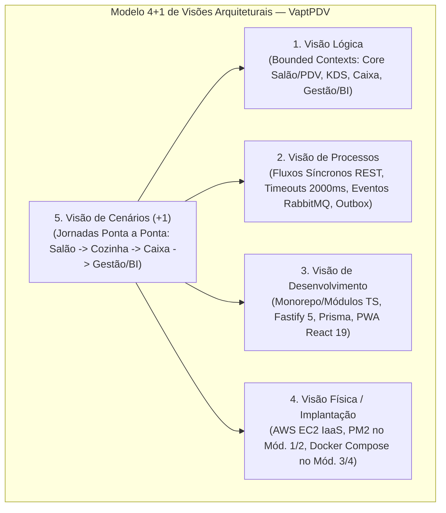

| Visão | Foco Principal | Artefatos e Decisões no VaptPDV |
| :--- | :--- | :--- |
| **1. Visão Lógica** | Decomposição funcional, entidades de domínio e fronteiras de contexto. | Separação entre **Core Salão/PDV (`vapt-pdv-core`)** (módulos `usuarios`, `produtos`, `comandas`, `saude`) e os 3 microsserviços satélites por estação: **`kds-service`** (`:3001`), **`caixa-service`** (`:3002`) e **`gestao-service`** (`:3003`). |
| **2. Visão de Processos** | Concorrência, sincronismo, assincronismo, tolerância a falhas e vazão. | Transações ACID com índice parcial de mesa única no Core; chamadas HTTP com timeout padronizado (`2000ms` / 2,0s) no Módulo 2; publicação assíncrona via **RabbitMQ** (`item.lancado`, `item.pronto`, `comanda.fechada`, `comanda.paga`, `estoque.movimentado`) no exchange `vaptpdv.eventos` no Módulo 4. |
| **3. Visão de Desenvolvimento** | Organização de código, camadas internas, pacotes, contratos e testes. | Node.js >= 20 + TypeScript + Fastify + JSON Schema / OpenAPI + Prisma ORM + Frontend Web/PWA (React 19, Vite, Tailwind CSS, TanStack Query, Zustand). Isolamento estrito por interfaces (`Gateways`) entre módulos e serviços. |
| **4. Visão Física (Deployment)** | Topologia de hardware, rede, contêineres e armazenamento em nuvem. | Instância **AWS EC2 (Ubuntu Server LTS)** com PostgreSQL local no Módulo 1 (IaaS puro via Git + PM2) evoluindo para orquestração **Docker Compose** (Módulos 3 e 4) com volumes nomeados (`pgdata_core`, `pgdata_kds`, `pgdata_caixa`, `pgdata_gestao`, `rabbitmq_data`) e rede bridge isolada (`vaptpdv-net`). |
| **5. Visão de Cenários (+1)** | Casos de uso críticos que validam a integração das quatro visões anteriores. | Cenário completo de abertura de comanda pelo garçom, preparo na cozinha (KDS), fechamento com taxa de 10%, recepção e divisão de conta no Caixa (`split payment` + troco + recibo `.paper`), baixa única de estoque e consolidação na Gestão/BI. |

---

## 3. Modelo C4 — Nível 1: Diagrama de Contexto do Sistema

O Nível 1 mostra como os cinco perfis de atores humanos interagem com o ecossistema **VaptPDV** durante a operação diária do estabelecimento.

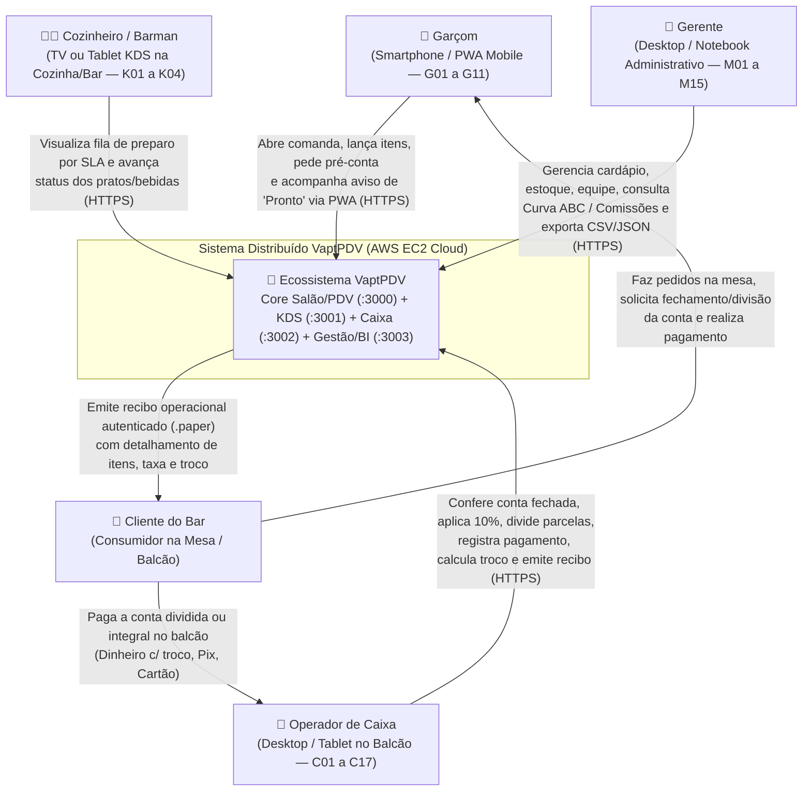

### Atores e Responsabilidades no Contexto

| Ator | Dispositivo Típico | Interação com o Ecossistema VaptPDV |
| :--- | :--- | :--- |
| **Garçom (`garcom`)** | Smartphone Android/iOS (PWA `/garcom`) | Abre comandas em mesas livres (`G01–G02`), lança produtos do cardápio com observações de preparo (`G03–G05`), solicita fechamento/pré-conta (`G06`, `G11`) e recebe alerta quando o item fica pronto no KDS (`G08`, `G10`). |
| **Cozinheiro / Barman (`cozinha`)** | Smart TV ou Tablet Horizontal (`/kds` Dark Mode) | Acompanha os pedidos recém-lançados no painel do **`kds-service`** (`K01–K04`), inicia o preparo e marca itens como `pronto` com 1 toque. |
| **Caixa (`caixa`)** | Computador ou Tablet no Balcão (`/caixa`) | Opera o **`caixa-service`** (`C01–C17`, exceto `C14` fora do escopo v1): visualiza contas aguardando pagamento, aplica/dispensa taxa de 10% (`C06`), divide a conta por pessoa ou por itens (`C11`), registra pagamentos parciais ou totais (`dinheiro` com troco `C07`, `pix` `C10`, `cartao`), libera a mesa e imprime o recibo operacional (`C12`). |
| **Gerente (`gerente`)** | Desktop ou Smartphone (`/gestao`) | Mantém o catálogo de produtos e estoque (`M02–M06`), gerencia equipe (`M12–M13`) e analisa indicadores do **`gestao-service`** (visão geral `M01`, vendas `M07`, faturamento `M09`, Curva ABC `M10`, desempenho de garçons `M11` e exportação de dados `M15`). |
| **Cliente (`cliente`)** | Presencial (Mesa / Balcão) | Consome os produtos, pode dividir a conta com acompanhantes e recebe o recibo detalhado e transparente da venda. |

---

## 4. Modelo C4 — Nível 2: Diagrama de Contêineres

O Nível 2 detalha os contêineres de software (aplicações, serviços de backend, bancos de dados isolados e broker de mensageria) que compõem a arquitetura completa do VaptPDV (estado alvo nos Módulos 2 a 4).

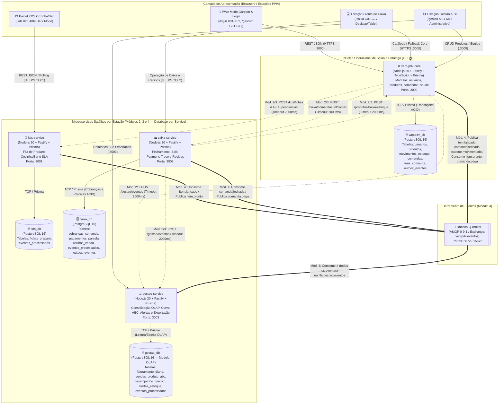

### Catálogo de Contêineres

| Contêiner | Tecnologia | Banco de Dados | Porta Padrão | Responsabilidade Central |
| :--- | :--- | :--- | :---: | :--- |
| **`vapt-pdv-core`** | Node.js 20, Fastify, TypeScript, Prisma | `vaptpdv_db` (PostgreSQL) | `3000` | Servidor da API central de Salão e do Frontend PWA. Preserva 100% o Módulo 1 e gerencia usuários (`garcom`, `caixa`, `gerente`, `cozinha`), catálogo/estoque de produtos, abertura de mesa, lançamento de itens com snapshot e pedido de pré-conta. |
| **`kds-service`** | Node.js 20, Fastify, TypeScript, Prisma | `kds_db` (PostgreSQL) | `3001` | Recebe itens recém-lançados que exigem preparo (cozinha/bar), organiza por ordem de chegada (FIFO) e SLA visual, e notifica quando o item está pronto para entrega (`K01–K04`). |
| **`caixa-service`** | Node.js 20, Fastify, TypeScript, Prisma | `caixa_db` (PostgreSQL) | `3002` | Recebe contas fechadas do salão, gerencia fila de recebimento (`C01–C17`), cálculo de divisão de conta (`split payment` por pessoas ou itens — `C11`), quitação única ou parcelada (`dinheiro` com troco exato, `pix`, `cartao`), disparo de `comanda.paga` e emissão do recibo operacional (`.paper` — `C12`). |
| **`gestao-service`** | Node.js 20, Fastify, TypeScript, Prisma | `gestao_db` (PostgreSQL) | `3003` | Motor gerencial e analítico (OLAP) da estação de Gestão (`M01–M15`): ingere eventos (`POST /gestao/eventos` no M2/M3 e fila `gestao.eventos` no M4) e fornece resumo diário de faturamento, Curva ABC (80/15/5), desempenho/comissões de garçons, alertas de estoque mínimo e exportação CSV/JSON (`GET /gestao/exportar`). |
| **`rabbitmq`** | RabbitMQ 3.13 (`management-alpine`) | Armazenamento Mnesia/Disco | `5672` (AMQP) / `15672` (UI) | Broker de mensageria responsável pelo roteamento assíncrono via Topic Exchange (`vaptpdv.eventos`), filas duráveis e Dead Letter Queues (DLQ). |

---

## 5. Modelo C4 — Nível 3: Diagrama de Componentes

### 5.1. Arquitetura Interna do `vapt-pdv-core` (Monólito Modular de Salão e Catálogo)

Mesmo residindo em um único processo e banco de dados (`vaptpdv_db`), o **PDV Core** respeita fronteiras rígidas de módulos. O módulo `comandas` nunca acessa tabelas de `usuarios` ou `produtos` diretamente via join SQL arbitrário; ele utiliza contratos internos (`GarcomGateway` / `UsuarioGateway`, `EstoqueGateway`) e integra-se aos microsserviços satélites por meio de adaptadores resilientes (`KdsGateway`, `CaixaGateway`, `GestaoGateway` e `OutboxPublisher`).

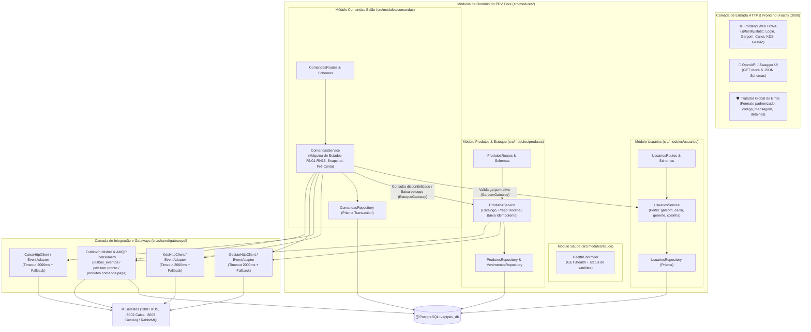

### 5.2. Arquitetura Interna dos Microsserviços Satélites e Mapeamento de Endpoints

Cada microsserviço satélite (`kds-service`, `caixa-service`, `gestao-service`) segue uma estrutura interna enxuta, padronizada e autônoma:

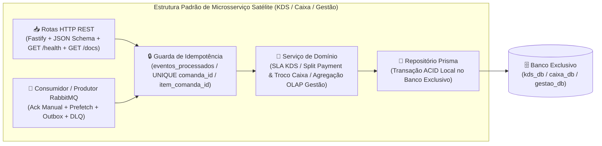

#### Matriz de Componentes e Contratos Expostos por Serviço

| Serviço / Módulo | Rotas Públicas (Frontend / Operador) | Rotas Internas de Integração (Módulos 1–3) | Filas RabbitMQ Consumidas / Eventos Publicados (Módulo 4) |
| :--- | :--- | :--- | :--- |
| **`vapt-pdv-core` (`usuarios` `:3000`)** | `POST /usuarios`, `GET /usuarios`, `GET /usuarios/:id`, `PATCH /usuarios/:id`, `POST /usuarios/:id/inativar` | `GET /usuarios/:id/validar-garcom` | — |
| **`vapt-pdv-core` (`produtos` `:3000`)** | `POST /produtos`, `GET /produtos`, `GET /produtos/:id`, `PATCH /produtos/:id`, `POST /produtos/:id/inativar` | `GET /produtos/:id/disponibilidade`, `POST /produtos/baixa-estoque` | Consome `produtos.comanda.paga` (`comanda.paga`); Publica `estoque.movimentado` |
| **`vapt-pdv-core` (`comandas` `:3000`)** | `POST /comandas`, `GET /comandas`, `GET /comandas/:id`, `POST /comandas/:id/itens`, `PATCH /comandas/:id/itens/:itemId`, `DELETE /comandas/:id/itens/:itemId`, `POST /comandas/:id/fechar`, `POST /comandas/:id/pagar` *(M1/Fallback)*, `POST /comandas/:id/cancelar` | Consome Gateways internos e HTTP dos satélites | Publica `item.lancado`, `comanda.fechada` (e `comanda.paga` quando pago via Core); Consome `pdv.item.pronto` (`item.pronto`) |
| **`kds-service` (`:3001`, `kds_db`)** | `GET /health`, `GET /docs`, `GET /kds/fichas` (alias `/kds/fila`), `PATCH /kds/fichas/:id/status` | `POST /kds/fichas`, `GET /kds/comandas/:comandaId/pendencias` (alias `/status-preparo`) | Consome `kds.item.lancado` (`item.lancado`); Publica `item.pronto` |
| **`caixa-service` (`:3002`, `caixa_db`)** | `GET /health`, `GET /docs`, `GET /caixa/comandas`, `GET /caixa/comandas/:comandaId`, `POST /caixa/comandas/:comandaId/dividir`, `POST /caixa/comandas/:comandaId/pagar`, `GET /caixa/recibos/:comandaId` | `POST /caixa/comandas/:comandaId/fechar` (recebe/recalcula pré-conta fechada do salão) | Consome `caixa.comanda.fechada` (`comanda.fechada`); Publica `comanda.paga` via `outbox_eventos` |
| **`gestao-service` (`:3003`, `gestao_db`)** | `GET /health`, `GET /docs`, `GET /gestao/resumo-diario` (alias `/analytics/resumo-diario`), `GET /gestao/ranking-produtos` (alias `/analytics/ranking-produtos`), `GET /gestao/desempenho-garcons` (alias `/analytics/desempenho-garcons`), `GET /gestao/alertas-estoque` (alias `/analytics/alertas-estoque`), `GET /gestao/exportar` | `POST /gestao/eventos` (alias `POST /analytics/eventos` — ingestão síncrona Mód. 2/3) | Consome `gestao.eventos` (`#` — `item.lancado`, `item.pronto`, `comanda.fechada`, `comanda.paga`, `estoque.movimentado`) |

---

## 6. Modelo C4 — Nível 4: Diagramas de Implantação e Orquestração (Módulos 1 a 4)

A arquitetura física evolui incrementalmente ao longo das quatro entregas da disciplina na infraestrutura **AWS EC2**.

### 6.1. Módulo 1 — Nuvem Pública IaaS (Deploy Nativo na AWS EC2)

No Módulo 1 (`entrega-1-cloud`), o foco é provar o funcionamento completo do **PDV Core** (API REST + Frontend PWA + PostgreSQL) em uma Máquina Virtual Linux na AWS EC2, sem Docker, gerenciado por **PM2** e configurado exclusivamente por variáveis de ambiente (`.env`).

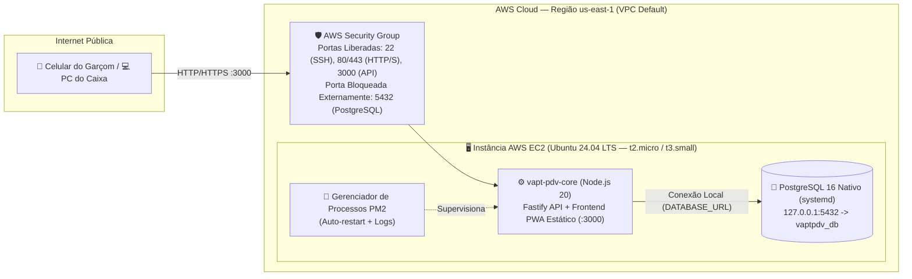

### 6.2. Módulo 2 — Arquitetura de Microsserviços (Comunicação HTTP Síncrona)

No Módulo 2 (`entrega-2-microsservicos`), entram em operação os três microsserviços satélites (`kds-service` `:3001`, `caixa-service` `:3002`, `gestao-service` `:3003`), cada um com seu próprio processo Node.js e seu próprio banco lógico isolado no PostgreSQL (`kds_db`, `caixa_db`, `gestao_db`), comunicando-se via HTTP REST síncrono com timeout de `2000ms` e degradação graciosa.

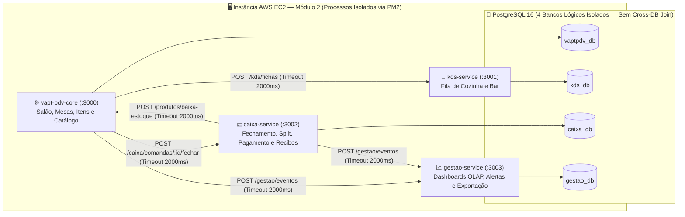

### 6.3. Módulos 3 e 4 — Containers (Docker Compose) + Mensageria (RabbitMQ)

No Módulo 3 (`entrega-3-containers`), todos os serviços e bancos são empacotados em contêineres Docker (`node:20-alpine` multi-stage e `postgres:16-alpine`) orquestrados por `docker-compose.yml` com volumes persistentes. No Módulo 4 (`entrega-4-mensageria`), adiciona-se o contêiner **`rabbitmq:3.13-management-alpine`**, substituindo o acoplamento temporal das notificações síncronas por eventos duráveis.

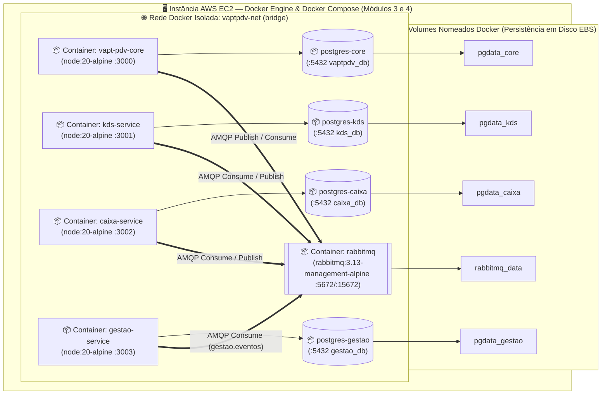

### 6.4. Especificação de Orquestração de Containers, Rede, Volumes e Healthchecks (Módulos 3 e 4)

Para garantir reprodutibilidade acadêmica e industrial (`docker compose up -d --build`) em uma instância AWS EC2 (`t3.small` com 2 GB RAM ou `t3.medium` com 4 GB RAM), a topologia de containers obedece à matriz de configuração abaixo:

| Nome do Serviço (`docker-compose.yml`) | Imagem Base / Build | Hostname DNS Interno (`vaptpdv-net`) | Portas (`Host:Container`) | Volume Persistente | Comando de `healthcheck` | `depends_on` (`service_healthy`) | Limite de Memória / CPU |
| :--- | :--- | :--- | :---: | :--- | :--- | :--- | :---: |
| **`postgres-core`** | `postgres:16-alpine` | `postgres-core` | `127.0.0.1:5432:5432` | `pgdata_core:/var/lib/postgresql/data` | `pg_isready -U vaptpdv -d vaptpdv_db` | — | `256M` / `0.50 CPU` |
| **`postgres-kds`** | `postgres:16-alpine` | `postgres-kds` | *(Apenas interno `:5432`)* | `pgdata_kds:/var/lib/postgresql/data` | `pg_isready -U vaptpdv -d kds_db` | — | `128M` / `0.25 CPU` |
| **`postgres-caixa`** | `postgres:16-alpine` | `postgres-caixa` | *(Apenas interno `:5432`)* | `pgdata_caixa:/var/lib/postgresql/data` | `pg_isready -U vaptpdv -d caixa_db` | — | `160M` / `0.25 CPU` |
| **`postgres-gestao`** | `postgres:16-alpine` | `postgres-gestao` | *(Apenas interno `:5432`)* | `pgdata_gestao:/var/lib/postgresql/data` | `pg_isready -U vaptpdv -d gestao_db` | — | `192M` / `0.30 CPU` |
| **`rabbitmq`** *(Mód. 4)* | `rabbitmq:3.13-management-alpine` | `rabbitmq` | `5672:5672`, `15672:15672` | `rabbitmq_data:/var/lib/rabbitmq` | `rabbitmq-diagnostics -q ping` | — | `256M` / `0.50 CPU` |
| **`vapt-pdv-core`** | Multi-stage `node:20-alpine` | `vapt-pdv-core` | `0.0.0.0:3000:3000` | — (Stateless) | `wget -qO- http://127.0.0.1:3000/health` | `postgres-core`, `rabbitmq` | `256M` / `0.50 CPU` |
| **`kds-service`** | Multi-stage `node:20-alpine` | `kds-service` | `0.0.0.0:3001:3001` | — (Stateless) | `wget -qO- http://127.0.0.1:3001/health` | `postgres-kds`, `rabbitmq` | `160M` / `0.25 CPU` |
| **`caixa-service`** | Multi-stage `node:20-alpine` | `caixa-service` | `0.0.0.0:3002:3002` | — (Stateless) | `wget -qO- http://127.0.0.1:3002/health` | `postgres-caixa`, `rabbitmq` | `160M` / `0.25 CPU` |
| **`gestao-service`** | Multi-stage `node:20-alpine` | `gestao-service` | `0.0.0.0:3003:3003` | — (Stateless) | `wget -qO- http://127.0.0.1:3003/health` | `postgres-gestao`, `rabbitmq` | `192M` / `0.30 CPU` |

#### Diretrizes de Segurança e Construção do `Dockerfile` Multi-Stage (`RNF09`)
1. **Estágio 1 (`builder`):** Baseado em `node:20-alpine`, instala `devDependencies`, gera o cliente Prisma (`npx prisma generate`) e compila o TypeScript (`npm run build`) e os assets estáticos do Frontend PWA (`vite build`).
2. **Estágio 2 (`runner`):** Baseado em `node:20-alpine` limpo, define `NODE_ENV=production`, copia apenas `dist/`, `node_modules` de produção e `prisma/`, executa `USER node` (sem privilégios de `root`) e inicia com `CMD ["sh", "-c", "npx prisma migrate deploy && node dist/server.js"]`.

---

## 7. Padrões de Sistemas Distribuídos e Resiliência Aplicados

### 7.1. Especificação de Resiliência, Timeouts, Retries e Degradação Graciosa (Módulos 2 e 3)

Na arquitetura de microsserviços síncronos (Módulos 2 e 3), o VaptPDV classifica rigorosamente as dependências externas em duas categorias: **Dependências Obrigatórias de Domínio (Fail-Fast)** e **Integrações Colaterais Pós-Commit (Graceful Degradation)**.

#### Matriz de Decisão de Falha por Operação Síncrona

| Operação Originadora | Serviço / Contexto Alvo | Tipo de Dependência | Timeout (`AbortSignal`) | Política de Retry Síncrono | Comportamento em Caso de Queda ou Timeout |
| :--- | :--- | :---: | :---: | :---: | :--- |
| **`POST /comandas`** (Validação de Garçom no Core) | `GET /usuarios/:id/validar-garcom` | **Obrigatória** (`RN08`) | `2000 ms` | `0` (Fail-Fast) | Aborta abertura e retorna **`HTTP 503 SERVICO_INDISPONIVEL`** (`detalhes.servico = "usuarios"`). |
| **`POST /comandas/:id/itens`** (Consulta de Estoque/Preço no Core) | `GET /produtos/:id/disponibilidade` | **Obrigatória** (`RN04`, `RN13`) | `2000 ms` | `0` (Fail-Fast) | Aborta lançamento e retorna **`HTTP 503 SERVICO_INDISPONIVEL`** (`detalhes.servico = "produtos"`). |
| **`POST /comandas/:id/itens`** (Envio de Ficha à Cozinha/Bar) | `POST /kds/fichas` (`kds-service` `:3001`) | **Colateral Pós-Commit** (`RN17`) | `2000 ms` | `1` retry (`+250ms` se erro de rede) | **Não reverte o item lançado.** Marca `integracao_pendente = true`, loga `WARN` e retorna **`201 Created`** com `avisos`. |
| **`POST /comandas/:id/fechar`** (Consulta de Pendências KDS) | `GET /kds/comandas/:id/pendencias` (`kds-service` `:3001`) | **Consultiva Colateral** (`RF22`) | `2000 ms` | `0` | **Não bloqueia o fechamento da pré-conta.** Fecha a comanda normalmente e inclui aviso de que o status do KDS não pôde ser verificado. |
| **`POST /comandas/:id/fechar`** (Sincronização da Pré-Conta com o Caixa) | `POST /caixa/comandas/:id/fechar` (`caixa-service` `:3002`) | **Colateral Pós-Commit** (`RN17`) | `2000 ms` | `1` retry (idempotente por `comanda_id`) | **Não reverte o fechamento da mesa no salão.** Marca `integracao_pendente = true`, loga `WARN` e retorna **`200 OK`** com `avisos` (permitindo fallback local ou reenvio). |
| **`POST /caixa/comandas/:id/pagar`** (Baixa de Estoque Mód. 2/3) | `POST /produtos/baixa-estoque` (`vapt-pdv-core` `:3000`) | **Obrigatória** (`RN10`) | `2000 ms` | `1` retry (idempotente por `comanda_id`) | Se falhar antes da baixa no modo síncrono (M2/M3), não confirma a quitação final e retorna **`HTTP 503 SERVICO_INDISPONIVEL`** (`detalhes.servico = "produtos"`). |
| **Notificação de Eventos Analíticos** (`item.lancado`, `comanda.fechada`, `comanda.paga`, `estoque.movimentado`) | `POST /gestao/eventos` (`gestao-service` `:3003`) | **Colateral Pós-Commit** (`RN17`) | `2000 ms` | `1` retry (idempotente por `evento_id`) | **Não reverte o lançamento, fechamento ou pagamento.** Registra pendência de sincronização e retorna **`200/201`** com `avisos`. |
| **Consultas Diretas a Satélites** (`/kds/*`, `/caixa/*`, `/gestao/*`) | Qualquer satélite ou seu respectivo banco PostgreSQL | **Obrigatória na Rota** (`RNF02`) | `2000 ms` | `0` (Fail-Fast) | Retorna imediatamente **`HTTP 503 SERVICO_INDISPONIVEL`** com envelope de erro padronizado. |

#### Fluxo de Estados da Chamada Resiliente no Gateway HTTP (`src/shared/gateways/`)

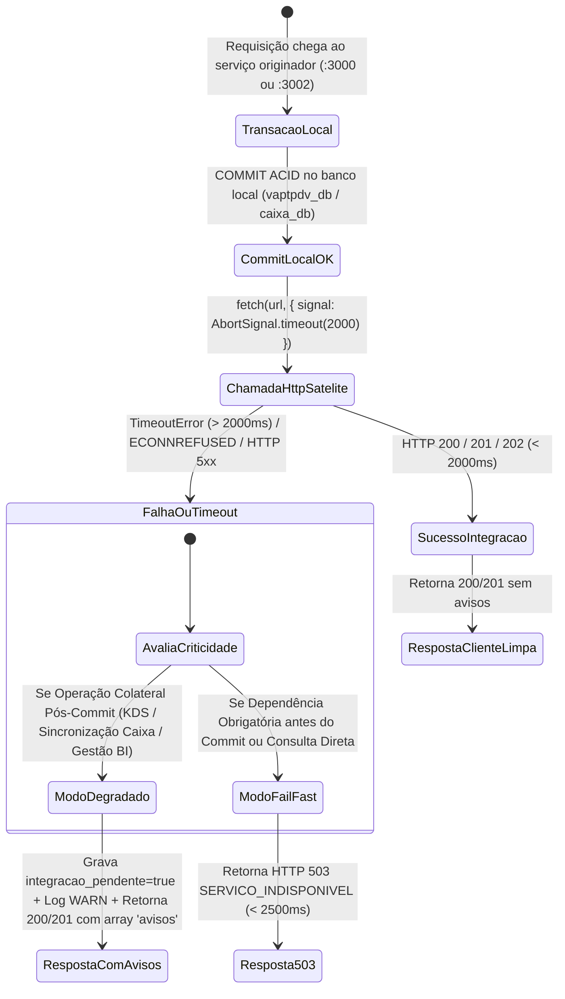

#### Exemplo de Resposta `200 OK` com Degradação Graciosa (Satélite Indisponível Pós-Commit)
```json
{
  "id": 42,
  "mesa": 12,
  "status": "fechada",
  "subtotal": "59.60",
  "taxa_servico": "5.96",
  "total": "65.56",
  "integracao_pendente": true,
  "avisos": [
    {
      "servico": "gestao-service",
      "status": "INDISPONIVEL_SINCRONIZACAO_PENDENTE",
      "mensagem": "Operação concluída com sucesso. Os indicadores gerenciais serão sincronizados automaticamente."
    }
  ]
}
```

#### Exemplo de Resposta `503 Service Unavailable` (Fail-Fast em Dependência Obrigatória ou Consulta Direta)
```json
{
  "erro": {
    "codigo": "SERVICO_INDISPONIVEL",
    "mensagem": "O serviço de Cozinha (kds-service) está temporariamente indisponível.",
    "detalhes": {
      "servico": "kds-service",
      "timeout_ms": 2000
    }
  }
}
```

---

### 7.2. Padrão Transactional Outbox (Módulo 4)

Para eliminar o problema de escrita dupla (*Dual-Write Problem* — salvar no PostgreSQL mas falhar ao publicar no RabbitMQ por queda momentânea de rede), tanto o `vapt-pdv-core` (`vaptpdv_db`) quanto o `caixa-service` (`caixa_db`) utilizam a tabela local `outbox_eventos`:

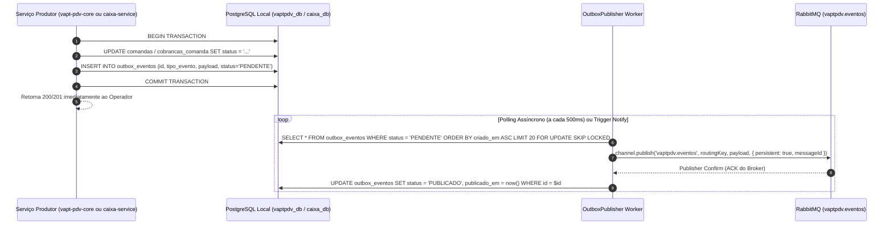

---

### 7.3. Idempotência nos Consumidores e nas Rotas Internas

Tanto nas chamadas HTTP com retentativa (Módulo 2/3) quanto na entrega *At-Least-Once* do RabbitMQ (Módulo 4), mensagens podem ser entregues mais de uma vez:
- **No `vapt-pdv-core` (Módulo `produtos` — Estoque):** A tabela `movimentos_estoque` possui índice único parcial `UNIQUE (comanda_id, produto_id) WHERE comanda_id IS NOT NULL AND tipo = 'BAIXA_VENDA'`. Tentar baixar o estoque da mesma comanda duas vezes é ignorado com segurança (`idempotente: true`).
- **No `kds-service` (`kds_db`):** Cada ficha de preparo possui `UNIQUE (item_comanda_id)`. Se o evento `item.lancado` for reentregue, nenhuma ficha duplicada é criada na TV da cozinha.
- **No `caixa-service` (`caixa_db`):** Cada cobrança de comanda possui `UNIQUE (comanda_id)` em `cobrancas_comanda` e cada recibo emitido possui `UNIQUE (comanda_id)` em `recibos_venda` (além da tabela `eventos_processados`). Uma comanda fechada ou paga é processada de forma estritamente idempotente.
- **No `gestao-service` (`gestao_db`):** Cada evento processado registra seu `evento_id` (UUID) na tabela `eventos_processados` dentro da mesma transação ACID de atualização dos agregados OLAP.

---

### 7.4. Topologia RabbitMQ, Retentativas e Dead Letter Queue (DLQ)

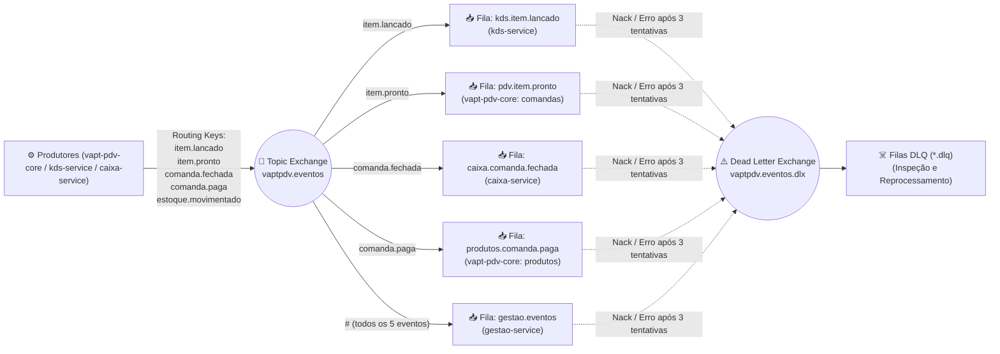

---

### 7.5. Isolamento OLTP vs. OLAP (CQRS Simplificado)

Consultas analíticas pesadas (soma de vendas do mês, Curva ABC de produtos, cálculo de comissões de garçons e exportação de dados CSV/JSON) não disputam *locks* nem CPU com os bancos transacionais `vaptpdv_db` e `caixa_db` (OLTP). O **`gestao-service`** mantém tabelas pré-agregadas em seu banco exclusivo `gestao_db` (OLAP), atualizadas a cada evento de negócio.

---

## 8. Análise Comparativa: Mensageria Tradicional (RabbitMQ) vs. Streaming de Eventos (Apache Kafka / Redpanda)

Conforme exigido no Módulo 4 da disciplina, a tabela abaixo fundamenta a escolha do **RabbitMQ** para a operação em tempo real do VaptPDV e delimita onde uma plataforma de **Streaming de Eventos (Kafka/Redpanda)** seria aplicável:

| Critério Arquitetural | Mensageria base em Filas (RabbitMQ — AMQP) | Streaming de Eventos (Apache Kafka / Redpanda) | Adequação ao VaptPDV |
| :--- | :--- | :--- | :--- |
| **Abstração Principal** | Filas inteligentes com roteamento flexível (*Exchanges* Direct, Topic, Fanout) e remoção da mensagem após `ACK`. | Log distribuído imutável particionado (*Append-only Commit Log*) com retenção configurável por tempo/tamanho. | **RabbitMQ vence no operacional:** rotear `item.lancado` para o KDS, `comanda.fechada` para o Caixa e `comanda.paga` para Estoque e Gestão/BI com confirmação individual por fila é direto e sem burocracia. |
| **Consumo de Memória na VM AWS EC2** | Muito baixo (~80 MB a 150 MB RAM em `management-alpine`), ideal para instâncias `t2.micro` / `t3.small`. | Mais elevado (Kafka exige JVM pesada; Redpanda é mais leve em C++, mas ainda demanda mais I/O e memória para segmentos). | **RabbitMQ vence em custo IaaS:** cabe confortavelmente na mesma VM EC2 junto com os 4 serviços Node.js e PostgreSQL. |
| **Garantia de Entrega e DLQ Nativa** | Suporte nativo a `ACK`/`NACK`, TTL por mensagem, *Dead Letter Exchanges (DLX)* e prioridade por fila. | Requer implementação manual de tópicos de *retry* e *DLQ* no código da aplicação consumidora. | **RabbitMQ vence em resiliência simples:** configuração declarativa de DLQ sem complexidade extra no consumidor. |
| **Reprocessamento Histórico (*Event Replay*)** | Mensagens consumidas com `ACK` são removidas da fila (não permite *replay* histórico nativo). | Consumidores podem reposicionar o *offset* para o início do log e reconstruir projeções de BI inteiras do zero. | **Kafka/Redpanda vence em Big Data/BI histórico:** se o `gestao-service` precisasse recalcular métricas de 2 anos atrás a partir dos eventos brutos, o log retido do Kafka seria superior. |

---

## 9. Architecture Decision Records (ADRs `ADR-01` a `ADR-12`)

### ADR-01: Adoção do Core Salão/PDV Coeso (`vapt-pdv-core`) + 3 Microsserviços Satélites por Estação (`kds-service`, `caixa-service`, `gestao-service`)
- **Contexto:** Em sistemas de PDV para bares, abrir comanda no salão, validar garçom, consultar disponibilidade e lançar itens exigem baixa latência (`< 200ms`), enquanto a fila de preparo da cozinha (KDS), a frente de caixa (fechamento financeiro, divisão de conta em múltiplas parcelas, cálculo de troco e emissão de recibos) e a retaguarda gerencial (OLAP/Curva ABC/Exportação) possuem ciclos de vida, perfis de operadores e modelos de dados próprios. O programa de fidelidade/cashback (`C14`) foi removido do escopo de backend v1 para priorizar o desmembramento real do Caixa como microsserviço transacional dedicado.
- **Decisão:** Preservar 100% do Módulo 1 no **`vapt-pdv-core`** (`:3000`, `vaptpdv_db` com módulos `usuarios`, `produtos`, `comandas`, `saude`) como núcleo de atendimento de Salão e Catálogo, e extrair **três microsserviços satélites alinhados às estações operacionais do estabelecimento**:
  1. **`kds-service`** (`:3001`, `kds_db`) — Cozinha e Bar (`K01–K04`).
  2. **`caixa-service`** (`:3002`, `caixa_db`) — Frente de Caixa, Split Payment, Troco e Recibos (`C01–C17`, exceto `C14`).
  3. **`gestao-service`** (`:3003`, `gestao_db`) — Retaguarda de Gestão, Relatórios OLAP/Curva ABC e Exportação (`M01–M15`).
- **Consequências Positivas:** Alinhamento 1:1 entre os 4 serviços de backend e as 4 estações de trabalho do sistema (`/garcom`, `/kds`, `/caixa`, `/gestao`); isolamento real de banco de dados (`Database-per-Service`); preservação integral do Módulo 1 e demonstração clara de comunicação síncrona (Módulo 2) e assíncrona (Módulo 4).
- **Trade-offs:** Requer sincronização confiável da comanda fechada entre `vapt-pdv-core` e `caixa-service` (via HTTP no Módulo 2/3 e via evento `comanda.fechada` + Outbox no Módulo 4).

### ADR-02: Stack Tecnológica Baseada em Node.js 20, Fastify, TypeScript e Prisma
- **Contexto:** O sistema precisa de alta performance em I/O concorrente, validação rigorosa de payloads JSON, documentação OpenAPI automática e segurança de tipos para quatro serviços distintos.
- **Decisão:** Padronizar **Node.js 20 LTS + TypeScript 5 + Fastify 5 + Prisma ORM** em todo o ecossistema (`vapt-pdv-core` e nos 3 microsserviços satélites).
- **Consequências:** Baixo consumo de memória por processo (~45 MB RAM), validação nativa por JSON Schema que já gera o Swagger (`/docs`), e migrações declarativas reprodutíveis via Prisma.

### ADR-03: Representação Monetária Exclusiva em Decimal Exato (`NUMERIC(10,2)`)
- **Contexto:** Aritmética de ponto flutuante binário IEEE 754 (`Float` / `number` do JavaScript) produz erros clássicos de arredondamento (ex.: `0.1 + 0.2 = 0.30000000000000004`), inaceitáveis em fechamento de conta, cálculo de taxa de 10%, divisão de conta (`split payment`) e cálculo de troco no caixa.
- **Decisão:** Armazenar todos os valores monetários como `DECIMAL(10,2)` no PostgreSQL (`vaptpdv_db`, `caixa_db`, `gestao_db`), realizar cálculos no backend usando `Prisma.Decimal` (com arredondamento `ROUND_HALF_UP` para 2 casas) e serializar valores monetários na API REST como strings de duas casas decimais (`"12.50"`).
- **Consequências:** Precisão contábil absoluta em 100% das operações financeiras.

### ADR-04: Garantia de Mesa Única Aberta por Índice Único Parcial no PostgreSQL
- **Contexto:** Dois garçons podem tentar abrir comanda para a mesma mesa (`mesa = 5`) simultaneamente pelo celular. Uma simples verificação `SELECT` seguida de `INSERT` na aplicação sofre condição de corrida (*Race Condition* TOCTOU).
- **Decisão:** Criar no banco `vaptpdv_db` o índice único parcial `CREATE UNIQUE INDEX comandas_mesa_aberta_unique_idx ON comandas (mesa) WHERE status = 'aberta';`.
- **Consequências:** O próprio motor do PostgreSQL impede duas comandas abertas na mesma mesa sob qualquer nível de concorrência, enquanto permite histórico ilimitado de comandas `fechada`, `paga` e `cancelada` para aquela mesma mesa.

### ADR-05: Preço e Nome Congelados no Lançamento do Item (`Snapshot Pattern`)
- **Contexto:** O gerente pode reajustar o preço da cerveja no cardápio às 22h, enquanto dezenas de mesas estão abertas desde as 19h.
- **Decisão:** Ao lançar um item na comanda, copiar `nome_copiado` e `preco_copiado` diretamente para a tabela `itens_comanda` (e propagar esse snapshot imutável para `cobrancas_comanda` e `recibos_venda` no `caixa-service`).
- **Consequências:** Imutabilidade histórica garantida (`RN04`); alterações de cardápio nunca recalculam itens já consumidos.

### ADR-06: Infraestrutura em Nuvem IaaS na AWS EC2 com PostgreSQL Local
- **Contexto:** O Módulo 1 exige deploy em nuvem pública IaaS com banco relacional configurado por variáveis de ambiente e controle explícito de sistema operacional, processos e firewall.
- **Decisão:** Utilizar uma instância **AWS EC2 (Ubuntu Server LTS)** com regras de Security Group restritas (porta `5432` fechada para a internet pública, acessível apenas internamente) e PostgreSQL 16 instalado na própria VM (no Módulo 1/2 via pacote nativo e `pm2`; a partir do Módulo 3 via containers Docker com volumes EBS).
- **Consequências:** Controle total sobre rede, processos, logs e bancos múltiplos sem limites artificiais de conexões de tiers gratuitos de DBaaS.

### ADR-07: Estratégia de Evolução Síncrona (Módulo 2) para Assíncrona (Módulo 4)
- **Contexto:** A disciplina avalia a comunicação HTTP entre microsserviços no Módulo 2 e a introdução de mensageria no Módulo 4.
- **Decisão:** Encapsular toda comunicação entre serviços atrás de interfaces de Gateway (`KdsGateway`, `CaixaGateway`, `EstoqueGateway`, `GestaoGateway`). No Módulo 2 e 3, a implementação concreta usa `fetch` HTTP com timeout de `2000ms` (2,0s); no Módulo 4, a implementação concreta passa a publicar e consumir eventos no RabbitMQ (exchange `vaptpdv.eventos`) via Outbox sem alterar as regras de negócio de domínio.
- **Consequências:** Transição limpa entre arquiteturas e comprovação prática do princípio Aberto/Fechado (OCP) e Inversão de Dependência (DIP).

### ADR-08: Interface Frontend Web/PWA Integrada ao Ecossistema
- **Contexto:** Um sistema de PDV, KDS, Caixa e Gestão/BI é muito melhor compreendido, operado e demonstrado nos vídeos de entrega quando possui interfaces visuais dedicadas para cada papel, mantendo 100% das regras de negócio no backend.
- **Decisão:** Incluir uma aplicação **Web/PWA responsiva e leve** (React 19 + TypeScript + Vite + Tailwind CSS + TanStack Query + Zustand), servida pelo ecossistema, com as estações especializadas (`/login`, `/garcom`, `/caixa`, `/kds`, `/gestao`), consumindo exclusivamente as rotas públicas documentadas no contrato REST.
- **Consequências:** Experiência de produto real em demonstrações e testes de ponta a ponta, respeitando rigorosamente a restrição de que nenhum cálculo financeiro definitivo ou validação de estado reside apenas no cliente.

### ADR-09: Padronização do Transactional Outbox Pattern em `vaptpdv_db` e `caixa_db` para Publicação Confiável no RabbitMQ
- **Contexto:** No Módulo 4, quando um item é lançado, uma comanda é fechada no salão ou um pagamento é concluído no caixa, o sistema precisa atualizar o PostgreSQL e publicar o evento correspondente (`item.lancado`, `comanda.fechada`, `comanda.paga`, `estoque.movimentado`) no RabbitMQ (`vaptpdv.eventos`). Realizar um `COMMIT` no banco seguido de `channel.publish()` direto na rota HTTP está sujeito ao *Dual-Write Problem*.
- **Decisão:** Adotar o **Transactional Outbox Pattern** através da tabela `outbox_eventos` nos bancos transacionais produtores (`vaptpdv_db` e `caixa_db`). O evento de domínio é gravado como registro (`status = 'PENDENTE'`) dentro da **mesma transação ACID** que altera a comanda ou a cobrança. Um worker assíncrono (`OutboxPublisher`) lê lotes com `FOR UPDATE SKIP LOCKED`, publica no RabbitMQ aguardando `Publisher Confirm` e atualiza o registro para `status = 'PUBLICADO'`.
- **Consequências:** Garantia *At-Least-Once* real sem necessidade de transações distribuídas 2PC (Two-Phase Commit), mantendo a latência das rotas HTTP imune a oscilações do RabbitMQ.

### ADR-10: Estratégia de Idempotência nos Consumidores via Chaves Naturais de Negócio e Constraints `UNIQUE`
- **Contexto:** Como o Outbox Worker e o RabbitMQ operam sob semântica *At-Least-Once Delivery* (e o cliente HTTP nos Módulos 2 e 3 pode reenviar requisições em caso de timeout de leitura), qualquer consumidor pode receber o mesmo evento (`item.lancado`, `comanda.fechada`, `comanda.paga`, `estoque.movimentado`) duas ou mais vezes.
- **Decisão:** Em vez de depender apenas de caches voláteis em memória, impor **Idempotência Estrutural no PostgreSQL** de cada consumidor combinando chaves naturais de domínio e tabela de controle transacional:
  1. **Estoque (`vaptpdv_db`):** Índice único parcial `UNIQUE (comanda_id, produto_id) WHERE comanda_id IS NOT NULL AND tipo = 'BAIXA_VENDA'`.
  2. **KDS (`kds_db`):** Constraint `UNIQUE (item_comanda_id)` na tabela `fichas_preparo` + `eventos_processados`.
  3. **Caixa (`caixa_db`):** Constraint `UNIQUE (comanda_id)` nas tabelas `cobrancas_comanda` e `recibos_venda` + `eventos_processados`.
  4. **Gestão/BI (`gestao_db`):** Tabela `eventos_processados (evento_id UUID PRIMARY KEY)` verificada e inserida na mesma transação que incrementa os agregados OLAP.
- **Consequências:** Desduplicação determinística garantida pelo SGBD mesmo com múltiplas réplicas de consumidores ou reinicialização de containers.

### ADR-11: Isolamento de Leitura Analítica e Exportação (CQRS / OLAP em `gestao-service`) para Proteção de Latência P95
- **Contexto:** Consultas gerenciais como Curva ABC (`GROUP BY produto_id` com janela acumulada de Pareto 80/15/5), faturamento por período, ranking de comissões de garçons e exportação de dados (`GET /gestao/exportar`) exigem varreduras agregadas. Executar essas queries em `vaptpdv_db` ou `caixa_db` durante o horário de pico disputaria I/O, buffer pool e locks com o lançamento de pedidos e o recebimento de pagamentos.
- **Decisão:** Implementar **CQRS (Command Query Responsibility Segregation)** orientado a eventos extraindo toda leitura analítica e exportação para o `gestao-service` (`:3003`) e seu banco exclusivo `gestao_db`. As tabelas `faturamento_diario`, `vendas_produto_abc`, `desempenho_garcom` e `alertas_estoque` são projeções desnormalizadas pré-calculadas incrementalmente a cada evento recebido.
- **Consequências:** Consultas de dashboard e exportações respondem em `< 50ms` lendo linhas já sumarizadas, e os bancos `vaptpdv_db` e `caixa_db` permanecem 100% dedicados ao OLTP (`ASR-01`, `ASR-07`).

### ADR-12: Autenticação Operacional por Seleção de Perfil (*Passwordless Shift Login*) e Roteamento por Estação de Trabalho
- **Contexto:** Em bares e lanchonetes de alta rotatividade, operadores de salão (garçons com bandeja na mão), operadores de balcão (caixa fixo), cozinheiros e gerentes precisam alternar ou assumir seu posto em segundos. Senhas complexas, fluxos OAuth2 ou expiração frequente de tokens JWT no meio do atendimento geram atrito severo e não agregam valor ao escopo acadêmico da disciplina.
- **Decisão:** Adotar **Login Operacional de Turno por Seleção de Perfil Ativo (`/login`)** integrado à API `GET /usuarios?ativo=true`. Ao selecionar seu usuário (`garcom`, `caixa`, `gerente` ou `cozinha`), o estado da sessão é persistido em `useSessionStore` (Zustand) e a SPA despacha automaticamente o operador para sua estação de trabalho dedicada (`/garcom` -> `:3000`, `/kds` -> `:3001`, `/caixa` -> `:3002`, `/gestao` -> `:3003`).
- **Consequências:** Zero fricção operacional no salão, cumprimento integral de `RF02`, `RF34` e `RN23`, e rastreabilidade completa de autoria em todas as operações.
