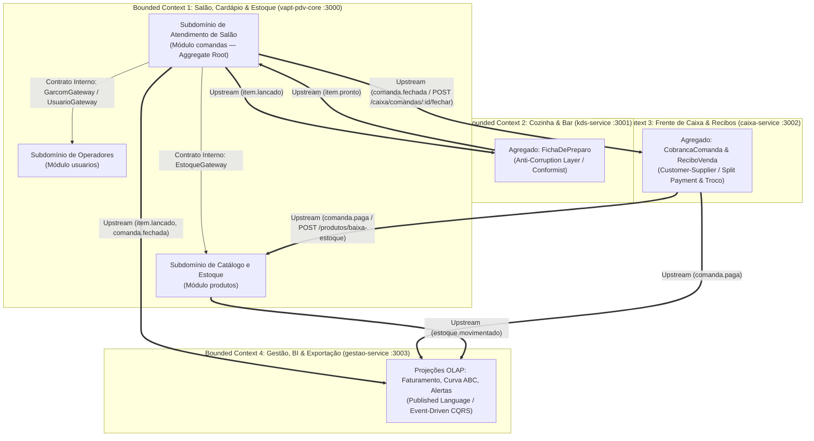
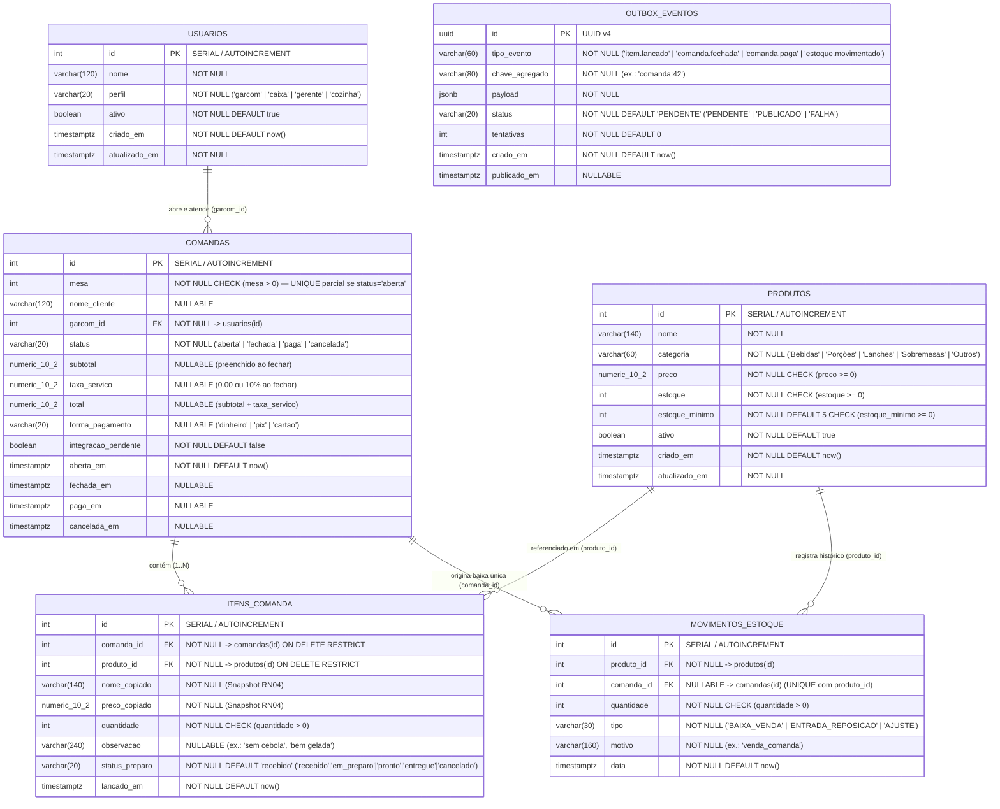
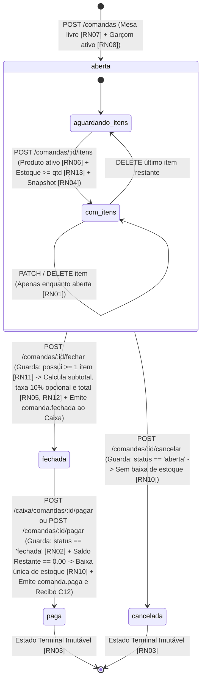
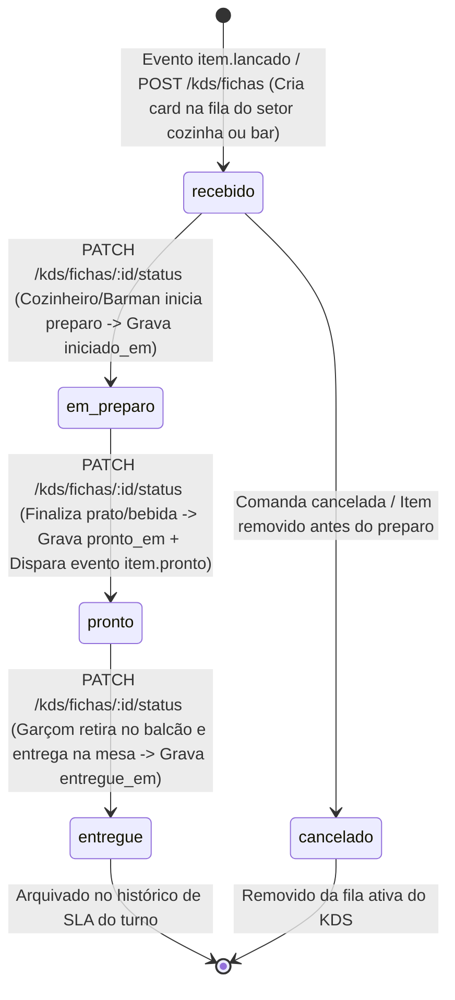
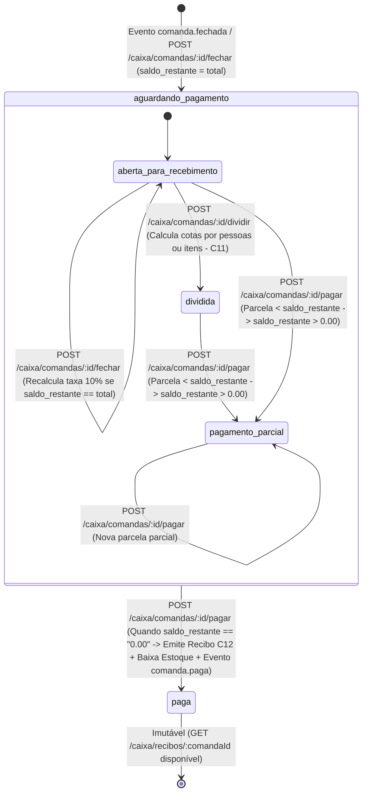

# 04 — Modelagem de Dados, Domain-Driven Design (DDD), Concorrência e Máquinas de Estados

| Metadado | Valor |
| :--- | :--- |
| **Projeto** | **VaptPDV** |
| **Data** | 04 de Novembro de 2026 |
| **Autores (Equipe)** | Kaio França e Mateus Neri |
---

## 1. Modelagem Estratégica e Tática com Domain-Driven Design (DDD)

### 1.1. Bounded Contexts (Contextos Delimitados) e Linguagem Ubíqua

O domínio do VaptPDV é particionado em **quatro Contextos Delimitados (Bounded Contexts)** alinhados às quatro estações operacionais do sistema, com responsabilidades claras, vocabulário próprio e bancos de dados fisicamente isolados a partir do Módulo 2 (`Database-per-Service`):

| Bounded Context | Implementação Física | Banco de Dados | Tipo de Carga | Conceitos Centrais da Linguagem Ubíqua |
| :--- | :--- | :--- | :--- | :--- |
| **1. Operação de Salão, Cardápio e Estoque (Core Domain)** | `vapt-pdv-core` (`:3000` — Módulos internos: `usuarios`, `produtos`, `comandas`, `saude`) | `vaptpdv_db` | OLTP Crítico (ACID) | *Comanda de Salão*, *Item Lançado*, *Preço Congelado (Snapshot)*, *Mesa Livre*, *Pedido de Pré-Conta*, *Movimento de Estoque*, *Operador (`garcom`/`caixa`/`gerente`/`cozinha`)*. |
| **2. Preparo de Cozinha e Bar (Supporting Domain)** | `kds-service` (`:3001`) | `kds_db` | OLTP Tempo Real | *Ficha de Preparo*, *Setor (`cozinha`/`bar`)*, *Fila FIFO de Pedidos*, *SLA de Preparo*, *Pronto para Entrega*. |
| **3. Frente de Caixa, Split Payment, Troco e Recibos (Core/Financial Domain)** | `caixa-service` (`:3002`) | `caixa_db` | OLTP Financeiro (ACID) | *Cobrança de Comanda*, *Fechamento com Taxa (10%)*, *Divisão de Conta (Split por Pessoa ou Item)*, *Parcela de Pagamento*, *Saldo Restante*, *Troco em Dinheiro*, *Recibo Operacional (`.paper`)*. |
| **4. Retaguarda de Gestão, Inteligência OLAP/BI e Exportação (Analytical Domain)** | `gestao-service` (`:3003`) | `gestao_db` | OLAP Analítico (Leitura Pesada) | *Faturamento Diário*, *Ticket Médio*, *Curva ABC de Produtos (80/15/5)*, *Desempenho e Comissões de Garçons*, *Alerta de Ruptura de Estoque*, *Exportação CSV/JSON*. |

### 1.2. Context Map (Mapa de Contextos e Padrões de Integração)



### 1.3. Desenho Tático: Entidades, Objetos de Valor, Agregados e Eventos

| Elemento Tático DDD | Nome no Domínio | Contexto | Descrição e Invariantes Protegidas |
| :--- | :--- | :--- | :--- |
| **Aggregate Root** | `Comanda` | Core Salão (`comandas`) | Raiz de agregado que governa os `ItemComanda` no salão. Garante que itens só são modificados com status `aberta` (`RN01`), que o fechamento exige $\ge 1$ item (`RN11`) e que `total = subtotal + taxa_servico` (`RN12`). |
| **Entity (Filha)** | `ItemComanda` | Core Salão (`comandas`) | Pertence exclusivamente a uma `Comanda`. Imutável após o fechamento da comanda. Preserva o snapshot do produto no instante da venda (`RN04`) e rastreia `observacao` e `status_preparo`. |
| **Aggregate Root** | `Produto` | Core Catálogo (`produtos`) | Governa o saldo de estoque e a emissão de `MovimentoEstoque`. Impede estoque negativo (`RN13`) e exclusão física (`RN14`). |
| **Aggregate Root** | `Usuario` | Core Equipe (`usuarios`) | Representa funcionários operadores (`garcom`, `caixa`, `gerente`, `cozinha`). Nunca sofre `DELETE` físico; apenas inativação lógica (`ativo = false`). |
| **Aggregate Root** | `FichaPreparo` | KDS (`kds-service`) | Controla o ciclo de preparo de um item na cozinha ou no bar (`recebido` → `em_preparo` → `pronto` → `entregue` / `cancelado`) e calcula o tempo decorrido para SLA visual. |
| **Aggregate Root** | `CobrancaComanda` | Caixa (`caixa-service`) | Governa a liquidação financeira de uma comanda fechada no caixa (`aguardando_pagamento` → `paga`), a simulação/registro de divisão (`split payment`), as parcelas (`PagamentoParcela`), o cálculo de `saldo_restante` e `troco` em `DECIMAL(10,2)`, e a emissão idempotente do `ReciboVenda` (`C12`). |
| **Entity (Filha)** | `PagamentoParcela` | Caixa (`caixa-service`) | Representa cada pagamento parcial ou integral registrado sobre uma `CobrancaComanda` (`dinheiro`, `pix`, `cartao`), incluindo `valor_recebido`, `valor_aplicado` e `troco`. |
| **Value Object** | `Dinheiro` (`Decimal(10,2)`) | Todos | Objeto de valor imutável com 2 casas decimais exatas e arredondamento `ROUND_HALF_UP`. Rejeita `NaN`, infinito ou valores negativos (`RN15`). |
| **Value Object** | `SnapshotProduto` | Core / Caixa | Par imutável `(nome_copiado, preco_copiado)` capturado no momento em que o garçom confirma o lançamento do item. |
| **Domain Event** | `item.lancado` | Core → KDS / Gestão | Emitido quando um item é adicionado à comanda aberta. Contém `comanda_id`, `mesa`, `garcom_id`, `observacao` e o objeto `item` (`item_comanda_id`, `produto_id`, `nome_copiado`, `categoria`, `preco_copiado`, `quantidade`). |
| **Domain Event** | `item.pronto` | KDS → Core / Gestão | Emitido quando o cozinheiro/barman finaliza o preparo. Permite atualizar `status_preparo = 'pronto'` e notificar o garçom responsável no PWA. |
| **Domain Event** | `comanda.fechada` | Core → Caixa / Gestão | Emitido quando o salão ou o balcão fecha a pré-conta (`POST /comandas/:id/fechar`). Contém `comanda_id`, `mesa`, `garcom_id`, `nome_cliente`, `aplicar_taxa_servico`, `subtotal`, `taxa_servico`, `total`, `fechada_em` e snapshot dos `itens`. |
| **Domain Event** | `comanda.paga` | Caixa / Core → Produtos / Gestão | Emitido após a quitação total da comanda (`saldo_restante == "0.00"`). Contém `comanda_id`, `mesa`, `garcom_id`, `forma_pagamento`, `subtotal`, `taxa_servico`, `total`, `troco_total`, `parcelas`, `paga_em` e lista de `itens`. |
| **Domain Event** | `estoque.movimentado` | Core (`produtos`) → Gestão | Emitido após baixa de estoque ou ajuste manual, informando `movimento_id`, `estoque_anterior`, `estoque_atual`, `estoque_minimo` e `abaixo_do_minimo`. |

---

## 2. Diagramas Entidade-Relacionamento (DER — Modelo Físico)

### 2.1. Banco de Dados Transacional de Salão e Catálogo: `vaptpdv_db` (`vapt-pdv-core` `:3000`)



### 2.2. Bancos de Dados dos Microsserviços Satélites (`kds_db`, `caixa_db`, `gestao_db`)

> [!NOTE]
> Como cada microsserviço possui seu próprio banco de dados isolado (`Database-per-Service`), referências como `comanda_id`, `item_comanda_id`, `produto_id` e `garcom_id` nos bancos satélites são **IDs lógicos externos** (`INTEGER` sem Foreign Key física cruzando bancos), sincronizados via payload de eventos ou chamadas REST.

```mermaid
erDiagram
    FICHAS_PREPARO {
        int id PK "Banco: kds_db (:3001)"
        int comanda_id "NOT NULL (ID lógico da comanda)"
        int item_comanda_id UK "NOT NULL UNIQUE (Idempotência)"
        int mesa "NOT NULL CHECK (mesa > 0)"
        int garcom_id "NOT NULL"
        varchar(120) nome_garcom "NULLABLE"
        varchar(30) setor "NOT NULL ('cozinha' | 'bar')"
        int produto_id "NOT NULL"
        varchar(140) nome_produto "NOT NULL"
        int quantidade "NOT NULL CHECK (quantidade > 0)"
        varchar(240) observacao "NULLABLE"
        varchar(20) status "NOT NULL ('recebido' | 'em_preparo' | 'pronto' | 'entregue' | 'cancelado')"
        timestamptz recebido_em "NOT NULL DEFAULT now()"
        timestamptz iniciado_em "NULLABLE"
        timestamptz pronto_em "NULLABLE"
        timestamptz entregue_em "NULLABLE"
    }

    COBRANCAS_COMANDA ||--o{ PAGAMENTOS_PARCELA : "recebe (1..N parcelas)"
    COBRANCAS_COMANDA ||--o| RECIBOS_VENDA : "emite ao quitar"

    COBRANCAS_COMANDA {
        int id PK "Banco: caixa_db (:3002)"
        int comanda_id UK "NOT NULL UNIQUE (Idempotência por comanda)"
        int mesa "NOT NULL CHECK (mesa > 0)"
        int garcom_id "NOT NULL"
        varchar(120) nome_cliente "NULLABLE"
        varchar(30) status "NOT NULL DEFAULT 'aguardando_pagamento' ('aguardando_pagamento' | 'paga' | 'cancelada')"
        boolean aplicar_taxa_servico "NOT NULL DEFAULT true"
        numeric_10_2 subtotal "NOT NULL CHECK (subtotal >= 0)"
        numeric_10_2 taxa_servico "NOT NULL CHECK (taxa_servico >= 0)"
        numeric_10_2 total "NOT NULL CHECK (total >= 0)"
        numeric_10_2 valor_pago "NOT NULL DEFAULT 0.00"
        numeric_10_2 saldo_restante "NOT NULL CHECK (saldo_restante >= 0)"
        numeric_10_2 troco_total "NOT NULL DEFAULT 0.00"
        varchar(20) modo_divisao "NOT NULL DEFAULT 'integral' ('integral' | 'pessoas' | 'itens')"
        int quantidade_pagadores "NOT NULL DEFAULT 1 CHECK (quantidade_pagadores >= 1)"
        jsonb itens_snapshot "NOT NULL (Itens congelados da comanda)"
        jsonb divisao_detalhes "NULLABLE (Cotas do split C11)"
        timestamptz fechada_em "NOT NULL DEFAULT now()"
        timestamptz paga_em "NULLABLE"
    }

    PAGAMENTOS_PARCELA {
        int id PK "Banco: caixa_db (:3002)"
        int cobranca_id FK "NOT NULL -> cobrancas_comanda(id)"
        int comanda_id "NOT NULL"
        int numero_parcela "NOT NULL CHECK (numero_parcela >= 1)"
        varchar(120) pagador_label "NULLABLE (ex.: 'Pessoa 1', 'Mesa Integral')"
        varchar(20) forma_pagamento "NOT NULL ('dinheiro' | 'pix' | 'cartao')"
        numeric_10_2 valor_aplicado "NOT NULL CHECK (valor_aplicado > 0)"
        numeric_10_2 valor_recebido "NOT NULL CHECK (valor_recebido >= valor_aplicado)"
        numeric_10_2 troco "NOT NULL DEFAULT 0.00 CHECK (troco >= 0)"
        timestamptz registrado_em "NOT NULL DEFAULT now()"
    }

    RECIBOS_VENDA {
        int id PK "Banco: caixa_db (:3002)"
        varchar(64) codigo_autenticacao UK "NOT NULL UNIQUE (ex.: VAPT-20261021-0042-PIX)"
        int comanda_id UK "NOT NULL UNIQUE"
        int cobranca_id FK "NOT NULL -> cobrancas_comanda(id)"
        jsonb resumo_recibo "NOT NULL (Snapshot completo do recibo .paper C12)"
        timestamptz emitido_em "NOT NULL DEFAULT now()"
    }

    FATURAMENTO_DIARIO {
        date data_referencia PK "Banco: gestao_db (:3003 — OLAP)"
        int comandas_pagas "NOT NULL DEFAULT 0"
        int comandas_canceladas "NOT NULL DEFAULT 0"
        numeric_12_2 faturamento_subtotal "NOT NULL DEFAULT 0.00"
        numeric_12_2 total_taxa_servico "NOT NULL DEFAULT 0.00"
        numeric_12_2 faturamento_total "NOT NULL DEFAULT 0.00"
        numeric_10_2 ticket_medio "NOT NULL DEFAULT 0.00"
        jsonb por_forma_pagamento "NOT NULL DEFAULT '{\"pix\":\"0.00\",\"cartao\":\"0.00\",\"dinheiro\":\"0.00\"}'"
        timestamptz atualizado_em "NOT NULL"
    }

    VENDAS_PRODUTO_ABC {
        int produto_id PK "Banco: gestao_db (:3003 — OLAP)"
        varchar(140) nome_produto "NOT NULL"
        varchar(60) categoria "NOT NULL"
        int quantidade_vendida "NOT NULL DEFAULT 0"
        numeric_12_2 receita_gerada "NOT NULL DEFAULT 0.00"
        char(1) classe_abc "NOT NULL DEFAULT 'C' ('A' | 'B' | 'C')"
        timestamptz atualizado_em "NOT NULL"
    }

    DESEMPENHO_GARCOM {
        int garcom_id PK "Banco: gestao_db (:3003 — OLAP)"
        varchar(120) nome_garcom "NOT NULL"
        int comandas_atendidas "NOT NULL DEFAULT 0"
        numeric_12_2 vendas_subtotal "NOT NULL DEFAULT 0.00"
        numeric_12_2 taxa_servico_gerada "NOT NULL DEFAULT 0.00"
        numeric_10_2 ticket_medio_mesa "NOT NULL DEFAULT 0.00"
        timestamptz atualizado_em "NOT NULL"
    }

    ALERTAS_ESTOQUE {
        int produto_id PK "Banco: gestao_db (:3003 — OLAP)"
        varchar(140) nome "NOT NULL"
        varchar(60) categoria "NOT NULL"
        int estoque_atual "NOT NULL"
        int estoque_minimo "NOT NULL"
        varchar(20) nivel_criticidade "NOT NULL ('zerado' | 'baixo')"
        timestamptz ultimo_movimento_em "NOT NULL DEFAULT now()"
    }

    EVENTOS_PROCESSADOS {
        uuid evento_id PK "Bancos: kds_db / caixa_db / gestao_db (Idempotência AMQP)"
        varchar(60) evento "NOT NULL"
        timestamptz processado_em "NOT NULL DEFAULT now()"
    }
```

---

## 3. Especificação de Concorrência, Locking, Isolamento Transacional e DDL Completo

### 3.1. Nível de Isolamento Transacional e Prevenção de Race Conditions no PostgreSQL

O PostgreSQL 16 opera por padrão em nível de isolamento **`READ COMMITTED`**. Em vez de utilizar `SERIALIZABLE` global (que causaria abortos espúrios de serialização sob alta concorrência de garçons lançando itens em mesas diferentes), o VaptPDV combina **`READ COMMITTED` + Locks Pessimistas Pontuais / Updates Atômicos + Constraints no SGBD**:

| Operação Crítica | Risco de Concorrência (Anomalia) | Mecanismo de Proteção no PostgreSQL (`vaptpdv_db` / `caixa_db`) | Resultado Determinístico |
| :--- | :--- | :--- | :--- |
| **Abertura Simultânea da Mesma Mesa (`POST /comandas`)** | *Phantom Read / TOCTOU*: Dois garçons consultam `SELECT` na mesa 12 ao mesmo tempo, veem livre e ambos executam `INSERT`. | **Índice Único Parcial no SGBD:**<br/>`CREATE UNIQUE INDEX comandas_mesa_aberta_unique_idx ON comandas (mesa) WHERE status = 'aberta';` | O PostgreSQL serializa a inserção na árvore B-Tree do índice parcial; a 1ª transação faz commit (`201 Created`) e a 2ª falha com código SQL `23505` (`unique_violation`), convertido pelo Fastify em **`409 MESA_OCUPADA`**. |
| **Fechamento ou Pagamento Concorrente (`POST /comandas/:id/fechar` ou `/caixa/comandas/:id/pagar`)** | *Lost Update*: Dois terminais tentam fechar ou liquidar a mesma comanda simultaneamente. | **Verificação Condicional de Status na Transação (`prisma.$transaction`) + `UNIQUE (comanda_id)`:**<br/>Atualização verifica `WHERE id = $id AND status = 'aberta'` (no fechar) ou `WHERE comanda_id = $id AND status = 'aguardando_pagamento'` (no caixa). | Apenas a primeira requisição finaliza a quitação; tentativas após `status = 'paga'` encontram o estado terminal e retornam **`409 COMANDA_IMUTAVEL`** (ou confirmação idempotente). |
| **Dedução Concorrente do Último Item em Estoque (`POST /produtos/baixa-estoque`)** | *Over-selling (Estoque Negativo)*: Duas mesas pagam simultaneamente os últimos 2 chopps quando o estoque tem apenas 3 unidades. | **Update Atômico Condicional + Check Constraint:**<br/>`UPDATE produtos SET estoque = estoque - $qtd WHERE id = $produtoId AND estoque >= $qtd;` aliado a `CHECK (estoque >= 0)`. | O `UPDATE` no PostgreSQL adquire *Row-Level Exclusive Lock* na linha do produto, reavalia a cláusula `WHERE estoque >= $qtd` sobre a versão mais recente pós-commit e se `rowCount === 0` faz `ROLLBACK` retornando **`409 ESTOQUE_INSUFICIENTE`**. |
| **Dupla Baixa de Estoque por Retentativa HTTP ou Reentrega RabbitMQ** | *Double Deduction*: Timeout de rede faz o cliente reenviar a requisição de baixa ou reentregar `comanda.paga`. | **Índice Único Parcial de Idempotência:**<br/>`CREATE UNIQUE INDEX movimentos_estoque_comanda_produto_unique_idx ON movimentos_estoque (comanda_id, produto_id) WHERE comanda_id IS NOT NULL AND tipo = 'BAIXA_VENDA';` | Antes de descontar (ou ao capturar conflito na constraint), o serviço detecta que o `comanda_id` já gerou movimento e retorna sucesso idempotente sem tocar no saldo. |

---

### 3.2. DDL SQL Completo de Referência para os 4 Bancos PostgreSQL

#### A. DDL do Banco 1: `vaptpdv_db` (`vapt-pdv-core` `:3000`)

```sql
-- Extensão para geração de UUIDs no Outbox
CREATE EXTENSION IF NOT EXISTS "pgcrypto";

-- 1. Tabela de Operadores do Sistema (Quatro Perfis Oficiais)
CREATE TABLE usuarios (
    id SERIAL PRIMARY KEY,
    nome VARCHAR(120) NOT NULL CHECK (char_length(trim(nome)) >= 2),
    perfil VARCHAR(20) NOT NULL CHECK (perfil IN ('garcom', 'caixa', 'gerente', 'cozinha')),
    ativo BOOLEAN NOT NULL DEFAULT true,
    criado_em TIMESTAMPTZ NOT NULL DEFAULT now(),
    atualizado_em TIMESTAMPTZ NOT NULL DEFAULT now()
);

-- 2. Tabela de Produtos e Saldo de Estoque
CREATE TABLE produtos (
    id SERIAL PRIMARY KEY,
    nome VARCHAR(140) NOT NULL CHECK (char_length(trim(nome)) >= 2),
    categoria VARCHAR(60) NOT NULL,
    preco NUMERIC(10, 2) NOT NULL CHECK (preco >= 0.00),
    estoque INTEGER NOT NULL DEFAULT 0 CHECK (estoque >= 0),
    estoque_minimo INTEGER NOT NULL DEFAULT 5 CHECK (estoque_minimo >= 0),
    ativo BOOLEAN NOT NULL DEFAULT true,
    criado_em TIMESTAMPTZ NOT NULL DEFAULT now(),
    atualizado_em TIMESTAMPTZ NOT NULL DEFAULT now()
);

-- 3. Tabela de Comandas (Ciclo de Vida de Atendimento da Mesa)
CREATE TABLE comandas (
    id SERIAL PRIMARY KEY,
    mesa INTEGER NOT NULL CHECK (mesa > 0),
    nome_cliente VARCHAR(120),
    garcom_id INTEGER NOT NULL REFERENCES usuarios(id) ON DELETE RESTRICT,
    status VARCHAR(20) NOT NULL DEFAULT 'aberta'
        CHECK (status IN ('aberta', 'fechada', 'paga', 'cancelada')),
    subtotal NUMERIC(10, 2) CHECK (subtotal IS NULL OR subtotal >= 0.00),
    taxa_servico NUMERIC(10, 2) CHECK (taxa_servico IS NULL OR taxa_servico >= 0.00),
    total NUMERIC(10, 2) CHECK (total IS NULL OR total >= 0.00),
    forma_pagamento VARCHAR(20)
        CHECK (forma_pagamento IS NULL OR forma_pagamento IN ('dinheiro', 'pix', 'cartao')),
    integracao_pendente BOOLEAN NOT NULL DEFAULT false,
    aberta_em TIMESTAMPTZ NOT NULL DEFAULT now(),
    fechada_em TIMESTAMPTZ,
    paga_em TIMESTAMPTZ,
    cancelada_em TIMESTAMPTZ
);

-- 4. Tabela de Itens da Comanda (Snapshot Imutável de Nome e Preço - RN04)
CREATE TABLE itens_comanda (
    id SERIAL PRIMARY KEY,
    comanda_id INTEGER NOT NULL REFERENCES comandas(id) ON DELETE RESTRICT,
    produto_id INTEGER NOT NULL REFERENCES produtos(id) ON DELETE RESTRICT,
    nome_copiado VARCHAR(140) NOT NULL,
    preco_copiado NUMERIC(10, 2) NOT NULL CHECK (preco_copiado >= 0.00),
    quantidade INTEGER NOT NULL CHECK (quantidade > 0),
    observacao VARCHAR(240),
    status_preparo VARCHAR(20) NOT NULL DEFAULT 'recebido'
        CHECK (status_preparo IN ('recebido', 'em_preparo', 'pronto', 'entregue', 'cancelado')),
    lancado_em TIMESTAMPTZ NOT NULL DEFAULT now()
);

-- 5. Tabela de Movimentações de Estoque (Auditoria e Idempotência - RN10)
CREATE TABLE movimentos_estoque (
    id SERIAL PRIMARY KEY,
    produto_id INTEGER NOT NULL REFERENCES produtos(id) ON DELETE RESTRICT,
    comanda_id INTEGER REFERENCES comandas(id) ON DELETE RESTRICT,
    quantidade INTEGER NOT NULL CHECK (quantidade > 0),
    tipo VARCHAR(30) NOT NULL DEFAULT 'BAIXA_VENDA'
        CHECK (tipo IN ('BAIXA_VENDA', 'ENTRADA_REPOSICAO', 'AJUSTE')),
    motivo VARCHAR(160) NOT NULL,
    data TIMESTAMPTZ NOT NULL DEFAULT now()
);

-- 6. Tabela Transactional Outbox para Publicação Confiável no RabbitMQ (Módulo 4 - ADR-09)
CREATE TABLE outbox_eventos (
    id UUID PRIMARY KEY DEFAULT gen_random_uuid(),
    tipo_evento VARCHAR(60) NOT NULL,
    chave_agregado VARCHAR(80) NOT NULL,
    payload JSONB NOT NULL,
    status VARCHAR(20) NOT NULL DEFAULT 'PENDENTE'
        CHECK (status IN ('PENDENTE', 'PUBLICADO', 'FALHA')),
    tentativas INTEGER NOT NULL DEFAULT 0,
    criado_em TIMESTAMPTZ NOT NULL DEFAULT now(),
    publicado_em TIMESTAMPTZ
);

-- Índices Críticos de Integridade e Performance
CREATE UNIQUE INDEX comandas_mesa_aberta_unique_idx
    ON comandas (mesa)
    WHERE status = 'aberta';

CREATE UNIQUE INDEX movimentos_estoque_comanda_produto_unique_idx
    ON movimentos_estoque (comanda_id, produto_id)
    WHERE comanda_id IS NOT NULL AND tipo = 'BAIXA_VENDA';

CREATE INDEX comandas_status_aberta_em_idx ON comandas (status, aberta_em DESC);
CREATE INDEX produtos_categoria_ativo_idx ON produtos (categoria, ativo);
CREATE INDEX itens_comanda_comanda_id_idx ON itens_comanda (comanda_id);
CREATE INDEX outbox_eventos_pendentes_idx ON outbox_eventos (status, criado_em ASC)
    WHERE status = 'PENDENTE';
```

#### B. DDL dos Bancos Satélites: `kds_db`, `caixa_db` e `gestao_db`

```sql
-- ============================================================================
-- BANCO 2: kds_db (Microsserviço kds-service :3001)
-- ============================================================================
CREATE TABLE fichas_preparo (
    id SERIAL PRIMARY KEY,
    comanda_id INTEGER NOT NULL,
    item_comanda_id INTEGER NOT NULL UNIQUE, -- Garante idempotência (RN18)
    mesa INTEGER NOT NULL CHECK (mesa > 0),
    garcom_id INTEGER NOT NULL,
    nome_garcom VARCHAR(120),
    setor VARCHAR(30) NOT NULL CHECK (setor IN ('cozinha', 'bar')),
    produto_id INTEGER NOT NULL,
    nome_produto VARCHAR(140) NOT NULL,
    quantidade INTEGER NOT NULL CHECK (quantidade > 0),
    observacao VARCHAR(240),
    status VARCHAR(20) NOT NULL DEFAULT 'recebido'
        CHECK (status IN ('recebido', 'em_preparo', 'pronto', 'entregue', 'cancelado')),
    recebido_em TIMESTAMPTZ NOT NULL DEFAULT now(),
    iniciado_em TIMESTAMPTZ,
    pronto_em TIMESTAMPTZ,
    entregue_em TIMESTAMPTZ
);

CREATE TABLE eventos_processados (
    evento_id UUID PRIMARY KEY,
    evento VARCHAR(60) NOT NULL,
    processado_em TIMESTAMPTZ NOT NULL DEFAULT now()
);

CREATE INDEX fichas_preparo_fila_idx ON fichas_preparo (setor, status, recebido_em ASC);
CREATE INDEX fichas_preparo_comanda_idx ON fichas_preparo (comanda_id, status);

-- ============================================================================
-- BANCO 3: caixa_db (Microsserviço caixa-service :3002)
-- ============================================================================
CREATE EXTENSION IF NOT EXISTS "pgcrypto";

CREATE TABLE cobrancas_comanda (
    id SERIAL PRIMARY KEY,
    comanda_id INTEGER NOT NULL UNIQUE, -- 1 cobrança única por comanda (RN18)
    mesa INTEGER NOT NULL CHECK (mesa > 0),
    garcom_id INTEGER NOT NULL,
    nome_cliente VARCHAR(120),
    status VARCHAR(30) NOT NULL DEFAULT 'aguardando_pagamento'
        CHECK (status IN ('aguardando_pagamento', 'paga', 'cancelada')),
    aplicar_taxa_servico BOOLEAN NOT NULL DEFAULT true,
    subtotal NUMERIC(10, 2) NOT NULL CHECK (subtotal >= 0.00),
    taxa_servico NUMERIC(10, 2) NOT NULL CHECK (taxa_servico >= 0.00),
    total NUMERIC(10, 2) NOT NULL CHECK (total >= 0.00),
    valor_pago NUMERIC(10, 2) NOT NULL DEFAULT 0.00 CHECK (valor_pago >= 0.00),
    saldo_restante NUMERIC(10, 2) NOT NULL CHECK (saldo_restante >= 0.00),
    troco_total NUMERIC(10, 2) NOT NULL DEFAULT 0.00 CHECK (troco_total >= 0.00),
    modo_divisao VARCHAR(20) NOT NULL DEFAULT 'integral'
        CHECK (modo_divisao IN ('integral', 'pessoas', 'itens')),
    quantidade_pagadores INTEGER NOT NULL DEFAULT 1 CHECK (quantidade_pagadores >= 1),
    itens_snapshot JSONB NOT NULL,
    divisao_detalhes JSONB,
    fechada_em TIMESTAMPTZ NOT NULL DEFAULT now(),
    paga_em TIMESTAMPTZ
);

CREATE TABLE pagamentos_parcela (
    id SERIAL PRIMARY KEY,
    cobranca_id INTEGER NOT NULL REFERENCES cobrancas_comanda(id) ON DELETE RESTRICT,
    comanda_id INTEGER NOT NULL,
    numero_parcela INTEGER NOT NULL CHECK (numero_parcela >= 1),
    pagador_label VARCHAR(120),
    forma_pagamento VARCHAR(20) NOT NULL
        CHECK (forma_pagamento IN ('dinheiro', 'pix', 'cartao')),
    valor_aplicado NUMERIC(10, 2) NOT NULL CHECK (valor_aplicado > 0.00),
    valor_recebido NUMERIC(10, 2) NOT NULL CHECK (valor_recebido >= valor_aplicado),
    troco NUMERIC(10, 2) NOT NULL DEFAULT 0.00 CHECK (troco >= 0.00),
    registrado_em TIMESTAMPTZ NOT NULL DEFAULT now()
);

CREATE TABLE recibos_venda (
    id SERIAL PRIMARY KEY,
    codigo_autenticacao VARCHAR(64) NOT NULL UNIQUE,
    comanda_id INTEGER NOT NULL UNIQUE,
    cobranca_id INTEGER NOT NULL REFERENCES cobrancas_comanda(id) ON DELETE RESTRICT,
    resumo_recibo JSONB NOT NULL,
    emitido_em TIMESTAMPTZ NOT NULL DEFAULT now()
);

CREATE TABLE eventos_processados (
    evento_id UUID PRIMARY KEY,
    evento VARCHAR(60) NOT NULL,
    processado_em TIMESTAMPTZ NOT NULL DEFAULT now()
);

CREATE TABLE outbox_eventos (
    id UUID PRIMARY KEY DEFAULT gen_random_uuid(),
    tipo_evento VARCHAR(60) NOT NULL,
    chave_agregado VARCHAR(80) NOT NULL,
    payload JSONB NOT NULL,
    status VARCHAR(20) NOT NULL DEFAULT 'PENDENTE'
        CHECK (status IN ('PENDENTE', 'PUBLICADO', 'FALHA')),
    tentativas INTEGER NOT NULL DEFAULT 0,
    criado_em TIMESTAMPTZ NOT NULL DEFAULT now(),
    publicado_em TIMESTAMPTZ
);

CREATE INDEX cobrancas_comanda_status_idx ON cobrancas_comanda (status, fechada_em DESC);
CREATE INDEX pagamentos_parcela_cobranca_idx ON pagamentos_parcela (cobranca_id, numero_parcela ASC);
CREATE INDEX caixa_outbox_pendentes_idx ON outbox_eventos (status, criado_em ASC) WHERE status = 'PENDENTE';

-- ============================================================================
-- BANCO 4: gestao_db (Microsserviço gestao-service :3003)
-- ============================================================================
CREATE TABLE eventos_processados (
    evento_id UUID PRIMARY KEY,
    evento VARCHAR(60) NOT NULL,
    processado_em TIMESTAMPTZ NOT NULL DEFAULT now()
);

CREATE TABLE faturamento_diario (
    data_referencia DATE PRIMARY KEY,
    comandas_pagas INTEGER NOT NULL DEFAULT 0,
    comandas_canceladas INTEGER NOT NULL DEFAULT 0,
    faturamento_subtotal NUMERIC(12, 2) NOT NULL DEFAULT 0.00,
    total_taxa_servico NUMERIC(12, 2) NOT NULL DEFAULT 0.00,
    faturamento_total NUMERIC(12, 2) NOT NULL DEFAULT 0.00,
    ticket_medio NUMERIC(10, 2) NOT NULL DEFAULT 0.00,
    por_forma_pagamento JSONB NOT NULL DEFAULT '{"pix":"0.00","cartao":"0.00","dinheiro":"0.00"}',
    atualizado_em TIMESTAMPTZ NOT NULL DEFAULT now()
);

CREATE TABLE vendas_produto_abc (
    produto_id INTEGER PRIMARY KEY,
    nome_produto VARCHAR(140) NOT NULL,
    categoria VARCHAR(60) NOT NULL,
    quantidade_vendida INTEGER NOT NULL DEFAULT 0,
    receita_gerada NUMERIC(12, 2) NOT NULL DEFAULT 0.00,
    classe_abc CHAR(1) NOT NULL DEFAULT 'C' CHECK (classe_abc IN ('A', 'B', 'C')),
    atualizado_em TIMESTAMPTZ NOT NULL DEFAULT now()
);

CREATE TABLE desempenho_garcom (
    garcom_id INTEGER PRIMARY KEY,
    nome_garcom VARCHAR(120) NOT NULL,
    comandas_atendidas INTEGER NOT NULL DEFAULT 0,
    vendas_subtotal NUMERIC(12, 2) NOT NULL DEFAULT 0.00,
    taxa_servico_gerada NUMERIC(12, 2) NOT NULL DEFAULT 0.00,
    ticket_medio_mesa NUMERIC(10, 2) NOT NULL DEFAULT 0.00,
    atualizado_em TIMESTAMPTZ NOT NULL DEFAULT now()
);

CREATE TABLE alertas_estoque (
    produto_id INTEGER PRIMARY KEY,
    nome VARCHAR(140) NOT NULL,
    categoria VARCHAR(60) NOT NULL,
    estoque_atual INTEGER NOT NULL,
    estoque_minimo INTEGER NOT NULL,
    nivel_criticidade VARCHAR(20) NOT NULL CHECK (nivel_criticidade IN ('zerado', 'baixo')),
    ultimo_movimento_em TIMESTAMPTZ NOT NULL DEFAULT now()
);
```

---

### 3.3. Dicionário de Colunas — Tabelas Principais

#### Tabela `usuarios` (`vaptpdv_db`)
| Coluna | Tipo PostgreSQL | Tipo Prisma | Nulo? | Valor Padrão | Restrições e Semântica |
| :--- | :--- | :--- | :---: | :--- | :--- |
| `id` | `SERIAL` | `Int @id @default(autoincrement())` | Não | Sequencial | Identificador único do operador. |
| `nome` | `VARCHAR(120)` | `String` | Não | — | Nome completo ou apelido operacional (mín. 2 caracteres). |
| `perfil` | `VARCHAR(20)` | `PerfilUsuario` (Enum) | Não | — | Valores permitidos: `garcom`, `caixa`, `gerente`, `cozinha`. |
| `ativo` | `BOOLEAN` | `Boolean` | Não | `true` | Soft delete lógico (`RN14`); `false` impede abrir novas comandas ou logar no turno. |
| `criado_em` | `TIMESTAMPTZ` | `DateTime @default(now())` | Não | `now()` | Data/hora UTC de criação do registro. |
| `atualizado_em`| `TIMESTAMPTZ` | `DateTime @updatedAt` | Não | `now()` | Atualizado automaticamente em cada `PATCH` ou inativação. |

#### Tabela `produtos` (`vaptpdv_db`)
| Coluna | Tipo PostgreSQL | Tipo Prisma | Nulo? | Valor Padrão | Restrições e Semântica |
| :--- | :--- | :--- | :---: | :--- | :--- |
| `id` | `SERIAL` | `Int @id @default(autoincrement())` | Não | Sequencial | Identificador único do item no cardápio. |
| `nome` | `VARCHAR(140)` | `String` | Não | — | Nome comercial exibido no cardápio (ex.: `"Chopp Pilsen 500ml"`). |
| `categoria` | `VARCHAR(60)` | `String` | Não | — | Agrupador de cardápio e roteamento KDS (`Bebidas`, `Porções`, `Lanches`, etc.). |
| `preco` | `NUMERIC(10,2)` | `Decimal @db.Decimal(10, 2)` | Não | — | Preço unitário vigente (`CHECK (preco >= 0)`). |
| `estoque` | `INTEGER` | `Int` | Não | `0` | Quantidade física disponível (`CHECK (estoque >= 0)`). |
| `estoque_minimo`| `INTEGER` | `Int` | Não | `5` | Gatilho para emissão de alerta de reposição na Gestão/BI (`>= 0`). |
| `ativo` | `BOOLEAN` | `Boolean` | Não | `true` | Quando `false`, bloqueia novos lançamentos (`RN06`), mantendo histórico. |
| `criado_em` | `TIMESTAMPTZ` | `DateTime @default(now())` | Não | `now()` | Timestamp UTC de cadastro. |
| `atualizado_em`| `TIMESTAMPTZ` | `DateTime @updatedAt` | Não | `now()` | Timestamp UTC da última alteração. |

#### Tabela `comandas` (`vaptpdv_db`)
| Coluna | Tipo PostgreSQL | Tipo Prisma | Nulo? | Valor Padrão | Restrições e Semântica |
| :--- | :--- | :--- | :---: | :--- | :--- |
| `id` | `SERIAL` | `Int @id @default(autoincrement())` | Não | Sequencial | Número da comanda digital. |
| `mesa` | `INTEGER` | `Int` | Não | — | Número da mesa física (`INTEGER > 0`). Na API JSON é serializado como inteiro `12` (aceitando na entrada inteiro `12` ou string numérica `"12"` convertida para inteiro `> 0`). Índice único parcial quando `status = 'aberta'`. |
| `nome_cliente` | `VARCHAR(120)` | `String?` | Sim | `NULL` | Identificação amigável opcional (ex.: `"Mariana Costa"`). |
| `garcom_id` | `INTEGER` | `Int` | Não | — | FK para `usuarios(id)`. Deve estar ativo e ter perfil `garcom` na abertura (`RN08`). |
| `status` | `VARCHAR(20)` | `StatusComanda` (Enum) | Não | `'aberta'` | Estados válidos: `aberta`, `fechada`, `paga`, `cancelada`. |
| `subtotal` | `NUMERIC(10,2)` | `Decimal? @db.Decimal(10, 2)` | Sim | `NULL` | Soma exata de `(preco_copiado * quantidade)` gravada no fechamento (`RN05`). |
| `taxa_servico` | `NUMERIC(10,2)` | `Decimal? @db.Decimal(10, 2)` | Sim | `NULL` | `"0.00"` ou `round_half_up(subtotal * 0.10, 2)` gravada no fechamento (`RN12`). |
| `total` | `NUMERIC(10,2)` | `Decimal? @db.Decimal(10, 2)` | Sim | `NULL` | Valor final a pagar (`subtotal + taxa_servico`). |
| `forma_pagamento`| `VARCHAR(20)` | `FormaPagamento?` (Enum) | Sim | `NULL` | Preenchido no pagamento: `dinheiro`, `pix` ou `cartao`. |
| `aberta_em` | `TIMESTAMPTZ` | `DateTime @default(now())` | Não | `now()` | Instante de abertura da mesa. |
| `fechada_em` | `TIMESTAMPTZ` | `DateTime?` | Sim | `NULL` | Instante de emissão da pré-conta pelo salão/caixa. |
| `paga_em` | `TIMESTAMPTZ` | `DateTime?` | Sim | `NULL` | Instante de quitação e baixa de estoque. |
| `cancelada_em` | `TIMESTAMPTZ` | `DateTime?` | Sim | `NULL` | Instante de cancelamento da comanda aberta. |

#### Tabela `itens_comanda` (`vaptpdv_db`)
| Coluna | Tipo PostgreSQL | Tipo Prisma | Nulo? | Valor Padrão | Restrições e Semântica |
| :--- | :--- | :--- | :---: | :--- | :--- |
| `id` | `SERIAL` | `Int @id @default(autoincrement())` | Não | Sequencial | Identificador único do lançamento (`item_comanda_id`). |
| `comanda_id` | `INTEGER` | `Int` | Não | — | FK para `comandas(id)`. |
| `produto_id` | `INTEGER` | `Int` | Não | — | FK para `produtos(id)`. |
| `nome_copiado` | `VARCHAR(140)` | `String` | Não | — | Cópia imutável do nome do produto no momento do lançamento (`RN04`). |
| `preco_copiado` | `NUMERIC(10,2)` | `Decimal @db.Decimal(10, 2)` | Não | — | Cópia imutável do preço unitário no momento do lançamento (`RN04`). |
| `quantidade` | `INTEGER` | `Int` | Não | — | Quantidade solicitada (`CHECK (quantidade > 0)` — `RN09`). |
| `observacao` | `VARCHAR(240)` | `String?` | Sim | `NULL` | Instrução especial enviada ao KDS (ex.: `"Sem gelo"`, `"Bem gelado"`). |
| `status_preparo`| `VARCHAR(20)` | `StatusPreparo` (Enum) | Não | `'recebido'` | Sincronizado com o KDS (`recebido`, `em_preparo`, `pronto`, `entregue`, `cancelado`). |
| `lancado_em` | `TIMESTAMPTZ` | `DateTime @default(now())` | Não | `now()` | Timestamp UTC de lançamento do item. |

#### Tabelas `cobrancas_comanda` e `pagamentos_parcela` (`caixa_db`)
| Coluna | Tabela | Tipo PostgreSQL | Restrições e Semântica |
| :--- | :--- | :--- | :--- |
| `comanda_id` | `cobrancas_comanda` | `INTEGER UNIQUE` | Chave lógica da comanda fechada no salão; garante idempotência (`RN18`). |
| `status` | `cobrancas_comanda` | `VARCHAR(30)` | `'aguardando_pagamento' \| 'paga' \| 'cancelada'`. |
| `valor_pago` / `saldo_restante` | `cobrancas_comanda` | `NUMERIC(10,2)` | Atualizados a cada parcela registrada (`saldo_restante = total - valor_pago`). Quando `saldo_restante == 0.00`, a cobrança muda para `'paga'`. |
| `modo_divisao` / `divisao_detalhes` | `cobrancas_comanda` | `VARCHAR(20)` / `JSONB` | Registra a divisão de conta (`'integral' \| 'pessoas' \| 'itens'`) calculada em `POST /caixa/comandas/:comandaId/dividir` (`C11`). |
| `valor_recebido` / `troco` | `pagamentos_parcela` | `NUMERIC(10,2)` | Para `forma_pagamento = 'dinheiro'` (`C07`), permite `valor_recebido >= valor_aplicado` e calcula `troco = valor_recebido - valor_aplicado`. |

---

## 4. Máquinas de Estados Formais

### 4.1. Ciclo de Vida da Comanda (`vapt-pdv-core` e integração com `caixa-service`)

A entidade `Comanda` governa o fluxo de atendimento da mesa e o disparo de fechamento para o caixa, obedecendo rigorosamente às regras de negócio **RN01 a RN13**.



#### Matriz de Invariantes e Transições da Comanda

| Transição | Rota da API | Pré-condições Obrigatórias (Guards) | Cálculos e Efeitos Transacionais | Eventos Emitidos |
| :--- | :--- | :--- | :--- | :--- |
| `(início)` → `aberta` | `POST /comandas` | 1. Usuário `garcom_id` existe, `ativo = true` e `perfil = 'garcom'` (`422 GARCOM_INVALIDO`).<br/>2. Não há comanda `aberta` na mesma `mesa` (`409 MESA_OCUPADA`). | Cria registro com `status = 'aberta'`, `aberta_em = now()`, totais `null`. | — |
| `aberta` → `aberta` (Lançar/Editar Item) | `POST /comandas/:id/itens`<br/>`PATCH .../itens/:itemId`<br/>`DELETE .../itens/:itemId` | 1. Comanda está `aberta` (`409 COMANDA_NAO_ABERTA`).<br/>2. `quantidade > 0` (`400 VALIDACAO`).<br/>3. Produto existe e `ativo = true` (`422 PRODUTO_INATIVO`).<br/>4. `produto.estoque >= quantidade` (`409 ESTOQUE_INSUFICIENTE`). | Grava `nome_copiado`, `preco_copiado` congelados (`RN04`), `observacao` e `status_preparo = 'recebido'`. Não desconta estoque físico ainda. | `item.lancado` (enviado ao `kds-service` e `gestao-service`) |
| `aberta` → `fechada` | `POST /comandas/:id/fechar` | 1. Comanda está `aberta` (`409 COMANDA_NAO_ABERTA`).<br/>2. Comanda possui pelo menos 1 item (`409 COMANDA_SEM_ITENS`). | Calcula `subtotal = Σ(preco_copiado × quantidade)`. Se `aplicar_taxa_servico = true`, `taxa_servico = round_half_up(subtotal × 0.10, 2)`, senão `"0.00"`. Grava `total = subtotal + taxa_servico` e `fechada_em = now()`. Bloqueia itens e envia cobrança ao `caixa-service`. | `comanda.fechada` (enviado ao `caixa-service` e `gestao-service`) |
| `fechada` → `paga` | `POST /caixa/comandas/:id/pagar`<br/>*(ou `POST /comandas/:id/pagar`)* | 1. Comanda está `fechada` (`409 COMANDA_NAO_FECHADA`).<br/>2. `forma_pagamento` $\in$ `{dinheiro, pix, cartao}` (`400 VALIDACAO`). | Registra parcela(s), calcula `troco` se `dinheiro`, e quando `saldo_restante == "0.00"` grava `status = 'paga'` e `paga_em = now()`, emite `ReciboVenda` (`C12`) e deduz `estoque` uma única vez (`RN10`). | `comanda.paga` e `estoque.movimentado` |
| `aberta` → `cancelada` | `POST /comandas/:id/cancelar` | 1. Comanda está `aberta` (`409 COMANDA_NAO_ABERTA` ou `409 COMANDA_IMUTAVEL` se já fechada/paga). | Muda status para `cancelada`, grava `cancelada_em = now()`, libera a mesa. Nenhum estoque é alterado. | Cancela fichas pendentes no KDS |

---

### 4.2. Ciclo de Vida da Ficha de Preparo no KDS (`kds-service` `:3001`)

O microsserviço **`kds-service`** gerencia sua própria máquina de estados para cada item enviado à cozinha (`setor = "cozinha"`) ou ao bar (`setor = "bar"`), permitindo visibilidade operacional em tempo real (`K01–K04`).



#### Regras de SLA e Roteamento Automático de Setor no KDS (`RN22`)

| Categoria do Produto | Setor de Destino no KDS | Faixa Verde (No Prazo) | Faixa Amarela (Atenção) | Faixa Vermelha (Atrasado / Alerta Visual) |
| :--- | :--- | :---: | :---: | :---: |
| **`Bebidas` / `Cervejas` / `Drinks`** | Setor **`bar`** | `< 3 min` | `3 a 6 min` | `> 6 min` (Borda vermelha pulsante) |
| **`Porções` / `Lanches` / `Pratos` / `Sobremesas`** | Setor **`cozinha`** | `< 10 min` | `10 a 20 min` | `> 20 min` (Borda vermelha pulsante + topo da fila) |

---

### 4.3. Máquina de Estados da Cobrança e Split Payment no Caixa (`caixa-service` `:3002`)



---

## 5. Contratos de Eventos de Domínio Unificados (Payloads JSON — Módulo 4)

Todos os **5 eventos de domínio** publicados no exchange `vaptpdv.eventos` (tipo `topic`) e na rota de ingestão síncrona `POST /gestao/eventos` (alias `POST /analytics/eventos`) seguem o **mesmo schema JSON canônico** definido em `05-contrato-apis-e-eventos.md`, com metadados de rastreabilidade (`evento`, `evento_id`, `versao`, `ocorrido_em`) e atributos de domínio na raiz do objeto.

### 5.1. Evento `item.lancado` (PDV Core → KDS Service & Gestão Service)
```json
{
  "evento": "item.lancado",
  "versao": 1,
  "evento_id": "evt_4a8b9c10-12ef-4d21-8a11-001122334455",
  "ocorrido_em": "2026-10-21T19:05:00.000Z",
  "comanda_id": 42,
  "mesa": 12,
  "garcom_id": 1,
  "nome_garcom": "Carlos Garçom",
  "observacao": "Bem gelado, colarinho baixo",
  "item": {
    "item_comanda_id": 105,
    "produto_id": 7,
    "nome_copiado": "Chopp Pilsen 500ml",
    "categoria": "Bebidas",
    "preco_copiado": "14.90",
    "quantidade": 2,
    "observacao": "Bem gelado, colarinho baixo"
  }
}
```

### 5.2. Evento `item.pronto` (KDS Service → PDV Core & Gestão Service)
```json
{
  "evento": "item.pronto",
  "versao": 1,
  "evento_id": "evt_7f21c330-98ab-4110-b220-556677889900",
  "ocorrido_em": "2026-10-21T19:07:45.000Z",
  "ficha_id": 301,
  "comanda_id": 42,
  "item_comanda_id": 105,
  "mesa": 12,
  "setor": "bar",
  "nome_produto": "Chopp Pilsen 500ml",
  "quantidade": 2,
  "tempo_preparo_segundos": 165
}
```

### 5.3. Evento `comanda.fechada` (PDV Core → Caixa Service & Gestão Service)
```json
{
  "evento": "comanda.fechada",
  "versao": 1,
  "evento_id": "evt_6b12d901-33ef-41a0-8201-998877665544",
  "ocorrido_em": "2026-10-21T20:15:00.000Z",
  "comanda_id": 42,
  "mesa": 12,
  "garcom_id": 1,
  "nome_cliente": "Mariana Costa",
  "aplicar_taxa_servico": true,
  "subtotal": "59.60",
  "taxa_servico": "5.96",
  "total": "65.56",
  "fechada_em": "2026-10-21T20:15:00.000Z",
  "itens": [
    {
      "item_comanda_id": 105,
      "produto_id": 7,
      "nome_copiado": "Chopp Pilsen 500ml",
      "categoria": "Bebidas",
      "preco_copiado": "14.90",
      "quantidade": 4,
      "observacao": "Bem gelado, colarinho baixo"
    }
  ]
}
```

### 5.4. Evento `comanda.paga` (Caixa Service / PDV Core → Módulo Produtos & Gestão Service)
```json
{
  "evento": "comanda.paga",
  "versao": 1,
  "evento_id": "evt_9d33e112-44bc-4982-9111-aabbccddeeff",
  "ocorrido_em": "2026-10-21T20:18:30.000Z",
  "comanda_id": 42,
  "mesa": 12,
  "garcom_id": 1,
  "nome_cliente": "Mariana Costa",
  "forma_pagamento": "pix",
  "subtotal": "59.60",
  "taxa_servico": "5.96",
  "total": "65.56",
  "troco_total": "0.00",
  "codigo_autenticacao": "VAPT-20261021-0042-PIX",
  "paga_em": "2026-10-21T20:18:30.000Z",
  "parcelas": [
    {
      "numero_parcela": 1,
      "pagador_label": "Mesa Integral",
      "forma_pagamento": "pix",
      "valor_aplicado": "65.56",
      "valor_recebido": "65.56",
      "troco": "0.00"
    }
  ],
  "itens": [
    {
      "produto_id": 7,
      "nome_copiado": "Chopp Pilsen 500ml",
      "categoria": "Bebidas",
      "preco_copiado": "14.90",
      "quantidade": 4
    }
  ]
}
```

### 5.5. Evento `estoque.movimentado` (PDV Core Módulo Produtos → Gestão Service)
```json
{
  "evento": "estoque.movimentado",
  "versao": 1,
  "evento_id": "evt_1c44f889-77da-4309-8999-112233445566",
  "ocorrido_em": "2026-10-21T20:18:31.000Z",
  "movimento_id": 512,
  "comanda_id": 42,
  "produto_id": 7,
  "nome_produto": "Chopp Pilsen 500ml",
  "categoria": "Bebidas",
  "quantidade_movimentada": -4,
  "estoque_anterior": 19,
  "estoque_atual": 15,
  "estoque_minimo": 20,
  "abaixo_do_minimo": true,
  "motivo": "venda_comanda"
}
```
