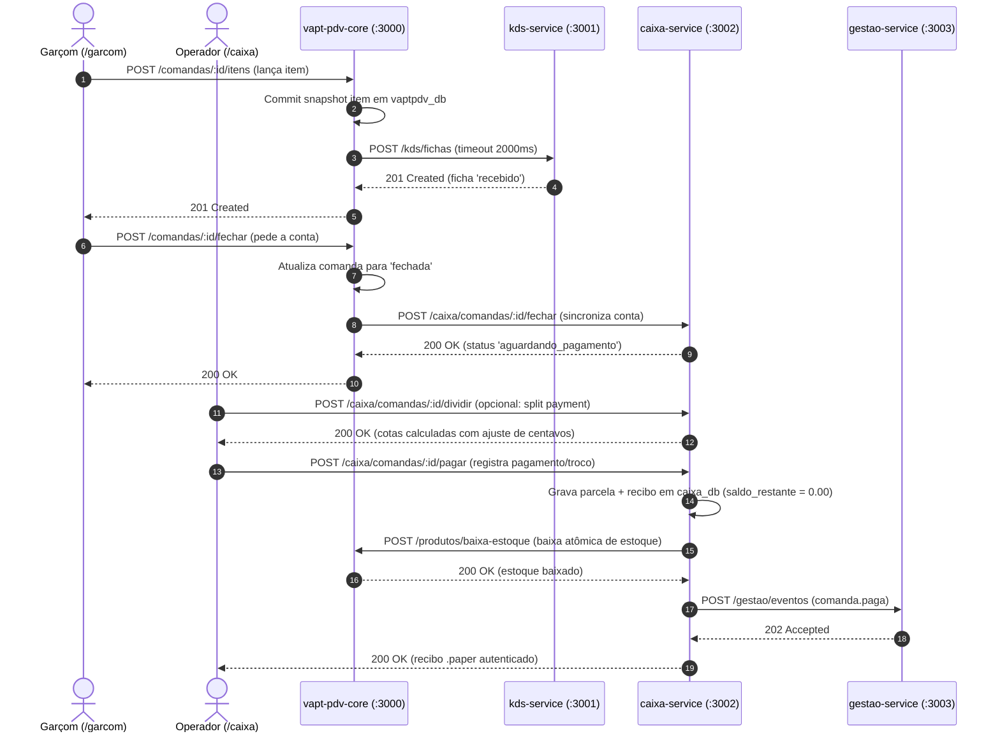
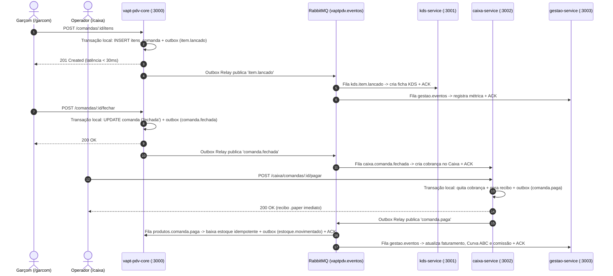

# 05 — ARD: Contrato de APIs REST e Eventos de Mensageria (RabbitMQ)

| Metadado | Valor |
| :--- | :--- |
| **Projeto** | **VaptPDV** |
| **Data** | 04 de Novembro de 2026 |
| **Autores (Equipe)** | Kaio França e Mateus Neri |
---

## Sumário

1. [Padrões Gerais de Comunicação HTTP/REST](#1-padrões-gerais-de-comunicação-httprest)
   - [1.1 Convenções de Formato, Tipos e Serialização](#11-convenções-de-formato-tipos-e-serialização)
   - [1.2 Envelope Padronizado de Erro e Catálogo de Códigos](#12-envelope-padronizado-de-erro-e-catálogo-de-códigos)
   - [1.3 Paginação e Filtros](#13-paginação-e-filtros)
2. [API do Core Salão / PDV (`vapt-pdv-core` — Porta `:3000`)](#2-api-do-core-salão--pdv-vapt-pdv-core--porta-3000)
   - [2.1 Observabilidade e Saúde (`/health` e `/docs`)](#21-observabilidade-e-saúde-health-e-docs)
   - [2.2 Módulo `usuarios` — Gestão de Equipe (`/usuarios`)](#22-módulo-usuarios--gestão-de-equipe-usuarios)
   - [2.3 Módulo `produtos` — Catálogo e Estoque (`/produtos`)](#23-módulo-produtos--catálogo-e-estoque-produtos)
   - [2.4 Módulo `comandas` — Operação de Salão e Compatibilidade M1 (`/comandas`)](#24-módulo-comandas--operação-de-salão-e-compatibilidade-m1-comandas)
3. [API do Microsserviço `kds-service` (Porta `:3001`)](#3-api-do-microsserviço-kds-service-porta-3001)
   - [3.1 Saúde (`GET /health` e `GET /docs`)](#31-saúde-get-health-e-get-docs)
   - [3.2 Recebimento Síncrono de Ficha (`POST /kds/fichas`)](#32-recebimento-síncrono-de-ficha-post-kdsfichas)
   - [3.3 Consulta da Fila de Preparo (`GET /kds/fichas`)](#33-consulta-da-fila-de-preparo-get-kdsfichas)
   - [3.4 Atualização de Status de Preparo (`PATCH /kds/fichas/:id/status`)](#34-atualização-de-status-de-preparo-patch-kdsfichasidstatus)
   - [3.5 Verificação de Pendências por Comanda (`GET /kds/comandas/:comandaId/pendencias`)](#35-verificação-de-pendências-por-comanda-get-kdscomandascomandaidpendencias)
4. [API do Microsserviço `caixa-service` (Porta `:3002`)](#4-api-do-microsserviço-caixa-service-porta-3002)
   - [4.1 Saúde (`GET /health` e `GET /docs`)](#41-saúde-get-health-e-get-docs)
   - [4.2 Fila de Contas no Caixa (`GET /caixa/comandas`)](#42-fila-de-contas-no-caixa-get-caixacomandas)
   - [4.3 Detalhe da Cobrança, Parcelas e Saldo (`GET /caixa/comandas/:comandaId`)](#43-detalhe-da-cobrança-parcelas-e-saldo-get-caixacomandascomandaid)
   - [4.4 Recebimento / Recálculo de Fechamento (`POST /caixa/comandas/:comandaId/fechar`)](#44-recebimento--recálculo-de-fechamento-post-caixacomandascomandaidfechar)
   - [4.5 Divisão de Conta / Split Payment (`POST /caixa/comandas/:comandaId/dividir`)](#45-divisão-de-conta--split-payment-post-caixacomandascomandaiddividir)
   - [4.6 Registro de Pagamento Único ou Parcelado (`POST /caixa/comandas/:comandaId/pagar`)](#46-registro-de-pagamento-único-ou-parcelado-post-caixacomandascomandaidpagar)
   - [4.7 Emissão do Recibo Operacional `.paper` (`GET /caixa/recibos/:comandaId`)](#47-emissão-do-recibo-operacional-paper-get-caixareciboscomandaid)
5. [API do Microsserviço `gestao-service` (Porta `:3003`)](#5-api-do-microsserviço-gestao-service-porta-3003)
   - [5.1 Saúde (`GET /health` e `GET /docs`)](#51-saúde-get-health-e-get-docs)
   - [5.2 Ingestão Síncrona de Evento Operacional (`[Interno] POST /gestao/eventos`)](#52-ingestão-síncrona-de-evento-operacional-interno-post-gestaoeventos)
   - [5.3 Resumo Diário do Estabelecimento (`GET /gestao/resumo-diario`)](#53-resumo-diário-do-estabelecimento-get-gestaoresumo-diario)
   - [5.4 Ranking de Produtos e Curva ABC (`GET /gestao/ranking-produtos`)](#54-ranking-de-produtos-e-curva-abc-get-gestaoranking-produtos)
   - [5.5 Desempenho e Comissões de Garçons (`GET /gestao/desempenho-garcons`)](#55-desempenho-e-comissões-de-garçons-get-gestaodesempenho-garcons)
   - [5.6 Alertas de Estoque Baixo (`GET /gestao/alertas-estoque`)](#56-alertas-de-estoque-baixo-get-gestaoalertas-estoque)
   - [5.7 Exportação de Relatórios Gerenciais (`GET /gestao/exportar`)](#57-exportação-de-relatórios-gerenciais-get-gestaoexportar)
6. [Catálogo Completo de Eventos RabbitMQ (Módulo 4)](#6-catálogo-completo-de-eventos-rabbitmq-módulo-4)
   - [6.1 Topologia do Broker (`vaptpdv.eventos`)](#61-topologia-do-broker-vaptpdveventos)
   - [6.2 Contratos JSON e Regras de Consumo por Evento](#62-contratos-json-e-regras-de-consumo-por-evento)
7. [Diagramas de Sequência Arquiteturais (Módulos 2/3 vs Módulo 4)](#7-diagramas-de-sequência-arquiteturais-módulos-23-vs-módulo-4)

---

## 1. Padrões Gerais de Comunicação HTTP/REST

### 1.1 Convenções de Formato, Tipos e Serialização

| Aspecto | Convenção Canônica |
| :--- | :--- |
| **Content-Type** | `application/json; charset=utf-8` (exceto `GET /gestao/exportar?formato=csv`, que retorna `text/csv; charset=utf-8`). |
| **Identificadores (`id`)** | Inteiros positivos (`INTEGER > 0`, gerados por `SERIAL` autoincrement no PostgreSQL, serializados como inteiros na API: `1`, `42`). Identificadores de eventos (`evento_id`) e do transactional outbox (`outbox_eventos.id`) utilizam `UUID v4` em formato string minúscula. |
| **Identificador de Mesa (`mesa`)** | Número inteiro positivo (`INTEGER > 0`, ex.: `12`) em todas as respostas JSON e no banco de dados. A validação de entrada (via JSON Schema / TypeBox) aceita inteiro positivo (`12`) ou string numérica (`"12"`) e converte para inteiro `> 0`. |
| **Valores Monetários (`RN15`)** | Serializados **sempre como string decimal com exatamente 2 casas** (`"14.90"`, `"0.00"`), respaldados por `DECIMAL(10,2)` no PostgreSQL e `Prisma.Decimal` (`ROUND_HALF_UP`). Nunca são trafegados como `float` binário. |
| **Datas e Horas** | Padrão `ISO 8601` em UTC (`YYYY-MM-DDTHH:mm:ss.sssZ`). |
| **Idempotência** | Operações de criação de fichas KDS, fechamento no Caixa, quitação de comandas, baixa de estoque e ingestão de eventos analíticos são idempotentes por chaves naturais (`item_comanda_id`, `comanda_id`, `parcela_id`, `evento_id`, `(comanda_id, produto_id)`). |
| **Documentação Interativa** | Todos os 4 serviços expõem especificação OpenAPI 3.1 em `GET /docs` (`@fastify/swagger` + `@fastify/swagger-ui`). |

### 1.2 Envelope Padronizado de Erro e Catálogo de Códigos

Qualquer resposta HTTP com status `>= 400` em qualquer um dos 4 serviços retorna o envelope padronizado (compatível com `RespostaErroSchema` do Fastify):

```json
{
  "erro": {
    "codigo": "ESTOQUE_INSUFICIENTE",
    "mensagem": "Estoque insuficiente para concluir a baixa dos itens da comanda.",
    "detalhes": {
      "produto_id": 7,
      "nome": "Hambúrguer Artesanal",
      "disponivel": 1,
      "solicitado": 3
    }
  }
}
```

| Status HTTP | Código de Erro (`erro.codigo`) | Quando Ocorre |
| :---: | :--- | :--- |
| `400` | `VALIDACAO` | Payload JSON malformado, campo obrigatório ausente, `mesa <= 0`, `preco <= 0`, `quantidade <= 0` ou `perfil` inválido. |
| `404` | `NAO_ENCONTRADO` | Recurso (`usuario`, `produto`, `comanda`, `item_comanda`, `ficha_preparo`, `cobranca`, `recibo`) inexistente. |
| `409` | `MESA_OCUPADA` | Já existe comanda com `status = 'aberta'` para o número de `mesa` informado (`RN07`). |
| `409` | `COMANDA_NAO_ABERTA` | Tentativa de adicionar/editar/remover itens ou fechar comanda cujo status não é `'aberta'` (`RN03`). |
| `409` | `COMANDA_NAO_FECHADA` | Tentativa de pagar comanda cujo status não é `'fechada'`. |
| `409` | `COMANDA_SEM_ITENS` | Tentativa de fechar ou pagar comanda com `0` itens lançados (`RN11`). |
| `409` | `COMANDA_IMUTAVEL` | Tentativa de alterar ou cobrar comanda já quitada (`status = 'paga'`) ou cancelada (`RN03`). |
| `409` | `ESTOQUE_INSUFICIENTE` | Saldo de estoque do produto menor que a quantidade solicitada na baixa (`RN06`). |
| `422` | `GARCOM_INVALIDO` | Usuário informado em `garcom_id` está inativo (`ativo = false`) ou seu perfil não é `'garcom'` (`RN08`). |
| `422` | `PRODUTO_INATIVO` | Tentativa de lançar em comanda um produto com `ativo = false` (`RN09`). |
| `422` | `VALOR_PAGAMENTO_INVALIDO` | Em `POST /caixa/comandas/:comandaId/pagar`: `valor <= 0`, `valor > saldo_restante` (para `pix`/`cartao`), ou `valor_recebido < valor` quando `forma_pagamento = 'dinheiro'`. |
| `422` | `DIVISAO_INVALIDA` | Em `POST /caixa/comandas/:comandaId/dividir`: `pessoas < 2` ou lista de cotas/itens vazia ou inconsistente com os itens da comanda. |
| `422` | `TRANSICAO_KDS_INVALIDA` | Tentativa de retroceder status de ficha KDS ou alterar ficha já em estado terminal (`entregue` ou `cancelado` — `RN18`). |
| `503` | `SERVICO_INDISPONIVEL` | Falha de comunicação ou timeout (`> 2000 ms`) em dependência síncrona obrigatória pré-commit (`ADR-07`). |
| `500` | `ERRO_INTERNO` | Erro inesperado não tratado na camada de infraestrutura. |

### 1.3 Paginação e Filtros

Endpoints de listagem suportam parâmetros de query opcionais:
- `pagina` (default `1`, inteiro `>= 1`) ou `offset` (default `0`)
- `limite` ou `limit` (default `50`, máximo `200`)
- Retornam a lista de itens na chave de recurso (`usuarios`, `produtos`, `comandas`, `fichas`, etc.) ou array direto padronizado.

---

## 2. API do Core Salão / PDV (`vapt-pdv-core` — Porta `:3000`)

> **Preservação do Módulo 1 (`entrega-1-cloud`):** Todos os endpoints abaixo já estão implementados e testados (143 testes automatizados) em `vapt-pdv-core` (`:3000`). A partir do Módulo 2, o Core Salão / PDV mantém esses contratos 100% compatíveis e sincroniza o fechamento de conta (`POST /comandas/:id/fechar`) com o `caixa-service` (`:3002`).

### 2.1 Observabilidade e Saúde (`/health` e `/docs`)

#### `GET /health`
Verifica a disponibilidade do processo Fastify e a conectividade com `vaptpdv_db` (`SELECT 1`).

- **Resposta `200 OK`:**
```json
{
  "status": "ok",
  "servico": "vapt-pdv-core",
  "banco": "conectado",
  "timestamp": "2026-04-11T18:30:00.000Z"
}
```
- **Resposta `503 Service Unavailable`:** `{"status": "erro", "servico": "vapt-pdv-core", "banco": "desconectado", "timestamp": "..."}`.

---

### 2.2 Módulo `usuarios` — Gestão de Equipe (`/usuarios`)

#### `POST /usuarios`
Cadastra um novo colaborador no sistema (`RF01`, `RF02`, `RF34`).
- **Body (`application/json`):**
```json
{
  "nome": "Carlos Garçom",
  "perfil": "garcom"
}
```
> **Valores aceitos em `perfil`:** `"garcom" | "caixa" | "gerente" | "cozinha"`.

- **Resposta `201 Created`:**
```json
{
  "id": 1,
  "nome": "Carlos Garçom",
  "perfil": "garcom",
  "ativo": true,
  "criado_em": "2026-04-11T12:00:00.000Z",
  "atualizado_em": "2026-04-11T12:00:00.000Z"
}
```
- **Erros:** `400 VALIDACAO`.

#### `GET /usuarios`
Lista usuários cadastrados com suporte a paginação e filtros opcionais (`RF02`).
- **Query Params (opcionais):**
  - `perfil`: `"garcom" | "caixa" | "gerente" | "cozinha"`
  - `ativo`: `"true" | "false"`
  - `limit`: inteiro (default `50`, máx `200`)
  - `offset`: inteiro (default `0`)
- **Resposta `200 OK`:** Array de objetos de usuário:
```json
[
  {
    "id": 1,
    "nome": "Carlos Garçom",
    "perfil": "garcom",
    "ativo": true,
    "criado_em": "2026-04-11T12:00:00.000Z",
    "atualizado_em": "2026-04-11T12:00:00.000Z"
  }
]
```
- **Erros:** `400 VALIDACAO`.

#### `GET /usuarios/:id`
Busca um colaborador pelo ID numérico inteiro (`RF02`).
- **Resposta `200 OK`:** Objeto do usuário.
- **Erros:** `400 VALIDACAO`, `404 NAO_ENCONTRADO`.

#### `PATCH /usuarios/:id`
Atualiza parcialmente o nome e/ou perfil de um colaborador (`RF03`).
- **Body (`application/json` — pelo menos um campo):**
```json
{
  "nome": "Carlos Silva",
  "perfil": "gerente"
}
```
- **Resposta `200 OK`:** Objeto do usuário atualizado.
- **Erros:** `400 VALIDACAO`, `404 NAO_ENCONTRADO`.

#### `POST /usuarios/:id/inativar`
Inativa logicamente um usuário de forma idempotente (`RF03`, `RN14`). Nunca utiliza exclusão física (`DELETE`).
- **Resposta `200 OK`:** Objeto do usuário com `ativo: false`.
- **Erros:** `400 VALIDACAO`, `404 NAO_ENCONTRADO`.

#### `GET /usuarios/:id/validar-garcom` [Interna]
Validação interna síncrona para abertura de comanda (`RF17`, `RN08`). Verifica se o usuário existe, está ativo e possui perfil `'garcom'`.
- **Resposta `200 OK`:**
```json
{
  "id": 1,
  "nome": "Carlos Garçom",
  "perfil": "garcom",
  "ativo": true,
  "valido": true
}
```
- **Erros:** `400 VALIDACAO`, `422 GARCOM_INVALIDO` (se inativo, perfil divergente ou inexistente).

---

### 2.3 Módulo `produtos` — Catálogo e Estoque (`/produtos`)

#### `POST /produtos`
Cadastra um novo item no cardápio com saldo inicial de estoque (`RF04`).
- **Body (`application/json`):**
```json
{
  "nome": "Hambúrguer Artesanal",
  "categoria": "Lanches",
  "preco": "29.90",
  "estoque": 50,
  "estoque_minimo": 10
}
```
> **Nota:** `preco` aceita string decimal (`"29.90"`) ou número positivo (`29.9`) na entrada e é sempre persistido como `DECIMAL(10,2)` e retornado como string de 2 casas (`"29.90"`). `estoque_minimo` tem default `0`. A estação de preparo (`cozinha` ou `bar`) é inferida da `categoria` (`RN22`).

- **Resposta `201 Created`:**
```json
{
  "id": 7,
  "nome": "Hambúrguer Artesanal",
  "categoria": "Lanches",
  "preco": "29.90",
  "estoque": 50,
  "estoque_minimo": 10,
  "ativo": true,
  "criado_em": "2026-04-11T12:05:00.000Z",
  "atualizado_em": "2026-04-11T12:05:00.000Z"
}
```
- **Erros:** `400 VALIDACAO`.

#### `GET /produtos`
Lista os produtos do catálogo com filtros opcionais (`RF05`).
- **Query Params (opcionais):**
  - `categoria`: string (ex.: `"Bebidas"`, `"Lanches"`, `"Porções"`)
  - `ativo`: `"true" | "false"`
  - `limit`: inteiro (default `50`, máx `200`)
  - `offset`: inteiro (default `0`)
- **Resposta `200 OK`:** Array de objetos de produto.
- **Erros:** `400 VALIDACAO`.

#### `GET /produtos/:id`
Retorna os detalhes e saldo atual de um produto pelo seu ID inteiro.
- **Resposta `200 OK`:** Objeto do produto.
- **Erros:** `400 VALIDACAO`, `404 NAO_ENCONTRADO`.

#### `PATCH /produtos/:id`
Atualiza parcialmente dados do produto (nome, categoria, preço, estoque, estoque mínimo) (`RF06`, `RN04`, `RN14`).
- **Body (`application/json` — pelo menos um campo):**
```json
{
  "preco": "32.90",
  "estoque": 60
}
```
- **Resposta `200 OK`:** Objeto do produto atualizado.
- **Erros:** `400 VALIDACAO`, `404 NAO_ENCONTRADO`.

#### `POST /produtos/:id/inativar`
Inativa logicamente o produto no cardápio de forma idempotente (`RF06`, `RN14`). Nunca utiliza exclusão física (`DELETE`).
- **Resposta `200 OK`:** Objeto do produto com `ativo: false`.
- **Erros:** `400 VALIDACAO`, `404 NAO_ENCONTRADO`.

#### `GET /produtos/:id/disponibilidade` [Interna]
Consulta se o produto está ativo e possui saldo suficiente para a quantidade desejada antes do lançamento (`RN06`, `RN09`).
- **Query Params (opcional):** `quantidade` (inteiro `>= 1`, default `1`).
- **Resposta `200 OK`:**
```json
{
  "id": 7,
  "nome": "Hambúrguer Artesanal",
  "preco": "29.90",
  "ativo": true,
  "estoque": 50,
  "disponivel": true
}
```
- **Erros:** `400 VALIDACAO`, `404 NAO_ENCONTRADO`.

#### `POST /produtos/baixa-estoque` [Interna]
Efetua baixa transacional e idempotente de estoque para os itens de uma comanda quitada (`RF07`, `RN06`, `RN10`). Invocado internamente pelo `caixa-service` nos Módulos 2 e 3 ou pelo consumidor de mensageria no Módulo 4.
- **Body (`application/json`):**
```json
{
  "comanda_id": 42,
  "itens": [
    {
      "produto_id": 7,
      "quantidade": 2
    }
  ]
}
```
- **Resposta `200 OK`:**
```json
{
  "status": "ok"
}
```
- **Erros:** `400 VALIDACAO`, `409 ESTOQUE_INSUFICIENTE`.

---

### 2.4 Módulo `comandas` — Operação de Salão e Compatibilidade M1 (`/comandas`)

#### `POST /comandas`
Abre uma nova comanda para uma mesa livre vinculada a um garçom ativo (`RF08`, `RN07`, `RN08`).
- **Body (`application/json`):**
```json
{
  "mesa": 12,
  "garcom_id": 1
}
```
> **Nota:** `mesa` aceita inteiro positivo (`12`) ou string numérica (`"12"`) e é sempre persistido e retornado como inteiro `12`. `garcom_id` deve ser o identificador inteiro de um garçom ativo.

- **Resposta `201 Created`:**
```json
{
  "id": 42,
  "mesa": 12,
  "garcom_id": 1,
  "status": "aberta",
  "forma_pagamento": null,
  "subtotal": "0.00",
  "taxa_servico": "0.00",
  "total": "0.00",
  "integracao_pendente": false,
  "itens": [],
  "aberta_em": "2026-04-11T19:00:00.000Z",
  "fechada_em": null,
  "paga_em": null
}
```
- **Erros:** `400 VALIDACAO`, `409 MESA_OCUPADA`, `422 GARCOM_INVALIDO`.

#### `GET /comandas`
Lista comandas ordenadas da mais recente para a mais antiga, com suporte a filtros combinados (`RF12`).
- **Query Params (opcionais):**
  - `status`: `"aberta" | "fechada" | "paga" | "cancelada"`
  - `mesa`: inteiro positivo (`12`)
  - `garcom_id`: inteiro positivo (`1`)
  - `de`: data inicial em UTC (`YYYY-MM-DDTHH:mm:ss.sssZ`)
  - `ate`: data final em UTC (`YYYY-MM-DDTHH:mm:ss.sssZ`)
- **Resposta `200 OK`:** Array de comandas com totais e lista de itens.

#### `GET /comandas/:id`
Detalha uma comanda específica com todos os seus itens e totais recalculados (`RF12`, `RN05`).
- **Resposta `200 OK`:**
```json
{
  "id": 42,
  "mesa": 12,
  "garcom_id": 1,
  "status": "aberta",
  "forma_pagamento": null,
  "subtotal": "59.80",
  "taxa_servico": "5.98",
  "total": "65.78",
  "integracao_pendente": false,
  "itens": [
    {
      "id": 101,
      "comanda_id": 42,
      "produto_id": 7,
      "nome_copiado": "Hambúrguer Artesanal",
      "preco_copiado": "29.90",
      "quantidade": 2,
      "subtotal": "59.80",
      "observacao": "Sem cebola, ponto da carne ao ponto",
      "status_preparo": "em_preparo",
      "criado_em": "2026-04-11T19:05:00.000Z"
    }
  ],
  "aberta_em": "2026-04-11T19:00:00.000Z",
  "fechada_em": null,
  "paga_em": null
}
```
- **Erros:** `400 VALIDACAO`, `404 NAO_ENCONTRADO`.

#### `POST /comandas/:id/itens`
Lança um item na comanda aberta copiando snapshot imutável de nome e preço (`RF09`, `RN04`, `RN06`, `RN09`) e dispara integração com o `kds-service` (`:3001`) e `gestao-service` (`:3003`).
- **Body (`application/json`):**
```json
{
  "produto_id": 7,
  "quantidade": 2,
  "observacao": "Sem cebola, ponto da carne ao ponto"
}
```
- **Resposta `201 Created`:** Objeto do item lançado na comanda. Caso `kds-service` ou `gestao-service` esteja indisponível nos Módulos 2/3, a operação de salão é preservada (`ADR-07`):
```json
{
  "id": 101,
  "comanda_id": 42,
  "produto_id": 7,
  "nome_copiado": "Hambúrguer Artesanal",
  "preco_copiado": "29.90",
  "quantidade": 2,
  "subtotal": "59.80",
  "observacao": "Sem cebola, ponto da carne ao ponto",
  "status_preparo": "recebido",
  "criado_em": "2026-04-11T19:05:00.000Z"
}
```
- **Erros:** `400 VALIDACAO`, `404 NAO_ENCONTRADO`, `409 COMANDA_NAO_ABERTA`, `409 ESTOQUE_INSUFICIENTE`, `422 PRODUTO_INATIVO`.

#### `PATCH /comandas/:id/itens/:itemId`
Ajusta a quantidade de um item de uma comanda aberta com validação de estoque adicional (`RF10`, `RN03`, `RN06`).
- **Body (`application/json`):**
```json
{
  "quantidade": 3
}
```
- **Resposta `200 OK`:** Objeto do item de comanda com quantidade e subtotal atualizados.
- **Erros:** `400 VALIDACAO`, `404 NAO_ENCONTRADO`, `409 COMANDA_NAO_ABERTA`, `409 ESTOQUE_INSUFICIENTE`.

#### `DELETE /comandas/:id/itens/:itemId`
Remove um item de uma comanda aberta (`RF11`, `RN03`).
- **Resposta `204 No Content`** (corpo vazio).
- **Erros:** `400 VALIDACAO`, `404 NAO_ENCONTRADO`, `409 COMANDA_NAO_ABERTA`.

#### `POST /comandas/:id/fechar`
Transiciona a comanda de `'aberta'` para `'fechada'` (pré-conta solicitada pelo Garçom em `G06` ou pelo Caixa), calcula `subtotal`, `taxa_servico` (10% opcional com arredondamento `HALF_UP`) e `total` (`RF13`, `RN11`, `RN12`) e envia a conta fechada ao `caixa-service` (`:3002`) via `POST /caixa/comandas/:comandaId/fechar` (nos Módulos 2 e 3) ou evento `comanda.fechada` (no Módulo 4).
- **Body (`application/json` — opcional):**
```json
{
  "aplicar_taxa_servico": true
}
```
- **Resposta `200 OK`:** Objeto da comanda com `status: "fechada"` e `fechada_em` preenchido.
- **Erros:** `400 VALIDACAO`, `404 NAO_ENCONTRADO`, `409 COMANDA_NAO_ABERTA`, `409 COMANDA_SEM_ITENS`.

#### `POST /comandas/:id/pagar`
Registra ou confirma a quitação da comanda fechada, executa a baixa atômica e idempotente de estoque por `(comanda_id, produto_id)` e transiciona o status para `'paga'` (`RF14`, `RN10`, `RN13`).
> **Papel nos Módulos 1 a 4:** No Módulo 1 (`entrega-1-cloud`), este endpoint é chamado diretamente pela estação de Caixa. Nos Módulos 2 e 3, o `caixa-service` (`:3002`) gerencia a divisão de conta (`split`), parcelas e cálculo de troco, e aciona internamente `POST /produtos/baixa-estoque` ou `POST /comandas/:id/pagar` ao quitar o `saldo_restante == 0.00`. No Módulo 4, a baixa é acionada de forma assíncrona pelo consumidor da fila `produtos.comanda.paga`.
- **Body (`application/json`):**
```json
{
  "forma_pagamento": "pix",
  "documento_cliente": "123.456.789-00"
}
```
> **Valores aceitos em `forma_pagamento`:** `"dinheiro" | "pix" | "cartao"`. `documento_cliente` é opcional (CPF/CNPJ).

- **Resposta `200 OK`:**
```json
{
  "id": 42,
  "mesa": 12,
  "garcom_id": 1,
  "status": "paga",
  "forma_pagamento": "pix",
  "subtotal": "59.80",
  "taxa_servico": "5.98",
  "total": "65.78",
  "integracao_pendente": false,
  "aberta_em": "2026-04-11T19:00:00.000Z",
  "fechada_em": "2026-04-11T19:40:00.000Z",
  "paga_em": "2026-04-11T19:45:00.000Z"
}
```
- **Idempotência (`RN10`):** Chamar `POST /comandas/:id/pagar` repetidamente com a mesma `forma_pagamento` para uma comanda já `'paga'` retorna `200 OK` sem duplicar baixa de estoque.
- **Erros:** `400 VALIDACAO`, `404 NAO_ENCONTRADO`, `409 COMANDA_NAO_FECHADA`, `409 COMANDA_IMUTAVEL`, `409 ESTOQUE_INSUFICIENTE`.

#### `POST /comandas/:id/cancelar`
Cancela uma comanda `'aberta'` ou `'fechada'` sem baixar estoque e liberando a mesa (`RF15`, `RN03`).
- **Resposta `200 OK`:** Objeto da comanda com `status: "cancelada"` e `cancelada_em` preenchido.
- **Erros:** `400 VALIDACAO`, `404 NAO_ENCONTRADO`, `409 COMANDA_IMUTAVEL`.

---

## 3. API do Microsserviço `kds-service` (Porta `:3001`)

### 3.1 Saúde (`GET /health` e `GET /docs`)
- **`GET /health` -> `200 OK`:**
```json
{
  "status": "ok",
  "servico": "kds-service",
  "banco": "conectado",
  "timestamp": "2026-04-11T19:05:00.000Z"
}
```

### 3.2 Recebimento Síncrono de Ficha (`POST /kds/fichas`)
Endpoint invocado pelo `vapt-pdv-core` nos Módulos 2 e 3 ao lançar item na comanda (`RF20`, `RN17`). Idempotente por `item_comanda_id`.
- **Body (`application/json`):**
```json
{
  "comanda_id": 42,
  "item_comanda_id": 101,
  "produto_id": 7,
  "mesa": 12,
  "garcom_id": 1,
  "garcom_nome": "Carlos Garçom",
  "nome_produto": "Hambúrguer Artesanal",
  "estacao": "cozinha",
  "quantidade": 2,
  "observacao": "Sem cebola, ponto da carne ao ponto"
}
```
- **Resposta `201 Created` (ou `200 OK` se `item_comanda_id` já registrado):**
```json
{
  "id": 1,
  "comanda_id": 42,
  "item_comanda_id": 101,
  "produto_id": 7,
  "mesa": 12,
  "garcom_nome": "Carlos Garçom",
  "nome_produto": "Hambúrguer Artesanal",
  "estacao": "cozinha",
  "quantidade": 2,
  "observacao": "Sem cebola, ponto da carne ao ponto",
  "status": "recebido",
  "recebido_em": "2026-04-11T19:05:01.000Z",
  "iniciado_em": null,
  "pronto_em": null,
  "entregue_em": null,
  "cancelado_em": null
}
```

### 3.3 Consulta da Fila de Preparo (`GET /kds/fichas`)
> **Alias de compatibilidade:** `GET /kds/fila` aponta para o mesmo handler.

Lista as fichas de preparo ordenadas FIFO por `recebido_em ASC` (`RF21`).
- **Query Params (opcionais):**
  - `estacao`: `"cozinha" | "bar"`
  - `status`: `"recebido" | "em_preparo" | "pronto" | "entregue" | "cancelado"` (pode receber múltiplos separados por vírgula, ex.: `recebido,em_preparo`)
  - `mesa`: inteiro positivo (`12`)
- **Resposta `200 OK`:**
```json
{
  "fichas": [
    {
      "id": 1,
      "comanda_id": 42,
      "item_comanda_id": 101,
      "mesa": 12,
      "garcom_nome": "Carlos Garçom",
      "nome_produto": "Hambúrguer Artesanal",
      "estacao": "cozinha",
      "quantidade": 2,
      "observacao": "Sem cebola, ponto da carne ao ponto",
      "status": "em_preparo",
      "tempo_decorrido_segundos": 420,
      "sla_status": "normal",
      "recebido_em": "2026-04-11T19:05:01.000Z",
      "iniciado_em": "2026-04-11T19:07:00.000Z",
      "pronto_em": null
    }
  ],
  "resumo": {
    "recebido": 1,
    "em_preparo": 3,
    "pronto": 2
  }
}
```
> **Cálculo de `sla_status`:** `< 480s` (8 min) = `"normal"`; `480s..900s` (8–15 min) = `"atencao"`; `> 900s` (> 15 min) = `"atrasado"`.

### 3.4 Atualização de Status de Preparo (`PATCH /kds/fichas/:id/status`)
Avança o estado de uma ficha KDS (`RF22`, `RN18`) e grava o evento na tabela `historico_status_ficha`. Quando o novo status é `"pronto"`, publica o evento `item.pronto` (no Módulo 4) para notificar o garçom.
- **Body (`application/json`):**
```json
{
  "status": "pronto",
  "alterado_por": "Chef Marcos"
}
```
- **Resposta `200 OK`:** Objeto da ficha atualizada com `pronto_em` preenchido.
- **Erros:** `404 NAO_ENCONTRADO`, `422 TRANSICAO_KDS_INVALIDA`.

### 3.5 Verificação de Pendências por Comanda (`GET /kds/comandas/:comandaId/pendencias`)
> **Alias de compatibilidade:** `GET /kds/comandas/:comandaId/status-preparo`.

Permite ao Garçom ou ao Caixa consultar se há itens ainda em preparo antes de fechar a conta (`RF23`).
- **Resposta `200 OK`:**
```json
{
  "comanda_id": 42,
  "mesa": 12,
  "possui_pendencias": false,
  "totais": {
    "recebido": 0,
    "em_preparo": 0,
    "pronto": 0,
    "entregue": 2,
    "cancelado": 0
  },
  "itens": [
    {
      "ficha_id": 1,
      "item_comanda_id": 101,
      "nome_produto": "Hambúrguer Artesanal",
      "quantidade": 2,
      "estacao": "cozinha",
      "status": "entregue"
    }
  ]
}
```

---

## 4. API do Microsserviço `caixa-service` (Porta `:3002`)

> **Escopo Operacional (`C01–C17`, exceto `C14` fora do escopo v1):** O `caixa-service` concentra toda a estação de Caixa (`/caixa`): fila de contas abertas/aguardando pagamento, conferência de itens, alternância da taxa de serviço de 10%, calculadora de divisão de conta (`split payment` por pessoas ou por itens — `C11`), registro de pagamentos únicos ou parcelados em `dinheiro`, `pix` e `cartao`, cálculo preciso de troco em `DECIMAL(10,2)` (`RN15`) e emissão do recibo operacional `.paper` (`C12`).

### 4.1 Saúde (`GET /health` e `GET /docs`)
- **`GET /health` -> `200 OK`:**
```json
{
  "status": "ok",
  "servico": "caixa-service",
  "banco": "conectado",
  "timestamp": "2026-04-11T19:40:00.000Z"
}
```

### 4.2 Fila de Contas no Caixa (`GET /caixa/comandas`)
Retorna a fila de cobranças do Caixa com resumo financeiro do turno (`C01`, `C02`, `C15`).
- **Query Params (opcionais):**
  - `status`: `"aberta" | "aguardando_pagamento" | "parcialmente_paga" | "paga" | "cancelada"`
  - `mesa`: inteiro positivo (`12`)
  - `busca`: número da mesa ou nome do garçom (`C02`)
- **Resposta `200 OK`:**
```json
{
  "comandas": [
    {
      "id": 1,
      "comanda_id": 42,
      "mesa": 12,
      "garcom_id": 1,
      "garcom_nome": "Carlos Garçom",
      "status": "aguardando_pagamento",
      "aplicar_taxa_servico": true,
      "subtotal": "59.80",
      "taxa_servico": "5.98",
      "total": "65.78",
      "valor_pago": "0.00",
      "saldo_restante": "65.78",
      "pessoas_divisao": 1,
      "fechada_em": "2026-04-11T19:40:00.000Z",
      "paga_em": null
    }
  ],
  "resumo_turno": {
    "aguardando_pagamento": 1,
    "pagas_hoje": 18,
    "faturamento_turno": "1842.50"
  }
}
```

### 4.3 Detalhe da Cobrança, Parcelas e Saldo (`GET /caixa/comandas/:comandaId`)
Retorna o espelho completo da conta selecionada no painel direito do Caixa (`C03`, `C05`), incluindo o snapshot de itens, as parcelas já pagas (`pagamentos_parcela`), o `saldo_restante` e o recibo quando quitada.
- **Resposta `200 OK`:**
```json
{
  "id": 1,
  "comanda_id": 42,
  "mesa": 12,
  "garcom_id": 1,
  "garcom_nome": "Carlos Garçom",
  "status": "parcialmente_paga",
  "aplicar_taxa_servico": true,
  "subtotal": "59.80",
  "taxa_servico": "5.98",
  "total": "65.78",
  "valor_pago": "32.89",
  "saldo_restante": "32.89",
  "troco_total": "0.00",
  "pessoas_divisao": 2,
  "itens": [
    {
      "item_comanda_id": 101,
      "produto_id": 7,
      "nome": "Hambúrguer Artesanal",
      "preco_unitario": "29.90",
      "quantidade": 2,
      "subtotal": "59.80"
    }
  ],
  "parcelas": [
    {
      "id": 1,
      "numero_parcela": 1,
      "pagador_rotulo": "Pessoa 1 de 2",
      "forma_pagamento": "pix",
      "valor_aplicado": "32.89",
      "valor_recebido": "32.89",
      "troco": "0.00",
      "criado_em": "2026-04-11T19:43:00.000Z"
    }
  ],
  "fechada_em": "2026-04-11T19:40:00.000Z",
  "paga_em": null
}
```
- **Erros:** `404 NAO_ENCONTRADO`.

### 4.4 Recebimento / Recálculo de Fechamento (`POST /caixa/comandas/:comandaId/fechar`)
Sincroniza a conta fechada vinda do Core/Salão (`:3000`) ou recalcula os totais no Caixa quando o operador ativa/desativa a taxa de serviço opcional de 10% (`C05`, `C06`, `RN12`). Idempotente por `comanda_id`.
- **Body (`application/json`):**
```json
{
  "mesa": 12,
  "garcom_id": 1,
  "garcom_nome": "Carlos Garçom",
  "aplicar_taxa_servico": true,
  "subtotal": "59.80",
  "taxa_servico": "5.98",
  "total": "65.78",
  "itens": [
    {
      "item_comanda_id": 101,
      "produto_id": 7,
      "nome": "Hambúrguer Artesanal",
      "preco_unitario": "29.90",
      "quantidade": 2,
      "subtotal": "59.80"
    }
  ]
}
```
> **Nota:** Se a cobrança já existir em `caixa_db`, o operador pode enviar apenas `{"aplicar_taxa_servico": false}` para recalcular `taxa_servico = "0.00"`, `total = subtotal` e atualizar `saldo_restante = total - valor_pago`.

- **Resposta `200 OK`:** Objeto completo da cobrança atualizada com `status: "aguardando_pagamento"` (ou `"parcialmente_paga"`).
- **Erros:** `400 VALIDACAO`, `409 COMANDA_IMUTAVEL`.

### 4.5 Divisão de Conta / Split Payment (`POST /caixa/comandas/:comandaId/dividir`)
Calcula e registra a divisão do `saldo_restante` (ou `total`) da comanda igualmente entre $N$ pessoas ou proporcionalmente por itens consumidos (`C11`, `RN15`). Garante ajuste de centavo residual na última cota para que a soma das cotas seja **exatamente igual** ao valor dividido.
- **Body (`application/json` — Modo 1: Divisão Igualitária por Pessoas):**
```json
{
  "modo": "pessoas",
  "pessoas": 3
}
```
- **Resposta `200 OK` (Modo `pessoas`):**
```json
{
  "comanda_id": 42,
  "mesa": 12,
  "modo": "pessoas",
  "pessoas": 3,
  "total_comanda": "65.78",
  "saldo_a_dividir": "65.78",
  "cotas": [
    {
      "numero_cota": 1,
      "rotulo": "Pessoa 1 de 3",
      "valor": "21.93"
    },
    {
      "numero_cota": 2,
      "rotulo": "Pessoa 2 de 3",
      "valor": "21.93"
    },
    {
      "numero_cota": 3,
      "rotulo": "Pessoa 3 de 3",
      "valor": "21.92"
    }
  ]
}
```
- **Body (`application/json` — Modo 2: Divisão por Itens):**
```json
{
  "modo": "itens",
  "cotas": [
    {
      "rotulo": "Cliente A",
      "itens": [
        {
          "item_comanda_id": 101,
          "quantidade": 1
        }
      ]
    },
    {
      "rotulo": "Cliente B",
      "itens": [
        {
          "item_comanda_id": 101,
          "quantidade": 1
        }
      ]
    }
  ]
}
```
- **Erros:** `400 VALIDACAO`, `404 NAO_ENCONTRADO`, `422 DIVISAO_INVALIDA`.

### 4.6 Registro de Pagamento Único ou Parcelado (`POST /caixa/comandas/:comandaId/pagar`)
Registra o pagamento integral ou de uma parcela/cota da comanda (`C04`, `C07`, `C10`, `C11`).
- Quando `valor` é omitido, assume quitação integral do `saldo_restante`.
- Quando `forma_pagamento = "dinheiro"`, calcula `troco = valor_recebido - valor_aplicado` em `DECIMAL(10,2)`.
- Quando o pagamento zera o `saldo_restante` (`"0.00"`):
  1. Muda o status da cobrança para `'paga'`.
  2. Gera o recibo autenticado em `recibos_venda` (`codigo_autenticacao` único).
  3. Aciona a baixa atômica e idempotente de estoque no `vapt-pdv-core` (`POST /produtos/baixa-estoque` ou `POST /comandas/:id/pagar` nos Módulos 2/3 ou publicação do evento `comanda.paga` via `outbox_eventos` no Módulo 4) e notifica o `gestao-service`.

- **Body (`application/json`):**
```json
{
  "forma_pagamento": "dinheiro",
  "valor": "32.89",
  "valor_recebido": "50.00",
  "pagador_rotulo": "Pessoa 2 de 2",
  "operador_nome": "Ana Caixa"
}
```
- **Resposta `200 OK` (Comanda Quitada — `saldo_restante == "0.00"`):**
```json
{
  "comanda_id": 42,
  "mesa": 12,
  "status": "paga",
  "aplicar_taxa_servico": true,
  "subtotal": "59.80",
  "taxa_servico": "5.98",
  "total": "65.78",
  "valor_pago": "65.78",
  "saldo_restante": "0.00",
  "troco_total": "17.11",
  "parcela_registrada": {
    "id": 2,
    "numero_parcela": 2,
    "pagador_rotulo": "Pessoa 2 de 2",
    "forma_pagamento": "dinheiro",
    "valor_aplicado": "32.89",
    "valor_recebido": "50.00",
    "troco": "17.11",
    "criado_em": "2026-04-11T19:45:00.000Z"
  },
  "recibo": {
    "id": 1,
    "numero_recibo": 1001,
    "codigo_autenticacao": "VAPT-20260411-12-9F4A",
    "emitido_em": "2026-04-11T19:45:00.000Z"
  },
  "avisos": []
}
```
- **Erros:** `400 VALIDACAO`, `404 NAO_ENCONTRADO`, `409 COMANDA_IMUTAVEL`, `409 ESTOQUE_INSUFICIENTE`, `422 VALOR_PAGAMENTO_INVALIDO`, `503 SERVICO_INDISPONIVEL`.

### 4.7 Emissão do Recibo Operacional `.paper` (`GET /caixa/recibos/:comandaId`)
Retorna os dados estruturados do comprovante térmico `.paper` (`C12`) para impressão ou exibição pós-venda.
- **Resposta `200 OK`:**
```json
{
  "id": 1,
  "numero_recibo": 1001,
  "comanda_id": 42,
  "mesa": 12,
  "garcom_nome": "Carlos Garçom",
  "operador_caixa": "Ana Caixa",
  "codigo_autenticacao": "VAPT-20260411-12-9F4A",
  "subtotal": "59.80",
  "taxa_servico": "5.98",
  "total": "65.78",
  "troco_total": "17.11",
  "itens": [
    {
      "nome": "Hambúrguer Artesanal",
      "quantidade": 2,
      "preco_unitario": "29.90",
      "subtotal": "59.80"
    }
  ],
  "pagamentos": [
    {
      "numero_parcela": 1,
      "pagador_rotulo": "Pessoa 1 de 2",
      "forma_pagamento": "pix",
      "valor_aplicado": "32.89",
      "valor_recebido": "32.89",
      "troco": "0.00"
    },
    {
      "numero_parcela": 2,
      "pagador_rotulo": "Pessoa 2 de 2",
      "forma_pagamento": "dinheiro",
      "valor_aplicado": "32.89",
      "valor_recebido": "50.00",
      "troco": "17.11"
    }
  ],
  "emitido_em": "2026-04-11T19:45:00.000Z"
}
```
- **Erros:** `404 NAO_ENCONTRADO`.

---

## 5. API do Microsserviço `gestao-service` (Porta `:3003`)

> **Compatibilidade de Rotas (`/gestao/*` e `/analytics/*`):** Todos os endpoints abaixo respondem tanto no prefixo canônico `/gestao/*` quanto no alias `/analytics/*` para total compatibilidade entre clientes.

### 5.1 Saúde (`GET /health` e `GET /docs`)
- **`GET /health` -> `200 OK`:**
```json
{
  "status": "ok",
  "servico": "gestao-service",
  "banco": "conectado",
  "timestamp": "2026-04-11T19:45:00.000Z"
}
```

### 5.2 Ingestão Síncrona de Evento Operacional (`[Interno] POST /gestao/eventos`)
> **Alias:** `POST /analytics/eventos`.

Endpoint utilizado nos Módulos 2 e 3 pelo `vapt-pdv-core` e pelo `caixa-service` para enviar eventos operacionais via HTTP antes da introdução do RabbitMQ no Módulo 4 (`RF29`, `RN23`). Aceita exatamente o mesmo schema JSON dos eventos do Módulo 4 (Seção 6.2) e é idempotente por `evento_id` via tabela `eventos_processados`.
- **Body (`application/json`):** Qualquer um dos 5 envelopes de evento (`comanda.paga`, `comanda.fechada`, `item.lancado`, `item.pronto`, `estoque.movimentado`).
- **Resposta `202 Accepted` (ou `200 OK` se `evento_id` já processado):**
```json
{
  "evento_id": "e0444444-2222-4333-8444-555555555555",
  "evento": "comanda.paga",
  "processado": true,
  "duplicado": false,
  "processado_em": "2026-04-11T19:45:01.000Z"
}
```

### 5.3 Resumo Diário do Estabelecimento (`GET /gestao/resumo-diario`)
> **Alias:** `GET /analytics/resumo-diario`.

Retorna os KPIs consolidados da data selecionada (`RF30`, `M01`, `M09`): faturamento total, subtotal de itens, taxa de serviço arrecadada, quantidade de pedidos pagos, ticket médio (`RN21`) e breakdown por forma de pagamento.
- **Query Params (opcional):** `data=YYYY-MM-DD` (default: data atual).
- **Resposta `200 OK`:**
```json
{
  "data": "2026-04-11",
  "total_vendas": "3450.80",
  "total_subtotal": "3137.09",
  "total_taxa_servico": "313.71",
  "quantidade_pedidos": 42,
  "ticket_medio": "82.16",
  "por_forma_pagamento": {
    "pix": "1850.40",
    "cartao": "1200.40",
    "dinheiro": "400.00"
  }
}
```

### 5.4 Ranking de Produtos e Curva ABC (`GET /gestao/ranking-produtos`)
> **Alias:** `GET /analytics/ranking-produtos`.

Lista os produtos ordenados por receita bruta decrescente com percentual individual, percentual acumulado e classificação automática na Curva ABC (`RF31`, `RN22`, `M10`: Classe `A` $\le 80\%$, Classe `B` $\le 95\%$, Classe `C` $> 95\%$).
- **Query Params (opcionais):** `limite` (default `20`), `categoria`.
- **Resposta `200 OK`:**
```json
{
  "receita_total_acumulada": "3137.09",
  "produtos": [
    {
      "posicao": 1,
      "produto_id": 7,
      "nome_produto": "Hambúrguer Artesanal",
      "categoria": "Lanches",
      "quantidade_vendida": 48,
      "receita_bruta": "1435.20",
      "percentual_receita": "45.75",
      "percentual_acumulado": "45.75",
      "classe_abc": "A"
    },
    {
      "posicao": 2,
      "produto_id": 8,
      "nome_produto": "Chopp Pilsen 500ml",
      "categoria": "Bebidas",
      "quantidade_vendida": 75,
      "receita_bruta": "1042.50",
      "percentual_receita": "33.23",
      "percentual_acumulado": "78.98",
      "classe_abc": "A"
    }
  ]
}
```

### 5.5 Desempenho e Comissões de Garçons (`GET /gestao/desempenho-garcons`)
> **Alias:** `GET /analytics/desempenho-garcons`.

Retorna a produtividade da equipe de salão e o total de comissões (taxa de serviço de 10%) geradas por garçom (`RF32`, `M11`).
- **Resposta `200 OK`:**
```json
{
  "garcons": [
    {
      "garcom_id": 1,
      "garcom_nome": "Carlos Garçom",
      "comandas_atendidas": 24,
      "total_vendido": "1980.50",
      "comissao_gerada": "180.05",
      "ticket_medio": "82.52"
    }
  ]
}
```

### 5.6 Alertas de Estoque Baixo (`GET /gestao/alertas-estoque`)
> **Alias:** `GET /analytics/alertas-estoque`.

Retorna os produtos cujo `estoque_atual <= estoque_minimo` ou esgotados (`RF33`, `M05`).
- **Query Params (opcional):** `apenas_ativos=true` (default `true`).
- **Resposta `200 OK`:**
```json
{
  "alertas": [
    {
      "produto_id": 9,
      "nome_produto": "Batata Frita Rústica",
      "categoria": "Porções",
      "estoque_atual": 3,
      "estoque_minimo": 8,
      "nivel": "baixo",
      "ativo": true,
      "atualizado_em": "2026-04-11T19:45:01.000Z"
    }
  ]
}
```

### 5.7 Exportação de Relatórios Gerenciais (`GET /gestao/exportar`)
Exporta os relatórios analíticos consolidados em formato `CSV` ou `JSON` para prestação de contas e fechamento contábil (`M15`).
- **Query Params:**
  - `tipo`: `"faturamento" | "produtos" | "garcons" | "alertas"` (default `"faturamento"`)
  - `formato`: `"csv" | "json"` (default `"csv"`)
  - `de`: `YYYY-MM-DD` (opcional)
  - `ate`: `YYYY-MM-DD` (opcional)
- **Resposta `200 OK` (`formato=csv`):** Header `Content-Type: text/csv; charset=utf-8` e `Content-Disposition: attachment; filename="relatorio-faturamento.csv"`.
- **Resposta `200 OK` (`formato=json`):** JSON estruturado com os registros do relatório solicitado.

---

## 6. Catálogo Completo de Eventos RabbitMQ (Módulo 4)

### 6.1 Topologia do Broker (`vaptpdv.eventos`)

- **Exchange Principal:** `vaptpdv.eventos` (tipo `topic`, `durable: true`)
- **Dead-Letter Exchange (DLX):** `vaptpdv.dlx` (tipo `topic`, `durable: true`) -> fila `vaptpdv.dlq`
- **Política de Entrega:** Mensagens publicadas com `persistent: true` (`deliveryMode: 2`), `content_type: "application/json"`, consumo com `prefetch(10)` e confirmação manual (`ack` após commit transacional no banco local).

| Routing Key (`evento`) | Publicador | Fila(s) Consumidora(s) | Binding Key | Ação de Negócio no Consumidor |
| :--- | :--- | :--- | :--- | :--- |
| `item.lancado` | `vapt-pdv-core` | `kds.item.lancado`<br>`gestao.eventos` | `item.lancado`<br>`#` | **KDS:** Cria ficha de preparo (`recebido`) idempotente por `item_comanda_id`.<br>**Gestão:** Registra volume de pedidos por estação/horário. |
| `item.pronto` | `kds-service` | `pdv.item.pronto`<br>`gestao.eventos` | `item.pronto`<br>`#` | **Core:** Atualiza `itens_comanda.status_preparo = 'pronto'` e exibe alerta ao garçom.<br>**Gestão:** Calcula SLA médio de preparo. |
| `comanda.fechada` | `vapt-pdv-core` | `caixa.comanda.fechada`<br>`gestao.eventos` | `comanda.fechada`<br>`#` | **Caixa:** Cria ou atualiza `cobrancas_comanda` (`aguardando_pagamento`) na fila do Caixa.<br>**Gestão:** Registra tempo de permanência de mesa. |
| `comanda.paga` | `caixa-service` / `vapt-pdv-core` | `produtos.comanda.paga`<br>`gestao.eventos` | `comanda.paga`<br>`#` | **Core (`produtos`):** Baixa estoque de forma idempotente por `(comanda_id, produto_id)` e marca comanda como `'paga'`.<br>**Gestão:** Atualiza `faturamento_diario`, `vendas_produto_abc` e `desempenho_garcom`. |
| `estoque.movimentado` | `vapt-pdv-core` | `gestao.eventos` | `#` | **Gestão:** Atualiza ou limpa alertas em `alertas_estoque` quando `estoque_atual <= estoque_minimo`. |

---

### 6.2 Contratos JSON e Regras de Consumo por Evento

> **Alinhamento 1:1 com `04-modelo-dados-e-dominio.md` (Seção 5):** Todos os eventos trazem `evento_id`, `evento`, `versao`, `ocorrido_em` e os atributos de domínio na raiz do objeto JSON (consumidores também aceitam fallback caso os atributos venham encapsulados em `dados`).

#### 6.2.1 `item.lancado`
```json
{
  "evento_id": "e0111111-2222-4333-8444-555555555555",
  "evento": "item.lancado",
  "versao": 1,
  "ocorrido_em": "2026-04-11T19:05:00.000Z",
  "comanda_id": 42,
  "item_comanda_id": 101,
  "produto_id": 7,
  "mesa": 12,
  "garcom_id": 1,
  "garcom_nome": "Carlos Garçom",
  "nome_produto": "Hambúrguer Artesanal",
  "categoria": "Lanches",
  "estacao": "cozinha",
  "quantidade": 2,
  "preco_unitario": "29.90",
  "subtotal": "59.80",
  "observacao": "Sem cebola, ponto da carne ao ponto"
}
```

#### 6.2.2 `item.pronto`
```json
{
  "evento_id": "e0222222-2222-4333-8444-555555555555",
  "evento": "item.pronto",
  "versao": 1,
  "ocorrido_em": "2026-04-11T19:16:00.000Z",
  "ficha_id": 1,
  "comanda_id": 42,
  "item_comanda_id": 101,
  "mesa": 12,
  "nome_produto": "Hambúrguer Artesanal",
  "estacao": "cozinha",
  "quantidade": 2,
  "status": "pronto",
  "pronto_em": "2026-04-11T19:16:00.000Z"
}
```

#### 6.2.3 `comanda.fechada`
```json
{
  "evento_id": "e0333333-2222-4333-8444-555555555555",
  "evento": "comanda.fechada",
  "versao": 1,
  "ocorrido_em": "2026-04-11T19:40:00.000Z",
  "comanda_id": 42,
  "mesa": 12,
  "garcom_id": 1,
  "garcom_nome": "Carlos Garçom",
  "aplicar_taxa_servico": true,
  "subtotal": "59.80",
  "taxa_servico": "5.98",
  "total": "65.78",
  "itens": [
    {
      "item_comanda_id": 101,
      "produto_id": 7,
      "nome": "Hambúrguer Artesanal",
      "categoria": "Lanches",
      "preco_unitario": "29.90",
      "quantidade": 2,
      "subtotal": "59.80"
    }
  ]
}
```

#### 6.2.4 `comanda.paga`
```json
{
  "evento_id": "e0444444-2222-4333-8444-555555555555",
  "evento": "comanda.paga",
  "versao": 1,
  "ocorrido_em": "2026-04-11T19:45:00.000Z",
  "comanda_id": 42,
  "mesa": 12,
  "garcom_id": 1,
  "garcom_nome": "Carlos Garçom",
  "forma_pagamento": "pix",
  "aplicar_taxa_servico": true,
  "subtotal": "59.80",
  "taxa_servico": "5.98",
  "total": "65.78",
  "troco_total": "0.00",
  "parcelas": [
    {
      "numero_parcela": 1,
      "pagador_rotulo": "Conta Integral",
      "forma_pagamento": "pix",
      "valor_aplicado": "65.78",
      "valor_recebido": "65.78",
      "troco": "0.00"
    }
  ],
  "itens": [
    {
      "item_comanda_id": 101,
      "produto_id": 7,
      "nome": "Hambúrguer Artesanal",
      "categoria": "Lanches",
      "preco_unitario": "29.90",
      "quantidade": 2,
      "subtotal": "59.80"
    }
  ]
}
```

#### 6.2.5 `estoque.movimentado`
```json
{
  "evento_id": "e0555555-2222-4333-8444-555555555555",
  "evento": "estoque.movimentado",
  "versao": 1,
  "ocorrido_em": "2026-04-11T19:45:01.000Z",
  "movimento_id": 5,
  "produto_id": 7,
  "nome_produto": "Hambúrguer Artesanal",
  "tipo": "saida",
  "quantidade": 2,
  "estoque_atual": 8,
  "estoque_minimo": 10,
  "abaixo_do_minimo": true,
  "comanda_id": 42
}
```

---

## 7. Diagramas de Sequência Arquiteturais (Módulos 2/3 vs Módulo 4)

### 7.1 Fluxo Síncrono HTTP/REST (Módulos 2 e 3)



### 7.2 Fluxo Assíncrono Orientado a Eventos com RabbitMQ e Outbox (Módulo 4)


