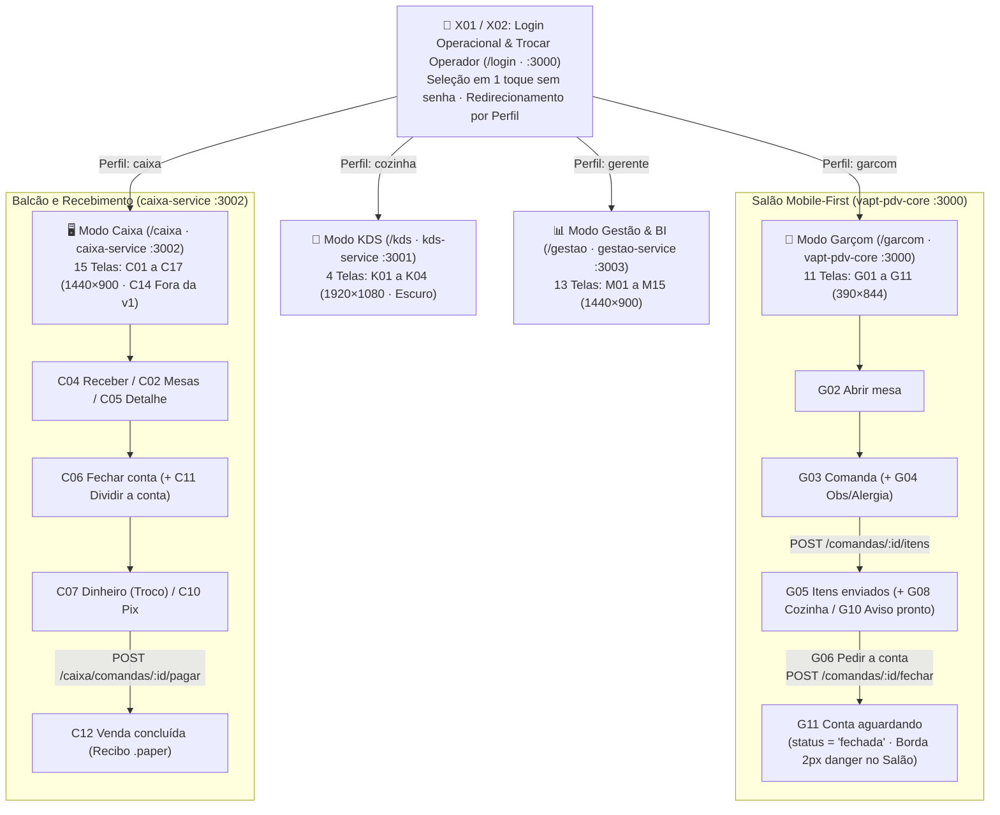

# 08 — Especificação de UX/UI Design e Arquitetura Frontend

| Metadado | Valor |
| :--- | :--- |
| **Projeto** | **VaptPDV** |
| **Data** | 04 de Novembro de 2026 |
| **Autores (Equipe)** | Kaio França e Mateus Neri |
---

## 1. Visão Geral e Princípios de Design

O design do **VaptPDV** foi concebido sob o lema: **"Mostarda, café e creme. Cantos arredondados, sem neon e sem emoji."**  
A prioridade máxima é a **velocidade, precisão e estabilidade operacional** durante os horários de pico (*rush*) de bares, botecos e lanchonetes:

* **Assinatura Visual Reconhecível:**
  1. **Tile tintado de produto (`ProductTile`):** Quadrado arredondado com a cor pastel da categoria (`tint-1` a `tint-4`) e ícone linear central em `text-2` (sem foto de produto na v1).
  2. **Faixa lateral de estado:** `10px` no ticket do KDS (SLA), `4px` em `brand-edge` para o marcador `"Minha"` mesa e `6px` nos toasts de feedback.
  3. **Mostarda só em ação:** Se um elemento usa `brand` (`#F2A81D` / `#F5B335`), ele é interativo (CTA primário, FAB, chip ativo) ou está selecionado. Todo o restante permanece silencioso em creme, café e branco.
* **Zero Poluição Visual e Cabeçalhos Limpos (`DESIGN.md` §16):** Proibido o uso de emojis, efeitos neon, gradientes decorativos ou sombras pesadas. **Indicadores técnicos permanentes** (*"Online"*, *"Sincronizado"*, *"API conectada"*, *"Impressora cozinha"*, versão do sistema ou resolução do terminal) **não aparecem nos cabeçalhos das telas operacionais**. Os cabeçalhos permanecem limpos com o foco na operação; falhas de comunicação ou reconexão aparecem exclusivamente via **Banner contextual ou Toast (`X03/X04`)** no ponto e no momento em que uma ação falha ou a rede oscila.
* **Ergonomia e Foco Operacional:** Alvos de toque generosos ($\ge 44\times44\text{ px}$ em mobile e telas touch; $56\text{–}72\text{ px}$ no KDS) e tipografia com números estritamente tabulares (`font-variant-numeric: tabular-nums`) para evitar desalinhamento de preços, contadores e cronômetros.
* **Tolerância a Ambientes Ruidosos e Acelerados:** Estados de mesa, comanda e fichas de preparo utilizam redundância de cor, ícone e texto explícito via componente `StatusPill` (*Livre*, *Aberta*, *Conta pedida*, *Aguardando pagamento*, *Em preparo*, *Pronto*).

---

## 2. Design System e Tokens Visuais (`DESIGN.md`)

### 2.1. Paleta de Cores Semântica (Temas Claro e Escuro)

| Token | Modo Claro | Modo Escuro | Semântica e Regra de Uso (`DESIGN.md` §2) |
| :--- | :---: | :---: | :--- |
| **`bg` (Creme)** | `#FBF7F1` | `#17120F` | Fundo principal das telas e páginas |
| **`surface`** | `#FFFFFF` | `#221A15` | Superfície de cards, painéis e campos |
| **`surface-raised`** | `#FFFFFF` | `#2A2019` | Modal, drawer, bottom sheet, toast e popover (elevação por tom no escuro) |
| **`surface-2`** | `#F3ECE1` | `#2D231C` | Campos desabilitados, steppers, trilhos, cabeçalhos de tabela e hover |
| **`border`** | `#E5DACB` | `#43342A` | Bordas decorativas e divisores sutis |
| **`border-strong`** | `#8C7A68` | `#8F7B69` | Borda de controle interativo (inputs, chips inativos, switch desligado, mesa livre tracejada; contraste $\ge 3:1$) |
| **`text` (Café)** | `#2B2019` | `#F6EEE4` | Tipografia principal (títulos, totais, valores) |
| **`text-2`** | `#6A5849` | `#C2B1A0` | Tipografia secundária (apoio, legendas, placeholders, ícones de `ProductTile`) |
| **`brand` (Mostarda)** | `#F2A81D` | `#F5B335` | Preenchimento de ação primária (*CTA*), FAB, chip ativo (nunca usado como linha fina no claro) |
| **`brand-hover` / `press`**| `#E39A0B` / `#C98400` | `#F8BF52` / `#E0A024` | Estados de hover (ponteiro fino) e pressionado do botão primário |
| **`on-brand`** | `#2B2019` | `#2B2019` | Texto e ícone de alto contraste sobre preenchimento `brand` |
| **`brand-soft`** | `#FDF0D2` | `#3D2E14` | Fundo suave de seleção, atenção, status *"Aberta"* (mesa) e *"Em preparo"* |
| **`brand-text`** | `#8A5200` | `#F5C766` | Texto legível sobre `brand-soft` e contorno de barras de gráfico |
| **`brand-edge`** | `#A86400` | `#F5B335` | **Linha ou ícone de seleção** (borda `2px` de item selecionado, faixa lateral `4px` de `"Minha"` mesa; garante $\ge 3:1$ no claro) |
| **`nav` (Café Profundo)**| `#3A2A21` | `#0F0B09` | Rail lateral do Caixa e Sidebar da Gestão (sempre escura nos dois temas) |
| **`success` (Manjericão)**| `#2F7D4F` | `#5FC083` | Status *"Livre"*, *"Pronto"*, *"Paga"*, switch ligado e barra de progresso de pagamento |
| **`success-soft` / `text`**| `#DDF0E4` / `#1F6B3E` | `#1D3326` / `#7FD39D` | Trio semântico de sucesso (fundo e texto) |
| **`danger` (Tomate)** | `#C4391D` | `#F07A60` | Erros, atraso de SLA, ação destrutiva e borda `2px` de *"Conta pedida"* |
| **`danger-soft` / `text`** | `#FBE3DC` / `#A52E15` | `#3D1E17` / `#FF9C85` | Trio semântico de erro, esgotado, estoque baixo e *"Conta pedida"* |
| **`tint-1` (Mostarda)** | `#FBE6B8` | `#4A3815` | Tile de produto: Lanches e Combos (`sandwich`, `package`) |
| **`tint-2` (Manjericão)**| `#E4EFD5` | `#27382A` | Tile de produto: Porções e Petiscos (`drumstick`) |
| **`tint-3` (Tomate)** | `#F8D9CC` | `#4A2A20` | Tile de produto: Sobremesas (`ice-cream-cone`) |
| **`tint-4` (Cappuccino)**| `#EBDDCB` | `#3A2E25` | Tile de produto: Bebidas (`cup-soda`) |

### 2.2. Tipografia, Escala e Formas

* **Família Tipográfica:** **Plus Jakarta Sans** (pesos 500 a 800); fallback `system-ui, sans-serif`.
* **Formatação Numérica:** `font-variant-numeric: tabular-nums` obrigatório em preços, tabelas, quantidades, relógios e cronômetros.
* **Escala Base (`DESIGN.md` §3):**
  * **KPI / Total (`--fs-kpi`):** `30–38px / 800`
  * **Título de Tela (`--fs-title`):** `24–26px / 800`
  * **Título de Seção (`--fs-section`):** `16–20px / 700–800`
  * **Corpo / Lista (`--fs-body`):** `14–15px / 600–700`
  * **Legenda (`--fs-caption`):** `13px / 600–700`
  * **Micro (`--fs-micro`):** `12px / 700` (mínimo absoluto)
  * **Escala KDS (leitura a 2–3 metros em TV `1920×1080`):** Local `--fs-kds-place: 40px/800`, Quantidade `--fs-kds-qty: 32px/800`, Item `--fs-kds-item: 30px/700`, Alergia `--fs-kds-allergy: 28px/800`, Botão `--fs-kds-button: 26px/800` (altura `72px`).
* **Raios de Borda (`--radius-*`):** `--radius-xs: 6px` (`kbd`, barras), `--radius-control: 14px` (botões md/lg, inputs, toasts, tiles), `--radius-card: 20px` (cards de produto, modais pequenos), `--radius-card-lg: 24px` (cards de mesa, tickets KDS, painéis grandes), `--radius-btn-lg: 18px` (botões xl, xxl e KDS), `--radius-sheet: 28px` (bottom sheet), `--radius-pill: 999px` (chips, `StatusPill`, switch, FAB).

---

## 3. Catálogo Completo das 46 Telas Oficiais (`docs/artes/` e `DESIGN.md` §7)

O sistema possui **46 telas renderizadas em alta fidelidade** distribuídas nas 5 pastas de `docs/artes/`, alinhadas diretamente com os **4 serviços da topologia distribuída** (`vapt-pdv-core` `:3000`, `kds-service` `:3001`, `caixa-service` `:3002`, `gestao-service` `:3003`).



### 3.1. Pasta 1: `docs/artes/telas-login/` (3 Telas + Referências Transversais `X03–X09` · `:3000`)

| ID | Arquivo em `docs/artes/telas-login/` | Viewport | Propósito e Componentes Principais |
| :--- | :--- | :---: | :--- |
| **`X01`** | `X01 Login operacional.png` | `1440×900` | Seleção de operador sem senha no desktop; cards agrupados por perfil (`garcom`, `caixa`, `cozinha`, `gerente`), marcador `"Último acesso"` com borda `brand-edge` e `ThemeToggle`. |
| **`X01 (Mobile)`**| `X01 Login (celular).png` | `390×844` | Versão mobile em coluna única para smartphones de salão; cards de operador com `Avatar` e entrada em 1 toque. |
| **`X02`** | `X02 Trocar operador.png` | Modal | Modal rápido para alternar o operador ativo sem encerrar o turno; informa que comandas abertas permanecem vinculadas a quem as abriu. |
| *`X03/X04`* | *(Referência `DESIGN.md` §7.0)* | Transversal | Banners contextuais de conexão (`Reconectando`, `Sem conexão`) e Toasts de resultado de ação (`sucesso`, `atenção`, `erro`) com faixa lateral de `6px`. |
| *`X05–X09`* | *(Referência `DESIGN.md` §7.0)* | Transversal | Padrões de `ConfirmDialog` (`X05`), telas de erro de página inteira (`X06`), estados de lista `Skeleton`/`EmptyState`/`ErrorState` (`X07`), instalação PWA (`X08`) e seletor de tema (`X09`). |

### 3.2. Pasta 2: `docs/artes/telas-garcom/` (11 Telas — `G01` a `G11`, Mobile `390×844` · `vapt-pdv-core` `:3000`)

| ID | Arquivo em `docs/artes/telas-garcom/` | Rota / Estado | Propósito e Componentes Principais |
| :--- | :--- | :--- | :--- |
| **`G01`** | `G01 Salão.png` | `/garcom` | Mapa de mesas em 2 colunas; cabeçalho limpo com turno, `ThemeToggle` e `Avatar` (sem badges técnicos); chips `Todas`, `Minhas`, `Livres`, `Conta pedida`; FAB `+ Abrir mesa` e `BottomNav`. |
| **`G02`** | `G02 Abrir mesa.png` | Sheet sobre `G01` | Bottom sheet para informar quantidade de pessoas e `nome_cliente` opcional; botão primário `xl` (`60px`) dispara `POST /comandas`. |
| **`G03`** | `G03 Comanda.png` | `/garcom/mesa/:id` | Montagem de pedido da mesa aberta: busca, chips de categoria, lista de produtos com `ProductTile` e `Stepper` (`44px`), itens esgotados bloqueados e rodapé fixo com CTA `"Enviar ao preparo"`. |
| **`G04`** | `G04 Observação e alergia.png` | Sheet sobre `G03` | Anotação de preparo especial por item: `Textarea` + chips rápidos (`"Sem cebola"`, `"Bem passado"`) + switch de **Alergia** com campo dedicado em destaque `danger`. |
| **`G05`** | `G05 Itens enviados.png` | `/garcom/mesa/:id/enviados`| Acompanhamento dos itens já despachados ao KDS com `StatusPill` (`Na fila`, `Em preparo`, `Pronto`), total parcial e botão secundário `"Pedir a conta"`. |
| **`G06`** | `G06 Pedir a conta.png` | Modal / Sheet | Revisão final de itens com o cliente na mesa, switch de `Gorjeta 10%`, aviso de que a comanda será bloqueada para novos itens e CTA `"Confirmar e avisar o caixa"` (`POST /comandas/:id/fechar`). |
| **`G07`** | `G07 Comandas.png` | `/garcom/comandas` | Aba `Comandas` do `BottomNav`: `SegmentedControl` (`Minhas` / `Todas`) e lista de cards de comandas com `StatusPill`, tempo decorrido e valor. |
| **`G08`** | `G08 Cozinha.png` | `/garcom/cozinha` | Aba `Cozinha` do `BottomNav`: visão mobile das fichas do garçom com filtro por status e botão de sucesso contornado `"Marcar como entregue"` (`PATCH /kds/fichas/:id/status`). |
| **`G09`** | `G09 Perfil.png` | `/garcom/perfil` | Aba `Perfil` do `BottomNav`: dados do garçom logado, seletor de tema (`Claro`/`Escuro`/`Sistema`), botão `"Trocar operador"` (`X02`) e `"Sair do turno"`. |
| **`G10`** | `G10 Aviso de item pronto.png` | Toast no topo de `G01` | Notificação flutuante no topo do celular (para nunca cobrir o rodapé fixo) disparada quando o KDS marca um item como `pronto` (evento `item.pronto`). |
| **`G11`** | `G11 Conta aguardando.png` | `/garcom/mesa/:id/fechada`| Estado somente leitura exibido após `G06`: mostra `StatusPill` `"Conta pedida"`, faixa explicando que a comanda está travada para edição e aguarda quitação no Caixa (`:3002`). |

### 3.3. Pasta 3: `docs/artes/telas-caixa/` (15 Telas — `C01` a `C17`, Desktop `1440×900` · `caixa-service` `:3002`)

> **Nota sobre IDs Reservados e Escopo v1:** Os códigos **`C08`** e **`C09`** foram intencionalmente consolidados no fluxo unificado de pagamento (`C06`/`C07`/`C10`/`C11`). A tela **`C14 Cliente e fidelidade`** consta nas 46 artes como referência visual, mas o domínio de Fidelidade/Cashback está **fora do escopo de backend da v1 (`Out-of-Scope v1`)**, comportando-se na interface de forma idêntica a `M14 Fiscal` (desabilitado com motivo *"disponível em breve"*).

| ID | Arquivo em `docs/artes/telas-caixa/` | Propósito e Componentes Principais |
| :--- | :--- | :--- |
| **`C01`** | `C01 Venda.png` | Ponto de venda principal: `RailNav` (`88px` em `#3A2A21`), `TopBar` limpa com busca (`F2`) e avatar do operador (sem badges técnicos de impressora/rede), grade de `ProductTile` em 4 colunas e painel lateral da comanda (`440px`, recolhível para `72px`) com switch `Gorjeta 10%` e CTA `xxl` (`68px`) **`Cobrar` (`F8`)**. |
| **`C02`** | `C02 Mesas.png` | Mapa amplo do salão em 6 colunas para o operador de caixa; exibe mesas `Livre`, `Aberta` e `Conta pedida` (borda `2px solid danger`). |
| **`C03`** | `C03 Pedidos.png` | Listagem tabular de todas as comandas do turno (`GET /caixa/comandas`) com filtros por `StatusPill` (`Aberta`, `Aguardando pagamento`, `Paga`, `Cancelada`) e busca por mesa/número. |
| **`C04`** | `C04 Receber.png` | Fila prioritária de recebimento (`GET /caixa/comandas?status=fechada`): destaca no topo os cards urgentes de mesas com `"Conta pedida"` e lista os pagamentos já concluídos no dia. |
| **`C05`** | `C05 Detalhe da comanda.png` | `Drawer` lateral direito (`GET /caixa/comandas/:comandaId`) exibindo todos os itens da comanda, status individual de preparo no KDS, resumo financeiro e ações (`Adicionar itens`, `Cancelar comanda`, `Fechar conta`). |
| **`C06`** | `C06 Fechar conta.png` | Tela de preparação de quitação (`POST /caixa/comandas/:comandaId/fechar`): revisão final de itens, alerta de pendências do KDS (`GET /kds/comandas/:id/pendencias`), switch de `Gorjeta 10%`, acesso a divisão de conta (`C11`) e seleção de modalidade de pagamento. |
| **`C07`** | `C07 Pagamento (dinheiro).png` | Quitação em espécie (`POST /caixa/comandas/:comandaId/pagar`): barra de progresso (`Já pago` vs. `Falta pagar`), teclado numérico em tela, chips de cédulas sugeridas (`R$ 20`, `R$ 50`, `R$ 100`) e cálculo automático de **Troco** (`RN19`). |
| **`C10`** | `C10 Pagamento (Pix).png` | Quitação via Pix (`POST /caixa/comandas/:comandaId/pagar`): renderização do componente `QR` sobre fundo branco fixo (mesmo no tema escuro), `StatusPill` `"Aguardando pagamento"` com cronômetro e botão de copiar código. |
| **`C11`** | `C11 Dividir a conta.png` | Split payment interativo (`POST /caixa/comandas/:comandaId/dividir`): `SegmentedControl` para dividir igualmente **por número de pessoas** ou **por item selecionado**, gerando parcelas independentes em `caixa_db` até zerar o saldo restante (`RN19`, `RN24`). |
| **`C12`** | `C12 Venda concluída.png` | Confirmação de liquidação (`status = 'paga'`): ícone de sucesso, resumo das parcelas e troco, visualização do recibo operacional `.paper` (`GET /caixa/recibos/:comandaId`, fundo branco fixo, fonte tabular) e botões `"Imprimir recibo"` e `"Nova venda"`. |
| **`C13`** | `C13 Cancelar comanda.png` | `ConfirmDialog` de segurança (`DESIGN.md` §16): alerta sobre itens já enviados ao preparo, exige escolha de motivo (radio) e digitação explícita de `"cancelar comanda"` para liberar o botão `.btn.ds`. |
| **`C14`** | `C14 Cliente e fidelidade.png` | **[Out-of-Scope v1]** Prancha de referência visual para futuro programa de pontos/cashback; na v1 o controle aparece desabilitado com motivo *"disponível em breve"* (`DESIGN.md` §15, sem backend de fidelidade). |
| **`C15`** | `C15 Observação e alergia.png` | Modal desktop equivalente ao `G04` para anotar observações e alergias ao lançar itens diretamente pelo Caixa (`C01`). |
| **`C16`** | `C16 Ajustes do Caixa.png` | Preferências locais da estação de caixa: operador logado, seletor de tema, padrão de sugestão de gorjeta 10%, alertas sonoros e aviso honesto de recursos fora da v1 (impressora térmica física). |
| **`C17`** | `C17 Atalhos.png` | Modal de referência rápida de atalhos de teclado (`F2 Buscar`, `F4 Cliente/CPF [fora da v1]`, `F6 Desconto [fora da v1]`, `F7 Nota fiscal [fora da v1]`, `F8 Cobrar`, `Esc Fechar`). |

### 3.4. Pasta 4: `docs/artes/telas-kds/` (4 Telas — `K01` a `K04`, TV `1920×1080` Tema Escuro · `kds-service` `:3001`)

| ID | Arquivo em `docs/artes/telas-kds/` | Propósito e Componentes Principais |
| :--- | :--- | :--- |
| **`K01`** | `K01 Painel de cozinha e bar.png` | Painel principal de produção (`GET /kds/fichas`): cabeçalho com `SegmentedControl` de setor (`Todos`, `Cozinha`, `Bar`) e relógio `32px`; colunas de tickets (`.tk`) com faixa lateral de `10px` e botão de `72px` (`"Iniciar preparo"` / `"Marcar como pronto"`). |
| **`K02`** | `K02 Tickets e SLA.png` | Especificação visual das 3 faixas de SLA do ticket: **Dentro do prazo** (faixa `success`, cronômetro normal), **Atenção** (faixa `brand`, texto `mm:ss · Atenção`) e **Atrasado** (faixa `danger`, texto `mm:ss · Atrasado`), além do bloco de **Alergia** (`28px/800` em `danger-soft`). |
| **`K03`** | `K03 Ajustes do KDS.png` | `Drawer` de configuração do monitor: filtro de estação padrão (`Cozinha` vs. `Bar`), alerta sonoro de novo pedido e limites parametrizáveis de tempo de SLA (ex.: Atenção aos 10 min, Atraso aos 15 min). |
| **`K04`** | `K04 Estados do KDS.png` | Estados especiais do KDS: fila vazia (`"Nenhum pedido na fila"`), carregando (`Skeleton` em escala de ticket) e banner de reconexão quando o `kds-service` perde contato temporário. |

### 3.5. Pasta 5: `docs/artes/telas-gestao/` (13 Telas — `M01` a `M15`, Desktop `1440×900` · `gestao-service` `:3003`)

> **Nota sobre IDs Reservados (`DESIGN.md` §7.4):** Os códigos **`M04`** (Categorias separadas) e **`M08`** (Detalhe isolado de venda) foram intencionalmente reservados e absorvidos diretamente pelos filtros de `M02 Cardápio` e pelo drawer de `M07 Vendas · Comandas`, totalizando 13 telas publicadas na pasta `telas-gestao`.

| ID | Arquivo em `docs/artes/telas-gestao/` | Rota de API Principal | Propósito e Componentes Principais |
| :--- | :--- | :--- | :--- |
| **`M01`** | `M01 Visão geral.png` | `GET /gestao/resumo-diario` | Dashboard executivo do gerente: `SideNav` escura, 4 cards de `KPI` (Faturamento, Comandas Pagas, Ticket Médio, Alertas de Estoque), gráfico de barras mostarda e `HBarList` de mais vendidos. |
| **`M02`** | `M02 Cardápio.png` | `GET /produtos` | Catálogo administrativo de produtos com chips de categoria, busca, indicador de estoque e `Switch` rápido para inativar/ativar item no cardápio (`POST /produtos/:id/inativar`). |
| **`M03`** | `M03 Produto.png` | `POST / PATCH /produtos` | Formulário completo de criação/edição de produto: nome, categoria (define a `tint` do `ProductTile` e o setor do KDS), preço decimal (`R$`), estoque atual e `estoque_minimo`. |
| **`M05`** | `M05 Estoque.png` | `GET /gestao/alertas-estoque` | Controle de inventário: banner de alerta para itens abaixo do mínimo, tabela com barra de nível visual, `StatusPill` (`Normal`, `Baixo`, `Esgotado`) e botão `"Repor estoque"`. |
| **`M06`** | `M06 Repor estoque.png` | `PATCH /produtos/:id` | Modal rápido de entrada de mercadoria com `Stepper`, cálculo em tempo real do novo saldo disponível e registro de motivo. |
| **`M07`** | `M07 Vendas · Comandas.png` | `GET /comandas` | Auditoria histórica de todas as comandas do período (`aberta`, `fechada`, `paga`, `cancelada`) com filtros de data (`de`/`ate`), mesa e forma de pagamento. |
| **`M09`** | `M09 Faturamento.png` | `GET /gestao/resumo-diario` | Análise financeira detalhada (OLAP): evolução de receita bruta (`faturamento_total`), líquida (`faturamento_subtotal`), gorjetas (`total_taxa_servico`) e composição percentual por `pix`, `cartao` e `dinheiro`. |
| **`M10`** | `M10 Curva ABC.png` | `GET /gestao/ranking-produtos` | Classificação de Pareto dos produtos vendidos: cards de resumo das Classes **A** (até 80% da receita), **B** (80–95%) e **C** (últimos 5%) e tabela ordenada por receita gerada. |
| **`M11`** | `M11 Desempenho de garçons.png`| `GET /gestao/desempenho-garcons`| Produtividade da equipe de salão: cards de destaque, comandas atendidas por garçom, volume de vendas, ticket médio e total de comissão de 10% (`taxa_servico_gerada`). |
| **`M12`** | `M12 Equipe.png` | `GET /usuarios` | Gestão de colaboradores com filtro por perfil (`garcom`, `caixa`, `cozinha`, `gerente`) e switch de inativação lógica (`POST /usuarios/:id/inativar`). |
| **`M13`** | `M13 Usuário.png` | `POST / PATCH /usuarios` | `Drawer` lateral para cadastrar ou editar colaborador com nome, seleção de perfil em radio cards descritivos e status ativo. |
| **`M14`** | `M14 Fiscal.png` | *(Somente leitura — v1)* | **[Out-of-Scope v1]** Tela de transparência de escopo (`DESIGN.md` §11 e §15): exibe os dados cadastrais do estabelecimento e explica em banner claro que a emissão de NFC-e/SEFAZ está fora do escopo da v1. |
| **`M15`** | `M15 Exportar dados.png` | `GET /gestao/exportar` | Modal para exportação de relatórios gerenciais do período selecionado em formato tabular (`CSV` / `JSON`). |

---

## 4. Comportamento Arquitetural do Mapa de Mesas: `"Pedir a Conta"` (`G06` → `G11`) vs. Índice Parcial do Banco

Uma decisão de engenharia fundamental do **VaptPDV** reconcilia a regra de banco de dados (`RN07`) com a experiência real de salão no Modo Garçom (`G01`, `G06`, `G11`) e Modo Caixa (`C02`, `C04`):

1. **O que acontece quando o Garçom toca em `"Pedir a conta"` (`G06` $\rightarrow$ `G11`):**
   - Na tela `G06 Pedir a conta`, ao confirmar o fechamento preliminar na mesa, o frontend invoca `POST /comandas/:id/fechar` (`{ aplicar_taxa_servico }`).
   - O backend calcula `subtotal`, `taxa_servico` e `total`, bloqueia a inclusão de novos itens (`RN01`) e altera o status da comanda no PostgreSQL (`vaptpdv_db`) para **`status = 'fechada'`**, disponibilizando-a imediatamente para o **`caixa-service` (`:3002`)** na fila `C04 Receber`.
   - O celular do garçom transita para a tela **`G11 Conta aguardando`**, travada em modo leitura até que o Caixa conclua o recebimento.
2. **Como o Banco de Dados trata a Mesa (`RN07`):**
   - No PostgreSQL, o índice único parcial é definido como `CREATE UNIQUE INDEX comandas_mesa_aberta_idx ON comandas (mesa) WHERE status = 'aberta'`.
   - Isso garante no nível físico do SGBD que nunca existam duas comandas `'aberta'` para a mesma mesa, mas permite tecnicamente que uma nova comanda seja aberta caso um novo grupo sente na mesa enquanto a conta anterior aguarda no caixa.
3. **Como o Mapa do Salão (`G01` e `C02`) exibe as Mesas:**
   - Para que a mesa **não pareça livre prematuramente** enquanto os clientes ainda estão sentados aguardando a maquininha ou o troco, o mapa de mesas do frontend (`G01 Salão` e `C02 Mesas`) consulta **tanto as comandas com `status = 'aberta'` quanto as comandas com `status = 'fechada'`** (`GET /comandas?status=aberta` e `GET /comandas?status=fechada`, ou `GET /caixa/comandas` no Caixa).
   - **Regra de Renderização do Card de Mesa (`.mesa`):**
     - **Sem comanda `aberta` nem `fechada`:** Renderiza como **`Livre`** (borda tracejada `border-strong`, `StatusPill` verde `"Livre"`).
     - **Com comanda `status = 'aberta'`:** Renderiza como **`Aberta` / `Ocupada`** (borda sólida sutil, `StatusPill` mostarda suave `"Aberta"`, tempo decorrido e subtotal acumulado).
     - **Com comanda `status = 'fechada'` (aguardando pagamento):** Renderiza com **borda dedicada `2px solid var(--color-danger)` (`#C4391D`)** e `StatusPill` vermelho suave **`"Conta pedida"`** (no Salão `G01`/`C02`) ou **`"Aguardando pagamento"`** (na lista de comandas `G07`/`C03`/`C04`).
   - Somente quando o operador de caixa executa `POST /caixa/comandas/:comandaId/pagar` (ou `POST /comandas/:id/pagar`, transitando a comanda para **`status = 'paga'`**) o card da mesa retorna ao estado visual **`Livre`**.

---

## 5. Matriz de Estados de Interface (`DESIGN.md` §9)

Todas as superfícies do frontend implementam de forma consistente os estados abaixo (documentados visualmente nas telas `X03/X04`, `X06`, `X07` e `K04`):

| Estado de Interface | Gatilho / Condição Técnica | Comportamento Visual e de Interação Obrigatório | Telas de Referência |
| :--- | :--- | :--- | :--- |
| **`Loading` (Carregando)** | `isLoading === true` na query inicial do TanStack Query | Renderiza **Skeletons (`.sk`)** com exatamente a mesma geometria, altura e quantidade de itens do conteúdo final (cards de mesa, linhas de produto ou tickets KDS) com *shimmer* suave (respeitando `prefers-reduced-motion`). Nunca usa spinner genérico de tela cheia. | `X07`, `K04` |
| **`Empty` (Vazio Inicial)** | API retorna lista vazia `[]` sem filtros ativos | Exibe ícone linear (`48–64px` em `text-2`), título curto em *sentence case* e botão/orientação da próxima ação (ex.: *"Nenhuma mesa ocupada no momento · Abra uma mesa para começar"*). | `X07`, `K04` |
| **`Empty Filter` (Busca sem Resultado)** | Filtro de categoria ou termo de busca retorna `[]` | Exibe *"Nada encontrado para «termo»"* acompanhado de botão secundário `"Limpar busca"` que restaura a listagem completa em 1 toque. | `X07`, `G03`, `C01` |
| **`Error` (Falha de Leitura / Mutação)** | Resposta HTTP `4xx` / `5xx` com envelope `{ erro: { codigo, mensagem, detalhes } }` | • **Em leitura de tela:** Renderiza componente `ErrorState` explicando o que houve em linguagem humana + botão `"Tentar de novo"` (`refetch()`).<br>• **Em ação/mutação (ex.: `409 ESTOQUE_INSUFICIENTE`):** Mantém o estado da tela e exibe **Toast (`X04`)** com faixa lateral `6px danger` (no topo da tela no celular `G01–G11` para não cobrir o rodapé fixo). | `X04`, `X06`, `X07` |
| **`Degraded` (Satélite Indisponível — `503`)** | Queda ou timeout (`2000ms`) em `kds-service`, `caixa-service` ou `gestao-service` | Exibe **Banner contextual (`X03`)** abaixo do cabeçalho informando o que está em reconexão e o que segue funcionando normalmente. **Nunca bloqueia** abertura de mesa, lançamento de item, fechamento ou pagamento (`RN17` / `SM-C2`). | `X03/X04`, `C06`, `K04` |
| **`Offline` (Sem Conexão com Servidor)** | Falha de rede local (`navigator.onLine === false` ou erro de rede) | Exibe **Banner persistente `danger`** `"Sem conexão com o servidor"`. Os botões de gravação ficam desabilitados com a segunda linha explicativa `"Sem conexão"`. Conforme `DESIGN.md` §9, **não há fila offline de vendas na v1**. | `X03`, `X06` |
| **`Out-of-Scope v1` (Recurso fora da v1)**| Controles previstos em versões futuras (Fidelidade/CPF `C14`, Fiscal/NFC-e `M14`, Desconto, Transferir mesa) | O controle permanece visível na posição ergonômica correta, porém desabilitado (`.btn.dis`) com o motivo explícito (*"disponível em breve"* ou banner explicativo em `M14 Fiscal`). | `X07`, `G03`, `C01`, `C14`, `M14` |

---

## 6. Contratos de Integração Frontend ↔ Backend

### 6.1. Mapeamento de Rotas e Ações por Superfície

| Superfície / Tela | Ação do Usuário | Método & Rota HTTP | Serviço Alvo | Tratamento de Resposta e Cache |
| :--- | :--- | :--- | :---: | :--- |
| **Login (`X01`, `X02`)** | Carregar operadores ativos | `GET /usuarios?ativo=true` | Core (`:3000`) | Popula cards por perfil; salva operador selecionado em `useAppStore`. |
| **Salão (`G01`)** | Carregar mapa de mesas do garçom | `GET /comandas?status=aberta` e `GET /comandas?status=fechada` | Core (`:3000`) | Pinta mesas `Aberta` e `Conta pedida` (`2px solid danger`); calcula tempo aberto. |
| **Abrir Mesa (`G02`)** | Confirmar abertura de mesa | `POST /comandas` | Core (`:3000`) | Recebe `201 Created`; invalida `['comandas']` e navega para `G03`. |
| **Cardápio (`G03`, `C01`, `M02`)**| Listar produtos disponíveis | `GET /produtos?ativo=true` | Core (`:3000`) | Renderiza `ProductTile` tintados; marca itens com `estoque === 0` como `Esgotado`. |
| **Lançar Pedido (`G03`, `C01`)** | Tocar em `"Enviar ao preparo"` | `POST /comandas/:id/itens` | Core (`:3000`) | Congela preço; invalida `['comanda', id]`, `['comandas']` e `['produtos']`. |
| **Ajustar / Remover Item (`G05`, `C05`)**| Alterar `Stepper` ou remover item | `PATCH` / `DELETE /comandas/:id/itens/:itemId` | Core (`:3000`) | Janela curta de `"Desfazer"` em toast; revalida detalhe da comanda. |
| **Pedir Pré-Conta no Salão (`G06`)**| Garçom pede a conta na mesa | `POST /comandas/:id/fechar` | Core (`:3000`) | Transita para `fechada`; exibe `G11` no garçom e entra na fila do Caixa (`C04`). |
| **Fila e Detalhe do Caixa (`C02–C05`)**| Carregar contas abertas e pedidas no balcão | `GET /caixa/comandas`<br>`GET /caixa/comandas/:comandaId` | Caixa (`:3002`) | Destaca mesas com `"Conta pedida"`, exibe saldo restante e parcelas já pagas. |
| **Fechar Conta no Caixa (`C06`)**| Confirmar fechamento (+/- 10%) e checar KDS | `POST /caixa/comandas/:comandaId/fechar`<br>`GET /kds/comandas/:comandaId/pendencias` | Caixa (`:3002`)<br>KDS (`:3001`) | Sincroniza subtotal, gorjeta de 10% e total; alerta se houver item pendente na cozinha. |
| **Dividir a Conta (`C11`)** | Dividir por pessoas ou por itens | `POST /caixa/comandas/:comandaId/dividir` | Caixa (`:3002`) | Gera cotas exatas em `Decimal(10,2)` (`RN19`) para pagamento parcelado. |
| **Pagar Parcela / Quitar (`C07`, `C10`)**| Registrar dinheiro (com troco), Pix ou cartão | `POST /caixa/comandas/:comandaId/pagar` | Caixa (`:3002`) | Calcula troco (`C07`), deduz `saldo_restante` e, ao zerar, liquida a comanda e baixa o estoque. |
| **Recibo Operacional (`C12`)** | Exibir e imprimir recibo `.paper` | `GET /caixa/recibos/:comandaId` | Caixa (`:3002`) | Exibe itens, parcelas pagas, troco e código de autenticação para impressão térmica. |
| **Cancelar Comanda (`C13`)** | Digitar `"cancelar comanda"` e confirmar | `POST /comandas/:id/cancelar` | Core (`:3000`) | Transita para `cancelada` sem baixar estoque; invalida `['comandas']` e `['caixa', 'comandas']`. |
| **Painel KDS (`K01`, `G08`)** | Listar fichas e avançar status | `GET /kds/fichas?setor=&status=`<br>`PATCH /kds/fichas/:id/status` | KDS (`:3001`) | Move ticket entre colunas (`recebido` $\rightarrow$ `em_preparo` $\rightarrow$ `pronto` $\rightarrow$ `entregue`). |
| **Gestão & BI (`M01`, `M05`, `M09–M11`, `M15`)**| Consultar KPIs, Curva ABC, Garçons, Alertas e Exportar | `GET /gestao/resumo-diario`<br>`GET /gestao/ranking-produtos`<br>`GET /gestao/desempenho-garcons`<br>`GET /gestao/alertas-estoque`<br>`GET /gestao/exportar` | Gestão (`:3003`)| Alimenta gráficos e tabelas gerenciais a partir do banco isolado `gestao_db`. |

### 6.2. Padronização de Query Keys, Polling (`refetchInterval`) e Regras de Optimistic UI (TanStack Query v5)

Para manter todas as estações de trabalho sincronizadas em tempo real sem sobrecarregar a instância AWS EC2, o frontend adota a seguinte política estrita de cache e revalidação:

| Query Key Padronizada | Rota Associada | `staleTime` | `refetchInterval` (Polling Ativo) | Regra de Mutação e Optimistic UI |
| :--- | :--- | :---: | :---: | :--- |
| `['usuarios', { ativo }]` | `GET /usuarios` (`:3000`) | `60_000 ms` (1 min) | Desabilitado (revalida no foco ou mutação) | Invalidação pessimista após `POST / PATCH / inativar` em `M12/M13`. |
| `['produtos', { categoria, ativo }]` | `GET /produtos` (`:3000`) | `15_000 ms` (15 s) | `30_000 ms` (30 s no Salão e Caixa) | **Nunca usa Optimistic UI para criação de venda sem validar estoque (`SM-C1`).** Invalida imediatamente após lançamento de item, pagamento ou reposição (`M06`). |
| `['comandas', { status }]` | `GET /comandas` (`:3000`) | `3_000 ms` (3 s) | **`5_000 ms` (5 s no Salão `G01`)** | Mantém o mapa do salão sincronizado entre garçons. |
| `['caixa', 'comandas', { status }]` | `GET /caixa/comandas` (`:3002`) | `3_000 ms` (3 s) | **`5_000 ms` (5 s em `C02`, `C03` e `C04`)** | Garante que quando o garçom pede a conta (`G06`), o card entra em `C04 Receber` como `"Conta pedida"` em até 5 segundos. |
| `['caixa', 'comanda', comandaId]` | `GET /caixa/comandas/:comandaId` (`:3002`) | `2_000 ms` (2 s) | `5_000 ms` (enquanto em cobrança em `C06–C11`) | Atualiza instantaneamente a barra de progresso (`Já pago` / `Falta pagar`), parcelas e troco após cada pagamento parcial. |
| `['kds', 'fichas', { setor, status }]`| `GET /kds/fichas` (`:3001`) | `1_000 ms` (1 s) | **`3_000 ms` (3 s no monitor `K01` e `G08`)** | **Optimistic UI permitido na transição de status (`PATCH /kds/fichas/:id/status`):** ao tocar em `"Iniciar preparo"` ou `"Marcar como pronto"`, o ticket move de coluna imediatamente com opção de `"Desfazer"`, revertendo em caso de erro HTTP. |
| `['gestao', recurso, params]` | `GET /gestao/*` (`:3003`) | `30_000 ms` (30 s) | `60_000 ms` (60 s em `M01`) | Consultas OLAP desacopladas do OLTP; botão manual de atualizar e exportação em `M15`. |

---

## 7. Arquitetura Técnica da Aplicação Frontend (`frontend/`)

### 7.1. Stack Tecnológica Oficial do Frontend

| Camada | Tecnologia | Versão / Configuração | Papel e Justificativa Arquitetural |
| :--- | :--- | :--- | :--- |
| **Runtime & Build** | `Vite` | `v6+` | Servidor de desenvolvimento instantâneo com HMR e build de produção gerando assets estáticos servidos pelo `@fastify/static` no `:3000`. |
| **Core & Framework** | `React` + `TypeScript` | `React 19` / `TS 5.7+` | Componentes fortemente tipados compartilhando os contratos DTO de `05-contrato-apis-e-eventos.md`. |
| **Design System & CSS** | `Tailwind CSS` + `tokens.css` | `v3.4+` | Configurado com as variáveis CSS em canais RGB (`--color-*` / `--c-*`) de `DESIGN.md` §12, suportando tema claro e escuro (`dark` no `<html>`, persistido em `localStorage['vapt_pdv_tema']`). |
| **Ícones do Sistema** | `Lucide React` | `latest` | Ícones lineares de traço uniforme (`14px` em pills, `20px` em botões, `24px` em navegação, `28–32px` em `ProductTile`), sem emojis. |
| **Data Fetching & Cache**| `TanStack Query` | `v5` (`@tanstack/react-query`) | Gerenciamento de cache, polling adaptativo por superfície (`3s` no KDS, `5s` no Salão/Caixa) e tratamento centralizado do envelope `{ erro: { codigo, mensagem, detalhes } }`. |
| **Estado Global de Sessão**| `Zustand` | `v5` (`zustand`) | Store persistida (`useAppStore`) para operador logado (`X01`/`X02`), tema ativo, rascunho de novos itens por mesa e estado de recolhimento do painel do Caixa (`440px` $\leftrightarrow$ `72px`). |

### 7.2. Contrato de Proxy Reverso (`vite.config.ts`) e Deploy em Produção

Em desenvolvimento (`:5173`), o Vite roteia transparentemente as chamadas para o **Core Salão/PDV (`:3000`)** e para os **3 Satélites (`:3001` KDS, `:3002` Caixa, `:3003` Gestão)**; em produção (Módulo 1 na VM AWS EC2 e Módulo 3 em Containers), o bundle compilado em `frontend/dist/` é servido pelo Fastify:

```typescript
// Trecho de proxy de desenvolvimento em frontend/vite.config.ts
server: {
  port: 5173,
  proxy: {
    '/comandas':  { target: 'http://localhost:3000', changeOrigin: true },
    '/produtos':  { target: 'http://localhost:3000', changeOrigin: true },
    '/usuarios':  { target: 'http://localhost:3000', changeOrigin: true },
    '/health':    { target: 'http://localhost:3000', changeOrigin: true },
    '/docs':      { target: 'http://localhost:3000', changeOrigin: true },
    '/kds':       { target: 'http://localhost:3001', changeOrigin: true },
    '/caixa':     { target: 'http://localhost:3002', changeOrigin: true },
    '/gestao':    { target: 'http://localhost:3003', changeOrigin: true },
    '/analytics': { target: 'http://localhost:3003', changeOrigin: true },
  }
}
```
