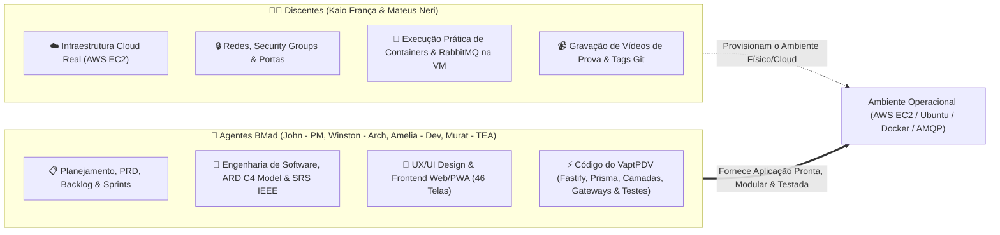
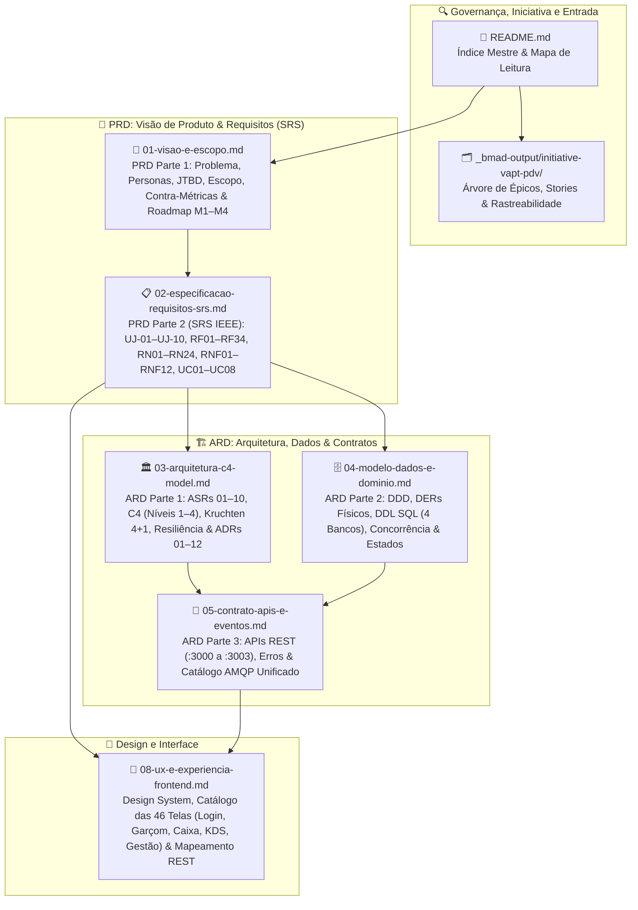

# 📘 Documentação Oficial de Engenharia de Software — Ecossistema VaptPDV

| Metadado | Valor |
| :--- | :--- |
| **Projeto** | **VaptPDV** |
| **Data** | 04 de Novembro de 2026 |
| **Autores (Equipe)** | Kaio França e Mateus Neri |
---

## 1. Visão Geral da Suite Documental

Esta pasta (`docs/engenharia/`) reúne a **Documentação Central de Produto (PRD), Engenharia de Requisitos (SRS), Arquitetura de Sistemas Distribuídos (ARD) e Experiência do Usuário (UX)** do projeto **VaptPDV**, cobrindo o ciclo operacional completo e o planejamento da arquitetura distribuída nos quatro módulos da disciplina:

1. **Módulo 1 — Computação em Nuvem IaaS (`entrega-1-cloud`):** Implantação nativa do **Core Salão/PDV (`vapt-pdv-core`)** (`:3000` — Backend em Camadas + Frontend Web/PWA integrado com Login Operacional, Modo Garçom e Modo Caixa) e banco **PostgreSQL** (`:5432` — `vaptpdv_db`) diretamente em máquina virtual **AWS EC2 (Ubuntu LTS)** gerenciada via **PM2**.
2. **Módulo 2 — Microsserviços (`entrega-2-microsservicos`):** Integração do Core Salão/PDV (`:3000`, `vaptpdv_db`) aos **3 Microsserviços Satélites por estação de trabalho** — `kds-service` (`:3001`, `kds_db`), `caixa-service` (`:3002`, `caixa_db`) e `gestao-service` (`:3003`, `gestao_db`) — com bancos isolados (`Database-per-Service`), chamadas HTTP REST síncronas com timeout de `2000ms`, degradação graciosa pós-commit (`avisos` + `integracao_pendente`) e fail-fast (`503 SERVICO_INDISPONIVEL`).
3. **Módulo 3 — Containers e Orquestração (`entrega-3-containers`):** Empacotamento em `Dockerfile` multi-stage (`node:20-alpine` com usuário não-root `USER node`) e orquestração completa via `docker-compose.yml` com rede `vaptpdv-net`, healthchecks determinísticos (`service_healthy`), limites de recursos para AWS EC2 e persistência de dados em volumes EBS.
4. **Módulo 4 — Mensageria e Streaming (`entrega-4-mensageria`):** Desacoplamento assíncrono via **RabbitMQ** (`vaptpdv.eventos`) com padrão **Transactional Outbox** (`outbox_eventos`), filas duráveis (`kds.item.lancado`, `pdv.item.pronto`, `produtos.comanda.paga`, `gestao.eventos`), Dead Letter Queues (`.dlq`), confirmação manual (`ack`) e consumidores idempotentes (`ADR-09` e `ADR-10`).

---

## 2. Divisão de Responsabilidades e Modelo de Governança

Para assegurar eficiência na execução acadêmica e máxima qualidade técnica, os papéis e fronteiras de atuação do projeto estão rigorosamente divididos entre os **Discentes** e a **Equipe de Agentes BMad**:

* **Discentes (Kaio França e Mateus Neri):**
  - Provisionamento e administração da infraestrutura em nuvem na **AWS EC2 (IaaS)**.
  - Configuração de rede, Security Groups (liberação controlada de portas `:3000`–`:3003`, `:5432`, `:5672`, `:15672`), chaves SSH e sistema operacional Ubuntu LTS.
  - Execução operacional de containers Docker, Docker Compose e broker RabbitMQ na nuvem.
  - Gravação dos vídeos comprobatórios no YouTube e publicação das tags Git da disciplina (`entrega-1-cloud`, etc.).
* **Agentes BMad (PM, Arquitetura, Dev, TEA e UX):**
  - **Foco 100% no Sistema VaptPDV:** Planejamento executivo, refinamento de requisitos e sustentação de todas as documentações formais de engenharia.
  - Construção do código da aplicação (Backend Fastify em camadas limpas, Prisma ORM, suíte de testes Vitest e Frontend Web/PWA responsivo com Login Operacional, Modo Garçom, Modo KDS, Modo Caixa e Modo Gestão).
  - Preparação e desacoplamento arquitetural do código (interfaces de serviço, gateways e isolamento por módulos) para que o sistema se encaixe nativa e perfeitamente nas arquiteturas exigidas em cada um dos 4 módulos da disciplina.

---

## 3. Diagrama da Arquitetura Documental

---

## 4. Catálogo de Documentos de Engenharia

| # | Documento | Papel na Suite | Conteúdo Principal |
| :---: | :--- | :---: | :--- |
| **01** | [01-visao-e-escopo.md](./01-visao-e-escopo.md) | **PRD (Parte 1)** | Declaração de problema de bares/lanchonetes, proposta de valor, KPIs (`OBJ-01` a `OBJ-06`) e Contra-Métricas (`SM-C1` a `SM-C4`), 5 personas + JTBD, visão da topologia (Core Salão `:3000` + KDS `:3001` + Caixa `:3002` + Gestão `:3003`), trade-offs por módulo e matriz de riscos. |
| **02** | [02-especificacao-requisitos-srs.md](./02-especificacao-requisitos-srs.md) | **PRD / SRS (Parte 2)** | Especificação formal IEEE 830 / ISO 29148 contendo **10 Jornadas do Usuário (`UJ-01` a `UJ-10`)**, **34 Requisitos Funcionais (`RF01` a `RF34`)** com critérios Dado/Quando/Então, **24 Regras de Negócio (`RN01` a `RN24`)**, **12 Requisitos Não Funcionais (`RNF01` a `RNF12`)**, matriz de rastreabilidade e **8 Casos de Uso expandidos**. |
| **03** | [03-arquitetura-c4-model.md](./03-arquitetura-c4-model.md) | **ARD (Parte 1)** | **10 Requisitos Arquiteturais Significativos (`ASR-01` a `ASR-10`)**, Visão 4+1 de Kruchten, **Modelo C4 Completo** (Níveis 1 a 4), matriz de orquestração Docker Compose, especificação de resiliência (Timeout `2000ms`, Degradação Graciosa, Outbox, DLQ) e **12 ADRs (`ADR-01` a `ADR-12`)**. |
| **04** | [04-modelo-dados-e-dominio.md](./04-modelo-dados-e-dominio.md) | **ARD (Parte 2)** | Modelagem estratégica e tática DDD (*Bounded Contexts*, *Aggregates*), **DERs físicos e DDL SQL completo dos 4 bancos** (`vaptpdv_db`, `kds_db`, `caixa_db`, `gestao_db`), especificação de concorrência/locking (`READ COMMITTED`), máquinas de estado e payloads de eventos reconciliados. |
| **05** | [05-contrato-apis-e-eventos.md](./05-contrato-apis-e-eventos.md) | **ARD (Parte 3)** | Contrato REST JSON das APIs nas portas `:3000` (`vapt-pdv-core`), `:3001` (`kds-service`), `:3002` (`caixa-service` — fechamento, divisão de conta/split, troco, pagamento e recibos `.paper`) e `:3003` (`gestao-service` — ingestão OLAP, resumo diário, Curva ABC, desempenho de garçons, alertas e exportação), catálogo de erros padronizados e eventos AMQP no exchange `vaptpdv.eventos`. |
| **08** | [08-ux-e-experiencia-frontend.md](./08-ux-e-experiencia-frontend.md) | **UX / UI Spec** | Especificação detalhada de UX/UI, tokens visuais (Mostarda `#F2A81D`, Café `#2B2019`, Creme `#FBF7F1`), catálogo das 46 telas oficiais (`docs/artes/`: Login `X01–X02`, Garçom `G01–G11`, Caixa `C01–C17`, KDS `K01–K04`, Gestão `M01–M15`), estados de interface e mapeamento REST 1:1. |

---

## 5. Artefatos de Iniciativa, Especificação Canônica e Execução BMad

Além desta pasta `docs/engenharia/`, a árvore de planejamento e rastreabilidade viva do projeto é mantida em:
- **Árvore da Iniciativa e Épicos:** [`_bmad-output/initiative-vapt-pdv/`](../../_bmad-output/initiative-vapt-pdv/)
- **Contrato Canônico (`SPEC.md` e Companions):** [`_bmad-output/specs/spec-vapt-pdv/SPEC.md`](../../_bmad-output/specs/spec-vapt-pdv/SPEC.md)
- **Status Geral e Sprint Board:** [`docs/STATUS.md`](../STATUS.md) e [`_bmad-output/implementation-artifacts/sprint-status.yaml`](../../_bmad-output/implementation-artifacts/sprint-status.yaml)

---

## 6. Mapa de Leitura para Avaliadoras Acadêmicas (Profas. Glaucia Melissa e Luiziane Paulino)

Para conferir a aderência aos requisitos dos módulos da disciplina:
1. **Alinhamento do Projeto e Escopo (PRD):** [01-visao-e-escopo.md — Seção 5](./01-visao-e-escopo.md)
2. **Requisitos do Sistema e Regras de Negócio (SRS):** [02-especificacao-requisitos-srs.md](./02-especificacao-requisitos-srs.md)
3. **Requisitos Arquiteturais (`ASRs`), Modelo C4 e ADRs (`ADR-01` a `ADR-12`):** [03-arquitetura-c4-model.md](./03-arquitetura-c4-model.md)
4. **Isolamento de Dados (`Database-per-Service`), DDL SQL e Concorrência:** [04-modelo-dados-e-dominio.md](./04-modelo-dados-e-dominio.md)
5. **Contrato de Interfaces REST e Mensageria AMQP:** [05-contrato-apis-e-eventos.md](./05-contrato-apis-e-eventos.md)
6. **Experiência do Usuário e 46 Telas do Ecossistema:** [08-ux-e-experiencia-frontend.md](./08-ux-e-experiencia-frontend.md)
